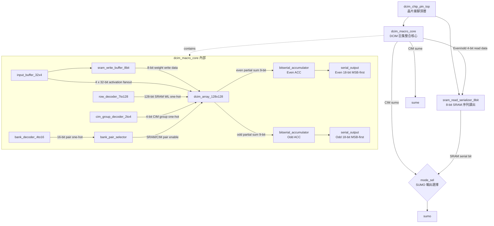
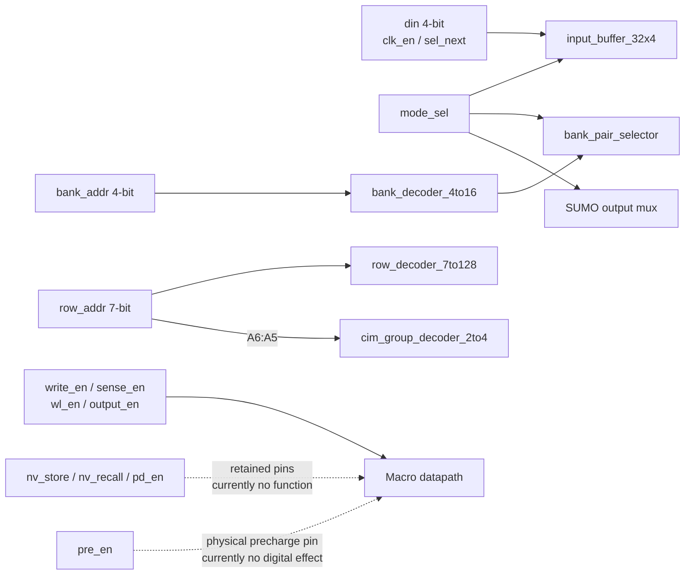
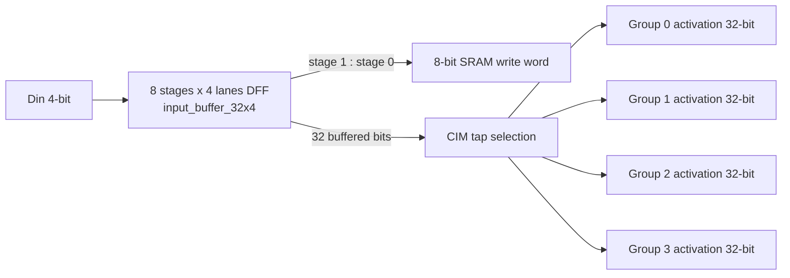
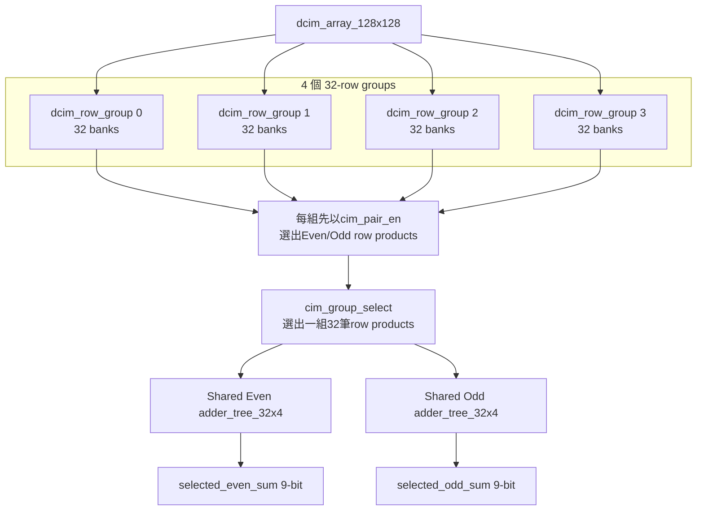
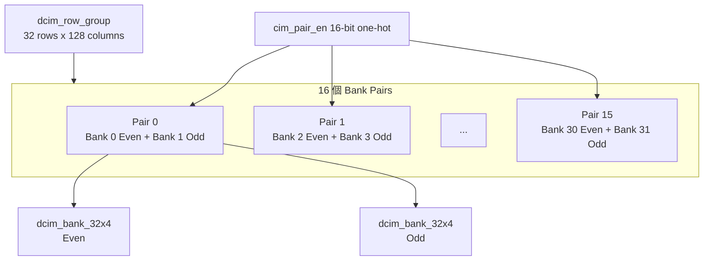
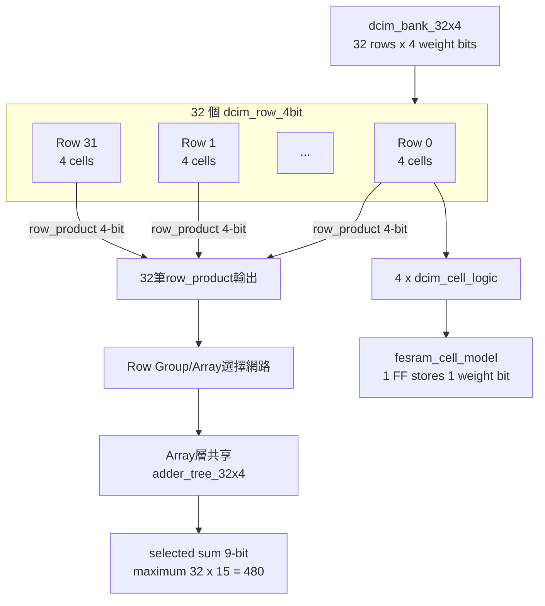
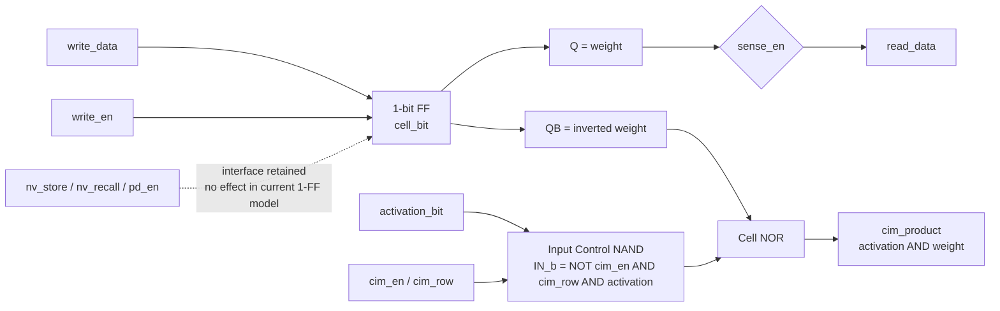
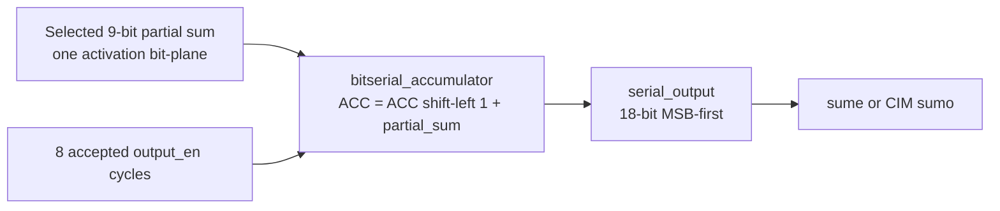
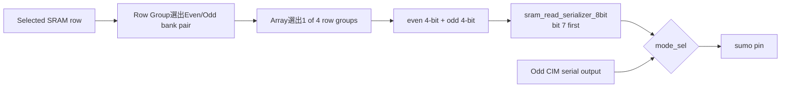
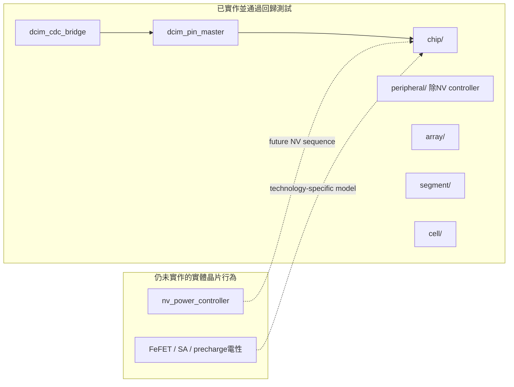

# CIM_CHIP RTL 關係與方塊圖

本文件描述目前 `CIM_CHIP` 資料夾內**已實作的 RTL**。目前已採用「先選Bank Pair與Row Group，再使用Even/Odd兩棵共享Adder Tree」的FPGA最佳化，完整Array只實例化兩棵 `adder_tree_32x4`。

## 1. 完整階層關係



> `serial_output` 實際上實例化在 `bitserial_accumulator` 內；圖中將它展開是為了顯示 18-bit 序列輸出階段。

## 2. 外部接腳到核心的控制關係



地址意義：

| 訊號 | 解碼結果 | 目前用途 |
|---|---|---|
| `row_addr[6:0]` | 7-to-128 one-hot | SRAM mode 選一個實體 row |
| `row_addr[6:5]` | 2-to-4 one-hot | CIM mode 選一個 32-row group |
| `bank_addr[3:0]` | 4-to-16 one-hot | 選一個 even/odd bank pair |
| `mode_sel` | SRAM/CIM demux | `0` 選 SRAM pair，`1` 選 CIM pair |

## 3. Input Path



- SRAM mode：前兩個 4-bit DFF stage 組成 `{stage1, stage0}` 的 8-bit write word。
- CIM mode：八個 stage 共形成 32 個 activation bits，並以一對四 fanout送到四個row groups。
- activation雖然廣播到四組，但 `cim_group_select[3:0]` 為one-hot，正常操作只允許一組產生有效結果。

## 4. 128 x 128 Array 結構



Array容量計算：

```text
4 groups
x 32 banks/group
x 32 rows/bank
x 4 cells/row
= 16,384 cells = 128 x 128 bits
```

正常CIM操作只選中一個位置：

```text
1個 row group x 1個 bank pair
                    ├── Even 32x4 bank
                    └── Odd  32x4 bank
```

未選bank的row products為0，因此pair與group選擇可使用one-hot OR mux；完成選擇後才進入兩棵共享加法樹。

## 5. 一個 Row Group 與 Bank Pair



每個pair共享同一個pair enable，但even與odd bank具有獨立的：

- 4-bit write data。
- 4-bit SRAM read data。
- 9-bit CIM partial sum。

SRAM read不把32個bank輸出全部送往Array；Row Group先用
`sram_pair_en[15:0]`選出一組Pair，再只輸出：

```text
selected_even_read_data[3:0]
selected_odd_read_data[3:0]
selected_pair_read_valid
```

目前核准的8-bit寫入排列為：

```text
even bank = sram_write_data[7:4]
odd bank  = sram_write_data[3:0]
```

## 6. Bank、Row與Cell的階層



目前Adder Tree數量：

```text
Even path 1棵 + Odd path 1棵 = 2棵 adder_tree_32x4
```

`bank_output_or_tree.sv`仍保留為講義原始Output Path的獨立參考與單元測試，但已不在正式Array/Macro合成階層中。

## 7. 單一Cell的寫入、讀取與CIM邏輯



數學關係：

```text
IN_b       = ~(cim_en & cim_row & activation)
QB         = ~weight
cim_product = ~(IN_b | QB)
            = cim_en & cim_row & activation & weight
```

## 8. CIM輸出路徑



Even與Odd各有一條完全獨立的路徑：

```text
selected_even_sum -> Even ACC -> sume
selected_odd_sum  -> Odd ACC  -> core_sumo
```

第8次有效 `output_en` 正緣後，Accumulator完成8個UINT8 activation bit planes的累積，並立即讓序列輸出的bit 17成為第一個輸出bit。

## 9. SRAM讀出路徑



- Row Group先選1 of 16 bank pairs，Array再選1 of 4 row groups；到serializer之前皆是組合式read selection。
- 上層介面只有兩份4-bit data和一個`selected_pair_read_valid`，不再攜帶32組raw bank read buses。
- `sram_read_serializer_8bit` 是SRAM read path唯一的clocked output stage。
- `mode_sel=0`：`sumo`輸出SRAM serial read bit。
- `mode_sel=1`：`sumo`輸出Odd CIM accumulator結果。
- `sume`固定用於Even CIM accumulator結果。

## 10. CIM_CHIP的完成邊界



`window_generator`、KWS layer controller、DCIM backend、requantization與完整
KWS system top屬於`../HYBRID_SYSTEM`，不屬於CIM_CHIP，因此不在本資料夾保留
空module。

目前尚未在RTL中重現：

- FeRAM/FeFET電性、極化與遲滯。
- 真實的NV store、power-down與recall狀態保存。
- Precharge與Sense Amplifier類比時序。
- 完整KWS layer/window/controller資料流；該部分由`HYBRID_SYSTEM`負責。
- 共享Adder Tree的pipeline版本；目前兩棵樹仍為組合邏輯。

## 11. 主要檔案對應

| 階層 | 模組 | 主要功能 |
|---|---|---|
| Chip | `dcim_chip_pin_top` | 外部pin、SRAM serializer、SUMO mode mux |
| Chip | `dcim_macro_core` | 解碼器、Array與兩條Accumulator整合 |
| Array | `dcim_array_128x128` | 四組product選擇與Even/Odd兩棵共享Adder Tree |
| Array | `dcim_row_group` | 16個bank pairs，共32個banks，先選pair products |
| Array | `bank_pair_selector` | SRAM/CIM模式下的pair enable |
| Array | `bank_output_or_tree` | 保留的講義原始OR tree參考；正式Array不再實例化 |
| Segment | `dcim_bank_32x4` | 32列權重、read mux與32筆4-bit row products |
| Segment | `dcim_row_4bit` | 同一activation對四個weight bits運算 |
| Segment | `adder_tree_32x4` | 32個4-bit product加總為9-bit |
| Cell | `dcim_cell_logic` | NOR型1-bit DCIM乘法 |
| Cell | `fesram_cell_model` | 目前以一個FF保存1-bit weight |
| Peripheral | `input_buffer_32x4` | 4-lane、8-stage輸入buffer與四組fanout |
| Peripheral | `bitserial_accumulator` | 8個bit planes累積及18-bit序列輸出 |
| Peripheral | `sram_read_serializer_8bit` | 8-bit SRAM資料MSB-first輸出 |
