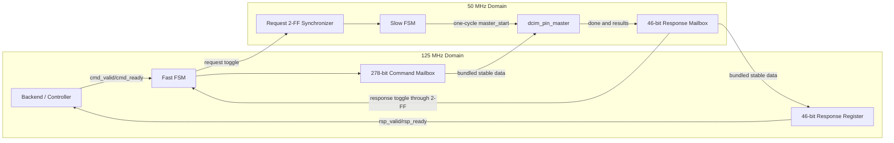
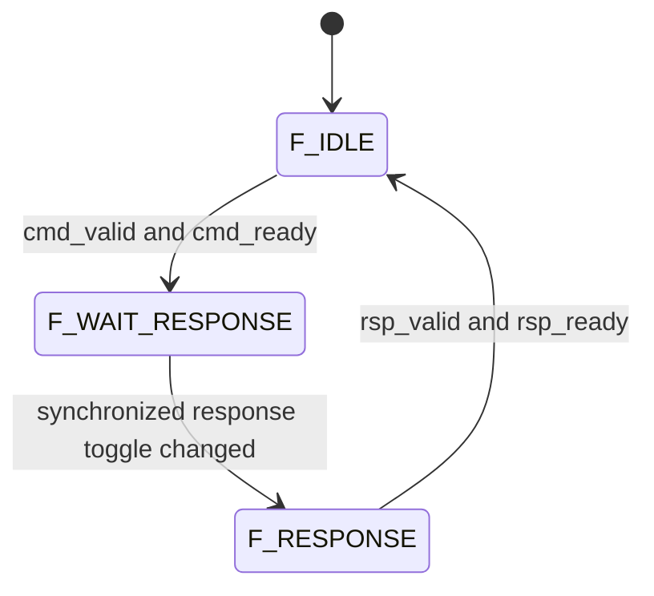
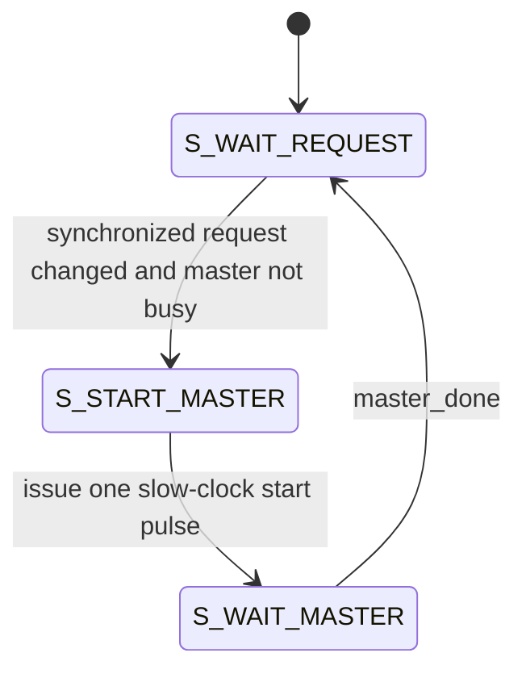

# DCIM CDC Bridge 程式架構、原理與驗證

> 目前此Bridge仍是單筆command mailbox，只支援單筆Write、Read與CIM。
> 新增的SRAM Burst需要連續的weight valid/ready資料流，尚未跨越125/50 MHz
> CDC；在現有CDC integration中，operation 3會以不支援錯誤結束。單一50 MHz
> `dcim_master_chip_top`已直接連接並使用完整Burst介面。

## 1. 實作目的

實作檔案：`fpga/dcim_cdc_bridge.sv`

`dcim_chip_pin_top` 與 `dcim_pin_master` 預定使用 50 MHz，但後續的 KWS backend、window generator 與 layer controller 預定使用 125 MHz。兩個 clock domain 不能直接傳遞單一 clock pulse 或正在變動的 multi-bit bus，因此加入 `dcim_cdc_bridge`：

```text
125 MHz backend
    ↓ command valid/ready
dcim_cdc_bridge
    ↓ 50 MHz master command
dcim_pin_master
    ↓ lecture-style pins
dcim_chip_pin_top
    ↑ serial result
dcim_pin_master
    ↑ 50 MHz result
dcim_cdc_bridge
    ↑ response valid/ready
125 MHz backend
```

Bridge只負責clock-domain crossing與交易保存，不負責line buffer、im2col、Even/Odd重組、bias或requantization。

## 2. 為何採單筆Toggle Mailbox

目前一個`dcim_pin_master`同時只能執行一筆命令；A4W8/A8W8 CIM交易需要91個50 MHz clocks。即使放入深度FIFO，命令仍只能逐筆等待，因此第一版採用：

```text
一筆outstanding command
+ 一份command mailbox
+ request toggle
+ response mailbox
+ response toggle
```

和深度Async FIFO相比，這個設計不需要：

- FIFO memory array。
- Binary/Gray read pointer。
- Binary/Gray write pointer。
- Full/empty comparison。
- 跨clock pointer同步器。

上層使用標準`valid/ready`介面，未來若改成多顆CIM或多個master，仍可在不改上層資料格式的情況下，把Bridge換成Async FIFO。

## 3. 模組架構



## 4. 命令與結果寬度

### 4.1 Command Mailbox

| 欄位 | Bits | 說明 |
|---|---:|---|
| `cmd_operation` | 2 | Write、Read、CIM或保留命令 |
| `cmd_row_addr` | 7 | SRAM row或CIM group address |
| `cmd_bank_addr` | 4 | 16組bank pair其中一組 |
| `cmd_weight` | 8 | SRAM寫入的W8 weight |
| `cmd_activation_flat` | 256 | 32個activation，每個8 bits |
| `cmd_activation_is_a8` | 1 | 0：A4；1：A8 |
| 合計 | 278 | 一筆完整命令 |

Bridge在`cmd_valid && cmd_ready`的125 MHz rising edge將這些欄位存入mailbox。從該edge到response被上層接受以前，mailbox完全不改變。

### 4.2 Response Mailbox

| 欄位 | Bits | 說明 |
|---|---:|---|
| `rsp_data_valid` | 1 | Read/CIM資料是否有效 |
| `rsp_error` | 1 | 非法命令等錯誤 |
| `rsp_sram_read_data` | 8 | SRAM serial read重組結果 |
| `rsp_even_raw_result` | 18 | W8 high nibble的dot product |
| `rsp_odd_raw_result` | 18 | W8 low nibble的dot product |
| 合計 | 46 | 一筆完整回應 |

`rsp_valid`表示Bridge有一筆尚未被125 MHz consumer取走的回應；它和`rsp_data_valid`意義不同。Weight Write成功時會有`rsp_valid=1`，但`rsp_data_valid=0`。

## 5. Request Toggle原理

125 MHz的一個clock pulse只有8 ns，50 MHz clock週期是20 ns。直接把8 ns的`cmd_valid`或`start`送進50 MHz domain，可能完全沒有50 MHz rising edge取樣到它。

Bridge在每次接受命令時反相`request_toggle_125`：

```text
初始值       0
第一筆命令   1
第二筆命令   0
第三筆命令   1
```

50 MHz端使用兩級同步器：

```text
request_toggle_125
    ↓
request_sync_meta_50
    ↓
request_sync_50
```

並以此判斷新事件：

```systemverilog
new_request_50 = request_sync_50 != request_seen_50;
```

同步器只放在單一toggle control bit，不可以對278個data bits分別放2-FF，否則各bit可能在不同clock才穩定。

程式在兩級同步暫存器上加入：

```systemverilog
(* ASYNC_REG = "TRUE" *)
```

讓Vivado辨識這些register為CDC synchronizer並在placement時盡量靠近。

## 6. Bundled-data安全條件

Multi-bit bus使用mailbox穩定時間配合toggle：

1. 125 MHz先在同一個edge保存278-bit command並反相request toggle。
2. Request toggle至少通過兩個50 MHz synchronizer stages。
3. Slow FSM再產生一個完整50 MHz clock的`master_start`。
4. `dcim_pin_master`才在後續rising edge擷取command。
5. 這段期間125 MHz command mailbox一直保持不變。

Response方向同理：

1. 50 MHz在看到`master_done`時保存46-bit result。
2. 同一個edge反相response toggle。
3. Toggle通過兩個125 MHz synchronizer stages。
4. Fast FSM將穩定已久的result mailbox載入125 MHz response register。

因此wide bus不靠每bit synchronizer，而是靠「資料先固定、事件後到達、收到ack前不覆寫」的協定保持一致。

## 7. 125 MHz Fast FSM



### `F_IDLE`

- `cmd_ready=1`。
- 等待`cmd_valid`。
- Handshake發生時保存完整命令。
- 將`request_toggle_125`反相。
- 進入`F_WAIT_RESPONSE`。

### `F_WAIT_RESPONSE`

- `cmd_ready=0`，不接受第二筆命令。
- 等待同步後的response toggle改變。
- 事件到達時把50 MHz response mailbox載入125 MHz output register。
- 進入`F_RESPONSE`。

### `F_RESPONSE`

- `rsp_valid=1`。
- 所有response輸出保持不變。
- 如果`rsp_ready=0`，可無限期停留，不會遺失結果。
- `rsp_valid && rsp_ready`後返回`F_IDLE`。

## 8. 50 MHz Slow FSM



### `S_WAIT_REQUEST`

- 比較`request_sync_50`與`request_seen_50`。
- 如果有新命令且`master_busy=0`，進入`S_START_MASTER`。

### `S_START_MASTER`

- `master_start=1`維持完整一個50 MHz clock。
- 更新`request_seen_50`，同一筆命令不會再次啟動。
- `dcim_pin_master`在這個狀態結束的rising edge暫存命令。

### `S_WAIT_MASTER`

- 等待`master_done=1`。
- 保存`result_valid/error/read/even/odd`。
- 將`response_toggle_50`反相。
- 返回`S_WAIT_REQUEST`。

125 MHz端在收到並消耗response以前不會產生下一個request，因此response mailbox不會提前被覆寫。

## 9. 完整交易時序

```text
125 MHz                           50 MHz
--------                          ------
cmd_valid & cmd_ready
capture command
toggle request  ────────────────► sync FF1
                                  sync FF2
                                  detect request
                                  S_START_MASTER
                                  master_start = 1
                                  dcim_pin_master executes
                                  master_done = 1
                  ◄────────────── capture result + toggle response
sync FF1
sync FF2
capture response
rsp_valid = 1
rsp_ready = 1
return to F_IDLE
```

Bridge會增加約兩到三個slow clocks的request啟動延遲，以及約兩到三個fast clocks的result返回延遲。相對於91個50 MHz clocks的CIM交易，這項控制延遲較小，而且不改變CIM計算結果。

## 10. Reset規格

`rst_125m`與`rst_50m`皆為active-high。

Reset後：

```text
request_toggle  = 0
request_seen    = 0
response_toggle = 0
response_seen   = 0
Fast FSM        = F_IDLE
Slow FSM        = S_WAIT_REQUEST
```

系統必須共同assert兩邊reset。建議top-level使用同一個外部reset來源，再分別對125 MHz和50 MHz產生「同步deassert」的local reset。第一版不支援交易進行中只reset單一domain；若任一domain需要reset，應一起取消當前交易並重置Bridge、Master與CIM digital model。

## 11. 與Pin Master連接

主要連接關係如下：

```systemverilog
dcim_cdc_bridge bridge (
    .clk_125m                (clk_125m),
    .rst_125m                (rst_125m),
    .cmd_valid               (backend_cmd_valid),
    .cmd_ready               (backend_cmd_ready),
    // backend command fields ...

    .clk_50m                 (clk_50m),
    .rst_50m                 (rst_50m),
    .master_start            (master_start),
    .master_operation        (master_operation),
    .master_row_addr         (master_row_addr),
    .master_bank_addr        (master_bank_addr),
    .master_weight           (master_weight),
    .master_activation_flat  (master_activation_flat),
    .master_activation_is_a8 (master_activation_is_a8),
    .master_busy             (master_busy),
    .master_done             (master_done),
    // master response fields ...
);

dcim_pin_master master (
    .clk                 (clk_50m),
    .rst                 (rst_50m),
    .start               (master_start),
    .operation           (master_operation),
    .command_row_addr    (master_row_addr),
    .command_bank_addr   (master_bank_addr),
    .command_weight      (master_weight),
    .activation_flat     (master_activation_flat),
    .activation_is_a8    (master_activation_is_a8),
    .busy                (master_busy),
    .done                (master_done),
    // result and chip pin connections ...
);
```

Bridge不直接連接`dcim_chip_pin_top`；連接順序一定是：

```text
Backend → CDC Bridge → Pin Master → Chip Pin Top
```

## 12. 單元測試

測試檔案：`tb/fpga/tb_dcim_cdc_bridge.sv`

這個testbench不展開128×128 array，而是使用variable-latency mock master，專門驗證CDC協定：

- `clk_125m`週期8 ns。
- `clk_50m`週期20 ns。
- 50 MHz clock刻意增加3 ns初始phase offset。
- 固定測試Write、Read、CIM與非法命令。
- 再執行32筆不同operation與256-bit隨機activation。
- 總共36筆命令。
- Command被接受後立刻反相所有來源腳位，確認mailbox已正確保存資料。
- Mock master檢查全部278 bits是否一致。
- Mock master使用不同延遲產生`busy/done`。
- 對`rsp_ready`施加0到5個fast clocks的backpressure。
- Backpressure期間檢查`rsp_valid`與全部46-bit結果保持不變。
- 比對送出命令數、`master_start`數與response數完全相同。
- Reset後等待多個slow clocks，確認沒有phantom command。

執行：

```bash
cd /home/LAB505/projects/KWS/KWS_DNN_Hybrid/CIM_CHIP
make test-dcim-cdc-bridge
```

## 13. 真實Chip整合測試

測試檔案：`tb/fpga/tb_dcim_cdc_bridge_integration.sv`

完整路徑：

```text
125 MHz testbench
→ dcim_cdc_bridge
→ 50 MHz dcim_pin_master
→ dcim_chip_pin_top
→ dcim_pin_master serial capture
→ dcim_cdc_bridge
→ 125 MHz testbench
```

測試內容：

1. 經過CDC在group 0、pair 0、row 0寫入`8'h21`。
2. 經過CDC在row 1寫入`8'h43`。
3. SRAM Read row 0，預期讀回`8'h21`。
4. A4W8：activation byte使用`8'hF3`和`8'hE2`，確認只取低nibble 3、2。
5. A4預期`even=14`、`odd=9`，W8重組結果233。
6. A8W8：activation使用130與200。
7. A8預期`even=1060`、`odd=730`，W8重組結果17690。
8. 非法operation預期`rsp_error=1`、`rsp_data_valid=0`。
9. 六筆交易必須剛好產生六次`master_start`。

執行：

```bash
make test-dcim-cdc-integration
```

執行全部FPGA層測試：

```bash
make test-fpga
```

執行lint：

```bash
make lint-fpga
```

## 14. Vivado與XDC注意事項

- 兩組toggle synchronizer已加上`ASYNC_REG`屬性。
- 如果50 MHz與125 MHz由同一個MMCM產生，XDC應正確建立兩個generated clocks。
- 不要把278-bit command mailbox的每一條data path盲目設成獨立2-FF synchronizer。
- 不要在不了解clock來源時直接對所有125/50 MHz路徑使用blanket false path；這可能把真正的錯誤也隱藏掉。
- 合成後應執行`report_cdc`，確認request/response toggle都被辨識為兩級同步器。
- Mailbox wide bus是bundled-data CDC，必須保留本文件定義的「一筆outstanding、收到response以前不覆寫」協定。

## 15. 後續系統整合

Bridge驗證完成後，後續工作移至`../HYBRID_SYSTEM`。其中DCIM backend位於
125 MHz domain，接收Bridge結果後執行：

```text
odd_raw + (even_raw << 4)
→ tile partial-sum accumulation
→ bias
→ requantization
→ saturation / activation
→ output feature-map writeback
```

這些運算是模型與layer相關功能，不屬於可重用的CIM晶片模型，因此不在
`CIM_CHIP/fpga`保留空module。
