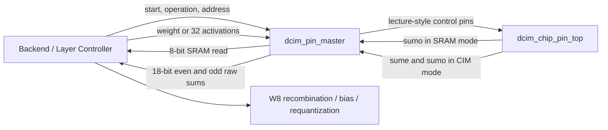
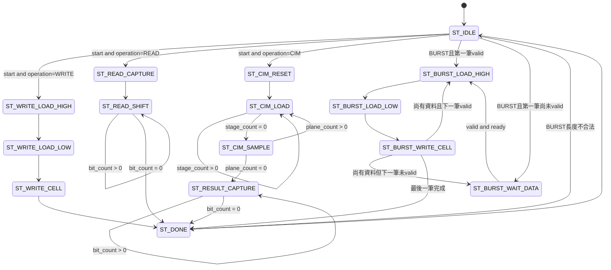

# DCIM Pin Master 架構與狀態機

## 1. 目的與模組位置

實作檔案：`fpga/dcim_pin_master.sv`

驗證檔案：`tb/fpga/tb_dcim_pin_master.sv`

`dcim_chip_pin_top` 保留講義所示的晶片控制腳位，因此一次 Weight Write、SRAM Read 或 CIM Compute 都不是單一 clock 能完成。`dcim_pin_master` 的工作是接收一筆較高階命令，再按照正確順序驅動這些晶片腳位。

本模組負責：

- 將一個 8-bit weight 分成 high/low nibble 並寫入一組 bank pair。
- 以ready/valid串流連續寫入多個W8，並自動遞增Bank/Row位址。
- 產生 SRAM sense/read 時序並接收 8-bit serial read data。
- 將 32 個 A4 或 A8 activation 轉成 bit-plane，送進晶片的四條 `din`。
- 送出八次 `output_en`，讓晶片內部 accumulator 完成計算。
- 同步接收 `sume`、`sumo` 的兩組 18-bit serial result。
- 對外提供 `busy`、`done`、`result_valid` 與 `error`。

本模組不負責：

- `odd + (even << 4)` 的 W8 結果重組。
- Bias、ReLU、Pooling、requantization 或下一層 activation 的產生。
- Conv/im2col、layer 排程及完整 KWS 推論控制。
- FeFET/FeSRAM 電性、variation、nonvolatile store/recall 或 power-down 模擬。

上述後處理與layer排程由`../HYBRID_SYSTEM`負責，不在CIM_CHIP內實作。

## 2. 系統關係



`dcim_pin_master` 和 `dcim_chip_pin_top` 使用同一個 `clk`。Master 是 FPGA 內部控制模組，不是新的 CIM 晶片腳位。

## 3. 命令介面

### 3.1 啟動與狀態

| 訊號 | 方向 | 說明 |
|---|---|---|
| `start` | input | 僅在 idle 時接受；建議送一個 clock pulse |
| `operation[1:0]` | input | `0`：單筆write，`1`：read，`2`：CIM，`3`：burst write |
| `busy` | output | FSM 正在執行交易時為 1 |
| `done` | output | 交易完成時維持一個 clock |
| `result_valid` | output | read 或 CIM 成功完成時，與 `done` 同時為 1 |
| `error` | output | 非法 operation 完成時，與 `done` 同時為 1 |

所有命令內容都在 `IDLE && start` 的 rising edge 被 master 暫存，所以 `start` 拉低後，外部可以更改 command input；交易中途改值不會改變正在執行的命令。

### 3.2 Address 與資料

| 訊號 | 用途 |
|---|---|
| `command_row_addr[6:0]` | SRAM write/read 使用完整 row address；CIM 使用 `[6:5]` 選 32-row group |
| `command_bank_addr[3:0]` | 選擇 16 組 bank pair 其中一組 |
| `command_weight[7:0]` | 要寫入的 W8 weight |
| `activation_flat[255:0]` | 32 個 activation，每個位置保留 8 bits |
| `activation_is_a8` | `1`：使用完整 8 bits；`0`：只使用每個 byte 的低 4 bits |
| `command_burst_length[11:0]` | Burst寫入字數，合法範圍1～2048，且不可超出最後位址 |
| `burst_weight_valid/ready` | 每筆Burst W8資料的ready/valid握手 |
| `burst_weight_data[7:0]` | 目前要求的Burst權重 |
| `burst_weight_row_addr[6:0]` | Master目前向資料來源要求的Row |
| `burst_weight_bank_addr[3:0]` | Master目前向資料來源要求的Bank Pair |

Activation 的 flat mapping 是：

```systemverilog
activation_flat[(row * 8) +: 8] = activation[row];
```

其中 `row` 是所選 32-row group 內的 local row 0 到 31。

## 4. A4 與 A8 的整合位置

目前 chip accumulator 固定接收八個 activation bit-plane。因此 master 對兩種 activation 使用相同的八次 `output_en`：

- A8：依序送 bit 7、6、5、4、3、2、1、0。
- A4：先送四個全 0 plane，再送 bit 3、2、1、0。

也就是：

```text
A8 value = activation_flat[row][7:0]
A4 value = {4'b0000, activation_flat[row][3:0]}
```

如此不必改動現有 chip 的「固定八次 sample」規格，也不會因 A4 只送四次而讓 accumulator 永遠無法進入 serial output。代價是 A4 與 A8 的 CIM transaction latency 相同。

每一個 plane 必須花八個 clock 填滿 `input_buffer_32x4`。因為該 buffer 是四條、每條八級的 shift chain，所以輸入順序是 stage 7 到 stage 0：

```text
clock 1 送 local row 28..31
clock 2 送 local row 24..27
...
clock 8 送 local row  0..3
```

在 `ST_CIM_LOAD` 中，四條 `din` 的公式為：

```text
row  = stage_count * 4 + lane
din[lane] = activation[row][plane_count]
```

## 5. Weight 與 Even/Odd 的意義

一個 W8 weight 寫入時分成：

```text
even bank = weight[7:4]
odd bank  = weight[3:0]
```

CIM 完成後，晶片送回兩個獨立的 18-bit unsigned result：

```text
even_raw_result = sum(activation[row] * weight[row][7:4])
odd_raw_result  = sum(activation[row] * weight[row][3:0])
```

完整 W8 dot product 必須在後續 backend 使用較寬的加法器重組：

```text
W8_result = odd_raw_result + (even_raw_result << 4)
```

不能把 `even` 與 `odd` 直接相加，也不能在 18-bit 寬度內先左移，否則最高 bits 可能被截斷。32 項 unsigned A8W8 dot product 最多需要 21 bits。

## 6. 完整狀態圖



## 7. 每個狀態的工作

| 狀態 | 主要輸出/動作 | 下一步 |
|---|---|---|
| `ST_IDLE` | 等待 `start`；在接受命令的 edge 暫存 address、weight、activation 與 A4/A8 mode | 依 operation 分流 |
| `ST_WRITE_LOAD_HIGH` | `clk_en=1`、`din=weight[7:4]`，送入 input path 第一級 | `ST_WRITE_LOAD_LOW` |
| `ST_WRITE_LOAD_LOW` | `clk_en=1`、`din=weight[3:0]`；前一個 high nibble 被推至第二級 | `ST_WRITE_CELL` |
| `ST_WRITE_CELL` | `wl_en=1`、`write_en=1`、`sel_next=1`，將 `{high,low}` 寫入 row/bank pair | `ST_DONE` |
| `ST_READ_CAPTURE` | `wl_en=1`、`sense_en=1`、`pre_en=1`；選定 pair 的 `{even,odd}` 在 edge 載入 serializer | `ST_READ_SHIFT` |
| `ST_READ_SHIFT` | 每個 rising edge 依序接收 `sumo` 的 bit 7 到 bit 0 | 收完後 `ST_DONE` |
| `ST_CIM_RESET` | `mode_sel=1`、`reset1=1`、`reset2=1`；清除 accumulator 與結果 serializer，不清除 weight | `ST_CIM_LOAD` |
| `ST_CIM_LOAD` | `mode_sel=1`、`clk_en=1`；送目前 plane 的四個 activation bits；重複八次填滿 32 rows | `ST_CIM_SAMPLE` |
| `ST_CIM_SAMPLE` | `mode_sel=1`、`sel_next=1`、`output_en=1`；adder tree partial sum 被 accumulator 接受 | 尚有 plane 時回 `ST_CIM_LOAD` |
| `ST_RESULT_CAPTURE` | 每個 rising edge 同步接收 `sume/sumo` 的 bit 17 到 bit 0 | 收完後 `ST_DONE` |
| `ST_BURST_WAIT_DATA` | `burst_weight_ready=1`，等待一筆有效W8 | `ST_BURST_LOAD_HIGH` |
| `ST_BURST_LOAD_HIGH` | 載入目前W8的high nibble | `ST_BURST_LOAD_LOW` |
| `ST_BURST_LOAD_LOW` | 載入目前W8的low nibble | `ST_BURST_WRITE_CELL` |
| `ST_BURST_WRITE_CELL` | 寫入目前Row/Bank；若非最後一筆，同edge預取下一筆並自動遞增位址 | Load、Wait或Done |
| `ST_DONE` | `done=1` 一個 clock；read/CIM 成功時 `result_valid=1`；非法命令時 `error=1` | `ST_IDLE` |

SRAM單筆Read直接進入`ST_READ_CAPTURE`，不需要先清零Serializer：該次Capture會完整覆寫8 bits，接收計數器則在接受命令時設為7。Read延遲為9 clocks；含DONE/IDLE交接，連續命令最早間隔11 clocks。初始化reset與CIM的`ST_CIM_RESET`仍保留。

## 8. SRAM Burst Write

Burst以Bank為快速變化維度：

```text
(row,bank) = (0,0) → (0,1) → ... → (0,15)
           → (1,0) → ... → (127,15)
```

資料來源只有在`burst_weight_valid && burst_weight_ready`時才送出一筆資料。
第一筆可以與`start`同edge握手；後續資料則在前一筆
`ST_BURST_WRITE_CELL`的edge預取。資料不中斷時：

```text
Word 0：LOAD_HIGH → LOAD_LOW → WRITE
Word 1：LOAD_HIGH → LOAD_LOW → WRITE
...
```

所以N筆Burst從接受start到done的延遲為：

```text
Burst latency = 3 × N clocks
```

若`valid`暫停，Master停在`ST_BURST_WAIT_DATA`，不遞增位址也不寫Cell。
長度為0，或起始位址加長度超過2048時，交易以`error=1`結束。

## 9. 為何 serial 接收不會漏掉第一個 bit

SRAM serializer 在 `ST_READ_CAPTURE` 結束的 rising edge 載入資料，該 edge 之後 `sumo` 立即顯示 bit 7。Master 在下一個 `ST_READ_SHIFT` rising edge 取樣 `sumo`；同一個 edge 晶片 serializer 也做 shift，但兩邊都是 nonblocking sequential logic，因此 master 取得的是 shift 前的 bit 7。

CIM 也使用相同規則。第八個 `output_en` edge 將完整 accumulator 載入 output serializer，edge 後 bit 17 已顯示；第一個 `ST_RESULT_CAPTURE` edge 取得 shift 前的 bit 17，之後依序取得 bit 16 到 bit 0。

## 10. 交易延遲

下表從 `start` 被接受的 rising edge 算到 `done` 出現，不包含上層等待 idle 的時間：

| 交易 | 狀態 clock 數 | 50 MHz 時間 |
|---|---:|---:|
| Weight Write | 3 | 60 ns |
| Weight Burst Write | `3 × N`（資料無stall） | `60 × N ns` |
| SRAM Read | 1 sense/load + 8 receive = 9 | 180 ns |
| A4W8 CIM | 1 reset + 64 load + 8 sample + 18 receive = 91 | 1.82 us |
| A8W8 CIM | 1 reset + 64 load + 8 sample + 18 receive = 91 | 1.82 us |

每個 activation plane 是八次 `ST_CIM_LOAD` 加一次 `ST_CIM_SAMPLE`，總共九個 clocks。八個 plane 共 72 clocks。

## 11. 驗證內容

`tb_dcim_pin_master.sv` 把 master 的所有 chip-side port 直接連到真實 `dcim_chip_pin_top`，驗證的不是單獨 FSM 假模型。測試項目如下：

1. Active-high `rst` 是否讓 master 與 chip model 進入乾淨 idle。
2. 在 row 45、bank pair 9 寫入 `8'hA5`，再經 serial `sumo` 讀回。
3. 對 group 0、pair 2 寫入 32 個不同 W8 weights。
4. A4W8：每個 activation byte 的高 nibble 故意填入非零垃圾，確認 master 只使用低 nibble。
5. 對 group 3、pair 15 寫入另一組 32 個不同 weights。
6. A8W8：使用完整八位 activation 驗證兩個 raw sums 和 W8 重組結果。
7. 從Row 40、Bank 14連續Burst 20筆，確認跨越Bank 15後自動進入下一Row。
8. 確認20筆無stall Burst精確使用60 cycles，且逐筆SRAM readback全部相符。
9. 送出長度0的Burst，確認`error=1`且`result_valid=0`。

執行整合測試：

```bash
cd /home/LAB505/projects/KWS/KWS_DNN_Hybrid/CIM_CHIP
make test-dcim-pin-master
```

只做 FPGA master 相關 regression：

```bash
make test-fpga
```

做 FPGA master 與整合 testbench lint：

```bash
make lint-fpga
```

做全部既有測試：

```bash
make test
```

## 12. HYBRID_SYSTEM整合邊界

下一層DCIM backend應在`../HYBRID_SYSTEM/rtl/dcim_adapter`接收
`even_raw_result`與`odd_raw_result`，先用至少21-bit datapath做W8重組，再進行
bias、scale/requantization與output-feature-map寫回。Layer controller則由
`../HYBRID_SYSTEM/rtl/control`負責產生每個tile的group address、bank pair
address、activation vector以及`start`。這些模組不屬於CIM_CHIP。
