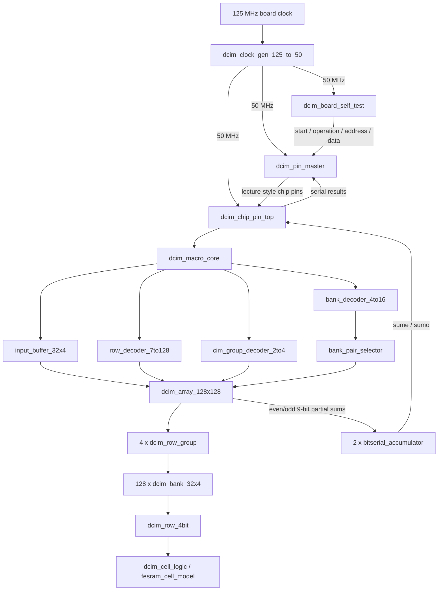
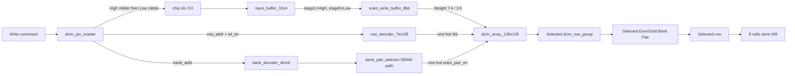
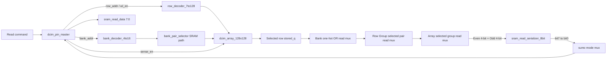
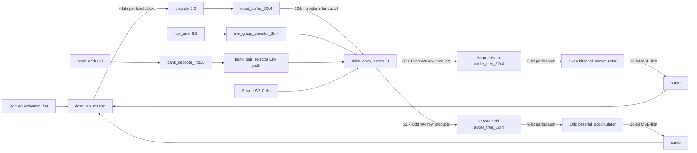

# DCIM三條操作路徑與Clock週期

## 1. 文件範圍

本文件以目前可合成的單一50 MHz整合架構為準，從
[`fpga/dcim_master_chip_top.sv`](./fpga/dcim_master_chip_top.sv)往內追蹤三種操作：

1. SRAM Weight Write。
2. SRAM Weight Read。
3. CIM Compute（A4W8或A8W8）。

交易控制由[`fpga/dcim_pin_master.sv`](./fpga/dcim_pin_master.sv)產生，晶片腳位邊界是
[`chip/dcim_chip_pin_top.sv`](./chip/dcim_chip_pin_top.sv)。目前Master與Chip共用同一個
50 MHz clock，因此這裡不包含CDC延遲。

本文的交易延遲統一定義為：

```text
T0 = dcim_pin_master在IDLE狀態接受start的上升緣
延遲 = 從T0到done變成1的上升緣之間的clock數
```

50 MHz的clock period為：

```text
Tclk = 1 / 50 MHz = 20 ns
```

Board Top內的MMCM lock、reset release與`dcim_board_self_test`命令間隔不計入單筆交易延遲。

## 2. 從Board Top看完整階層



`dcim_master_chip_top`目前使用`dcim_board_self_test`作為命令來源。未來接入Hybrid System時，
Layer Controller可以取代Self Test，但`dcim_pin_master -> dcim_chip_pin_top`以下的三條路徑不變。

## 3. 三種交易總覽

| 交易 | Master內部操作 | 接受start到done | 50 MHz時間 | 最終輸出 |
|---|---|---:|---:|---|
| SRAM Write | 2次Nibble Load + 1次Cell Write | 3 clocks | 60 ns | Weight存入選定Row/Pair |
| SRAM Burst Write | N筆High/Low/Write，位址自動遞增 | 3N clocks（無stall） | 60N ns | 連續存入N個W8 |
| SRAM Read | 1次Sense/Capture + 8次Serial Receive | 9 clocks | 180 ns | `sram_read_data[7:0]` |
| A4W8 CIM | 1次ACC Reset + 64次Activation Load + 8次Sample + 18次Serial Receive | 91 clocks | 1.82 us | Even/Odd各18-bit raw result |
| A8W8 CIM | 同上 | 91 clocks | 1.82 us | Even/Odd各18-bit raw result |

A4仍使用8個planes：前四個planes送0，後四個planes送A[3:0]。因此目前A4與A8的交易延遲相同。

`done`是一個獨立狀態，之後FSM還要回到`IDLE`。若上層要連續發送命令，依目前FSM最早的
start接受間隔為：

| 交易 | start接受到下一次start可接受 |
|---|---:|
| SRAM Write | 5 clocks |
| SRAM Burst Write | Burst內每筆3 clocks；Burst結束至下一命令另有2 clocks |
| SRAM Read | 11 clocks |
| CIM Compute | 93 clocks |

這個間隔比交易延遲多兩個clock：一個`ST_DONE`週期，以及回到`ST_IDLE`後等待下一個接受邊緣。

---

## 4. SRAM Weight Write路徑

### 4.1 資料與控制路徑

一筆Write命令包含：

```text
command_row_addr[6:0]   = 選擇128列之一
command_bank_addr[3:0]  = 選擇16個8-bit Bank Pair之一
command_weight[7:0]     = 寫入的W8 Weight
```



地址路徑與資料路徑在選定的Cell Pair會合：

```text
row_addr -> row_decoder_7to128 -> wl_select[127:0]
bank_addr -> bank_decoder_4to16 -> bank_pair_selector -> sram_pair_en[15:0]

pair_row_write_en = local_wl_select AND write_en AND selected_sram_pair
```

一個8-bit Weight被分成：

```text
Even Bank = Weight[7:4]
Odd Bank  = Weight[3:0]
```

### 4.2 Write逐Clock流程

假設寫入`8'hA5`：

| Clock區間 | Master狀態 | Chip控制 | 在區間結束的上升緣發生什麼 |
|---|---|---|---|
| T0 -> T1 | `ST_WRITE_LOAD_HIGH` | `clk_en=1, sel_next=0, din=A` | T1：Input Buffer stage 0載入A |
| T1 -> T2 | `ST_WRITE_LOAD_LOW` | `clk_en=1, sel_next=0, din=5` | T2：stage 0載入5，原本A移到stage 1 |
| T2 -> T3 | `ST_WRITE_CELL` | `sel_next=1, wl_en=1, write_en=1` | T3：`{stage1,stage0}=A5`寫入選定Even/Odd Cells；進入DONE |

因此：

```text
Write latency = 2 load + 1 write = 3 clocks = 60 ns @ 50 MHz
```

`sram_write_buffer_8bit`是組合邏輯，不增加額外clock。Row Decoder、Bank Decoder與Pair Selector也都是
組合邏輯；真正儲存Weight的clock edge只有T3。

### 4.3 Burst Write

`operation=3`啟動Burst，`command_burst_length`指定1～2048筆。
位址以Bank Pair為快速變化維度：

```text
(row,bank) → (row,bank+1)
(row,15)   → (row+1,0)
```

資料透過`burst_weight_valid/ready`握手。第一筆可以和`start`同edge
被Master接收；後續資料在前一筆`ST_BURST_WRITE_CELL`的edge預取，因此
資料連續有效時狀態沒有命令bubble：

```text
LOAD_HIGH → LOAD_LOW → WRITE → LOAD_HIGH → LOAD_LOW → WRITE → ...
```

所以：

```text
N-word Burst latency = 3N clocks
完整2048-word Array = 6144 clocks = 122.88 us @ 50 MHz
```

若資料來源暫時將`valid`拉低，Master進入`ST_BURST_WAIT_DATA`，等待期間
不寫Cell、不減少remaining count，也不遞增位址。長度0或Burst跨越Array
最後位址時會回傳`error=1`。

---

## 5. SRAM Weight Read路徑

### 5.1 資料與控制路徑



從Cell到Serializer之前都是組合讀取：

```text
stored_q
 -> dcim_row_4bit.read_data
 -> dcim_bank_32x4 one-hot OR
 -> dcim_row_group selected pair
 -> dcim_array_128x128 selected group
 -> {even_read_data, odd_read_data}
```

`sram_read_serializer_8bit`是Read路徑中唯一的資料暫存器。它在Sense有效的上升緣載入：

```text
read_shift_register = {even_read_data, odd_read_data}
```

在SRAM模式`mode_sel=0`時，Chip Top將Serializer輸出接到`sumo`。

### 5.2 Read逐Clock流程

| Clock區間 | Master狀態 | Chip動作 | 在區間結束的上升緣發生什麼 |
|---|---|---|---|
| T0 -> T1 | `ST_READ_CAPTURE` | `wl_en=1, sense_en=1, pre_en=1, sel_next=1` | T1：選定W8覆寫Serializer，edge後`sumo=bit[7]` |
| T1 -> T2 | `ST_READ_SHIFT` #1 | Sense關閉 | T2：Master取得bit[7]，Serializer移到bit[6] |
| T2 -> T3 | `ST_READ_SHIFT` #2 | Sense關閉 | T3：Master取得bit[6] |
| ... | ... | ... | ... |
| T8 -> T9 | `ST_READ_SHIFT` #8 | Sense關閉 | T9：Master取得bit[0]並進入DONE |

因此：

```text
Read latency = 1 sense/load + 8 receive
             = 9 clocks
             = 180 ns @ 50 MHz
```

注意：

- 每筆Read不再先reset：Capture完整覆寫8 bits，Master在接受命令時重設自己的接收計數器。系統初始化reset與CIM reset仍保留；reset與Capture不可同時啟用，因為reset優先。
- Serializer在T1後已經顯示bit[7]，Master在T2取得它。
- Master與Serializer都使用nonblocking sequential logic，所以T2取得的是shift前的bit[7]，不會漏掉第一個bit。
- `sense_en`只能維持一個Capture週期；若持續為1，Serializer會反覆重新載入而不會正常shift。
- `pre_en`保留講義Pin，但目前數位模型沒有類比Precharge延遲，因此不影響資料或clock數。

---

## 6. CIM Compute路徑

### 6.1 Activation、Weight與Partial Sum路徑



每個Activation plane的32 bits不是一次由Pin輸入，而是透過四條`din`分8個clock填入Input Buffer：

```text
Load 1：local rows 28..31
Load 2：local rows 24..27
...
Load 8：local rows 0..3
```

Input Buffer填滿後，`sel_next=1`將32 bits送到Array。每列輸出：

```text
row_product[row] = activation_bit[row] ? stored_W4[row] : 0
```

兩顆共用Adder Tree在同一個Sample週期組合式算出：

```text
even_partial_sum = sum(32個even row_product)
odd_partial_sum  = sum(32個odd row_product)
```

Adder Tree沒有pipeline register，所以本身不增加clock，但完整Cell選擇到Adder Tree的組合延遲必須滿足50 MHz時序。

### 6.2 八個Activation Planes

Master依序處理：

```text
plane 7 -> plane 6 -> plane 5 -> plane 4
        -> plane 3 -> plane 2 -> plane 1 -> plane 0
```

每個plane需要：

```text
8個ST_CIM_LOAD + 1個ST_CIM_SAMPLE = 9 clocks
```

Sample上升緣兩顆Accumulator同時執行：

```text
next_acc = (acc << 1) + partial_sum
```

所以Even與Odd是平行運作，並不是Even做8次後再由Odd做8次。

### 6.3 CIM逐階段Clock流程

| 階段 | Master狀態 | Clock數 | 功能 |
|---|---|---:|---|
| Accumulator初始化 | `ST_CIM_RESET` | 1 | `reset1=1, reset2=1`，清除ACC與輸出shift register，不清除Weight |
| Plane 7載入與Sample | `ST_CIM_LOAD x8` + `ST_CIM_SAMPLE` | 9 | 載入32個A[7]並接受一次partial sum |
| Plane 6載入與Sample | 同上 | 9 | 處理A[6] |
| Plane 5載入與Sample | 同上 | 9 | 處理A[5] |
| Plane 4載入與Sample | 同上 | 9 | 處理A[4] |
| Plane 3載入與Sample | 同上 | 9 | 處理A[3] |
| Plane 2載入與Sample | 同上 | 9 | 處理A[2] |
| Plane 1載入與Sample | 同上 | 9 | 處理A[1] |
| Plane 0載入與Sample | 同上 | 9 | 處理A[0]；同一edge載入18-bit輸出Serializer |
| 結果回收 | `ST_RESULT_CAPTURE x18` | 18 | 同步取得`sume/sumo`的bit[17]到bit[0] |

總計：

```text
CIM latency = 1 reset
            + 8 planes x (8 load + 1 sample)
            + 18 receive
            = 1 + 8 x 9 + 18
            = 91 clocks
            = 1.82 us @ 50 MHz
```

可再拆成：

```text
Activation serial loading = 8 x 8 = 64 clocks
Actual ACC sample edges   = 8 clocks
Result serial receive     = 18 clocks
Reset                     = 1 clock
```

第八次`output_en`的上升緣已完成最後一次累加，並讓`sume/sumo`的bit[17]立即可見；接下來18個
`ST_RESULT_CAPTURE` clocks分別取得bit[17:0]。

### 6.4 A4與A8

目前Accumulator固定接受8次Sample，因此：

```text
A8：送 A[7], A[6], A[5], A[4], A[3], A[2], A[1], A[0]
A4：送 0,    0,    0,    0,    A[3], A[2], A[1], A[0]
```

兩者都花91 clocks。若未來要讓A4只花4個planes，必須一起修改Accumulator完成條件、Master的
`plane_count`與序列輸出啟動條件，不能只少送四次`output_en`。

### 6.5 W8結果重組

Chip與Master目前回傳兩個獨立結果：

```text
even_raw_result = sum(A[row] * Weight[row][7:4])
odd_raw_result  = sum(A[row] * Weight[row][3:0])
```

完整unsigned W8 dot product尚未在`dcim_master_chip_top`內合併。Hybrid Backend必須以至少21-bit
資料路徑計算：

```text
full_W8_result = odd_raw_result + (even_raw_result << 4)
```

## 7. 三條路徑的Clock邊界比較

| 元件/動作 | Write | Read | CIM |
|---|---:|---:|---:|
| Input Buffer | 2 clocks載入Weight | 不使用 | 每plane 8 clocks，共64 |
| Decoder / Pair Selector | 0，組合式 | 0，組合式 | 0，組合式 |
| Cell Array | 1 clock寫入 | 組合讀取 | 組合產生row products |
| Adder Tree | 不使用 | 不使用 | 0，組合式 |
| Bitserial Accumulator | 不使用 | 不使用 | 8個Sample clocks |
| SRAM Read Serializer | 不使用 | 1個load + 8個Master receive | 不使用 |
| ACC Serial Output | 不使用 | 不使用 | 第8次Sample同時load，之後18個Master receive |
| Master Reset狀態 | 0 | 0 | 1 |
| Master總延遲 | 3 | 9 | 91 |

「組合式0 clock」不代表沒有延遲，而是沒有額外register latency；其propagation delay仍會影響
Vivado setup timing。

## 8. 波形觀察建議

### 8.1 共通訊號

```text
u_pin_master.state
master_start
master_busy
master_done
chip_mode_sel
chip_row_addr
chip_bank_addr
```

### 8.2 Write

```text
chip_clk_en
chip_sel_next
chip_din[3:0]
chip_wl_en
chip_write_en
u_chip.u_dcim_macro_core.sram_write_data[7:0]
```

預期依序看到High Nibble、Low Nibble與一次Write pulse。

### 8.3 Read

```text
chip_sense_en
u_chip.even_read_data[3:0]
u_chip.odd_read_data[3:0]
u_chip.serial_read_bit
chip_sumo
master_sram_read_data[7:0]
```

預期Sense週期後`sumo`由bit[7]開始，Master接收8次後形成完整Byte。

### 8.4 CIM

```text
u_pin_master.stage_count
u_pin_master.plane_count
chip_clk_en
chip_sel_next
chip_din[3:0]
chip_output_en
chip_sume
chip_sumo
master_even_raw_result[17:0]
master_odd_raw_result[17:0]
```

若在Macro Core階層觀察，還可加入：

```text
selected_even_partial_sum[8:0]
selected_odd_partial_sum[8:0]
even_accumulated_sum[17:0]
odd_accumulated_sum[17:0]
```

## 9. 驗證方式

驗證Pin Master直接連接真實128x128 Chip Top的三條路徑：

```bash
cd /home/LAB505/projects/KWS/KWS_DNN_Hybrid/CIM_CHIP
make test-dcim-pin-master
```

驗證Chip Pin Top的直接腳位操作：

```bash
make test-chip-pin-top
```

驗證50 MHz Board Top、Self Test、Pin Master與Chip完整連線：

```bash
make test-dcim-master-chip-top
```

這些測試驗證數位功能與控制順序，不包含真實FeFET電性、Precharge、Sense Amplifier類比延遲、
variation或板外通訊延遲。
