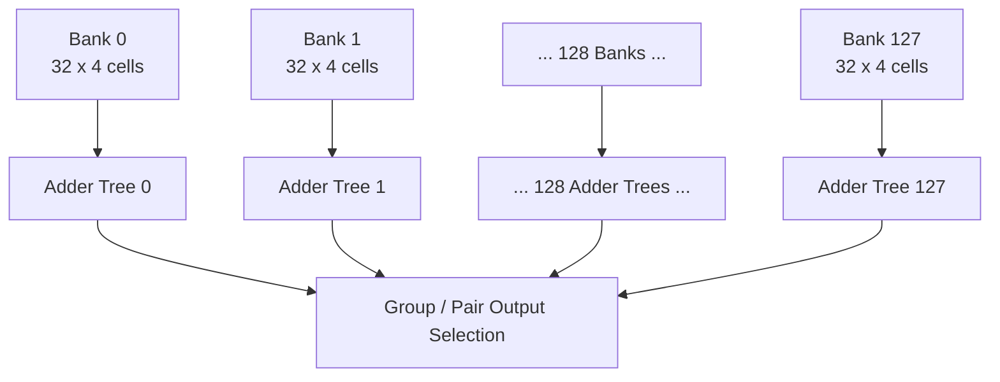
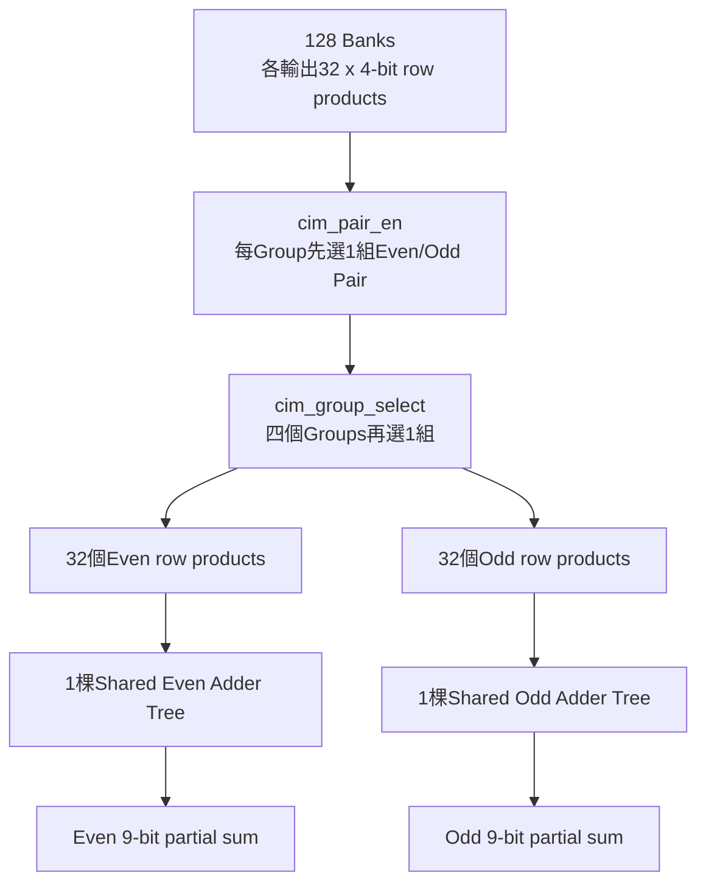
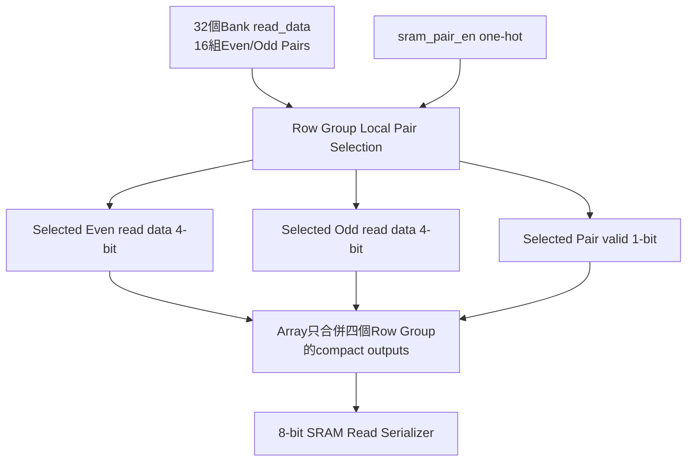
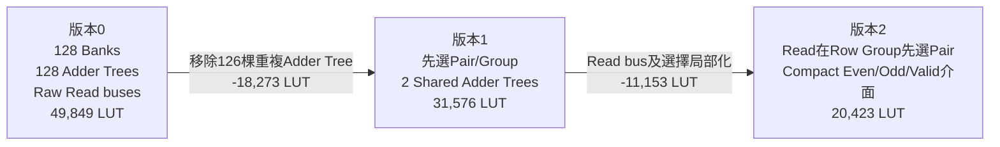

# CIM_CHIP LUT最佳化歷程：49,849 → 31,576 → 20,423

## 1. 結論

三個LUT數字下降的主要原因不是縮小128×128 Weight Array，也不是把Weight FF改成BRAM，
而是兩次利用目前合法操作「一次只選一個Row Group及一個Bank Pair」所做的資源共享：

1. 把每個32×4 Bank各自擁有的Adder Tree，改成整個Array只共享Even/Odd兩棵Adder Tree。
2. 把SRAM Read的所有Bank寬總線輸出，改成在Row Group內先選出唯一Even/Odd Bank Pair，
   再只向上傳送兩個4-bit nibble及一個valid。

```text
原始版本：資料全部先運算／輸出，再從大量結果中選擇
最佳化後：先根據one-hot控制選資料，再讓少量共用硬體運算／輸出
```

LUT由49,849降至20,423，共減少29,426 LUT，降幅約59.03%。FF仍維持約16,512，
代表16,384個1-bit Weight Cells仍完整保留。

## 2. 數據來源與比較限制

目標FPGA為PYNQ-Z2使用的`xc7z020clg400-1`，共有53,200個Slice LUT與106,400個FF。

| 階段 | LUT | LUT使用率 | FF | 資料狀態 |
|---|---:|---:|---:|---|
| 原始128棵Adder Tree | 49,849 | 93.70% | 16,512 | 專案先前記錄值；原始`.rpt`目前未保留 |
| Even/Odd兩棵共享Adder Tree | 31,576 | 59.35% | 16,512 | 目前保留的Placed報告可查證 |
| Read Pair介面與選擇路徑最佳化 | 20,423 | 38.39% | 16,512 | 專案先前記錄值；原始`.rpt`目前未保留 |

31,576的證據是：

[`impl_1/dcim_chip_pin_top_utilization_placed.rpt`](./impl_1/dcim_chip_pin_top_utilization_placed.rpt)

該報告內部日期為2026-08-17，內容為：

```text
Design          = dcim_chip_pin_top
Device          = xc7z020clg400-1
Slice LUTs      = 31,576 / 53,200 = 59.35%
Slice Registers = 16,512 / 106,400 = 15.52%
```

目前另有較新的Board Top報告：

[`vivado_master_chip_build/reports/utilization_impl.rpt`](./vivado_master_chip_build/reports/utilization_impl.rpt)

其結果為20,997 LUT及16,620 FF，但Top是`dcim_master_chip_top`，包含Clock Generator、Self Test與
Pin Master，不是單獨`dcim_chip_pin_top`，所以不能拿20,997直接取代或精確比較20,423。

要做正式論文表格，三個版本必須使用完全相同的：

- RTL Top。
- FPGA Part。
- XDC clock與IO限制。
- Vivado版本。
- Synthesis/Implementation Strategy。
- report階段（Post-Synthesis或Post-Implementation不可混用）。

## 3. 資源變化

| 變化 | 減少LUT | 相對前一版降幅 | 相對原始版剩餘比例 |
|---|---:|---:|---:|
| 49,849 → 31,576 | 18,273 | 36.66% | 63.34% |
| 31,576 → 20,423 | 11,153 | 35.32% | 40.97% |
| 49,849 → 20,423 | 29,426 | 59.03% | 40.97% |

以53,200 LUT計算剩餘資源：

| 階段 | 已使用 | 剩餘 | 使用率 |
|---|---:|---:|---:|
| 原始 | 49,849 | 3,351 | 93.70% |
| 第一次最佳化 | 31,576 | 21,624 | 59.35% |
| 第二次最佳化 | 20,423 | 32,777 | 38.39% |

## 4. 第一階段：128棵Adder Tree改成2棵

### 4.1 原始架構

完整Array包含：

```text
4 Row Groups
× 每Group 32個dcim_bank_32x4
= 128個32×4 Banks
```

原始版本在每個Bank旁各放一棵`adder_tree_32x4`：



每棵Adder Tree把32個4-bit row products加成9-bit結果，包含五層加法：

```text
32 → 16 → 8 → 4 → 2 → 1
```

雖然一次合法CIM操作只使用一個Row Group與一個Bank Pair，其他126棵左右的Adder Tree仍被
結構化實例化，Vivado必須為大量平行加法與其路由配置LUT。

### 4.2 最佳化架構

重構後先選出目前有效的資料，再進行算術：



Adder Tree數量：

```text
原始：4 Groups × 32 Banks = 128棵
新版：1棵Even + 1棵Odd = 2棵
減少：126棵
```

### 4.3 修改的RTL責任

#### `segment/dcim_bank_32x4.sv`

原始概念：

```text
32個row_product → Bank內Adder Tree → bank_sum[8:0]
```

目前概念：

```text
32個row_product直接輸出
Adder Tree不再屬於每個Bank
```

參考：[`segment/dcim_bank_32x4.sv`](./segment/dcim_bank_32x4.sv)

#### `array/dcim_row_group.sv`

在16組Bank Pairs中，先依`cim_pair_en[15:0]`選出唯一有效的：

```text
selected_even_product[0:31]
selected_odd_product[0:31]
```

參考：[`array/dcim_row_group.sv`](./array/dcim_row_group.sv)

#### `array/dcim_array_128x128.sv`

從四個Row Groups中選出唯一有效Group，然後只實例化：

```text
u_shared_even_adder_tree
u_shared_odd_adder_tree
```

參考：[`array/dcim_array_128x128.sv`](./array/dcim_array_128x128.sv)

#### `array/bank_output_or_tree.sv`

這個模組仍保留為講義原始Output Path參考及單元測試，但已不在正式Array/Macro合成階層中。

參考：[`array/bank_output_or_tree.sv`](./array/bank_output_or_tree.sv)

### 4.4 為什麼LUT下降18,273？

主要減少：

- 126棵重複的五層加法樹。
- 128筆9-bit`bank_sum`的後級選擇與路由。
- 大量局部Carry Chain及其LUT前級邏輯。

新增成本：

- Pair選擇前的32筆Even/32筆Odd row-product mux/OR網路。
- 四個Row Group間的product選擇網路。

新增的選擇邏輯遠小於126棵完整Adder Tree，因此最後仍淨減少18,273 LUT。

### 4.5 功能與代價

在以下合法控制條件下，數學結果不變：

```text
cim_group_select為one-hot
cim_pair_en為one-hot
一次只計算一個Group及一個Pair
```

代價是不能同時讓多個Pairs使用各自Adder Tree並行輸出。這不是目前Pin協定支援的操作，所以對
目前單Pair交易不造成額外cycle；但共享前的Group/Pair選擇到Adder Tree形成更集中的組合路徑，
可能增加關鍵路徑延遲。

## 5. 第二階段：SRAM Read先選Pair再向上輸出

### 5.1 原始Read架構問題

原始階層傾向把每個Bank的4-bit read data完整往上送：

```text
每個Row Group：32 Banks × 4 bits = 128-bit raw read bus
四個Row Groups：4 × 128 bits = 512條read data訊號
```

Array或更上層再根據Row Group與Bank Pair執行大範圍OR/mux。雖然每次只讀一個Pair，仍需處理：

- 大量跨模組寬總線。
- 每個Bank輸出的mask/gating。
- 32 Banks及4 Groups的多層選擇。
- 高fanout enable及較長的跨Array繞線。

### 5.2 最佳化Read架構

目前在每個`dcim_row_group`內先完成16組Pairs選擇：



每個Row Group對外介面由概念上的32組4-bit Bank read outputs，縮成：

```systemverilog
selected_even_read_data[3:0]
selected_odd_read_data[3:0]
selected_pair_read_valid
```

即每個Group只需9條有效資訊；四個Groups合計36條，而不是把512條raw data跨到Array層。

### 5.3 修改的RTL責任

#### `segment/dcim_bank_32x4.sv`

Bank內完成32 Rows的one-hot read OR mux，只輸出一個4-bit `read_data`及`read_valid`。Read是組合式，
Bank不加入第二級read register。

#### `array/dcim_row_group.sv`

收集32個Banks的內部`bank_read_data`，在Group內依選定Pair產生：

```text
selected_even_read_data
selected_odd_read_data
selected_pair_read_valid
```

Raw Bank buses不再跨出Row Group。

#### `array/dcim_array_128x128.sv`

只對四個Row Groups的compact read results做one-hot合併，不再處理四組完整32-Bank read buses。

#### `chip/dcim_macro_core.sv`與`chip/dcim_chip_pin_top.sv`

向上只傳遞選定Even/Odd nibble與valid，交給`sram_read_serializer_8bit`組成：

```text
read_word = {selected_even_read_data, selected_odd_read_data}
```

### 5.4 為什麼LUT下降11,153？

主要原因不是單純「少幾個output port」；SystemVerilog port本身不會消耗LUT。真正減少的是：

- 寬Read Bus後方的mask、OR及mux邏輯被局部化。
- 已選定Pair以外的read資料不再需要跨Group/Array傳遞。
- Vivado更容易把one-hot enable與局部OR選擇合併進LUT。
- 大量長距離訊號與高fanout控制減少，Place後的LUT combining更有效。

因此31,576降至20,423，減少11,153 LUT。由於目前未保留20,423版本的hierarchical utilization
report，無法把11,153精確拆成「Bank mux多少、Group mux多少、routing optimization多少」；上述是
依RTL架構變更可確認的主要來源，而不是每個子模組的精確LUT歸屬。

### 5.5 功能與假設

功能等價需要：

```text
row_read_en最多one-hot
sram_pair_en最多one-hot
一次只讀一個Row及一個Even/Odd Pair
```

這符合目前Row Decoder、Bank Decoder及Pin協定。若未來要同時讀取多個Pairs，就不能直接沿用目前
的compact介面。

## 6. 為什麼FF幾乎沒有下降？

完整128×128 Array包含：

```text
128 × 128 = 16,384個1-bit Weight Cells
```

目前每個Cell由一個FF保存Weight，所以至少需要16,384 FF。其餘少量FF來自Input Buffer、
Accumulator及Serial Output，合計約16,512。

兩次最佳化都針對組合邏輯：

```text
Adder Tree、OR、mux、mask與跨層選擇
```

沒有刪除Weight Cells，因此FF維持不變是合理且必要的結果。這也證明LUT下降不是因為Array容量
縮小。

## 7. 架構變化總圖



## 8. 這些最佳化帶來的實際好處

- LUT使用率從93.70%降到38.39%，為PE、Hybrid Controller與後處理保留空間。
- 降低大量重複Adder Tree造成的邏輯密度。
- 減少跨Row Group的寬Read Bus與長距離繞線。
- 提高Placement與Routing成功機率。
- 保留完整128×128 Weight容量及合法操作下的數值結果。

但不能只因LUT下降就宣稱速度一定提高：

- 共享Adder Tree前增加Group/Pair selection。
- Cell → selection → Adder Tree → Accumulator仍是集中式組合路徑。
- Timing必須另外比較WNS、TNS、logic levels與route delay。

因此面積最佳化與時序最佳化應分開報告。

## 9. 建議的正式比較方法

為了讓論文中的數據可重現，建議保留三個RTL tag或資料夾：

```text
baseline_128_adders/
shared_2_adders/
shared_2_adders_compact_read/
```

每個版本使用相同Tcl流程產生：

```tcl
report_utilization -hierarchical -hierarchical_depth 5 -file utilization_hier.rpt
report_utilization -file utilization_total.rpt
report_timing_summary -file timing_summary.rpt
report_route_status -file route_status.rpt
```

論文至少比較：

| 指標 | 說明 |
|---|---|
| LUT / FF / Slice | 面積與Placement壓力 |
| WNS / TNS | 是否滿足目標Clock |
| Logic Delay / Route Delay | 問題來自邏輯還是繞線 |
| Total cycles | 資源共享是否增加交易週期 |
| Throughput | 每秒能完成多少Group/Pair運算 |
| Dynamic Power | 只能作FPGA實作版本間估計，不代表真實ACIM功耗 |

只有在相同Top、Part、XDC與Vivado Strategy下得到的報告，才適合直接宣稱LUT由49,849降到
31,576再降到20,423。
