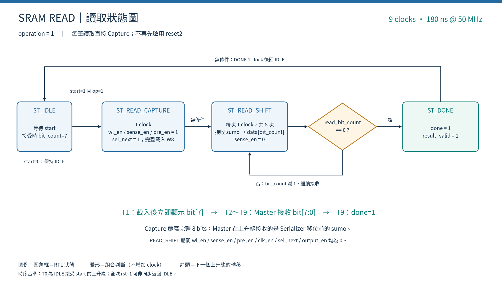
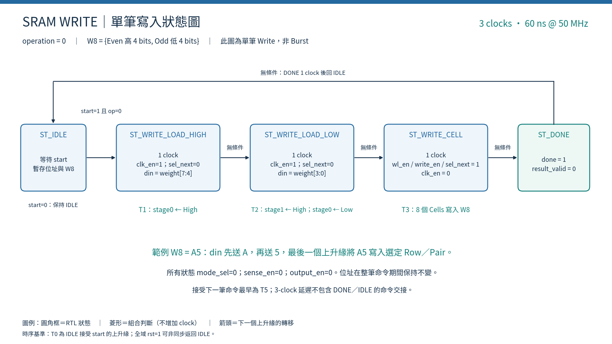
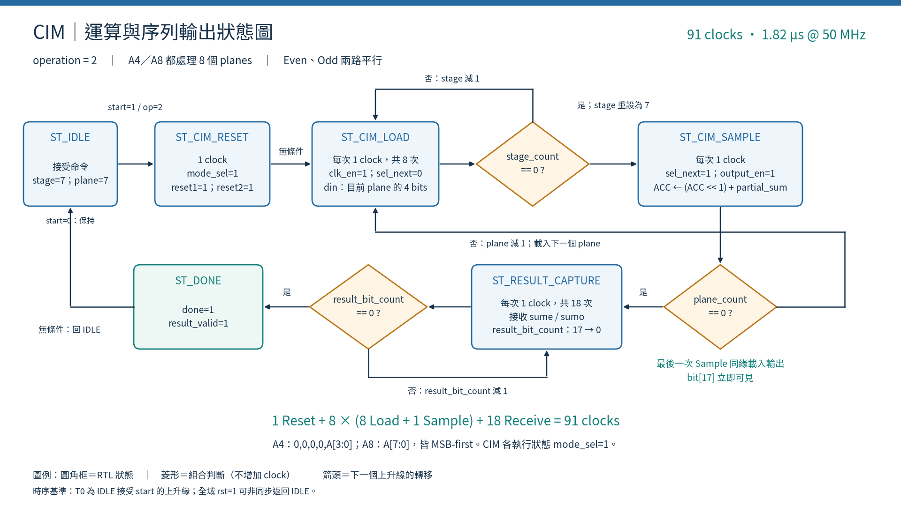

# DCIM Demo：操作順序、分區波形與驗證說明

核對日期：2026-09-08。以目前 [tb_dcim_pin_master.sv](../tb/fpga/tb_dcim_pin_master.sv) 與 [dcim_pin_master.sv](../fpga/dcim_pin_master.sv) 為準；Read 已省略每筆 Reset，Burst Write 已實作。

## 1. Demo 快速操作

1. 將所有相依 RTL 加入 Vivado Design Sources，將 `tb_dcim_pin_master.sv` 加入 Simulation Sources。
2. 在 Simulation Sources 將 `tb_dcim_pin_master` 設為 Top，執行 **Run Behavioral Simulation**。這裡設定的是模擬 Top，不是合成 Top。
3. 在模擬的 Tcl Console 執行下列指令。Windows 請換成你的實際專案路徑，使用正斜線；大括號可保護含空白的路徑。
4. 波形執行完成後使用 Zoom Fit，再放大指定命令；以 `start` 被接受的上升緣作為 T0。
5. 先展示 A5 Write，再展示 A5 Read，最後展示 A4W8／A8W8 CIM。

```tcl
source {/home/LAB505/projects/KWS/KWS_DNN_Hybrid/CIM_CHIP/docs/dcim_grouped_wave.tcl}
```

[可直接執行的 Tcl](./dcim_grouped_wave.tcl) 會建立新的分區波形頁面、restart 並 run all。它不會修改 RTL。再次 source 會新增另一頁波形。

若只跑文字驗證：

```bash
cd /home/LAB505/projects/KWS/KWS_DNN_Hybrid/CIM_CHIP
make test-dcim-pin-master
make test-dcim-master-chip-top
make test-dcim-cdc-integration
```

Makefile 目前未啟用 VCD／FST 輸出；看圖請使用 Vivado Behavioral Simulation。新增尚未記錄的訊號後，需 restart 並重新執行才能看到完整歷史。

## 2. 測試架構與四個觀察區

```text
Testbench：命令、權重、activation、golden model
  → dut：dcim_pin_master
  → chip：dcim_chip_pin_top
  → sume／sumo 序列輸出
  → Master 接收暫存器
  → Testbench 數值與狀態比較
```

本 TB 的實例名稱是 **dut** 與 **chip**，不是板級 Top 裡的 u_pin_master／u_chip。

| 波形區 | 內容 | Demo 說明 |
|---|---|---|
| 01_COMMAND_STATE | clk、start、operation、FSM、stage／plane counter | 哪一筆命令、目前哪個狀態 |
| 02_CHIP_INPUT_PINS | Chip 實例的真實輸入 port | 哪些腳位在這個 clock 區間拉高或拉低 |
| 03_CHIP_OUTPUT_PINS | sume、sumo | 晶片目前送出的序列 bit |
| 04_RECEIVED_RESULTS | 接收資料、完成旗標與 TB 預期值 | 完整結果是否正確 |

第04區是 Master／TB 訊號，不是新增的 Chip 輸出腳位。`actual_w8` 是 TB 重組結果，並非 Chip 內的硬體輸出。

| operation | 命令 |
|---:|---|
| 0 | 單筆 SRAM Write |
| 1 | SRAM Read |
| 2 | CIM |
| 3 | SRAM Burst Write |

不能只看 operation 判斷是否正在執行：命令完成後 operation 可能仍保留原值。請一起看 start、dut/state、done。
命令只在 IDLE 接受；`busy=0` 在 DONE 也成立，等待新命令時應確認 `!busy && !done`。

## 3. 可直接貼上的分區波形 Tcl

以下內容與獨立 Tcl 檔相同：

```tcl
# Vivado XSim GUI: launch tb_dcim_pin_master before sourcing this file.
create_wave_config DCIM_GROUPED
restart

set tb /tb_dcim_pin_master

# 01: Command, clock and Master state
set g_cmd [add_wave_group "01_COMMAND_STATE"]
foreach sig {
    clk rst start operation busy done result_valid error activation_is_a8
    dut/state dut/stage_count dut/plane_count
} {
    add_wave -into $g_cmd ${tb}/${sig}
    log_wave ${tb}/${sig}
}

# 02: Actual Chip input ports
set g_in [add_wave_group "02_CHIP_INPUT_PINS"]
foreach sig {
    clk model_rst_n reset1 reset2 mode_sel wl_en write_en sense_en pre_en
    clk_en sel_next output_en nv_store nv_recall pd_en
} {
    add_wave -into $g_in ${tb}/chip/${sig}
    log_wave ${tb}/chip/${sig}
}
foreach sig {row_addr bank_addr} {
    add_wave -into $g_in -radix unsigned ${tb}/chip/${sig}
    log_wave ${tb}/chip/${sig}
}
add_wave -into $g_in -radix hex ${tb}/chip/din
log_wave ${tb}/chip/din

# 03: Actual serial output ports
set g_out [add_wave_group "03_CHIP_OUTPUT_PINS"]
foreach sig {clk sume sumo} {
    add_wave -into $g_out ${tb}/chip/${sig}
    log_wave ${tb}/chip/${sig}
}

# 04: Received results and testbench golden values (not Chip ports)
set g_result [add_wave_group "04_RECEIVED_RESULTS"]
foreach sig {done result_valid error} {
    add_wave -into $g_result ${tb}/${sig}
    log_wave ${tb}/${sig}
}
add_wave -into $g_result -radix hex ${tb}/sram_read_data
log_wave ${tb}/sram_read_data
foreach sig {
    even_raw_result odd_raw_result expected_even expected_odd actual_w8 expected_w8
} {
    add_wave -into $g_result -radix unsigned ${tb}/${sig}
    log_wave ${tb}/${sig}
}

run all
```

## 4. 完整測試命令順序

編號以 Master 接受的一筆命令為單位；20-word Burst 只占一筆命令。每個命令都依序等待完成，再發下一筆。

| 命令編號 | 操作 | 位址／內容 | 驗證目的 |
|---|---|---|---|
| — | Reset | rst=1，維持3個上升緣後解除 | 清除模型；確認 Idle、旗標與 model_rst_n |
| 1 | Read | Row45、Pair9，預期00 | 初始化後直接讀取 |
| 2 | Write | Row45、Pair9 ← A5 | 基本寫入 |
| 3 | Read | Row45、Pair9 → A5 | 寫後讀回 |
| 4 | Write | Row46、Pair10 ← FF | 寫入全1 |
| 5 | Write | Row47、Pair11 ← 00 | 寫入全0 |
| 6 | Read | Row46、Pair10 → FF | 讀回全1 |
| 7 | Read | Row47、Pair11 → 00 | 切換讀取內容，確認沒有殘值 |
| 8 | Read | Row45、Pair9 → A5 | 切換位址後仍正確 |
| 9 | Burst Write | Row40、Pair14起連續20筆 | 跨列、自動遞增、無等待60 clocks |
| 10～29 | Read ×20 | 依序讀回Burst的20筆 | 驗證實際儲存內容 |
| 30～61 | Write ×32 | Row0～31、Pair2 | 準備A4W8權重 |
| 62 | CIM A4W8 | Group0、Pair2 | 忽略activation高4 bits，檢查運算 |
| 63 | Read | Row0、Pair2 → 23 | CIM後讀回指定權重，確認模式切換 |
| 64～95 | Write ×32 | Row96～127、Pair15 | 準備A8W8權重 |
| 96 | CIM A8W8 | Group3、Pair15 | 完整8-bit activation計算 |
| 97 | Read | Row96、Pair15 → 51 | CIM後讀回指定權重 |
| 98 | 非法Burst | command_burst_length=0 | error=1、result_valid=0 |
| — | 結束 | errors=0則PASS，否則`$fatal` | 彙整驗證結果 |

資料表中的 A5／FF／00／23／51 為十六進位。
共67次單筆Write、27次Read、2次CIM、1次合法Burst、1次非法Burst，合計98筆命令。
67次Write加Burst的20筆，共87次有效W8寫入；不是完整2048位置測試。

## 5. 測資輸入與計算預期

投影片簡化版：[16:9正方形配置摘要](./cmd62_snapshot/cmd62_square_slide_16x9.png)；[獨立正方形權重圖](./cmd62_snapshot/before_cmd62_square.png)。0以省略號標示，色塊仍保留已寫入0的位置；投影片右側節錄關鍵權重與命令62結果。

命令62以前的完整權重分布與逐列乘加，見 [128×32權重表與命令62解說](./cmd62_snapshot/CMD62_MEMORY_AND_EXPLANATION.md)。另附 [Excel三工作表](./cmd62_snapshot/before_cmd62_and_CIM.xlsx) 與 [完整PNG](./cmd62_snapshot/before_cmd62_128x32.png)。每格是4-bit Bank值，並非單一Cell。

### 5.1 SRAM 8-bit權重

`weight_model[0:127][0:15]` 是 TB 保存預期權重的參考記憶體。
每次Write更新對應項目，Read比較實際讀回值。每個W8分成：

```text
Even Bank = Weight[7:4]
Odd Bank  = Weight[3:0]
讀回 Byte = {Even, Odd}
```

### 5.2 Burst 的20筆

位址順序：

```text
Row40：Pair14、15       2筆
Row41：Pair0～15       16筆
Row42：Pair0、1         2筆
```

固定圖樣公式（不是每次執行不同的隨機資料）：

```text
high = row[3:0] XOR pair
low  = (row[6:3] + pair) mod 16
W8   = (high << 4) + low
```

例如 Row40/Pair14=63、Row40/Pair15=74、Row41/Pair0=95、Row42/Pair1=B6（hex）。
第一次stream valid與start同時有效，之後持續valid，所以20筆耗時60 clocks。

預取注意：WRITE_CELL期間Chip位址是目前第k筆，而 burst_weight_row_addr／bank_addr已要求第k+1筆。
若下一筆valid=0，當前寫入仍完成，位址與remaining先更新，然後才進WAIT保持。
一般延遲為 `3N + W` clocks，W是WAIT_DATA停留週期數；此TB案例W=0。

### 5.3 A4W8：Group0、Pair2

令 r=0～31：

```text
全域Row = r
W[r] = (7*r + 35) mod 256
A[r] = (5*r + 3) mod 16
activation_flat內的byte = 0xA0 OR A[r]
activation_is_a8 = 0
```

前幾筆權重為23、2A、31（hex），activation輸入byte為A3、A8、AD、A2（hex）。
高4 bits刻意放A，確認Master只使用低4 bits。實際plane順序：
`0,0,0,0,A[3],A[2],A[1],A[0]`。

### 5.4 A8W8：Group3、Pair15

令 r=0～31：

```text
全域Row = 96+r
W[r] = (13*r + 81) mod 256
A[r] = (11*r + 23) mod 256
activation_is_a8 = 1
```

前3筆(W,A)為(81,23)、(94,34)、(107,45)，此處為十進位。
實際plane順序：`A[7],A[6],...,A[0]`。

### 5.5 Golden比較

```text
expected_even = Σ A[r] * ((W[r] >> 4) & 15)
expected_odd  = Σ A[r] * (W[r] & 15)
expected_w8   = (expected_even << 4) + expected_odd
actual_w8     = (擴位後even_raw_result << 4) + 擴位後odd_raw_result
```

| 測試 | Even預期 | Odd預期 | unsigned W8預期 |
|---|---:|---:|---:|
| A4W8 | 2,124 | 1,744 | 35,728 |
| A8W8 | 27,096 | 25,424 | 458,960 |

這裡是unsigned權重運算，沒有signed INT8校正、zero-point、bias或requantization。
expected_even／odd在計算命令前準備；actual_w8／expected_w8在CIM完成後由TB更新。請在done後查看完整比較值。

## 6. Chip腳位控制表

表格描述正常交易狀態；系統rst已解除，model_rst_n=1。
nv_store／nv_recall／pd_en目前由Master固定0。
reset1清ACC，reset2清序列輸出，不會清權重；model_rst_n是儲存模型的active-low reset。

| 操作／狀態 | 主要拉高的Chip控制腳位 | din／上升緣動作 |
|---|---|---|
| Write：ST_WRITE_LOAD_HIGH | clk_en | din=weight[7:4]，載入stage0 |
| Write：ST_WRITE_LOAD_LOW | clk_en | din=weight[3:0]；原High移到stage1 |
| Write：ST_WRITE_CELL | wl_en、write_en、sel_next | 選定Cells寫入{stage1,stage0} |
| Read：ST_READ_CAPTURE | wl_en、sense_en、pre_en、sel_next | Serializer覆寫完整8-bit讀值 |
| Read：ST_READ_SHIFT | 上述讀取控制皆0 | Master每上升緣接收一個sumo bit |
| CIM：ST_CIM_RESET | mode_sel、reset1、reset2 | 清除ACC與序列輸出狀態 |
| CIM：ST_CIM_LOAD | mode_sel、clk_en | 每clock載入4個activation bits |
| CIM：ST_CIM_SAMPLE | mode_sel、sel_next、output_en | ACC接受當前partial sum |
| CIM：ST_RESULT_CAPTURE | mode_sel、sel_next | Master同步接收sume／sumo |
| Burst：ST_BURST_LOAD_HIGH | clk_en | 載入目前W8高4 bits |
| Burst：ST_BURST_LOAD_LOW | clk_en | 載入目前W8低4 bits |
| Burst：ST_BURST_WRITE_CELL | wl_en、write_en、sel_next | 寫當前W8，若仍有資料則可預取下一筆 |
| Burst：ST_BURST_WAIT_DATA | 無上述操作使能 | 等待串流；不寫Cell |
| ST_DONE／ST_IDLE | 無上述操作使能 | done僅在DONE為1；等待／交接命令 |

SRAM操作mode_sel=0；CIM的執行狀態mode_sel=1，回DONE後為0。
pre_en目前是保留腳位，未模擬類比Precharge時間。
合法Write／Burst完成時result_valid=0；Read／CIM完成時result_valid=1，error=0。
正常result_valid只在DONE有效，不能把接收中的暫存值當作完整結果。

## 7. 逐Clock說明與Demo講稿

延遲以T0接受start至done升高的上升緣差計算；50 MHz每週期20 ns。系統啟動reset與命令間隔另計。
菱形判斷是組合邏輯，不額外增加clock。

| 操作 | 狀態週期 | 延遲 | 下一命令最早接受間隔 |
|---|---|---:|---:|
| 單筆Write | High＋Low＋Write | 3 clocks／60 ns | 5 clocks |
| Read | Capture＋8 Receive | 9 clocks／180 ns | 11 clocks |
| CIM A4／A8 | Reset＋8×(8 Load＋Sample)＋18 Receive | 91 clocks／1.82 µs | 93 clocks |
| Burst N筆，無等待 | N×(High＋Low＋Write) | 3N clocks | 3N+2 clocks |

### Write：命令2，A5

| 區間 | 狀態 | 區間結束的邊緣 |
|---|---|---|
| T0→T1 | LOAD_HIGH：clk_en=1、din=A | T1 stage0載入A |
| T1→T2 | LOAD_LOW：clk_en=1、din=5 | T2 stage1=A、stage0=5 |
| T2→T3 | WRITE_CELL：wl_en/write_en/sel_next=1 | T3選定Row45/Pair9寫入A5，done=1 |

講稿：「先花兩個clock把8-bit權重拆成兩次4-bit輸入，第三個clock寫入選定的8個Cells。」
sram_write_data為組合使能輸出，主要在WRITE_CELL區間觀察A5。

### Read：命令3，讀回A5

| 時點 | 行為 |
|---|---|
| T0 | 接受Read，位址／sense等控制進入Capture |
| T1 | Serializer覆寫A5，邊緣後sumo顯示bit7 |
| T2～T9 | Master依序接收1、0、1、0、0、1、0、1 |
| T9 | sram_read_data=A5，done與result_valid=1 |

講稿：「每次Capture完整覆寫Serializer，所以不需要先reset；Capture一拍，加上Master接收八拍，共九拍。」
第一筆Read命令1是00，不要誤認為應該讀出A5。

### CIM：命令62／96

| 時點（相對各自T0） | 行為 |
|---|---|
| T0→T1 | CIM_RESET |
| T10、19、28、37、46、55、64、73 | 八次Sample上升緣 |
| T73後 | 最後一次累加結果同緣載入Serializer，bit17可見 |
| T74～T91 | Master平行接收Even／Odd各18 bits |
| T91 | done=1，raw results完整 |

講稿：「每個plane有32個activation bits，4條din需要八拍載入，再一拍Sample；八個plane後，兩路18-bit結果平行輸出。」
每次Sample：`ACC_next=(ACC<<1)+partial_sum`。Even／Odd不是輪流計算。
單plane最大partial sum為32×15=480，9 bits足夠；32項A8W8完整結果最大2,080,800，至少21 bits。
CIM組合路徑：Cell products → Row Group選Pair → Array選Group → 兩顆共用Adder Tree → ACC。

### 波形判讀注意

- 上升緣前是當拍取樣的資料，上升緣後會更新狀態／輸出。例如Master接收sumo的同緣，Serializer已移到下一bit。
- state更新後看到的腳位是下一個週期的控制。講述「此緣寫入」時，應對照此緣之前的write_en。
- 固定訊號先收合；先講第01區狀態，再講第02區脚位、最後看第03／04區結果。
- 本圖／Tcl是Behavioral Simulation，不能據此宣稱post-route timing或實體FeFET電性已驗證。

## 8. 驗證內容與界限

| 項目 | 本TB實際檢查 |
|---|---|
| Reset | busy/done/result_valid/error清除、model_rst_n解除 |
| 單筆Write | 完成狀態不報錯、不標result_valid；指定案例由後續Read/CIM驗證資料 |
| 27筆Read | 每筆資料、result_valid、error、恰好9 clocks、期間reset1/reset2不拉高 |
| 合法Burst | 20筆無等待恰好60 clocks、完成旗標，之後逐筆讀回 |
| A4W8 | 忽略activation高4 bits；Even／Odd與W8 golden比較 |
| A8W8 | 完整activation、不同Group／Pair；Even／Odd與W8 golden比較 |
| CIM後Read | 每次CIM後讀回一個指定位置，驗證該位置權重與模式切換 |
| 非法Burst | 零長度回error且result_valid=0 |

尚未在本TB專門覆蓋：Burst第一筆延後、中途stall、越界拒絕；Write 3 clocks與CIM 91 clocks沒有獨立精確延遲斷言；不包含完整陣列所有位置讀回或CNN逐層推論。
完整2048筆Burst＋2048次讀回與一次CIM見 `tb_dcim_master_chip_top.sv`；跨時脈整合見 `tb_dcim_cdc_bridge_integration.sv`。目前CDC mailbox沒有Burst串流功能。

Read省略reset修改後，先前已執行並通過三項make測試：test-dcim-pin-master、test-dcim-master-chip-top、test-dcim-cdc-integration。本次文件整理不代表重新執行Vivado／板上驗證。
Tcl需在Vivado XSim GUI實際執行；不應在一般tclsh直接用來模擬。

## 9. 簡報狀態圖

另提供由上往下閱讀的直式版本（1080×1920，9:16），原橫式版本保留：

| 直式圖 | PNG | SVG |
|---|---|---|
| SRAM Read | [PNG](./state_diagrams/sram_read_state_9x16.png) | [SVG](./state_diagrams/sram_read_state_9x16.svg) |
| SRAM Write | [PNG](./state_diagrams/sram_write_state_9x16.png) | [SVG](./state_diagrams/sram_write_state_9x16.svg) |
| CIM | [PNG](./state_diagrams/cim_state_9x16.png) | [SVG](./state_diagrams/cim_state_9x16.svg) |

以下PNG皆1920×1080（16:9），SVG可放大。

### SRAM Read



[SVG](./state_diagrams/sram_read_state_16x9.svg)

### SRAM Write（單筆，非Burst）



[SVG](./state_diagrams/sram_write_state_16x9.svg)

### CIM



[SVG](./state_diagrams/cim_state_16x9.svg)

## 10. 相關文件

- [完整三條操作路徑](../DCIM_THREE_OPERATION_PATHS.md)
- [Master設計架構](../DCIM_PIN_MASTER_ARCHITECTURE.md)
- [各層測試總指南](../TB_VERIFICATION_GUIDE.md)
