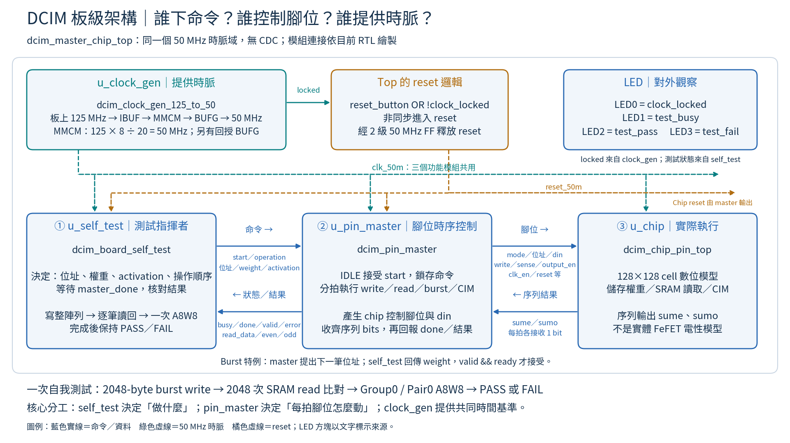

# DCIM top 關係圖：一頁簡報



- [PNG：1920×1080，可直接放入 16:9 投影片](state_diagrams/dcim_top_relationship_16x9.png)
- [SVG：文字已轉為向量輪廓，放大不需額外安裝中文字型](state_diagrams/dcim_top_relationship_16x9.svg)
- [繪圖程式](state_diagrams/render_top_relationship.py)

## 建議講解順序（約一分鐘）

1. 上方 clock_gen 將板上 125 MHz 轉成 50 MHz，提供共同時間基準。MMCM 負責頻率，BUFG 負責全域時脈分配，另一路 BUFG 用於回授。
2. 左下 self_test 決定測試內容：寫入全部權重、逐筆讀回、執行一次 CIM，再核對結果。
3. 中間 pin_master 接受 start 與命令，將一次操作轉成多個 clock 的晶片控制腳位；self_test 不直接控制 chip。
4. 右下 chip 執行儲存／計算，以 sume、sumo 序列回傳；master 收齊後回報 done 與完整結果，self_test 決定 PASS／FAIL。
5. 上方 LED 顯示鎖定、忙碌、通過或失敗。時脈與 reset 是共同配套，不是另一條運算命令。

## 與 RTL 的對應及簡化界線

- 接線來源：[dcim_master_chip_top.sv](../fpga/dcim_master_chip_top.sv)。
- 三個重點模組：[self-test](../fpga/dcim_board_self_test.sv)、[pin master](../fpga/dcim_pin_master.sv)、[clock generator](../fpga/dcim_clock_gen_125_to_50.sv)。
- reset_button 同時接 MMCM reset 與 top reset 邏輯。top 使用 `reset_button | ~clock_locked` 非同步進入 reset，再經兩級 50 MHz FF 釋放。
- reset_50m 直接送 self_test/master；chip 的 model_rst_n/reset1/reset2 由 master 輸出，所以圖上沒有畫成 reset_50m 直接連 chip。
- Burst 是另一組資料握手：master 提供請求位址，self_test 依位址產生 weight；有效傳輸需 valid && ready。命令介面則是 IDLE 接受 start，並非通用 ready/valid 命令介面。
- sume/sumo 每路每拍一 bit 是結果接收階段的行為，不表示所有狀態都在輸出有效結果；SRAM read 使用 sumo。
- 此板級自測為 2048-byte burst、2048 次 read、Group0/Pair0 一次 A8W8，不是完整 CNN，也不是所有 group/pair 的 CIM 覆蓋。
- 圖中為合成硬體的時脈架構；Verilator 下 clock generator 是 bypass，TB 直接提供 50 MHz，不驗證 MMCM 電性。

## 重繪及驗證

需要 matplotlib 與支援繁體中文的字型，例如 Noto Sans CJK TC：

```bash
python3 CIM_CHIP/docs/state_diagrams/render_top_relationship.py --font /path/to/NotoSansCJKtc-Regular.otf
```

本次依 RTL 接線核對、生成 PNG/SVG，檢查 1920×1080 尺寸與 SVG XML，並人工檢視版面。僅新增圖與說明，沒有修改 RTL，未重跑模擬或 Vivado。
