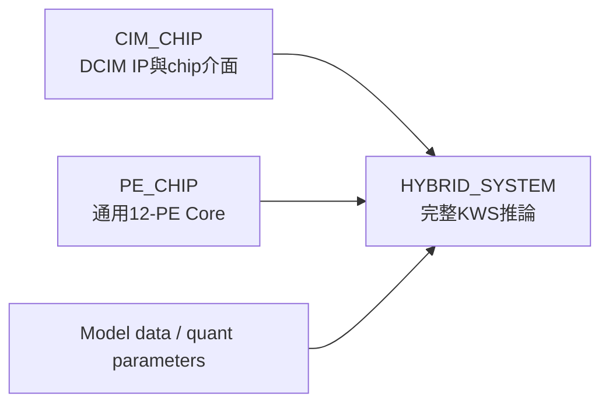
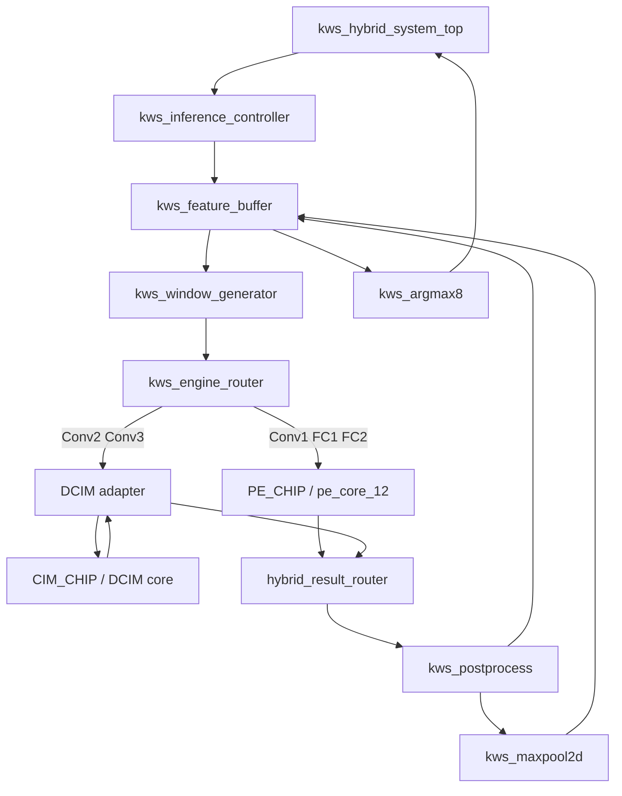

# KWS_DNN_Hybrid 專案資料夾重新規劃

## 1. 結論

PE適合獨立實作在：

```text
/home/LAB505/projects/KWS/KWS_DNN_Hybrid/PE_CHIP
```

但完整系統不應放在`PE_CHIP`或`CIM_CHIP`內。建議建立第三個同層資料夾：

```text
HYBRID_SYSTEM
```

三個區塊的依賴方向為：



規則：

- `CIM_CHIP`不得引用`PE_CHIP`。
- `PE_CHIP`不得引用`CIM_CHIP`。
- 只有`HYBRID_SYSTEM`可以同時引用兩者。
- 同一份RTL只保留一個source of truth，不複製到其他資料夾。

## 2. 三個專案的責任邊界

### `CIM_CHIP`

只負責：

- 1-bit cell storage/logic model。
- 32x4 bank與adder tree。
- 128x128 array。
- decoder、input buffer、accumulator與serial output。
- `dcim_macro_core`與`dcim_chip_pin_top`。
- FPGA側的DCIM pin transaction控制與CDC參考介面。
- DCIM獨立單元、整合、合成與PPA驗證。

不負責：

- Conv/FC layer排程。
- PE運算。
- Feature-map buffer。
- Pooling、ReLU、requantization。
- 最終KWS分類。

### `PE_CHIP`

只負責：

- Signed INT8 MAC primitive。
- 12個PE的output-stationary array。
- PE local accumulator與lane mask。
- PE local weight buffer。
- 通用K長度與output batch控制。
- Conv1、FC1與FC2所需的通用dot-product行為。
- PE獨立單元、整合、合成與PPA驗證。

不負責：

- 決定目前執行Conv1、FC1或FC2。
- 讀取完整feature-map座標。
- Pooling、ReLU與requantization。
- DCIM控制。
- PYNQ-Z2完整系統top。

`PE_CHIP`代表一個可獨立驗證與合成的logic core，不表示最後一定使用第二顆實體FPGA或第二顆ASIC。

### `HYBRID_SYSTEM`

負責所有model-aware功能：

- PYNQ-Z2 clock/reset與最終top。
- Layer descriptor與inference FSM。
- Feature-map ping-pong buffers。
- Conv window、FC vector與Flatten地址產生。
- PE/DCIM engine selection。
- Conv2/Conv3 weight mapping、reload與DCIM tile排程。
- PE/DCIM結果格式統一。
- Bias、requantization、ReLU、MaxPool。
- FC2 Argmax與輸出介面。
- 完整模型逐層與end-to-end驗證。

## 3. 建議完整資料夾樹

```text
KWS_DNN_Hybrid/
├── README.md
├── Makefile
├── HYBRID_PROJECT_DIRECTORY_STRUCTURE.md
│
├── docs/
│   ├── KWS_HYBRID_ACCELERATOR_ARCHITECTURE.md
│   ├── MODEL_QUANTIZATION_SPEC.md
│   ├── PE_DCIM_INTERFACE_SPEC.md
│   └── VERIFICATION_PLAN.md
│
├── model_data/
│   ├── manifest/
│   ├── weights/
│   ├── quant_params/
│   └── golden_vectors/
│
├── scripts/
│   ├── export_model_data.py
│   ├── generate_pe_vectors.py
│   ├── generate_dcim_mapping.py
│   └── compare_rtl_results.py
│
├── CIM_CHIP/
│   ├── cell/
│   ├── segment/
│   ├── array/
│   ├── peripheral/
│   ├── chip/
│   ├── fpga/
│   ├── tb/
│   ├── constraints/
│   ├── filelists/
│   ├── docs/
│   └── Makefile
│
├── PE_CHIP/
│   ├── rtl/
│   │   ├── arithmetic/
│   │   ├── array/
│   │   ├── buffer/
│   │   ├── control/
│   │   └── core/
│   ├── tb/
│   │   ├── arithmetic/
│   │   ├── array/
│   │   ├── buffer/
│   │   ├── control/
│   │   ├── core/
│   │   └── data/
│   ├── constraints/
│   ├── filelists/
│   ├── docs/
│   ├── Makefile
│   └── README.md
│
├── HYBRID_SYSTEM/
│   ├── rtl/
│   │   ├── common/
│   │   ├── control/
│   │   ├── memory/
│   │   ├── datapath/
│   │   ├── dcim_adapter/
│   │   ├── integration/
│   │   ├── debug/
│   │   └── top/
│   ├── tb/
│   │   ├── control/
│   │   ├── memory/
│   │   ├── datapath/
│   │   ├── dcim_adapter/
│   │   ├── integration/
│   │   ├── system/
│   │   └── data/
│   ├── constraints/
│   ├── ip/
│   ├── filelists/
│   ├── scripts/
│   ├── docs/
│   ├── Makefile
│   └── README.md
│
└── build/
    ├── cim_chip/
    ├── pe_chip/
    └── hybrid_system/
```

`build/`只保存模擬、Vivado synthesis與implementation產物，不應成為RTL source的一部分。

## 4. `PE_CHIP`內部詳細規劃

```text
PE_CHIP/
├── rtl/
│   ├── pe_pkg.sv
│   ├── arithmetic/
│   │   ├── activation_center_127.sv
│   │   ├── pe_multiplier_s9xs8.sv
│   │   ├── pe_accumulator_s32.sv
│   │   └── pe_mac_lane.sv
│   │
│   ├── array/
│   │   └── pe_array_12.sv
│   │
│   ├── control/
│   │   └── pe_core_controller.sv
│   │
│   └── core/
│       ├── pe_core_12.sv
│       └── pe_standalone_top.sv
│
├── tb/
│   ├── arithmetic/
│   │   ├── tb_activation_center_127.sv
│   │   ├── tb_pe_multiplier_s9xs8.sv
│   │   ├── tb_pe_accumulator_s32.sv
│   │   └── tb_pe_mac_lane.sv
│   ├── array/
│   │   └── tb_pe_array_12.sv
│   ├── control/
│   │   └── tb_pe_core_controller.sv
│   ├── core/
│   │   ├── tb_pe_core_12.sv
│   │   └── tb_pe_kws_layers.sv
│   └── data/
│       ├── conv1_patch.mem
│       ├── conv1_weight.mem
│       ├── fc1_vector.mem
│       └── fc2_vector.mem
│
├── constraints/
│   └── pe_standalone_top_pynq_z2.xdc
├── filelists/
│   └── pe_rtl.f
├── docs/
│   ├── PE_CORE_ARCHITECTURE.md
│   └── PE_VERIFICATION_GUIDE.md
├── Makefile
└── README.md
```

### `pe_core_12`建議邊界

PE Core固定配合目前12-filter KWS checkpoint：activation以QUInt8儲存但
zero-point固定127，weight為two's-complement QInt8且zero-point為0，bias為0。
介面分成命令、單一coherent sample stream及結果三組。

控制：

```text
start
k_length
lane_mask[11:0]
busy
done
error
```

Activation與weight共用一個握手：

```text
sample_valid
sample_ready
activation_u8[7:0]
weight_vector_i8[12*8-1:0]
result_valid
result_ready
result_vector_s32[12*32-1:0]
```

PE Core只計算：

```text
acc[lane] +=
    (signed({1'b0, activation_u8}) - 127)
    * signed(weight_int8[lane])
```

單一`sample_valid`保證同一個k的activation與12個weights不會錯位。共享
centering只做一次；lane mask直接成為12個accumulator的clock enable；一拍
weight register併入input pipeline，整層weight memory留在HYBRID_SYSTEM。
詳細接口、pipeline與FSM見`PE_CHIP/docs/PE_CORE_ARCHITECTURE.md`。

## 5. `CIM_CHIP`建議保留方式

目前`CIM_CHIP`已有完整測試與Makefile，不建議現在搬動這些檔案：

```text
cell/
segment/
array/
peripheral/
chip/
fpga/dcim_pin_master.sv
fpga/dcim_cdc_bridge.sv
tb/
```

其中：

- `dcim_pin_master`雖然是FPGA邏輯，但它直接定義Chip Pin交易，因此暫時歸在`CIM_CHIP`最容易維護。
- `dcim_cdc_bridge`與Pin Master已有共同整合測試，也先保留原路徑。
- `HYBRID_SYSTEM`用filelist引用這兩份來源，不再複製一份。

待Hybrid System穩定後，若仍希望更嚴格區分，可再將兩者移到`CIM_CHIP/interface/`並一次更新Makefile。

## 6. `HYBRID_SYSTEM`內部詳細規劃

```text
HYBRID_SYSTEM/rtl/
├── common/
│   ├── kws_hybrid_pkg.sv
│   ├── reset_synchronizer.sv
│   └── hybrid_clock_reset_controller.sv
│
├── control/
│   ├── kws_layer_descriptor_rom.sv
│   ├── kws_inference_controller.sv
│   └── kws_engine_router.sv
│
├── memory/
│   ├── kws_feature_buffer.sv
│   ├── kws_pe_weight_rom.sv
│   ├── kws_dcim_weight_rom.sv
│   └── kws_quant_parameter_rom.sv
│
├── datapath/
│   ├── kws_window_generator.sv
│   ├── kws_vector_serializer.sv
│   ├── kws_maxpool2d.sv
│   ├── kws_requantizer.sv
│   ├── kws_postprocess.sv
│   └── kws_argmax8.sv
│
├── dcim_adapter/
│   ├── dcim_weight_mapper.sv
│   ├── dcim_weight_loader.sv
│   ├── dcim_tile_buffer_4x32.sv
│   ├── dcim_command_scheduler.sv
│   └── kws_dcim_result_backend.sv
│
├── integration/
│   ├── dcim_system_core.sv
│   ├── hybrid_result_router.sv
│   └── kws_compute_subsystem.sv
│
├── debug/
│   └── hybrid_self_test_controller.sv
│
└── top/
    └── kws_hybrid_system_top.sv
```

### 為何最終top改名

原先的名稱：

```text
kws_dcim_system_top
```

適合DCIM standalone bring-up，但系統加入PE後，建議最終top改為：

```text
kws_hybrid_system_top
```

對應XDC也應另建：

```text
HYBRID_SYSTEM/constraints/kws_hybrid_system_top_pynq_z2.xdc
```

舊的`CIM_CHIP/constraints/kws_dcim_system_top_pynq_z2.xdc`對應尚未實作的
系統top，已移除。DCIM-only合成使用
`CIM_CHIP/constraints/dcim_chip_pin_top_pynq_z2.xdc`；混合系統則必須另建
`HYBRID_SYSTEM/constraints/kws_hybrid_system_top_pynq_z2.xdc`，兩者不可混用。

## 7. 系統整合關係圖



### 共用結果介面

PE一次產生最多12個INT32結果，現有DCIM一次回傳一個filter的結果。第一版建議使用`hybrid_result_router`統一成scalar result stream：

```text
result_valid
result_ready
result_layer_id
result_output_index
result_channel
result_acc_int32[31:0]
```

PE的12個結果先進入小型result buffer，再逐筆送到共用post-process；DCIM結果可直接逐筆送入。這樣可以先共用一套requantization，面積與控制較容易驗證。

若後續量測顯示PE結果輸出成為瓶頸，再升級成多lane post-process，不必在第一版先增加12組requantizer。

## 8. Filelist與Makefile關係

### 各自獨立驗證

```bash
make -C CIM_CHIP test
make -C PE_CHIP test
make -C HYBRID_SYSTEM test
```

### 根目錄統一入口

建議根目錄Makefile提供：

```text
make test-cim
make test-pe
make test-system
make test-all
make lint-all
```

### Source filelists

```text
CIM_CHIP/filelists/dcim_rtl.f
PE_CHIP/filelists/pe_rtl.f
HYBRID_SYSTEM/filelists/hybrid_rtl.f
```

`hybrid_rtl.f`引用另外兩個filelist或由Vivado Tcl依序加入：

```text
1. CIM_CHIP sources
2. PE_CHIP sources
3. HYBRID_SYSTEM sources
4. kws_hybrid_system_top
```

不能把RTL複製到HYBRID_SYSTEM，否則後續修正PE或DCIM時會產生兩個不同版本。

## 9. 三種獨立合成目標

資料夾分開後，可建立三個Vivado top進行公平比較：

| 合成目標 | Top | 用途 |
|---|---|---|
| DCIM-only | `dcim_chip_pin_top`或DCIM bring-up top | DCIM LUT/FF/timing基線 |
| PE-only | `pe_standalone_top` | 12-PE LUT/FF/DSP/timing基線 |
| Hybrid | `kws_hybrid_system_top` | 完整推論系統資源與時序 |

這三個top使用不同XDC與Vivado run，不能在同一個run同時設定三個top。

比較時需統一：

- 同一片XC7Z020-1CLG400C。
- 相同核心clock目標。
- 相同量化精度。
- 相同輸入與模型。
- 報告core-only與system-level兩種資源，避免把I/O與Clock Wizard混入core比較。

## 10. 分層測試歸屬

### `CIM_CHIP/tb`

驗證：

- Cell、row、bank、array。
- Decoder/input path。
- Accumulator/serializer。
- Macro/Chip Pin Top。
- Pin Master與CDC。

### `PE_CHIP/tb`

驗證：

- UINT8 code減固定zero-point 127。
- Signed 9-bit activation乘signed INT8 weight。
- INT32 accumulation。
- 12-lane同步與lane mask。
- Output-stationary clear/start/done。
- Conv1 K=9。
- FC1 K=144與12/12/8 batches。
- FC2 K=32與8-lane batch。

### `HYBRID_SYSTEM/tb`

驗證：

- Window flatten順序。
- Feature-buffer ping-pong。
- Conv2/Conv3 DCIM mapping。
- Signed-weight與zero-point修正。
- PE/DCIM result routing。
- Requantization、ReLU、Pool。
- 逐層Python golden comparison。
- 完整八分類推論。

## 11. 建議遷移順序

目前不要移動`CIM_CHIP`內任何已完成RTL。建議順序：

```text
Step 1  在空的PE_CHIP建立資料夾骨架
Step 2  實作並驗證activation_center_127與pe_multiplier_s9xs8
Step 3  實作pe_accumulator_s32與pe_mac_lane
Step 4  建立pe_array_12與pe_core_12
Step 5  PE_CHIP單獨合成，取得LUT/FF/DSP/timing
Step 6  建立HYBRID_SYSTEM骨架
Step 7  以filelist引用CIM_CHIP與PE_CHIP
Step 8  實作DCIM量化adapter與共用資料路徑
Step 9  建立kws_hybrid_system_top
Step 10 完成逐層及完整推論驗證
```

第一個實際建立的PE檔案建議是：

```text
PE_CHIP/rtl/arithmetic/activation_center_127.sv
```

先窮舉確認UINT8 code到signed 9-bit centered value，再建立：

```text
PE_CHIP/rtl/arithmetic/pe_multiplier_s9xs8.sv
```
並確認signed 9-bit乘signed INT8的位寬與Vivado DSP推論，再往上組成MAC與
12-PE array。
