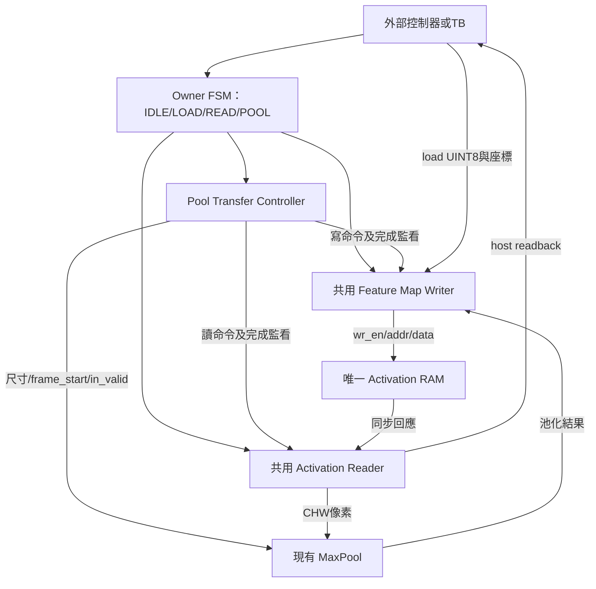
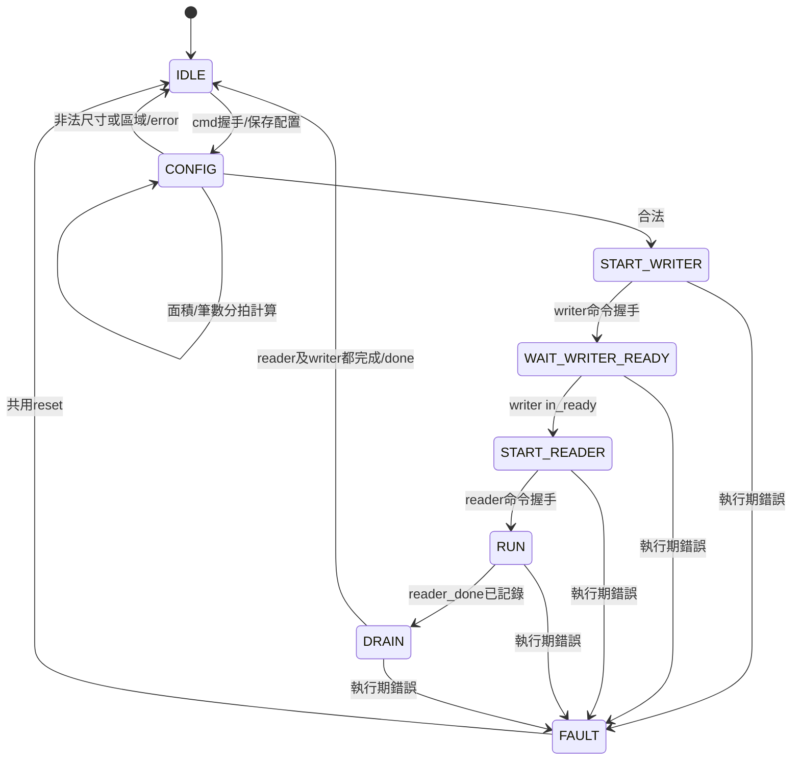

# Activation 記憶體子系統：元件關係、控制流程與驗證

日期：2026-10-04。本文是S1/S2的閱讀與操作指南；設計基準及分階段清單仍以[架構基準](SINGLE_BUFFER_ARCHITECTURE.md)為準。不是第二份互相競爭的規劃。

目前已有S1三個底層元件及S2池化整合。PE、DCIM、Argmax、全層排程、AXI/DMA、DDR與板級top尚未接入這條路徑，不能把這個top稱為完整KWS推論晶片。

## 1. 檔案與分工

所有路徑相對`HYBRID_SYSTEM/`。

| 檔案 | 責任 | 不負責 |
|---|---|---|
| `rtl/kws_system_pkg.sv` | UINT8、位址、筆數與模式共用定義 | 執行運算 |
| `rtl/memory/activation_buffer.sv` | 32768×8同步一讀一寫RAM | CHW座標、任務排程 |
| `rtl/control/feature_map_writer.sv` | LINEAR/CHW位址、接收與commit追蹤 | 來源區重疊判定 |
| `rtl/datapath/activation_reader.sv` | LINEAR/PATCH取值、兩筆回應緩衝、反壓 | 決定下一層 |
| `rtl/datapath/maxpool2x2_uint8.sv` | 2×2 stride2、UINT8最大值、奇數尾端捨棄 | RAM地址管理、輸出反壓 |
| `rtl/control/pool_transfer_controller.sv` | 池化配置驗證、先寫後讀啟動、完成事件保存 | 儲存像素、計算最大值 |
| `rtl/integration/kws_activation_path.sv` | 實例化上述元件、host/pool互斥與資料mux | 板級pin/AXI、全模型推論 |

RAM/Reader/Writer/MaxPool沒有因S2而修改介面。Pool控制器只傳控制與尺寸；資料mux在integration層。

## 2. 元件關係圖



權重RAM沒有放進來。MaxPool的line buffer也不是另一份feature-map RAM；它只保存上一列，以組成2×2視窗。當前仍使用原有實作，不宣稱已改為BRAM。

## 3. Top外部介面：三種互斥工作

共同規則：命令和資料只在valid&&ready的上升緣被接受；valid且未ready時上游保持payload。reset同步active-high並同時送到所有子模組。RAM不清除。

### 3.1 LOAD：主機載入

命令`load_valid/load_ready`，參數`load_mode/base/count/width/height/channels`直接交給Writer。接受後等`load_data_ready`才送資料。

- LINEAR：base+index；使用16-bit count。
- CHW：base+cHW+yW+x；使用8-bit W/H、6-bit C。
- 資料：`load_data_valid/load_data_ready`、8-bit `load_data`、6-bit `load_channel`、8-bit `load_y/load_x`。
- 結束：`load_done`或`load_error`單拍，成功前最後寫入已commit。

載入順序可以y→x→channel交錯，Writer負責散寫成CHW。此功能由整合TB真正執行，不以預先排列的假資料繞過Writer。

### 3.2 READ：主機讀回

`read_valid/read_ready`接受15-bit base及16-bit count，Reader固定LINEAR。

輸出為`read_out_valid/read_out_ready`、`read_data[7:0]`、`read_last`。`read_last`只在valid時有意義。下游可任意停頓；最後握手後回報`read_done`。

這是本地同步串流，不是AXI memory-mapped bus，也不等同CPU直接讀DDR。

### 3.3 POOL：記憶體到記憶體池化

`pool_valid/pool_ready`接受來源/目的15-bit base、8-bit W/H、6-bit C。配置接受後保存，外部參數可改變。

`pool_done`代表輸入全消費且結果全寫入。`pool_error`是單拍；若同時`fault=1`，必須共用reset後恢復。非法配置不進FAULT，可以送下一筆合法命令。

### 仲裁與埠所有權

同拍競爭優先序：POOL > LOAD > READ。只在命令接受時仲裁，不中途搶占。低優先命令必須保持valid直到ready，否則視為撤回而不是已接受。

| Owner | RAM寫入來源 | RAM讀取用途 | 其他命令 |
|---|---|---|---|
| HOST_IDLE | 無 | 無 | 可接受一種命令 |
| HOST_LOAD | Writer接host資料 | 無 | 全部阻擋 |
| HOST_READ | 無 | Reader送host | 全部阻擋 |
| POOL | Writer接Pool結果 | Reader送Pool | 全部阻擋 |

Reader/Writer的terminal脈波由top再登錄一拍，且同時釋放owner；外部看到done時可以準備下一命令。FAULT保留POOL owner、busy=1；不允許新命令進來污染未排空狀態。

## 4. 池化數學與範圍檢查

輸入`C×H×W`，輸出`C×floor(H/2)×floor(W/2)`。

`Y[c,y,x]=max(X[c,2y,2x],X[c,2y,2x+1],X[c,2y+1,2x],X[c,2y+1,2x+1])`。

本版合法尺寸：2≤W≤126、2≤H≤255、1≤C≤31。C限制來自現有MaxPool的5-bit通道數，不能把32截成0。輸入輸出大小與base相加用32-bit檢查，合法後才縮為16-bit命令筆數。

來源區`[src,src+Nin)`、目的區`[dst,dst+Nout)`都不得超過32768；相鄰合法，重疊非法：

`src < dst_end && dst < src_end`。

不做原地池化；不驗證來源已初始化，這是上層責任。無效配置在任何子命令發出前被拒絕，因此沒有RAM存取。

## 5. 池化控制器完整狀態圖



| 狀態 | 拉高/觀察的主要訊號 | 原因 |
|---|---|---|
| IDLE | cmd_ready | 不接受同拍像素 |
| CONFIG | 無子命令 | phase0算輸入/輸出面積；phase1算乘C筆數；phase2檢查範圍 |
| START_WRITER | writer_cmd_valid | LINEAR、dst、Nout；直到握手 |
| WAIT_WRITER_READY | 觀察writer_in_ready | cmd_ready不代表Writer已完成CONFIG |
| START_READER | reader_cmd_valid | LINEAR、src、Nin |
| RUN | reader_out_ready、pixel_valid | 接收整張CHW串流；首筆fire才frame_start |
| DRAIN | 保持完成追蹤 | 最後結果可能仍在Pool輸出/Writer暫存 |
| FAULT | fault、busy；禁止新命令 | 子模組沒有abort介面，不能只讓控制器回IDLE |

## 6. 三種「完成」不能混用

| 事件 | 含義 |
|---|---|
| Reader done | 所有輸入已被Pool接收 |
| Pool out_frame_done | 最後池化結果已產生，不代表尾像素消費完；此版不以它決定完成 |
| Writer done | 最後結果已提交到RAM |
| Controller done | Reader與Writer的完成事件都已記錄 |
| Top pool_done | 將Controller完成再登錄一拍，並釋放owner |

Controller使用reader_done_seen、writer_done_seen保存單拍事件。Writer可以比Reader早完成，也可以晚完成，不要求同拍。

以W=5、H=3為例：最後結果在輸入(y=1,x=3)形成，但還有x=4及整個y=2。Reader ready不能接Writer ready，否則Writer結束後ready變0，奇數尾端永遠消費不完。實作的reader_out_ready由RUN/DRAIN及錯誤條件控制，不依正常writer ready。

## 7. 資料有效的逐拍關係

1. Reader請求在上升緣E被RAM接受，E後RAM資料有效。
2. E+1 Reader把資料存入其兩筆FIFO。
3. E+2若ready，Pool接受該像素；若為首筆，同拍frame_start。
4. 某像素完成2×2視窗時，Pool在該上升緣後拉高out_valid和結果。
5. 下一上升緣Writer接受結果並保存地址/資料。
6. 再下一上升緣Writer的wr_en使RAM實際寫入。

輸入空拍只暫停Pool座標，不清line buffer。Pool輸出沒有ready，本版靠先啟動Writer和整段獨占RAM寫埠保證接收；每個pool_out_valid都必須對應writer_in_ready。

## 8. 錯誤、reset與部分更新

非法外部配置：error脈波、無子命令/無讀寫、回IDLE。

執行期reader_error、writer_error或`pool_out_valid&&!writer_in_ready`：進FAULT並產生error，停止供給Pool新像素、不接受新任務。top禁止fault後RAM寫入；Reader可能把已有信用的請求收完到FIFO，不能把FAULT宣稱為全部子模組已排空。共用reset清除reader pending/FIFO、writer pending、pool座標及兩層控制器。

已提交資料不回滾，reset不清RAM。故中止後目的區只算部分更新，重新啟動前由上層決定重新載入與覆寫。沒有內建硬體timeout；獨占端口與有效時脈是介面前提。

## 9. 模擬驗證與如何操作

```bash
cd /home/LAB505/projects/KWS/KWS_DNN_Hybrid/HYBRID_SYSTEM
make test-activation-path lint-activation-path
make test-activation-reader lint-activation-reader
make test-feature-map-writer lint-feature-map-writer
make test-activation-buffer lint-activation-buffer
```

整合TB：`tb/integration/tb_kws_activation_path.sv`。

1. 經host LINEAR載入全RAM sentinel。
2. 經host CHW模式，以y/x/channel交錯順序載入來源圖。
3. TB獨立以四值最大值公式計算Golden，不使用DUT輸出當答案。
4. 發出Pool命令，逐筆檢查真正RAM的read/write地址、資料、數量與唯一frame_start。
5. 透過host Reader，隨機ready讀回整片32768筆，確認來源與目的區外sentinel未改動。

測試尺寸含C=2/H=3/W=5奇數尾端，以及模型的1×64×126、12×30×61、12×13×28、12×4×12；另測2×2單結果且來源目的相鄰、31-channel合法上界。測試非法重疊、來源/目的越界、零或過小尺寸、W=127、C=0/32、大尺寸乘積；中途reset後恢復。每次Pool啟動都同拍提出load/read請求並確認兩者不ready，再撤回未接受請求，驗證POOL優先。

FAULT測試才使用明確故障注入：強制controller看到writer不ready，以驗證鎖定及共用reset恢復；正常數值測試全部使用原始Reader/RAM/Pool/Writer，不以stub繞過資料路徑。

2026-10-04實測（Verilator 5.030）：9個成功池化案例、11個預期拒絕、294912筆記憶體讀回比較通過；整合lint通過，S1 Reader/Writer/RAM測試及lint通過。相同Golden檢查正常計算與恢復後計算；故障中止本身不宣稱目的資料完整。未執行Vivado/板測，也未重跑所有PE/CIM回歸。

## 10. 波形閱讀順序

TB根節點`tb_kws_activation_path`，DUT為`dut`：

| 波形群組 | 建議訊號 |
|---|---|
| 外部操作 | clk/rst、load_valid/ready、pool_valid/ready、read_valid/ready、busy、pool_done/error、fault |
| 任務控制 | dut/owner、dut/controller/state、config_phase、reader_done_seen、writer_done_seen |
| Reader | dut/reader/state、r_en/r_addr、ram_valid/ram_data、r_valid/r_ready/r_data |
| Pool | frame_start、pixel_valid、cfg_w/cfg_h/cfg_c、pooled_valid/pooled_data |
| Writer | dut/writer/state、w_ready、w_en/w_addr/w_data、wc_done |

先找pool命令握手，再找Writer in_ready、Reader開始、唯一frame_start、最後Writer commit，最後看pool_done。對奇數尺寸特別觀察wc_done是否早於rc_done且串流仍繼續。

## 11. 尚未完成的系統工作

- Argmax未接此top；原S2規劃中的分類分支保留待辦，不宣稱完成。
- 真實PE的Conv1→RAM→Pool與軟體輸出比對屬S3。
- 全層descriptor/controller與DCIM backend分別屬S4/S5。
- 未建立本路徑板級wrapper、XDC或Vivado專案流程；此top有寬資料介面，不應直接把所有port綁到PYNQ實體pin。
- 尚未量測LUT/FF/BRAM、125MHz等時序，也沒有板測。配置乘法運算區需由Vivado實測，不能把RTL可模擬視為PPA保證。
- DDR仍需PS/AXI搬移器與所有權管理；本路徑固定本地RAM延遲。
