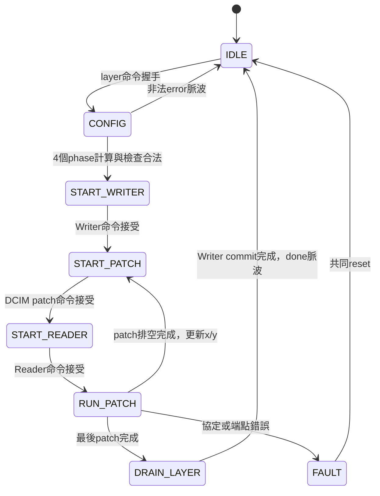

# S5-C 第一批：dcim_layer_controller 與 PoT 名稱統一

日期：2026-10-15。本批實作整層**控制器**，不是完成S5-C真實DCIM／RAM整層整合。測試端點為可控制延遲的協定刺激，沒有把stub稱作真實運算驗收。

## 1. 檔案與本次採用的決定

- 新增 `rtl/control/dcim_layer_controller.sv`、`tb/control/tb_dcim_layer_controller.sv`。
- Makefile新增 `test-dcim-layer-controller`、`lint-dcim-layer-controller`。
- `rtl/datapath/pe_pot_result_stream.sv`改名為`pot_result_stream.sv`，module同名；TB也改為`tb_pot_result_stream.sv`。參數、FIFO、量化與ReLU邏輯不變。
- 更新PE engine、後處理self-test、Makefile、Vivado來源清單與文件引用。已生成的build/snapshot/XPR不批次改寫；重新產生專案或更新Design Sources後再合成。
- 固定Cin=Cout=12、K=108、3×3/stride1/padding0；layer_id只接受1/2（PoT ROM的Conv2/3 ID，不是九操作descriptor index）。
- W/H仍由命令提供，接受合法的小型測試尺寸，不強制只允許30×15／14×6。需W/H≥3，來源及目的區不重疊、端點≤32768。
- `error`為單拍；執行期錯誤另保持`fault=1,busy=1`直到共同reset。CONFIG非法回IDLE而不啟動任何端點。
- resident metadata由外層管理，本模組只檢查valid與layer_id。整層busy期間所有權與權重不可更改。

## 2. 責任與連線

```text
系統命令 → [dcim_layer_controller] → Reader/Writer/patch啟動
                    │
          座標、完成旗標、協定檢查

RAM → activation_reader → kws_dcim_subsystem → pot_result_stream → feature_map_writer → RAM
          UINT8                INT32                 UINT8
```

資料payload不經controller保存；不新增activation RAM、im2col buffer、ΣW、FIFO、CDC或bit-plane控制。

外部固定接線：Reader `mode=READ_PATCH,count=108,channels=12`；Writer `mode=WRITE_CHW,channels=12`，CHW模式忽略cmd_count，可接0。Reader/Writer的base、尺寸、座標使用本controller輸出。

| Controller群組 | 連接方式 |
|---|---|
| reader_out_valid/last/ready | 真正Reader的out_valid/last/ready |
| dcim_activation_valid/ready | subsystem的activation_valid/ready；data直接由Reader接過去 |
| dcim_patch_valid/ready/done/error | subsystem的patch握手及狀態 |
| raw_path_enable | 同時gate raw→PoT兩端握手，見下方公式 |
| post_layer_id/relu_enable | PoT配置，在命令接受時保存、整層保持 |
| post_valid/channel/last/error/ready | PoT FIFO輸出端，不是raw DCIM端 |
| writer_in_valid/channel/x/y | Writer輸入控制與tag；data直接接PoT UINT8 |
| writer_done/error | 真正Writer的提交完成／錯誤 |
| dcim_source_error | 進入FAULT後通知backend取消；直到共同reset保持 |

raw連線必須是：

```systemverilog
pot_in_valid     = dcim_result_valid && raw_path_enable;
dcim_result_ready = pot_in_ready    && raw_path_enable;
// accumulator=result_data; channel_id={1'b0,filter_id}; in_last=result_last;
// 正常raw資料in_error可接0；subsystem.error由controller監測並中止。
```

不要只gate其中一側，否則可能單邊計數。PoT仍使用KWS模型ROM，名稱變通用不代表任意模型皆支援。同一模組定義可重用，不代表這次已實作PE/DCIM共用一個實體FIFO。

## 3. 八個狀態與完成流程



執行期任何狀態發現錯誤均可進FAULT，不只RUN_PATCH。

CONFIG分四拍：輸入面積與輸出寬高→來源大小與輸出面積→輸出大小→驗界。32-bit端點比較後才使用配置，不讓截位掩蓋越界。

RUN_PATCH使用7-bit activation_count（0..108）、4-bit result_count（0..12，亦為期望channel）。Reader/DCIM完成脈波分別保存，允許與最後一次資料握手同拍或晚到；結果計數納入當拍fire。跨patch沒有NEXT狀態，也沒有重播／filter FSM。

下一patch必須同時滿足：Reader完成、DCIM完成、12筆PoT輸出全部被Writer接受。此前patch_x/y不變，故不需在PoT FIFO再加x/y。Writer自己保存已接受資料的地址，因此最後一筆接受後才更新座標安全。

Writer完成事件可早於進入DRAIN_LAYER，使用writer_done_seen保存。最後post握手不等於RAM commit，DRAIN仍等真正writer_done。

## 4. 防護與錯誤時序

- Activation last須只在第108筆，禁止超量／Reader宣告完成後仍輸入。
- PoT channel須0..11且last只在第12筆；錯tag、錯error不讓Writer握手。
- Reader過早done、DCIM在activation未滿108時done、Writer在最後patch最後結果之前done、重複done均視為錯誤。
- runtime_bad立即關閉本地資料／命令gate。`dcim_source_error`只由已註冊FAULT狀態產生，避免 `source_error→backend activation_ready→當拍計數檢查→source_error` 組合回授。
- backend可能在錯誤邊緣仍完成其已在途內部工作；不宣告成功、不接收其結果，靠共同reset清理，不做rollback或自動retry。
- 過去已被Writer接受的pending write可能仍提交，目的層必須整體標為無效。所有端點、PoT FIFO與DCIM兩域都須遵守共同reset契約。
- 沒有timeout；來源永久不提供足夠資料或下游永久反壓會等待。不能宣稱可識別所有外部失效。

## 5. 測試如何執行

```bash
cd /home/LAB505/projects/KWS/KWS_DNN_Hybrid/HYBRID_SYSTEM
make lint-dcim-layer-controller test-dcim-layer-controller > build/dcim_layer_review.log 2>&1
make test-pot-stream test-pot-engine test-postprocess-pot lint-s4 > build/pot_rename_review.log 2>&1
```

首次執行前若build不存在，先用`mkdir -p build`。等命令結束再看log與退出碼，不需持續查看每拍數值。

### Controller TB

只從公開ports驅動，沒有force FSM。posedge監測交易與座標，negedge驅動輸入；全域watchdog避免測試死鎖。

正常5層：3×3、5×4、Conv2 30×15、Conv3 14×6，以及reset/fault後3×3無資料停頓恢復。共420個正常patch、5040筆正常結果。最後reset測試另讓一個patch輸出12筆後取消整層，故摘要outputs為5052，不代表多出12筆成功層結果。

檢查Writer每層只命令一次、Reader/DCIM每patch各一次、108/12交易數、x/y掃描、channel對齊、命令在ready=0保持、命令握手後外部配置改變不影響保存值。測Reader done與最後輸入同拍／晚到，DCIM done早於／同拍／晚於最後PoT輸出，Writer done同拍／晚到；最後輸出停頓時座標不前進。

10個非法配置：resident無效/錯層、非法layer、W<3、H=0、重疊、來源越界、目的越界、大尺寸乘積、DCIM已有error。

11個執行期fault：錯activation last、早Reader done、早DCIM done、錯channel、錯post last、post_error、早Writer done、resident撤銷、Reader/Writer/DCIM error。檢查非法資料未握手、error單拍、fault鎖定與reset恢復。

7個reset位置：CONFIG、Writer命令等待、patch命令等待、Reader命令等待、RUN輸入前、輸入完成後、輸出完成但尚未Writer commit。

`+CORRUPT_EXPECTATION`故意破壞Reader座標期望，需非零結束且匹配`reader coordinates mismatch`，不把timeout當負向測試通過。

### 名稱遷移回歸

PoT stream測comb/pipeline兩配置；PE engine檢查改名後實例仍能正確執行；postprocess與S4 lint核對下游引用。舊名稱不保留相容wrapper，避免同時維護兩個同義module。

## 6. 實測結果與限制

2026-10-15，Verilator 5.030：

| 測試 | 結果 |
|---|---|
| Controller lint | PASS，未豁免RTL警告 |
| Controller協定TB | PASS：layers=5 rejected=10 faults=11 resets=7 patches=435 outputs=5052 |
| 故意錯座標期望 | 正確拒絕，PASS |
| PoT stream comb/pipeline | 各768筆、全部256個ROM地址、FIFO/反壓/reset：PASS |
| PE9/PE8/PE8-pipeline × 後處理comb/pipeline | 六組各7 jobs、109 outputs：PASS |
| PoT後處理 | 80筆、RNE/ReLU/pool/frame tags：PASS |
| S4整合lint | PASS；未重跑完整S4軟體資料集 |

摘要patches=435包含reset/fault刻意中止的命令，不是435個成功patch；正常5層為420個完整patch。測試結果在當前工作樹取得，使用者已有後處理等變更保留，不能宣稱乾淨checkout已獨立重現。

這份controller TB是協定驗證，不含真實MAC或RAM，完整DCIM整層數值驗收不能據此標PASS。Vivado合成、時序與板測未執行。既有Vivado frozen snapshots未更新、Tcl只更新來源檔名，未實際執行Vivado。

## 7. 2026-10-15 審查後 V1～V6 補測

本輪只修改TB、Makefile與文件，controller及PoT RTL不變。保留第6節歷史結果，新增驗收如下：

| 項目 | 補測內容 |
|---|---|
| V1 | START_WRITER／START_PATCH／START_READER／DRAIN_LAYER各注入Reader error、Writer error、DCIM error、resident無效、意外post_valid，共20例 |
| V2 | Reader／DCIM的第一次done已記住後再脈衝；Writer第一次done與最後輸出同拍，DRAIN中再次高電位，共3例 |
| V3 | 108筆後不送Reader done再送第109筆；12筆後不送DCIM done再送第13筆，共2例 |
| V4 | 3×3來源12×9=108筆，src=32660/dst=0；目的12筆，src=0/dst=32756；反向相鄰src=12/dst=0，共3個完整成功層 |
| V5 | 同一正常層在CONFIG、三種命令等待、RUN、DRAIN六個位置提交非法新配置，busy期間不接受；在回IDLE前撤銷valid，原層仍完整成功 |
| V6 | 保留Reader錯座標負向測試，新增`+CORRUPT_WRITER`，必須因`output coordinate/tag mismatch`失敗 |

V1/V2/V3使用唯讀階層觀察確認目標state／count／done_seen確實到達，不force或修改內部狀態。意外post_valid在非RUN狀態不能握手；注入錯誤時將相關ready設高，確定沒有偷偷多接受命令。FAULT檢查error單拍、done不成功、狀態鎖定；下一案例共同reset確認回到IDLE，之後三個邊界層與busy測試層驗證正常恢復。不是每個fault之後都重新計算一整層。

Writer重複done為連續兩個取樣edge都高的壓力案例；若正常任務已回IDLE才再送脈波，不會冒稱這是同一筆交易內的重複偵測。

合法的來源終點等於目的起點，原正常層`dst=W*H*12`已測過；本輪額外補上最高端點及反向相鄰，不把原覆蓋抹除。

本輪`make lint-dcim-layer-controller test-dcim-layer-controller`退出碼0，Verilator 5.030，無Warning/Error：

```text
PASS extensions nonrun_faults=20 duplicate_done=3 excess=2 boundaries=3 busy_probes=6
PASS dcim_layer_controller layers=9 rejected=10 faults=11 resets=7 patches=454 outputs=5184
PASS expected controller coordinate rejection
PASS expected controller Writer coordinate rejection
```

`faults=11`仍是原RUN案例，新增fault另計20+3+2，所以本輪共36個故障注入案例。正常9層共424個完整patch、5088筆結果；其餘96筆是刻意中止案例先前已接受的結果。454個patch命令包含424正常＋原11 fault＋原4 reset＋V1的10個＋V2/V3的5個。5184結果包含5088正常＋原reset的12＋V1 DRAIN五例60＋V2 Writer12＋V3超量結果12。

Log：`HYBRID_SYSTEM/build/dcim_layer_controller/verification_v1_v6.log`；兩個負向測試分別為`negative.log`、`negative_writer.log`。原`verification.log`保留歷史第一批結果。TB只讀內部狀態確認覆蓋，並未修改RTL；不等於正式coverage分析或真實端點整合。未重跑未改動的PoT／PE回歸、未執行Vivado。

## 8. 下一步

依原規劃建立真實Reader/RAM→DCIM subsystem→PoT→Writer整合TB，加入Conv2/3軟體權重／activation/golden；再修改共享kws_activation_path的所有權與resident管理。本次尚未將新controller掛入該top，不開放FULL模式。
