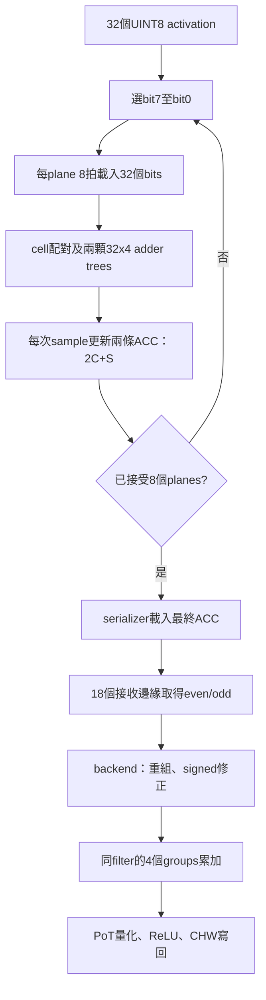

# DCIM S5：數學公式、權重映射與實際資料順序

更新：2026-10-13。用途：論文與簡報的推導筆記，不是已完成的 S5 驗收報告。

範圍：UINT8 activation、zero-point=128、signed INT8 weight、無 bias。既有 chip/master 已有 bit-serial 與序列結果路徑；跨 group signed 累加及整層 backend 仍是 S5 規劃。本文沒有更動 RTL。

## 1. 符號與卷積

固定輸出座標 (y,x)，令 c 為輸入 channel、f 為輸出 filter、u/v 為 kernel 座標。

$$Y_f(y,x)=\sum_{c=0}^{11}\sum_{u=0}^{2}\sum_{v=0}^{2}(A_u[c,y+u,x+v]-128)W_s[f,c,u,v].$$

其中 A_u 的下標表示 unsigned，不是 kernel 的 u 索引。Y 為量化前的整數累加值，不是 FP32 輸出。

$$k=9c+3u+v,\qquad Y_f=\sum_{k=0}^{107}(A_{u,k}-128)W_{s,f,k}.$$

FC 同樣是點積，只是不再以滑動空間視窗取得輸入：

$$Y_f^{FC}=\sum_{k=0}^{K-1}(A_{u,k}-128)W_{s,f,k}.$$

## 2. 容量與映射（建議方案）

每個 bank 為 32×4 bits；同一 group 的一個 pair 保存32個8-bit權重。四個 groups、每組16個pairs，共64個實體pair區塊、2048 bytes。

$$row=k,\quad group=\lfloor k/32\rfloor,\quad local\_row=k\bmod32,\quad pair=f.$$

$$image\_address=16\times row+pair.$$

| Group | 有效 k | Padding數 |
|---|---|---:|
| 0 | 0～31 | 0 |
| 1 | 32～63 | 0 |
| 2 | 64～95 | 0 |
| 3 | 96～107 | 20 |

一個完整filter是108項，分布在四個groups中相同pair編號的四個不同實體區塊。12個filters使用48個區塊，不是144個；只有強制每份3×3獨占pair時才需要144個。

單層1296 bytes可駐留；Conv2+Conv3共2592 bytes，不能同時完整駐留。分group計算不代表每次重新載入權重。

## 3. Unsigned編碼與修正

$$W_u=W_s+128,\qquad U_g=\sum_{r=0}^{31}A_{u,g,r}W_{u,g,f,r}.$$

這不是直接將signed byte當unsigned解讀；signed零權重應編為0x80。

$$S_A[g]=\sum_r A_{u,g,r},\qquad S_W[g,f]=\sum_r W_{u,g,f,r}.$$

$$P_{g,f}=U_g-128S_A[g]-128S_W[g,f]+16384K_g.$$

$$P_{g,f}=\sum_r(A_{u,g,r}-128)W_{s,g,f,r},\qquad Y_f=\sum_{g=0}^{3}P_{g,f}.$$

固定32-row運算取 K_g=32；padding A_u=W_u=128，所有raw MAC與sum統計都包含padding。單一padding貢獻為16384−16384−16384+16384=0。不能raw算32項、修正只算12項。

既有 `rtl/dcim_adapter/dcim_u8_offset_correction.sv` 有一級registered輸出、無ready；backend須保存valid結果，不能因下游停頓而遺失。

## 4. Bit-serial正確性與兩個nibbles

$$A_{u,r}=\sum_{b=0}^{7}a_{r,b}2^b,\qquad W_{u,r}=L_r+16H_r.$$

$$S_{L,b}=\sum_{r=0}^{31}a_{r,b}L_r,\qquad S_{H,b}=\sum_{r=0}^{31}a_{r,b}H_r.$$

$$U=\sum_b2^b(S_{L,b}+16S_{H,b}).$$

交換加總順序即可證明跨channel打包等價。每個row先配對自己的activation與weight；adder tree只加配對後的乘積，不會產生跨row交叉乘法。同一次sample必須是相同bit平面、相同輸出filter及空間位置。

目前RTL採 **MSB-first**，不是LSB-first：

$$C_{-1}=0,\qquad C_t=2C_{t-1}+S_{7-t},\quad t=0,\ldots,7.$$

$$C_7=128S_7+64S_6+32S_5+16S_4+8S_3+4S_2+2S_1+S_0.$$

兩條ACC分別累加H與L，現有master定義：

$$U=odd\_raw+(even\_raw\ll4).$$

even是高nibble、odd是低nibble。重組前先zero-extend，避免18-bit左移丟失高位。

位寬界限：S≤32×15=480（9 bits）；單nibble ACC≤32×255×15=122400（17 bits可表示，介面使用18 bits）；完整unsigned MAC≤32×255²=2080800（21 bits可表示，backend可用32 bits）。

## 5. 現有RTL的真實輸入與輸出順序

來源：`CIM_CHIP/fpga/dcim_pin_master.sv`、`peripheral/input_buffer_32x4.sv`、`peripheral/bitserial_accumulator.sv`、`peripheral/serial_output.sv`（均相對repository root）。

1. 權重先經SRAM寫入並保持；activation_flat每個byte對應一個local row，共32 bytes。
2. ST_CIM_RESET清ACC/序列輸出狀態，不清cell權重。
3. plane_count由7降至0。每個plane的ST_CIM_LOAD執行8拍，每拍din[3:0]送入4個不同rows的同一bit，不是同一activation的4個bits。
4. stage_count由7降至0：先送rows28～31，接著24～27，最後0～3。這是為了shift chain最終對齊；din[lane]=A[4×stage+lane][plane]。
5. ST_CIM_SAMPLE讓緩衝bits進入選定group/pair。兩顆adder trees形成9-bit partial_sum；有效output_en正緣立即更新C←2C+S。
6. 重複LOAD+SAMPLE共8個planes。A4模式仍執行8個planes，高四個plane補0。
7. 第八個有效sample同一正緣，把包含第八筆partial sum的next_acc載入serializer；正緣之後bit17可見。不是載入舊ACC。
8. Master進入ST_RESULT_CAPTURE，以後續18個接收邊緣收取bit17→bit0；sume/sumo兩條線同時收，不是先收完even再收odd。
9. Master提供兩個18-bit字；S5 backend才重組U、做signed修正、跨group累加。四組完成後才能量化/ReLU。

LOAD+SAMPLE為8×(8+1)=72個master clocks，另有reset狀態、18次結果接收與命令完成/握手開銷；72不是完整命令延遲，也不包含CDC。

## 6. 可手算例子

四個有效rows：A=[3,5,2,6]、unsigned W=[2,4,3,1]；其餘rows以A=0排除。這是unsigned核心教學例，不是zp128的signed模型golden。前兩項可屬CH0，後兩項屬CH1。

直接計算：3×2+5×4+2×3+6×1=38。所有W<16，因此even=0，odd=38。

| plane | bits（row0～3） | S | 更新後ACC |
|---|---|---:|---:|
| 7 | 0000 | 0 | 0 |
| 6 | 0000 | 0 | 0 |
| 5 | 0000 | 0 | 0 |
| 4 | 0000 | 0 | 0 |
| 3 | 0000 | 0 | 0 |
| 2 | 0101 | 5 | 5 |
| 1 | 1011 | 6 | 16 |
| 0 | 1100 | 6 | 38 |

位元字串由左至右列出row0至row3，不是Verilog vector的MSB到LSB標示。

Signed修正例：A_u=[129,130]、W_s=[−2,3]，W_u=[126,131]。U=33284、S_A=259、S_W=257、K=2，修正33284−128×259−128×257+16384×2=4，等於1×(−2)+2×3。硬體若補到32項，需補30組(128,128)並使用K=32，結果仍為4。

## 7. 後處理與地址

設該channel重定標比例為2^(−s)，則概念式為：

$$q=clip_{[0,255]}(RNE(Y_f2^{-s})+128).$$

RNE是round-to-nearest ties-to-even；不能用直接截斷取代。s取值、合法範圍與實際參數以軟體匯出及requantizer實作為準，不假設任意signed shift皆已支援。

$$q_{ReLU}=\max(q,128),\qquad addr=base+fH_{out}W_{out}+yW_{out}+x.$$

完整四組累加之後才量化/ReLU。不同filter若使用不同scale，Argmax前需確認輸出可直接比較，不可只因都是UINT8就認定尺度相同。

## 8. 工作量與評估界線

$$N_{cmd/patch}=4\times12=48.$$

Conv2：364個patch、17472次CIM命令；Conv3：48個patch、2304次。命令數不是clock數。權重駐留期間不同patch不必重新載入。

逐層不重疊執行時，應分別報告weight-load、layer-execution（含activation搬移/結果/後處理）、總時間。預載TB省略的是載入模擬，不代表實體硬體零時間換層。

## 9. 驗證與論文使用限制

本文件核對現有RTL順序，並以獨立整數計算檢查例子及分組/位元重排恆等式；不是本次新跑RTL或Vivado通過的宣告。S5跨group/backend仍待實作驗證。

未來驗收須比較：寫入讀回、各plane sums、兩條ACC、18-bit序列重建、signed修正、四組累加、量化結果與RAM地址；使用真實chip/master，不以golden輸出替代DUT。

以上是本專案數學推導，不是外部論文引用。論文需另外引用量化/CIM相關文獻，並區分FPGA行為模型與真實FeFET/NV電路。
