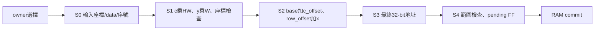
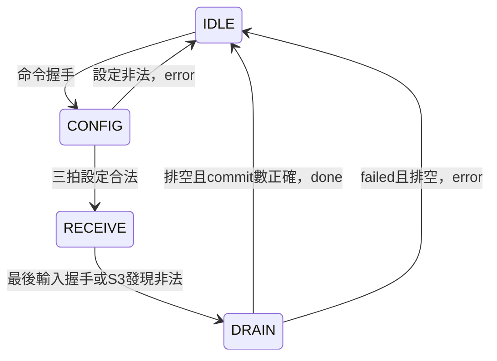

# Writer 五級管線（2026-10-19）

## 範圍與狀態

依使用者核准實作。只修改Writer RTL、測試與文件，不改reset/CDC、PE/DCIM或RAM。新增測試尚未執行，交Claude驗證；不宣稱125MHz已通過。原版routed WNS=-3.744ns，最差owner→Writer CE，資料路徑11.502ns。

## SPEC

公開ports不變：同步active-high rst；cmd_valid/ready保存命令；in_valid/ready接管輸入；wr_en/addr/data連永遠可接受的一拍同步RAM，不是DDR/AXI。命令參數只在IDLE握手更新。CHW筆數C×H×W、LINEAR筆數count；保留CONFIG三拍及寬位元範圍檢查。CHW允許任意合法座標順序，不提供座標去重。payload FF不reset，只有valid與控制reset。

CHW：base+c×HW+y×W+x；LINEAR：base+index。LINEAR沿用同樣管線延遲，非必要項設零。S0 index保存握手前accepted_count，不使用後來更新的計數。所有乘加保持32-bit，檢查地址<32768後才截15-bit；實際DSP推導留待Vivado，未強制DSP屬性。

| 正緣 | 資料位置 |
|---|---|
| E0 | input_fire，S0保存 |
| E1 | S1乘積與合法旗標 |
| E2 | S2兩組部分和 |
| E3 | S3完整地址 |
| E4 | S4合法則pending_valid=1 |
| E5 | RAM採樣wr_en並commit |
| E6 | 若為最後一筆且排空，done=1，回IDLE |

pipe_valid[0..3]對應S0..S3，pending_valid對應S4。每拍向後移動，無輸入傳bubble；不加逐級ready鏈，因RAM無反壓且各級吞吐量一拍一筆。非法資料例外見下節。accepted_count保留原名但語意改成所有已握手筆數（含後來取消），committed_count只算實際寫入。

## 錯誤／reset契約（不能沿用舊固定延遲）

S3有效且座標不合法或地址越界時，禁止建立S4，清除S0..S3 valid並進DRAIN/failed。更早已在S4的資料仍可於該正緣寫入；非法筆及所有較晚筆取消，包含錯誤偵測同拍新握手資料。in_ready不接地址運算組合反饋，避免重建長路徑。下一拍排空回報error，不回報done。目的記憶體僅部分更新，不rollback。

reset取消所有尚未commit資料；wr_en受rst抑制，RAM也須共同reset；不清RAM、不回報假done/error。下一命令可重新啟動。正常done在最後commit之後一拍，與舊版同拍done不同。

上層PE/DCIM/pool controller已使用writer_done保存與DRAIN等待；本次不改它們，完整回歸仍必須確認沒有依賴舊延遲。

## 測試與工作檔案

- 舊 `tb/control/tb_feature_map_writer.sv` 保留完整RAM讀回、全深度／Conv1／非法設定／任意CHW順序等案例；其scoreboard本來就是commit驅動，僅更新reset案例說明。
- 新 `tb/integration/tb_feature_map_writer_pipeline.sv`：由公開握手建立獨立expected queue，精確五拍commit、LINEAR/CHW連續與bubble、首/中/末非法資料及取消、S0..S4各年齡reset取消並重跑。接真實RAM；完整讀回由舊TB負責。預期8成功、3error；禁止把預期當實測。
- `+CORRUPT_EXPECTED`必須以`PIPELINE_SCOREBOARD mismatch`失敗，不是任意非零exit。
- `tb_kws_inference_top.sv`新增獨立PERF monitor，觀察start→done，不包含之後debug scan；分別列input request握手→load_done、各weight request握手→load_done、operation命令握手→op_done，其餘為排程/等待/分類。reset後重新計時。
- Makefile新增`test-writer-pipeline`，保留既有Writer單測與lint。

驗證任務見[Claude prompt](WRITER_PIPELINE_CLAUDE_REVIEW_PROMPT.md)。

## 推論時間估算（不是修改後實測）

來源：既有 `build/inference_p1_post1/normal_seed_128_half_9434_phase_2700.log`，125MHz系統/約53MHz CIM，PIPE1/POST1，帶來源隨機空拍。

| 完成區間 | 相鄰累計cycle差 | 換算ms |
|---|---:|---:|
| 模擬開始至Pool1完（含reset及輸入供應） | 18823 | 0.150584 |
| Conv1（含前置權重供應/排程） | 73382 | 0.587056 |
| Pool2 | 21982 | 0.175856 |
| Conv2（含前置權重供應/DCIM寫入） | 4122148 | 32.977184 |
| Pool3 | 4390 | 0.035120 |
| Conv3（含前置權重供應/DCIM寫入） | 575041 | 4.600328 |
| Pool4 | 599 | 0.004792 |
| FC1（含權重供應） | 6686 | 0.053488 |
| FC2（含權重供應） | 421 | 0.003368 |
| 合計到FC2完成 | 4823472 | 38.587776 |

此表不是各層純MAC時間；相鄰op_done差包含該層前置載入與排程。分類另有少量固定延遲，舊log未直接印done cycle。因此現階段估算單次系統推論約39ms量級（輸入UINT8特徵，含權重載入/CDC/後處理，不含20ms按鍵等待、不含ROM生成與事後RAM掃描）。最後FULL的4867295 cycles包含32040筆驗證讀回，不可全算推論。

Writer每命令終端較舊版多約5拍；FULL有輸入載入+九操作共10個Writer命令，孤立估算約50系統拍=0.4us，但排程重疊與跨域相位可改變確切差值，須新PERF log確認，不能把50拍當精確全系統增量。

移除self_test控制器不會移除必要資料供應。不同來源速度會改變延遲；若要排除全部權重載入，請使用新PERF的operations合計並另外列分類/排程，而非直接宣稱上述38.6ms是純運算。現有整體STA未過，125MHz數值僅為邏輯週期換算，不能當成可上板保證。
