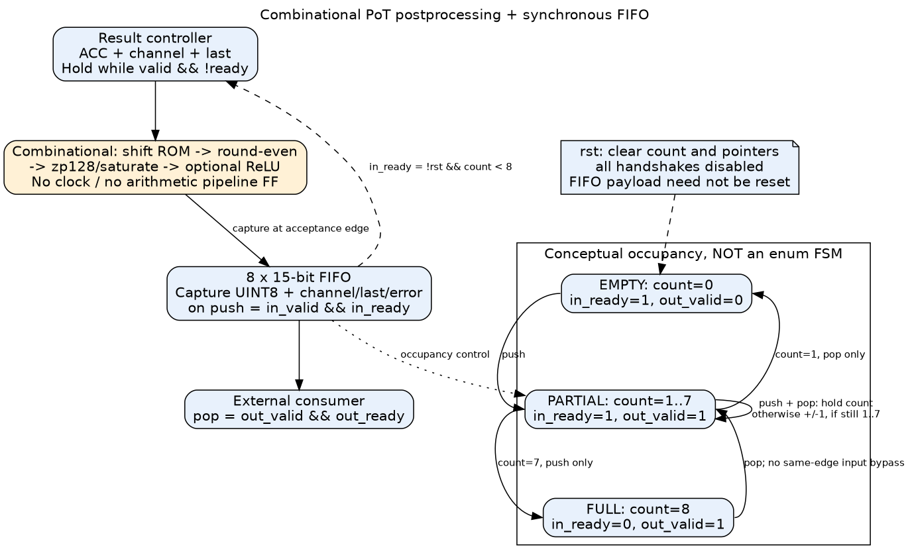

# 組合 PoT 後處理：架構、外部控制與驗證

## 1. 本次修改與適用範圍

新增「組合量化＋原本 8-entry FIFO」，保留原三級管線版。適用目前 UINT8 zp128、signed INT8 weight、無 bias、PoT 模型；沒有改 PE 乘法器、Operand FF、Product FF、分組 FSM 或模型常數。

新增固定參數 `POSTPROCESS_PIPELINED`，一路由 board top／self-test 傳至 `pe_pot_engine`／`pe_pot_result_stream`：

| 參數 | 選擇 |
|---|---|
| POSTPROCESS_PIPELINED=1（預設） | 原三級量化管線＋FIFO |
| POSTPROCESS_PIPELINED=0 | 組合量化＋FIFO |
| RESULT_PIPELINED=0/1 | 獨立選擇 raw ACC 輸出端是否有 Output FF |

兩個參數不可混淆。PE8 pipeline + 組合後處理仍保留 raw Output FF；PE8 精簡版也仍保留 Operand/Product 管線。參數是在 elaboration 時固定，不是新的 runtime 控制腳位。

## 2. 修改後的資料路徑



```text
精簡版：ACC FF → lane mux ──────────────────┐
                                          ├→ 組合 PoT/ReLU → FIFO FF → 外部
管線版：ACC FF → lane mux → raw Output FF ──┘

layer/channel → 組合 shift ROM → 組合量化的 shift_amount
```

這是兩種獨立配置的比較，不是同時實例化兩條 PE 路徑。

新增 [requantizer_int32_to_uint8_pot_comb.sv](../rtl/datapath/requantizer_int32_to_uint8_pot_comb.sv)，只有 ACC[31:0]、shift[4:0]、UINT8 三組資料介面，沒有 clk/reset/valid，也沒有 latch。數學保持：

`UINT8 = clip( round_to_nearest_even(ACC / 2^shift) + 128, 0, 255 )`

支援 shift=0..31。signed 算術右移取得 floor quotient，低位得到非負 remainder，依大於半值／等於半值且 quotient 為奇數決定 increment；負值同樣適用。超出 −128..127 的 rounded 值先飽和，範圍內以翻轉 sign bit 實現 +128。啟用 ReLU 時將 UINT8 下界提高為 128。

沒有把 rounding 改為 truncation，沒有只取低 8 bits。非法 ROM 位址仍使用預設 shift0，並將 error 跟該筆結果一起輸出。

## 3. pe_pot_result_stream 的修改

來源：[pe_pot_result_stream.sv](../rtl/datapath/pe_pot_result_stream.sv)。

FIFO、count、rd_ptr、wr_ptr 為兩個分支共用；generate 只保留其中一種量化與控制邏輯。

| 元件 | 原管線分支 g_pipeline | 新組合分支 g_comb |
|---|---|---|
| 算術暫存器 | 保留三級 | 無 |
| tag[0:2] | 延遲 metadata，對齊量化結果 | 無，直接同拍保存 |
| reserved | 計算管線＋FIFO 的所有在途結果 | 無 |
| 接受條件 | reserved<8 | count<8 |
| FIFO 寫入事件 | 量化輸出 q_valid | 輸入握手 accept |
| FIFO payload | 延遲後 tag＋UINT8 | 當前 error/last/channel＋UINT8 |

量化管線移入 `g_pipeline`，所以舊波形路徑的 quantizer/reserved/tag 需加上該 generate 層；count 與 FIFO 仍在 stream 模組層。組合版沒有對應的在途資料暫存器可觀察。

## 4. 外部控制如何改變

**介面腳位與握手定義不變，接收延遲改變。** 既有 group/result controller 不需要新增狀態或延遲計數器。

```text
in_ready  = !rst && count<8
push      = in_valid && in_ready
out_valid = !rst && count!=0
pop       = out_valid && out_ready
```

push 的同一個正緣將 `{error,last,channel,UINT8}` 寫入 FIFO。因此上游可以在握手後換資料；未握手時須保持 ACC、channel、last 等有效 payload。layer/relu 在 engine 接受 compute 命令時已鎖定，不能在工作途中換成下一筆命令的設定。

FIFO 滿且當拍 pop 時，仍不接受新 input；下一拍空出位置才恢復 ready。這刻意保留沒有 `out_ready → in_ready` 組合 bypass 的控制方式。

| push/pop | 上升緣動作 |
|---|---|
| 0/0 | 不移動指標與 count |
| 1/0 | 寫入、wr_ptr++、count++ |
| 0/1 | rd_ptr++、count-- |
| 1/1 | 讀寫指標各前進，count 不變 |

EMPTY／PARTIAL／FULL 是 count 的概念狀態，不是新 enum FSM。rst 有最高優先權，清除 count/指標並禁止握手；不必 reset 所有 FIFO payload，out_valid 決定資料有效性。

### 延遲範例

以 FIFO 原先為空、下游一直 ready、E0 接受 raw 結果為前提：

| 邊緣 | 原管線版 | 組合版 |
|---|---|---|
| E0 | 量化 stage1 擷取 | 量化結果寫入 FIFO，邊緣後 out_valid=1 |
| E1 | stage2 | 最早可完成外部握手 |
| E2 | stage3，量化結果有效 | 可繼續處理後續資料 |
| E3 | 寫入 FIFO | — |
| E4 | 最早外部握手 | — |

這是 raw stream 邊界的每筆延遲，不是完整 Conv/FC 加速比例。FIFO 已有資料、反壓、raw Output FF 與分組開銷都會影響整體 cycles。兩版在足夠容量且連續 ready 時都可每拍一筆。

### 完成訊號仍維持原契約

- `group_result_done`：最後 raw 結果被後處理接受。組合版在此時已將該 UINT8 保存進 FIFO；管線版則保留在途空間保證。
- `core_done`：所有分組 raw 結果完成提交。
- `compute_done`：核心完成且所有 UINT8 已被外部接收。

組合版不能因為計算很快，就將 compute_done 提前到最後 raw 握手；原 `active/core_finished/retired` 邏輯完全保留。

外部應依 valid/ready/done 控制，不應硬編碼「等四拍再讀」。若使用 ILA，改看 `postprocess/fifo_push`、`count`、`in_valid/in_ready`、`out_valid/out_ready`；組合值可在週期內變化，只在合法擷取邊緣有意義。

## 5. 修改檔案分類

| 分類 | 檔案 |
|---|---|
| 新組合運算 | `HYBRID_SYSTEM/rtl/datapath/requantizer_int32_to_uint8_pot_comb.sv` |
| stream 重構 | `HYBRID_SYSTEM/rtl/datapath/pe_pot_result_stream.sv` |
| 傳遞參數 | `pe_pot_engine.sv`、`pe_board_top.sv`、`pe_board_self_test.sv` |
| 新固定 top | `pe8_compact_pot_comb_board_top.sv`、`pe8_pipeline_pot_comb_board_top.sv` |
| 原測試擴充 | quantizer、stream、engine、board 四份 TB |
| 建置支援 | 兩份 Makefile、`create_pe_board_project.tcl`、`test_board_tcl.py` |

原三級 quantizer 的 RTL 本身沒有修改。既有 `_pot_board_top` 仍選原管線版，新 `_pot_comb_board_top` 才選組合版，避免既有專案不知不覺換成另一個架構。

## 6. 驗證方法與執行指令

從 repository 根目錄：

```bash
make -C HYBRID_SYSTEM lint-requantizer-pot test-requantizer-pot test-pot-stream test-pot-engine
make -C PE_COMPARISON test-board
python3 PE_COMPARISON/scripts/test_board_tcl.py --lint-snapshots
```

| 層級 | 檢查內容 |
|---|---|
| 數值單元 | 原管線版與新組合版都對獨立 sign/magnitude 除法模型比對；shift0..31、INT32 端點、正負半值、飽和邊界、20,000 組亂數／bubble 刺激 |
| Stream 兩版 | 各 768 筆，遍歷 256 組 layer/channel 位址，驗證 ReLU/error/tag、滿 FIFO、反壓保持、同拍 push/pop、滿且 pop 不 bypass、reset 丟棄舊資料、首筆延遲 |
| Engine 六組 | PE9／PE8 精簡／PE8 raw pipeline 各搭配兩種後處理，經真正 BRAM/loader/aligner/MAC/FIFO 公開介面測試；每組七個工作、109 個輸出；最後輸出刻意停 20 拍，檢查 done 不提早 |
| Board 八組 | 舊三組、原 PoT 三組、新組合 PoT 兩組；每組兩輪52筆，按鍵 reset、載入途中中斷、PASS保持與 timeout FAIL |
| Tcl mock＋快照 lint | 八種匯入配置、來源快照完整性、正常非 OOC 流程、XDC/hooks、禁止覆寫，對複製的 sources 執行 Verilator lint |

測試不是強迫讀取內部暫存器來繞過運算；quantizer 使用獨立數學模型，stream／engine 根據公開 handshake 建立 scoreboard。Board TB 額外觀察 self-test 的內部結果以核對，並使用模擬用 IBUF/BUFG 替身，不能取代實板時脈驗證。

本次實際執行結果：

| 測試 | 結果 |
|---|---|
| 兩種 quantizer | PASS，管線輸出檢查 37,627 筆；組合輸出於每次有效輸入核對同一個獨立 golden |
| 兩種 stream | 各 PASS 768 筆、720 次同拍輸入／輸出、41 次滿額度時 pop；首筆延遲與 reset 檢查通過 |
| 六種 engine | 各 PASS 7 工作／109 輸出，反壓保持檢查 155～157 次 |
| 八種 board 配置 | 各 PASS 104 輸出，另有 sticky timeout FAIL 檢查通過 |
| 快照 Tcl mock／lint | 八種匯入配置全通過；不是執行 Vivado |

## 7. Vivado：由 GUI 合成新的兩個版本

在 Windows Vivado Tcl Console，關閉當前專案後分別執行：

```tcl
set pe_variant pe8_compact_pot_comb
source {C:/Windows/System32/aoc-workspace/projects/KWS/KWS_DNN_Hybrid/PE_COMPARISON/vivado/create_pe_board_project.tcl}
```

另一個專案改為：

```tcl
set pe_variant pe8_pipeline_pot_comb
source {C:/Windows/System32/aoc-workspace/projects/KWS/KWS_DNN_Hybrid/PE_COMPARISON/vivado/create_pe_board_project.tcl}
```

預設建立於 `PE_COMPARISON/build/board/<variant>/`，只匯入，仍由 GUI 執行 Synthesis／Implementation／Bitstream。沿用同一份 PYNQ-Z2 板級 XDC 與 125 MHz 時脈，不使用 OOC，pin 與 LED 定義不變。

來源是快照，因此舊 build 專案不會自動更新。若新名稱資料夾也已存在，指定另一個 `pe_board_build_root`；腳本不覆寫已有成果。

## 8. 比較與限制

建議先比較兩個新 top；若要研究後處理本身，再以同一 RESULT_PIPELINED 比較 `_pot` 與 `_pot_comb`。同一模型、時脈、XDC、工具版本、策略與 workload 才能公平比較。

可能減少的 FF 包括算術管線、tag 延遲與 reserved；不能未實測就承諾 LUT 或功耗下降。純組合電路仍可能產生切換與 glitch，`push` 只是控制保存結果，不會自動 clock-gate 算術電路。

精簡版新關鍵路徑可能是 ACC/lane mux → shift/round/saturate → FIFO；raw pipeline 版則由 Output FF 出發。ROM 的 channel/layer 選擇路徑也須檢查。沒有加入 false-path 或 multicycle 掩蓋時序問題；控制器等待不會自動放寬單週期時序。

本次 Linux 環境沒有 Vivado：RTL 模擬、lint 與 Tcl mock 通過，不代表 125 MHz 已實際通過，也沒有新的 LUT/FF 實測結果；必須以 Windows routed timing/report 驗證。
