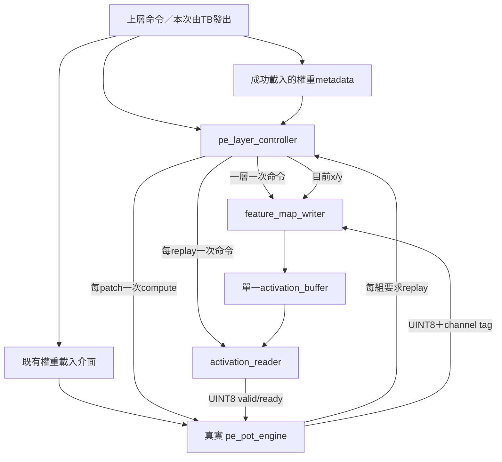
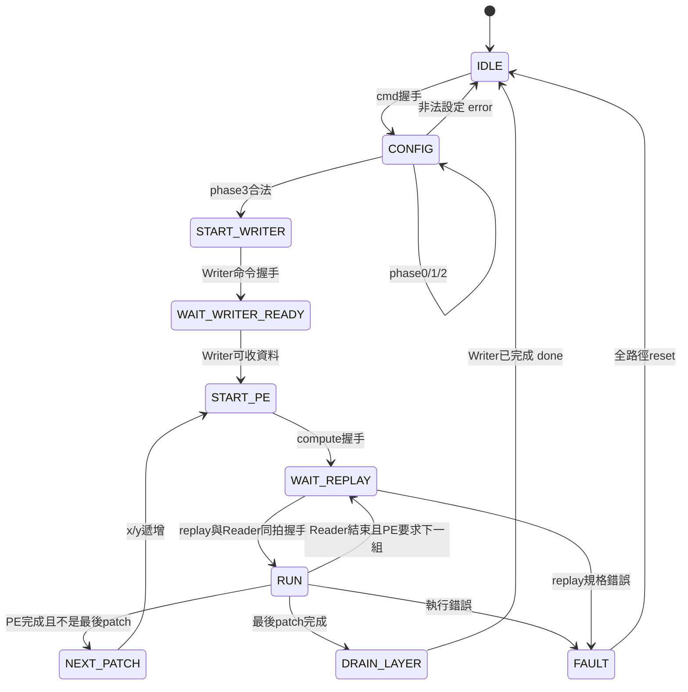

# S3 第一部分：pe_layer_controller 設計與驗證

本文件說明已實作的 `rtl/control/pe_layer_controller.sv` 與
`tb/control/tb_pe_layer_controller.sv`。控制器測試連接真正的 Reader、Writer、RAM、
weight loader、PE array、PoT/ReLU/FIFO；不是用假 PE 輸出 golden。

**完成此控制器不等於 S3 全部完成。** 正式共享 top 的 PE owner、Conv1→Pool 串接與
相同 checkpoint 的真實資料測試仍待下一步；不加入 Argmax、AXI、DDR、A/B buffer 或 DCIM。

## 1. 分工與元件關係



乘加、權重定址、分組、PoT量化、ReLU、FIFO保留在 `pe_pot_engine`。
新控制器只有設定暫存、座標/計數、握手控制與狀態機；8-bit activation/result資料直接連線，
不經過控制器、不新增feature-map RAM。Pool仍由 `pool_transfer_controller` 控制。

最重要的頻率關係是「命令次數」，不是固定clock延遲：

| 操作 | 次數 |
|---|---|
| 載入權重 | 上層每層一次，不由本控制器重新載入 |
| Writer命令 | 整層一次 |
| PE compute命令 | 每個patch/vector一次 |
| Reader命令 | 每次PE replay一次，包含第一組 |

## 2. 介面與整合契約

### Layer命令與權重身分

| 訊號 | 意義 |
|---|---|
| `clk/rst` | 同clock，同步active-high reset；須與Reader/Writer/PE/RAM共同reset |
| `cmd_valid/cmd_ready` | 僅IDLE接受；所有命令欄位於握手保存 |
| `cmd_is_fc` | 0：3×3 stride1無padding；1：LINEAR向量 |
| `cmd_layer_id[2:0]` | PoT ROM的0/1/2=Conv1/2/3、3/4=FC1/2 |
| `cmd_relu_enable` | 傳給PE，依layer決定，FC2通常0 |
| `cmd_src_base/dst_base[14:0]` | UINT8 byte位址，來源目的區不可重疊 |
| `cmd_width/height[7:0]` | Conv完整來源W/H；FC忽略 |
| `cmd_input_channels[5:0]` | Conv輸入channel數；FC忽略 |
| `cmd_vector_length[7:0]` | FC K；Conv以9×Cin推導、不用此欄位 |
| `cmd_output_channels[5:0]` | 輸出channel數，可表示32 |
| `resident_valid/layer_id/k/channels` | 最近成功載入權重的metadata，由上層保存，不是憑空指定 |
| `busy/done/error/fault` | 非IDLE即busy；done/error單拍；執行FAULT保持至reset |

`pe_pot_engine.layer_ready`只代表有合法resident weights，不能證明是目前要求的layer。
正式整合必須在權重load握手保存pending metadata，成功load_done才公開resident_valid；
新load/reset/失敗時失效。不得只用TB常數代替真正載入紀錄。本次TB在真實load成功後設定metadata。

整個busy期間上層必須禁止Host、Pool或其他工作使用共享Reader/Writer，禁止重新載入權重。
本控制器檢查resident metadata是否匹配，但不可能自行知道外部偷偷改寫而沒有更新metadata。
這項互斥是下一步正式top要實作的責任。

### 資料連接

```text
Reader.out_data        → PE.activation_u8
controller.pe_activation_valid → PE.activation_valid
PE.activation_ready    → controller.pe_activation_ready
controller.reader_out_ready    → Reader.out_ready

PE.out_data            → Writer.in_data
PE.out_channel_id      → controller → Writer.in_channel（補0成6bit）
controller.writer_x/y  → Writer.in_x/y
controller.writer_in_valid → Writer.in_valid
Writer.in_ready        → controller.writer_in_ready
controller.pe_out_ready → PE.out_ready
```

Reader的valid/last、PE結果的valid/channel/group_last/error回到控制器，用於握手與協定檢查。
資料bytes不進入控制器。所有valid/ready以posedge兩者同時為1視為一次交易。

Writer固定 `WRITE_CHW`；FC以C×1×1寫回，地址自然為dst+c。
`writer_count`提供總筆數以保持Writer介面連接完整，但CHW模式由W/H/C決定筆數。

## 3. 程式碼的四個區塊

### 區塊一：保存命令與分拍預計算

命令握手後保存在 `_q` 暫存器；改動外部cmd欄位不改變正在執行的工作。

CONFIG共四個phase：

| Phase | 工作 |
|---|---|
| 0 | source_plane=W×H；Conv輸出W/H減2，FC為1×1；K=9×Cin或vector_length |
| 1 | source_size=Cin×source_plane或K；output_plane=Hout×Wout |
| 2 | output_size=Cout×output_plane |
| 3 | 完整範圍、ROM類型、權重metadata、容量檢查；合法才縮位K並啟動Writer |

中間總量/端點保留32bit，K先用16bit；不是先截成8bit再檢查。
拒絕K=0、K>255、Cout=0/>32、越界、來源目的重疊、不匹配的resident weights。
依目前ROM，Conv ID必須0..2且Cout<=12，FC ID必須3/4且FC2 Cout<=8。
Conv要求W/H>=3且Cin>0。這些是本階段模型/引擎限制，不是通用CNN IP。

權重深度條件：`K × ceil(Cout/12) <= 512`。例如FC1：144×3=432合法；255×24channels使用510合法；255×32使用765拒絕。
Conv2/3的ID存在僅供既有PE能力一致性；最終混合模型分工仍由上層選DCIM，沒有改變基準。

### 區塊二：進度記錄

- `patch_x/y`：目前輸出座標，直到此patch全部結果被Writer接受才可更新。
- `next_group_base`：預期的replay group base，0→12→24；不是另一份PE分組計算器。
- `activation_count`：本次replay已接受的activation數，核對last與K。
- `result_count`：本patch已接受結果數，必須按channel0..Cout−1。
- `reader_active`：已啟動Reader且尚未收到reader_done。
- `pe_done_seen/writer_done_seen`：保存單拍完成事件，避免事件不同時到達造成死結。

### 區塊三：命令與資料握手控制

`WAIT_REPLAY`將Reader命令與PE replay做原子握手：只在Reader可接受命令時接受PE要求。
先確認K與group base正確，再發命令。沒有先ack再等待Reader的遺失窗口。

RUN中Reader資料受PE.activation_ready反壓，既有Reader兩筆FIFO負責同步RAM回應。
結果通道在WAIT_REPLAY/RUN均可使用，不能等待所有replay結束才讀結果，否則可能堵住PE。

結果tag/error異常在Writer之前擋住；writer接受與PE輸出握手相同。最後結果接受不等於RAM commit。

### 區塊四：FSM與完成條件



共10個具名狀態，START/WAIT區分命令被接受與資料端就緒。
其他執行狀態遇到Reader/Writer error或resident metadata失效也會FAULT。
沒有多餘DONE狀態，成功返回IDLE同時done脈波。

PE.compute_done的既有契約是**所有量化結果已被下游接受之後**，不是同拍接受最後一筆。
Reader.done也在最後activation握手後出現。本控制器依照這些實際介面契約追蹤計數。
Writer.done可能早於進入DRAIN_LAYER，所以必須從START_WRITER後持續保存事件。
非最後patch只等PE/Reader與結果契約，不等整層Writer.done。

## 4. Conv1例子

輸入1×32×63，src=8064；輸出12×30×61，dst=10080，K=9。
先載入108筆INT8權重，Writer整層命令一次；掃描1830個patch，每patch一次compute與一次replay。
因此Reader共取得16470筆（相鄰窗口資料重讀），Writer共提交21960筆。

第一個patch地址：8064,8065,8066,8127,8128,8129,8190,8191,8192。
結果地址為`10080+c×1830+y×61+x`，不是依PE產生順序直接線性存入。

FC1則是一個compute、三個LINEAR Reader命令，每次讀同一份144筆，共432筆輸入交易、32筆輸出。
新控制器不負責PE有效lane mask，既有group controller處理12+12+8。

## 5. Reset、錯誤與時序限制

- CONFIG拒絕：error單拍，返回IDLE；沒有啟動Reader/Writer/PE。
- 執行FAULT：error單拍、busy/fault保持、不接受新命令；須一起reset控制器/Reader/Writer/PE/RAM控制狀態。
- RAM內容不清除、沒有rollback。先前接受的Writer pending仍可能完成提交，部分目的區不能當作有效整層結果。
- Reader/PE故障或下游永遠不ready可能永久等待；不加入硬體timeout，TB另有watchdog。
- 沒有任意延遲DDR或CDC支援；沿用同clock本地RAM契約。
- CONFIG分拍不等於所有乘法都不用硬體；Writer的CHW地址計算仍是原設計。本次沒有面積或時序最佳化的宣稱。
- RTL使用可合成的enum、always_ff、always_comb和定寬運算，lint通過不等於Vivado資源/時序通過。

## 6. 驗證方法

```bash
cd /home/LAB505/projects/KWS/KWS_DNN_Hybrid/HYBRID_SYSTEM
make lint-pe-layer-controller test-pe-layer-controller
```

Makefile分別編譯PE8 `RESULT_PIPELINED=0/1`；PoT後處理使用既有pipeline=1，控制器RTL完全相同。
整合編譯僅對既有zp128下未使用的sum-W訊號等關閉UNUSEDSIGNAL警告；新控制器單獨lint沒有關閉此警告。

### 真實元件與獨立scoreboard

TB透過實際weight_valid/ready載入權重；透過activation_buffer的公開同步埠初始化/讀回，不讀DUT內部mem當golden。
golden用完整索引公式、signed乘加、絕對值除法/餘數實作round-to-nearest-even、飽和與ReLU，不複製RTL的位移演算法。
PoT shift常數獨立列於TB，不讀DUT ROM取得預期值。

每拍檢查：

- Writer命令整層恰好一次；patch數、replay group base、原子握手。
- 真實RAM讀取地址與每replay K筆數。
- PE每筆結果的channel、x/y、數值與停頓時payload保持。
- 每個RAM commit的地址和數值；層完成不得早於全部寫入。
- 每組最後一筆結果刻意停13次取樣，其他結果週期性停頓。
- 全32768位址讀回，包含來源與目的區外A5 sentinel，防止不正確覆寫。

測試使用test-only互連pause同時控制Writer可見valid與PE可見ready，兩端接受交易一致；不是替換Writer或PE。
錯誤測試另外在公開replay K/out_error邊界注入錯誤，與正常數值測試分開。

| 正常案例 | 目的 |
|---|---|
| Conv 2×4×5 → 12×2×3，K18 | 多輸入channel、跨patch/跨列、非零base |
| Conv 1×3×3 → 1×1×1，src32759 | 最小patch、讀到地址32767、ReLU關閉 |
| 完整Conv1尺寸，K9/Cout12 | 1830 patches、21960筆結果、固定記憶體規劃 |
| FC1 K144/Cout32 | 三組replay、末組8 lanes、432筆activation |
| FC K255/Cout24 | 最大8-bit K、weight深度510邊界、ReLU關閉 |
| FC2 K32/Cout8 | 小於12 channels、ReLU關閉 |
| reset後重做FC2 | 中途取消後恢復 |

12個拒絕測試涵蓋零K、零/過大Cout、重疊、來源/目的越界、不支援ID、resident無效/K/ID不匹配、非法Conv設定、weight深度765。
兩個FAULT案例為replay K錯誤、PE result error；檢查鎖定/單拍error/reset恢復。
另在Reader已有有效資料時中止整條路徑並重新載入後重跑。

本次使用確定性測試權重/activation，不是checkpoint真實Conv1準確率驗證；之前四組軟體Pool golden仍保留在S2測試。

### 實際執行結果（Verilator 5.030）

| 配置 | 正常案例 | 非法命令 | FAULT案例 | RAM讀回檢查 | 結果停頓取樣 |
|---|---:|---:|---:|---:|---:|
| PE8 RESULT_PIPELINED=0 | 7 | 12 | 2 | 229376 | 3768 |
| PE8 RESULT_PIPELINED=1 | 7 | 12 | 2 | 229376 | 1948 |

兩配置均PASS。停頓取樣數受管線相位與TB週期性反壓影響，不能用此欄單獨宣稱效能優劣。
S1 Reader/Writer/RAM原測試與lint、S2池化整合與四組軟體Pool golden全部回歸通過。
本次環境沒有Vivado，未執行合成/implementation/上板，也未重跑全部歷史PE/CIM回歸。

## 7. 下一步

1. 擴充 `kws_activation_path` 的PE操作所有權、Reader PATCH設定、PE/Pool資料選擇及resident metadata管理；不複製activation RAM。
2. 建立原規劃的 `tb/integration/tb_pe_conv1_pool_memory.sv`，先比對Conv1(ReLU後)記憶體，再直接用硬體結果做Pool。
3. 核對真實checkpoint權重/activation的展開順序與量化；軟體pool1→硬體Conv1/ReLU→比對relu1→硬體Pool→比對pool2。
4. 回歸S1/S2及本控制器測試後，才將S3端到端標為完成；再進行板級top與Vivado實際資源/時序驗證。
