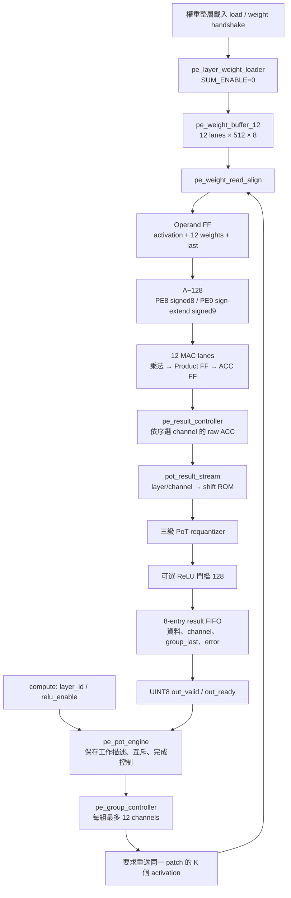
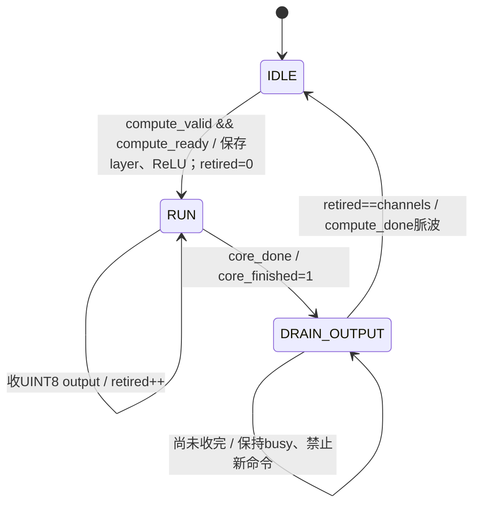
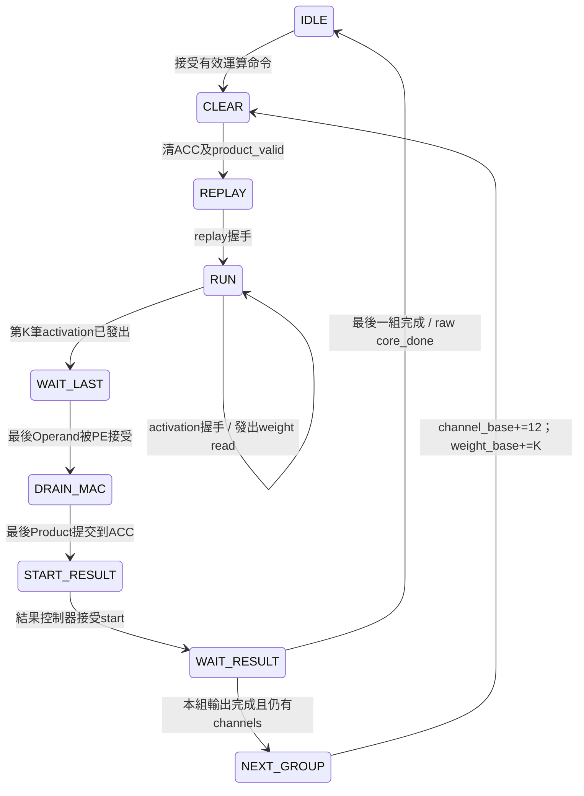
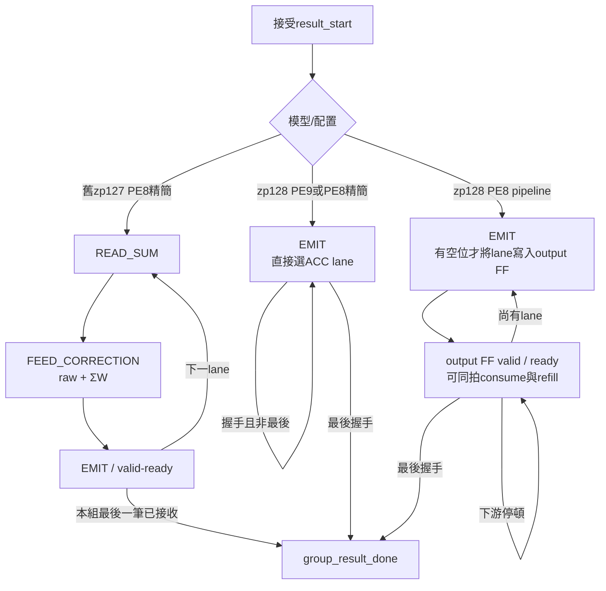

# PE9／PE8／PE8 pipeline：zp128 與 PoT 整合

更新：2026-09-21。這是已實作的 RTL／模擬規格，不是 Vivado 時序或板上測量結果。
保留原有 zp127／Q31 路徑，不覆寫舊專案與合成報告；乘法器及 Operand Pipeline 不變。

## 1. 先確定比較的是同一個模型

本版本輸入是 UINT8，zero-point=128；權重是 signed INT8，zero-point=0，沒有 bias。

```text
ACC[c] = Σk (A[k] − 128) × W[c,k]
k_c = −log2(s_input × s_weight[c] / s_output)
Q[c] = clip[0,255](round_nearest_even(ACC[c] / 2^k_c) + 128)
ReLU(Q) = max(Q,128)                 # FC2 不啟用
```

`k_c` 是量化右移量，不是內積長度 `K`。右移量 0..31 可以逐筆變化；本 checkpoint 的 k_c 為 6..10。
RTL 使用算術右移、餘數／half 比較、nearest-even、飽和，不是直接截取低 8 bits。
可變位移會推導選擇邏輯，仍需檢查 post-route timing；三段 requantization 不保證 125 MHz。

### 為何這次 PE8 能刪掉 ΣW？

舊模型 zp127：`Σ(A−127)W = Σ(A−128)W + ΣW`。
新模型 zp128：`Σ(A−128)W` 本身就是目標，因此不用補償。
這是模型數值契約改變，不是把同一個舊模型的必要加法省略。
不能以 zp127 的 PE9 結果與 zp128 的 PE8 結果做「同一算法」比較。

## 2. 分層架構與資料流



權重依 channel-major 傳入：channel0 的 K 筆，再 channel1 的 K 筆，依序到最後。
每組 12 channels 同時計算，超過 12 時必須依 replay descriptor 重送 activation。
FC1 的 32 channels 仍分 12+12+8；Conv1 是一個 patch 對 12 channels；FC2 是一組 8 channels。
一個 compute 命令不是整張 Conv feature map，而是一個 patch 或 FC vector 的所有 output channels。

### 檔案變動

| 檔案 | 本次設計 |
|---|---|
| `rtl/integration/pe_memory_engine.sv` | 新增固定參數 INPUT_ZERO_POINT，預設 127 保留舊版；128 時兩類 PE 都計算 A−128，移除 ΣW 生成／記憶體／修正路徑 |
| `rtl/control/pe_result_controller.sv` | 將 APPLY_SUM_CORRECTION 與 PE8 位寬分開；新增 RAW_PIPELINED 彈性輸出 FF |
| `rtl/integration/pe_pot_engine.sv` | 新增完整 PE→PoT→UINT8 工作封裝；等待下游收完結果才 done |
| `rtl/datapath/pot_result_stream.sv` | shift lookup、量化、ReLU、tag 延遲、FIFO／backpressure |
| `rtl/datapath/kws_pot_shift_rom.sv` | 76 個 layer/channel 的固定 shift；不合法位址有 valid=0 |
| `rtl/datapath/relu_uint8_zp127.sv` | 名稱維持相容，新增 ZERO_POINT 參數，預設 127；新路徑用 128 |
| `rtl/datapath/kws_postprocess_pot.sv` | 獨立 frame 版本：PoT→ReLU→可選 2×2 pool；舊 Q31 檔不動 |
| `rtl/dcim_adapter/dcim_u8_offset_correction.sv` | DCIM unsigned offset 編碼的獨立 INT32 修正器，尚未接 master |
| `PE_COMPARISON/rtl/board/*_pot_board_top.sv` | 三個固定參數板級 top；125 MHz IBUF/BUFG、按鍵同步、LED、自我測試 |
| `PE_COMPARISON/rtl/board/pe_board_golden_pot.sv` | 獨立預算的 zp128／PoT／ReLU 結果，不使用 DUT 輸出作 golden |

`pe8_result_controller_pipeline.sv` 的舊 ΣW 修正管線保留給 zp127；zp128 不會實例化它。
XML elaboration 已確認每組只有一個 PE array，且三種 zp128 組態均沒有 sum builder、sum memory 或 correction instance。
這證明組態選擇，不代表 Vivado LUT/FF 數量已量測。

## 3. 外部介面與工作完成規則

`pe_pot_engine` 沿用原本 load／weight／compute／replay／activation 的 valid-ready 協定：

- 新增 `compute_layer_id[2:0]`：0/1/2/3/4 = Conv1/Conv2/Conv3/FC1/FC2。
- `relu_enable` 與 layer_id 在 compute handshake 保存，不須整個工作期間維持在輸入。
- `out_data[7:0]` 是 UINT8，不是舊 raw engine 的 signed INT32。
- `out_channel_id[4:0]` 是整層 channel 編號；`out_group_last` 是每個 12-lane group 的最後一筆，不一定是整個工作最後一筆。
- 最後 channel 編號應為 `load_channels−1`。只有全部 UINT8 output 握手完成且內部 raw engine 完成，才回報 `compute_done`。
- 在等待輸出期間仍保持 `compute_busy`；新的 load／compute 不會被接受。
- layer/channel 超出 shift ROM：該筆帶 `out_error`，工作帶 sticky `compute_error`；錯誤資料不可作正常推論使用。
- 舊 loader 的 K／channels／容量檢查保留。新封裝不驗證你載入的權重真的來自指定 layer；上游仍須確保 checkpoint、shape、scales 一致。

### 工作級狀態圖

以下三態是由 `active` 與 `core_finished` 表示的概念狀態，沒有重複新增一份大型 enum FSM。



輸出可在 RUN 就開始被接收，並不是一定要等 DRAIN_OUTPUT 才輸出。
若下游永久不 ready，工作就保持 busy；這是正常 backpressure，不會偷偷丟掉結果。
reset 為同步 active-high，取消當前工作、FIFO 和 in-flight valid；BRAM 權重內容不保證清零，須重新載入有效 layer。

### 每組 MAC 的共用 FSM（沒有改動原本控制器）



注意：接上新封裝後，上圖的「本組輸出完成」是 raw 結果送入後處理成功；外部工作完成還須等量化 FIFO 清空。

## 4. PE9 與 PE8 到底差在哪？

| 項目 | PE9，zp128 | PE8 精簡，zp128 | PE8 pipeline，zp128 |
|---|---|---|---|
| activation 數值 | A−128，9-bit sign-extension | A−128，8-bit | 同 PE8 |
| 名義乘法 | signed9 × signed8 | signed8 × signed8 | 同 PE8 |
| Product FF | 17-bit | 16-bit | 16-bit |
| ACC FF | signed32 | signed32 | signed32 |
| ΣW 路徑 | 無 | 無 | 無 |
| raw結果控制 | 直接選 lane | 同 PE9 | lane選擇後增加1個彈性FF |
| PoT/ReLU/FIFO | 共用 | 共用 | 共用 |
| RAW輸出II，无停頓 | 1 | 1 | 1 |
| RAW首筆延遲 | 基準 | 相同 | 每group多1拍 |

**算法相同，結果相同；不同的是表達位寬與 pipeline 邊界。**
新模型 A−128 的範圍只有 −128..127，PE9 最高 sign bit 是冗餘的。
Vivado 可能將 PE9 的乘法有效位寬裁成 8-bit，因此新模型下 PE9/PE8 的面積可能非常接近，不能預先保證 PE8 有明顯節省。
需要研究「zp127 下用 ΣW 換窄乘法器」時，請用舊版組態另做一組實驗，不能與新模型混表。

### raw結果 FSM 比較



PIPE/HOLD 是同一 EMIT 狀態的 valid-ready 行為，不是交替兩拍才能輸出；因此 II 仍為 1。
`issued_all` 阻止最後一筆已寫入 FF 後再次發出，`group_result_done` 等最後一筆真正被接受。

### 模擬 cycle 觀察值（raw engine，不含 PoT 與外部停頓）

由既有 `tb_pe_memory_engine` performance 區段記錄 command handshake 到 done 邊緣。
這是該 TB 的 source/replay 時序下的結果，不是任何上游配置都固定的總 latency。

| 一筆工作 | PE9 zp128 | PE8 zp128 | PE8 pipeline zp128 |
|---|---:|---:|---:|
| Conv1 patch，K=9 C=12 | 30 | 30 | 31 |
| FC1 vector，K=144 C=32 | 489 | 489 | 492 |
| FC2 vector，K=32 C=8 | 49 | 49 | 50 |

FC1 有三組，所以 raw output FF 總共增加 3 拍。新封裝還有 requantizer／FIFO／完成確認延遲，不能直接把此表當成 UINT8 端點 latency。

## 5. PoT 與 pooling 的連接注意事項

`pot_result_stream` 在接受 raw result 時就保留 FIFO 空位，reserved 包含尚在三級 quantizer 中的資料。
容量 8，reserved==8 即停止接受。不能只看 FIFO 的已寫入 count，否則 downstream stall 時管線中的資料會溢出。
無停頓時 raw 在 E0 接受，quantizer 在 E2 後產生 Q，FIFO 在 E3 後產生 out_valid，最早 E4 被外部握手接收。
layer/channel/error/ReLU/last 一起延遲，不能用當前輸入的 channel 來解讀三拍前的結果。

獨立的 `kws_postprocess_pot` 是沒有 ready 的 frame-stream 版本，已有 PoT→ReLU→pool；
**不要將 pe_pot_engine 的 UINT8 再接入這個 INT32 輸入，以免量化兩次。**
PE 輸出通常是每個 patch 的所有 channels；現有 maxpool 接受 channel-major 的完整平面順序。
完整 CNN 還需要 feature-map RAM／重排與 layer controller，再把已量化 UINT8 送既有 maxpool。
或者將 raw 結果重排後送 frame 版 postprocess。兩種路徑擇一，不是直接串接兩次後處理。

## 6. DCIM 已做與未做的部分

獨立新增一拍、II=1 的 `dcim_u8_offset_correction`，前提是權重使用 `Wu=Ws+128` 的 offset 編碼：

```text
ACC = ΣAuWu − 128ΣAu − 128ΣWu + 16384K
    = Σ(Au−128)Ws
```

使用 48-bit signed 中間結果，溢出 INT32 時飽和並回報 overflow。
四項輸入必須對應相同 output、相同 K；跨 tile 的 partial sums 和兩個 sum 也必須一致累積。
不適用於將 signed W 的原始 two's-complement byte 直接視為 UINT8 的情況。
本次未改 CIM_CHIP 腳位、controller 或權重編碼，也未供應 ΣAu／ΣWu 的儲存與累加控制。
這是已驗證的算術元件，不是宣稱 DCIM 全段推論已完成。

## 7. 驗證方式與涵蓋範圍

於 `HYBRID_SYSTEM`：

```sh
make test-memory-engine-zp128 test-pot-engine
make test-pot-stream test-postprocess-pot test-dcim-offset
make check-engine-elaboration-zp128 check-engine-elaboration
make test-memory-engine test-postprocess test-requantizer-pot-exports
```

於 `PE_COMPARISON`：

```sh
make test-board lint-board test-memory-comparison
python3 scripts/test_board_tcl.py --lint-snapshots
```

| 測試 | 核對內容 |
|---|---|
| raw engine，3種zp128 | 每種44 loads、50 jobs、863 outputs；reset/invalid/backpressure、Operand payload/last |
| pe_pot_engine，3種 | 每種7 jobs、109 outputs；五層shape的合成資料、FC1三組、ReLU on/off、descriptor凍結、final stall至少20拍、done不早發、不合法layer的錯誤傳遞 |
| PoT stream | 768 outputs；全部256 ROM位址、錯誤flag、tag對齊、FIFO滿、長停頓、in-flight reset |
| frame postprocess | 80 outputs；ReLU/bypass、兩channel 4×4→2×2 maxpool、座標、frame_done、input bubbles |
| DCIM修正 | 300組一致統計＋2個overflow案例，另驗bubble/reset |
| 板級TB | 舊3種＋新3種，各兩輪104 outputs；按鍵中止/restart/bounce、sticky PASS、timeout FAIL |
| model資料 | 26,944筆逐層軟體輸出＋RTL unit向量；ROM的76項與匯出scale完全一致 |
| Tcl | 六種建立專案、來源快照、hook/XDC、禁止覆寫，快照另經Verilator lint；mock不是Vivado |

測試不 force DUT、不繞過 SRAM／控制器。整合 golden 用 INT64 MAC 與 sign/magnitude 除法 nearest-even，獨立於 RTL floor-shift 實作。
軟體資料驗證採每層匯出的輸入，不代表整張語音模型從第一層一路 RTL 串接至 FC2 的端到端驗證。

## 8. Windows Vivado 正常板級匯入

關閉既有專案，再選一個新的組態：

```tcl
set pe_variant pe8_compact_pot
source {C:/Windows/System32/aoc-workspace/projects/KWS/KWS_DNN_Hybrid/PE_COMPARISON/vivado/create_pe_board_project.tcl}
```

其餘為 `pe9_pot`、`pe8_pipeline_pot`；舊 `pe9`／`pe8_compact`／`pe8_pipeline` 仍是 zp127 raw 版本。
建立於 `PE_COMPARISON/build/board/<variant>`，只匯入，由 GUI Run Synthesis／Implementation。
沒有 OOC；125 MHz、同一 XDC、MAX_DSP=0、IBUF/BUFG／reset 處理延用既有版本。
同名目錄已存在時拒絕覆寫，可設定新 `pe_board_build_root`。舊 snapshot 不會自動取得新版來源。

LED[0] heartbeat、LED[1] busy、LED[2] PASS、LED[3] FAIL。板級正常結束應 PASS 持續亮、busy/FAIL 滅，heartbeat 繼續閃爍。
這三個新 top 均包含真實 PE、記憶體、PoT 和 self-test；面積報告請分離 engine 與測試／clock/reset／golden 的階層成本。
比較頻率相同且 timing 通過的 routed 結果，記錄 LUT、FF、BRAM、DSP、WNS/WHS、cycles；不要用整個測試 top 的總 LUT 直接稱為 PE core 面積。

## 9. 尚需完成

1. Windows Vivado 新專案 synthesis/implementation、125 MHz setup/hold 與板上實測。
2. 完整 KWS 的 feature-map 記憶體／layout、window generator、layer controller、pool 與 argmax 串接。
3. DCIM 權重 offset 載入、ΣAu／ΣWu 統計與分塊控制，再串接本次的修正器。
4. 更換模型時重新匯出／核對 shift ROM 和資料；不得只換 weights 不換 scales。
