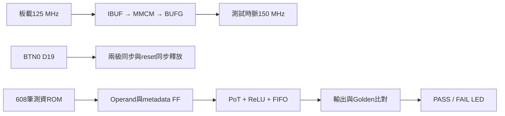
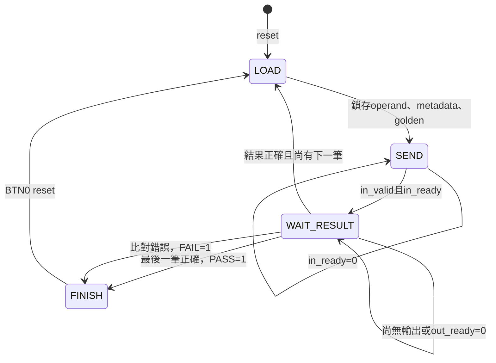

# 後處理獨立 PYNQ-Z2 板級驗證

## 目的與範圍

使用正常板級 top，不使用 OOC。預設測試 150 MHz，可獨立選擇組合後處理或管線後處理。
原有 PE／CIM／後處理 RTL 不修改。測試範圍是 `pe_pot_result_stream`：模型 shift ROM、PoT 重新量化、可選 ReLU、metadata 與 8-entry FIFO；不包含 PE、MaxPool、Argmax 或完整 CNN。

公式：`clip_UINT8(RNE(acc / 2^k) + 128)`，ReLU 開啟時下限為 128。



`POSTPROCESS_PIPELINED=0`：Operand FF → 模型ROM／PoT／ReLU → FIFO暫存。

`POSTPROCESS_PIPELINED=1`：Operand FF → 模型ROM／三階段PoT／ReLU → FIFO暫存。

兩種模式獨立合成。時序分析要同時看 top 最差路徑與 `test/dut` 路徑；最差路徑也可能落在測資ROM或自我測試比較器，不可直接視為後處理本身的瓶頸。

## 控制狀態



任何未完成狀態等待超過65535個clock會鎖存FAIL，避免失去回應但沒有錯誤指示。
板級測試一次只保留一筆未完成交易，輸出ready每16個clock有8個clock關閉。
它驗證結果保持及握手，不代表一筆／clock的滿載吞吐測試；FIFO滿載交互驗證另由既有 `tb_pe_pot_result_stream` 完成。

## Windows Vivado 2023.2 操作

先關閉目前專案，Tcl Console：

```tcl
set pp_pipeline 0
set pp_frequency 150
source {C:/Windows/System32/aoc-workspace/projects/KWS/KWS_DNN_Hybrid/HYBRID_SYSTEM/board/postprocess/create_project.tcl}
```

只建立／匯入專案，不自動啟動合成。GUI依序 Run Synthesis → Run Implementation → Open Implemented Design。
報告指令：

```tcl
source {C:/Windows/System32/aoc-workspace/projects/KWS/KWS_DNN_Hybrid/HYBRID_SYSTEM/board/postprocess/report.tcl}
```

預設輸出在 `HYBRID_SYSTEM/build/postprocess/pp0_f150/`，reports亦在此專案底下。
管線版請先關閉專案，改 `set pp_pipeline 1` 再source，產生 `pp1_f150`。
若已存在，腳本拒絕覆寫；開啟既有XPR，或事先設定新路徑：

```tcl
set pp_destination {C:/fpga/pp0_f150_run02}
```

改頻率後必須重新產生／合成對應設定的專案，不能只更改XDC的板載時脈。
支援50/75/100/125/150/200/250 MHz，固定VCO 750 MHz，輸出除數=750/目標MHz。
這只是可選目標，不保證能滿足所有頻率。MMCM真實primitive由Vivado合成，Verilator則旁路，不能以RTL模擬證明MMCM鎖定或實體頻率。

## 時序通過條件與報告

- input clock固定125 MHz／8 ns；150 MHz由MMCM產生，檢查 `clocks.rpt` 的generated clock應約6.667 ns。
- routed WNS、WHS均須非負，TNS、THS須為0，並檢查pulse width及未限制的內部路徑。
- `utilization_hierarchical.rpt` 分開觀察 `test/dut` 與整個top；ROM、控制器、比較器、時脈元件均有驗證額外成本。
- XDC僅排除非同步按鍵到第一級同步FF、LED輸出；沒有排除後處理資料路徑。
- 通過Implementation後才 Generate Bitstream、Hardware Manager燒錄。需要保留methodology／DRC報告，不忽略critical warning。
- 獨立板級通過不代表與PE整合後一定通過，布局、繞線與介面路徑會改變。
- 固定測資驅動的top可能被Vivado做常數／可達資料最佳化；這是此板級測試實例的結果，不是未受限制後處理IP的絕對Fmax或面積。

## LED與按鍵

| LED | 意義 |
|---|---|
| LED0 | MMCM locked |
| LED1 | 自我測試busy，執行很快可能肉眼看不到 |
| LED2 | 608筆全部正確後保持PASS |
| LED3 | 數值、metadata不符或逾時後保持FAIL |

正常完成為LED0、LED2亮，LED1、LED3滅。BTN0（D19，不是SRST）清除狀態並重測。按鍵先同步，釋放reset亦同步；接點彈跳可能導致多次重測，但不會非同步解除運算暫存器reset。

## 測試方法與限制

`generate_vectors.py` 根據目前76個有效layer/channel的k產生8種輸入，共608筆。Golden採Python整數絕對值除法／餘數的ties-to-even演算法，不呼叫待測RTL。
涵蓋零、正半值tie-even、正／負1.5 tie、INT32最大／最小飽和、負值ReLU、一般非tie、channel/last/error傳遞。
模型ROM的k值改變時必須重新生成測資；此測試驗證依照該ROM的運算，不獨立證明模型k值正確。

```bash
cd HYBRID_SYSTEM/board/postprocess
make test
python3 test_project_tcl.py
# 模型ROM修改後：make vectors
```

`tb_postprocess_board` 同時實例化comb及pipeline，完整608筆後以按鍵reset再次測試，最後注入錯誤Golden確認FAIL可被偵測。
Tcl mock僅驗證匯入腳本語法／參數與普通top流程，不等同Windows Vivado成功合成。
目前未在此Linux環境執行Vivado、post-route模擬或實體板測，不能宣稱已通過150 MHz。

### 2026-10-01 本次驗證結果

| 驗證 | 結果 |
|---|---|
| `make test`（此board資料夾） | PASS，comb與pipeline各608筆，reset後各再608筆；每輪4868 clocks |
| 錯誤注入 | PASS，故意修改Golden後FAIL保持、PASS不亮 |
| `python3 test_project_tcl.py` | PASS，兩個mode、150 MHz參數、目標part、非OOC |
| HYBRID_SYSTEM `make test-pot-stream BUILD_DIR=/tmp/pp_stream_regression` | PASS，兩個mode各768筆，含全部256個ROM位址、非法位址、滿載、同時push/pop、reset及latency |
| Windows Vivado實作與板測 | 尚未執行 |
