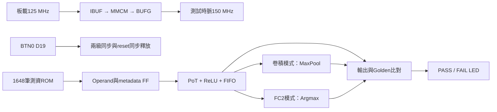
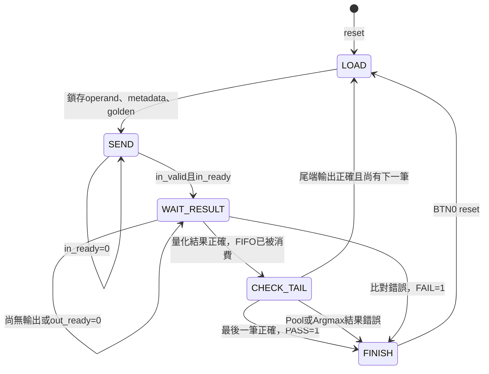

# 後處理獨立 PYNQ-Z2 板級驗證

## 目的與範圍

使用正常板級 top，不使用 OOC。預設測試 150 MHz，可獨立選擇組合後處理或管線後處理。
原有 PE／CIM／後處理底層 RTL 不修改。現在測試範圍包含 `pot_result_stream` 的模型 shift ROM、PoT 重新量化、可選 ReLU、metadata、8-entry FIFO，以及新整合的 `postprocess_tail`：MaxPool及Argmax。不包含 PE、全模型排程、feature-map記憶體或完整 CNN。

公式：`clip_UINT8(RNE(acc / 2^k) + 128)`，ReLU 開啟時下限為 128。



`POSTPROCESS_PIPELINED=0`：Operand FF → 模型ROM／PoT／ReLU → FIFO暫存。

`POSTPROCESS_PIPELINED=1`：Operand FF → 模型ROM／三階段PoT／ReLU → FIFO暫存。

兩種模式獨立合成，兩者均包含MaxPool及Argmax。pipeline參數僅改變PoT路徑，不移除MaxPool內部line buffer／輸出FF或Argmax狀態FF。
時序分析要同時看 top 最差路徑與 `test/dut`、`test/tail` 路徑；最差路徑也可能落在測資ROM或自我測試比較器，不可直接視為後處理本身的瓶頸。
這兩個階層使用KEEP_HIERARCHY方便報告篩選（不是DONT_TOUCH），內部仍可最佳化。新舊報告同時有測試範圍／階層設定變更，不應把所有面積差都歸因於pool/argmax本身。

## 控制狀態



任何未完成狀態等待超過65535個clock會鎖存FAIL，避免失去回應但沒有錯誤指示。
板級測試一次只保留一筆未完成交易，輸出ready每16個clock有8個clock關閉。
它驗證結果保持及握手，不代表一筆／clock的滿載吞吐測試；FIFO滿載交互驗證另由既有 `tb_pot_result_stream` 完成。

`postprocess_tail`只在`out_valid && out_ready`時消費FIFO資料，避免停頓時重複計算。
mode=0量化驗證／旁路，mode=1卷積池化（CHW，x最快），mode=2 FC2（class 0到7）。mode、尺寸與frame_start由測試控制器保持至本筆尾端驗證完成。
Argmax在第一筆的SEND階段預先clear，不能把clear與第一筆有效輸入同時送入，否則底層clear優先會丟掉該筆。
MaxPool第一筆frame_start與有效資料同緣輸入。奇數尾列／尾行丟棄，pool_done可能早於最後一筆原始pixel；控制器仍消費完整frame後才切換模式。
Pool／Argmax輸出是不可反壓的valid pulse，本測試比較器永遠接收；未來接入可停頓記憶體時需新增輸出FIFO或完整流控，不能直接當成已完成的CNN串流控制器。

## Windows Vivado 2023.2 操作

先關閉目前專案，Tcl Console：

```tcl
set pp_pipeline 0
set pp_frequency 150
source {C:/Windows/System32/aoc-workspace/projects/KWS/KWS_DNN_Hybrid/HYBRID_SYSTEM/board/postprocess/create_project.tcl}
```

只建立／匯入專案，不自動啟動合成。GUI依序 Run Synthesis → Run Implementation → Open Implemented Design。
報告指令：

```tcl
source {C:/Windows/System32/aoc-workspace/projects/KWS/KWS_DNN_Hybrid/HYBRID_SYSTEM/board/postprocess/report.tcl}
```

預設輸出在 `HYBRID_SYSTEM/build/postprocess/pp0_f150/`，reports亦在此專案底下。
管線版請先關閉專案，改 `set pp_pipeline 1` 再source，產生 `pp1_f150`。
若已存在，腳本拒絕覆寫；開啟既有XPR，或事先設定新路徑：

```tcl
set pp_destination {C:/fpga/pp0_f150_run02}
```

改頻率後必須重新產生／合成對應設定的專案，不能只更改XDC的板載時脈。
支援50/75/100/125/150/200/250 MHz，固定VCO 750 MHz，輸出除數=750/目標MHz。
這只是可選目標，不保證能滿足所有頻率。MMCM真實primitive由Vivado合成，Verilator則旁路，不能以RTL模擬證明MMCM鎖定或實體頻率。

## 時序通過條件與報告

- input clock固定125 MHz／8 ns；150 MHz由MMCM產生，檢查 `clocks.rpt` 的generated clock應約6.667 ns。
- routed WNS、WHS均須非負，TNS、THS須為0，並檢查pulse width及未限制的內部路徑。
- `utilization_hierarchical.rpt` 分開觀察 `test/dut`（量化/ReLU/FIFO）、`test/tail`（pool/argmax）與整個top；ROM、控制器、比較器、時脈元件均有驗證額外成本。
- XDC僅排除非同步按鍵到第一級同步FF、LED輸出；沒有排除後處理資料路徑。
- 通過Implementation後才 Generate Bitstream、Hardware Manager燒錄。需要保留methodology／DRC報告，不忽略critical warning。
- 獨立板級通過不代表與PE整合後一定通過，布局、繞線與介面路徑會改變。
- 固定測資驅動的top可能被Vivado做常數／可達資料最佳化；這是此板級測試實例的結果，不是未受限制後處理IP的絕對Fmax或面積。

新增路徑報告：

| 報告 | 範圍 |
|---|---|
| setup_paths.rpt | 整個板級top的最差setup路徑 |
| postprocess_internal_setup.rpt | 起終點都在dut或tail的暫存器，含跨兩者的路徑 |
| postprocess_inbound_setup.rpt | 任何起點到dut或tail暫存器，含Operand FF與控制器輸入路徑 |
| postprocess_internal_hold.rpt | 後處理暫存器之間的hold路徑 |

若找不到階層暫存器會警告，不會把缺少報告視為通過。檢查Source／Destination才能確認真正瓶頸。
加入pool/argmax擴大檢查範圍，但不會把所有運算延遲串加成一個週期；FIFO、pool輸出FF及argmax狀態FF切開路徑，Fmax由其中最差的一段決定。

## 六組自動合成／實作：100、125、150 MHz × pipeline 0、1

新增 `board/postprocess/sweep_postprocess.tcl`，與原本只匯入的 `create_project.tcl` 不同：這份腳本會自動依序執行六個獨立專案的 Synthesis、Implementation 到 route_design、產生報告。不使用 OOC，不產生 bitstream，不自動燒錄板子。

先關閉目前 Vivado 專案，在 Tcl Console 輸入：

```tcl
set pp_jobs 4
set pp_sweep_root {C:/Windows/System32/aoc-workspace/projects/KWS/KWS_DNN_Hybrid/HYBRID_SYSTEM/build/postprocess_sweep/run01}
source {C:/Windows/System32/aoc-workspace/projects/KWS/KWS_DNN_Hybrid/HYBRID_SYSTEM/board/postprocess/sweep_postprocess.tcl}
```

若有Windows路徑長度問題，可只把 `pp_sweep_root` 改成較短的 `C:/fpga/pp_run01`。腳本仍從自身所在資料夾尋找RTL，不依賴pwd。
未指定root時會自動建立時間戳目錄；指定的目錄若已存在則拒絕覆寫，第二輪請改run02。

| 子專案 | pipeline | 目標MHz | MMCM除數 | 週期ns |
|---|---:|---:|---:|---:|
| pp0_f100 | 0 | 100 | 7.5 | 10 |
| pp0_f125 | 0 | 125 | 6 | 8 |
| pp0_f150 | 0 | 150 | 5 | 約6.667 |
| pp1_f100 | 1 | 100 | 7.5 | 10 |
| pp1_f125 | 1 | 125 | 6 | 8 |
| pp1_f150 | 1 | 150 | 5 | 約6.667 |

每組在自己的專案資料夾內保存XPR、Vivado runs、reports；共同根目錄的 `summary.csv` 每完成一組即追加一列：

`pipeline, target_mhz, status, actual_period_ns, LUT, FF, BRAM_tiles, DSP, BUFG, WNS_ns, WHS_ns, setup_hold_check`

CSV資源為**整個板級top**，包含ROM及自我測試。後處理本體請看各組 `reports/utilization_hierarchical.rpt` 中 `test/dut` 及 `test/tail`，避免將驗證電路誤算成後處理。

腳本檢查BUFG輸出時脈是否真的對應目標頻率，再取得setup/hold最差slack。
`status=COMPLETE` 表示流程及報告完成，**不代表時序通過**；`setup_hold_check` 只依setup/hold判定，pulse-width、DRC、未限制路徑仍須查報告。
失敗的執行標記 `ERROR` 並存 `sweep_error.log`，繼續下一組。未知資源欄位為NA，不假設為0。

Console每組有 `SWEEP n/6 START`／`END`；最後看到 `SWEEP FINISHED` 才代表六組均已嘗試完成。
每個專案使用相同原始碼與策略，執行期間請勿改RTL。先測完再做下一輪修改，避免頻率比較混入RTL差異。

### MaxPool／Argmax的範圍

**更新後這六組均包含MaxPool與Argmax**，透過 `rtl/integration/postprocess_tail.sv` 分流共用的FIFO輸出。
MaxPool需有正確CHW空間順序／frame資訊；Argmax僅比較相同輸出量化尺度的FC2八類結果（目前FC2 shift皆6）。不是pool結果再送argmax。
請用新的 `pp_sweep_root`（例如run02_full）建立六組專案。舊XPR沒有新模組來源，不能只重跑舊專案就假設範圍已更新。

### 自動流程的驗證

`python3 board/postprocess/test_sweep_tcl.py` 實際執行上述Tcl，以mock替代Vivado命令，驗證六組、CSV解析、負slack、合成失敗、錯頻率、失敗後繼續及防覆寫。本次mock及原有匯入腳本mock皆通過。這不是Vivado實測；目前環境無Vivado，實際六組報告須在Windows執行後取得。

## LED與按鍵

| LED | 意義 |
|---|---|
| LED0 | MMCM locked |
| LED1 | 自我測試busy，執行很快可能肉眼看不到 |
| LED2 | 1648筆及pool／argmax結果全部正確後保持PASS |
| LED3 | 數值、metadata不符或逾時後保持FAIL |

正常完成為LED0、LED2亮，LED1、LED3滅。BTN0（D19，不是SRST）清除狀態並重測。按鍵先同步，釋放reset亦同步；接點彈跳可能導致多次重測，但不會非同步解除運算暫存器reset。

## 測試方法與限制

`generate_vectors.py` 根據目前76個有效layer/channel的k產生8種輸入，共608筆。Golden採Python整數絕對值除法／餘數的ties-to-even演算法，不呼叫待測RTL。
涵蓋零、正半值tie-even、正／負1.5 tie、INT32最大／最小飽和、負值ReLU、一般非tie、channel/last/error傳遞。
模型ROM的k值改變時必須重新生成測資；此測試驗證依照該ROM的運算，不獨立證明模型k值正確。

另外增加1008筆pixel及32筆FC2分數，合計1648筆：

| 測資（寬×高×channels） | pixel數 | Pool輸出數 | 驗證 |
|---|---:|---:|---|
| 61×3×2 | 366 | 60 | Conv1寬度、奇數尾欄／尾列、跨channel |
| 28×3×2 | 168 | 28 | Conv2寬度、奇數尾列 |
| 12×4×2 | 96 | 24 | Conv3寬度、兩列pool結果 |
| 126×3×1 | 378 | 63 | line-buffer最大支援寬度 |
| FC2四組×8 | 32 | — | 全相同取0、重複最大取較早index、最後類別勝出、首類別勝出 |

這是採實際寬度的縮短測試frame，不是假裝跑完真實模型的所有高度／channel。Pool Golden用Python直接對2×2四點取max，Argmax Golden用第一個最大值index；不重用RTL比較器。

```bash
cd HYBRID_SYSTEM/board/postprocess
make test
python3 test_project_tcl.py
# 模型ROM修改後：make vectors
```

`tb_postprocess_board` 同時實例化comb及pipeline，完整1648筆後以按鍵reset再次測試，並分別注入量化／pool／argmax的錯誤Golden確認FAIL可被偵測。
Tcl mock僅驗證匯入腳本語法／參數與普通top流程，不等同Windows Vivado成功合成。
目前未在此Linux環境執行Vivado、post-route模擬或實體板測，不能宣稱已通過150 MHz。

### 2026-10-01 本次驗證結果

| 驗證 | 結果 |
|---|---|
| `make test`（此board資料夾） | PASS，comb與pipeline各1648筆，reset後各再1648筆；每輪13190 clocks |
| 錯誤注入 | PASS，量化、pool及argmax的錯誤Golden皆被偵測 |
| `python3 test_project_tcl.py` | PASS，兩個mode、150 MHz參數、目標part、非OOC |
| HYBRID_SYSTEM `make test-pot-stream BUILD_DIR=/tmp/pp_stream_regression` | PASS，兩個mode各768筆，含全部256個ROM位址、非法位址、滿載、同時push/pop、reset及latency |
| 更新後 `make test-maxpool test-argmax test-pot-stream BUILD_DIR=/tmp/pp_tail_regression` | PASS，三類底層回歸皆通過 |
| Windows Vivado實作與板測 | 尚未執行 |
