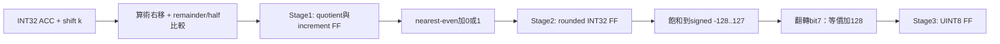

# PoT requantizer：zp128 / nearest-even / per-channel shift

日期：2026-09-21。本次只新增獨立元件、TB、匯出資料驗證工具及 Makefile 目標。
尚未替換 kws_postprocess 或修改 PE/DCIM engine；原本 zp127 / Q31 模組保留。

## 1. 規格與數值契約

```text
S = Σ (A_uint8 - 128) * W_int8
M_c = s_input * s_weight[c] / s_output = 2^(-k_c)
Y = clip_UINT8(round_nearest_even(S / 2^k_c) + 128)
```

`requantizer_int32_to_uint8_pot.sv` 接受 clk、同步active-high rst、in_valid、
signed INT32 accumulator、5-bit shift_amount；輸出 out_valid 與 UINT8 output_uint8。
位移支援 0..31（0是不缩放）；不支援負位移/左移、任意zero-point、bias或非PoT scale。
如果新模型需要 k<0 或 k>31，匯出程式會失敗，不會偷偷截斷為5 bits。
所有介面上的shift可以每拍改變，必須與當拍accumulator配對。
無ready／backpressure，II=1；下游須能接收每個out_valid。

## 2. 三級管線，沒有新增FSM



若E0擷取輸入，E0後stage1有效、E1後stage2有效、E2後輸出有效。
即三個register stages／由輸入擷取edge到輸出edge相隔兩個clock period，
與現有Q31 RTL的valid延遲一致，不應誤解成E3才輸出。
所有valid在reset清除，中途reset會取消在途資料；invalid時輸出可保持舊值，不能當新結果。
每拍換channel/k、連續輸入、插入bubble都不需要新FSM。

Stage1 使用 signed quotient q=floor(S/2^k)，remainder r為S低k個two's-complement bits。
當 r>2^(k-1)，或 r==2^(k-1) 且 q為奇數時 increment=1，其餘0。
k=0特殊處理為不捨入。負數也成立，例如-0.5→0、-1.5→-2。
Stage2的32-bit加法安全：k=0不加1，k>=1時quotient範圍已縮到約±2^30。
不取INT32_MIN的32-bit絕對值，因此沒有abs(-2^31)溢位問題。

例：7808/256=30.5，nearest-even→30，加128→158；原RTL半值遠離零會得到159。
負數例：-256/512=-0.5，nearest-even→0，加128→128。
本設計不只是`ACC >>> k`，也不沿用舊Q31的half-away-from-zero捨入。

## 3. k_c 不固定如何配置？

目前模型：Conv1 k={8,9}；Conv2={7,8,9}；Conv3={8,9,10}；FC1={7,8}；FC2={6}。
76個output channels仍需channel對應的shift參數，但每筆由32-bit Q31減為5-bit shift。
現有模型只需4 bits即可表示6..10，本元件選5 bits以支援0..31。
可變shift會合成為選擇網路／barrel shifter，不是免費接線，但不需要32×32乘法器。
若將來只支援6..10，可另外測量有限位移MUX版本；本次不限制模型至這五個值。

```text
layer_id + out_channel_id → shift參數記憶體 → k_c
                                 與ACC/channel/last對齊 → requantizer
```

如果shift存在同步BRAM，需要先查k並暫存ACC，或預取且對齊valid；
不可直接使用上一個channel的k。pixel不改變同一channel的k，但跨layer/channel要更新。

## 4. 驗證內容與結果

```bash
cd /home/LAB505/projects/KWS/KWS_DNN_Hybrid/HYBRID_SYSTEM
make lint-requantizer-pot
make test-requantizer-pot
make test-requantizer-pot-exports
```

第一組可在沒有外部模型資料時獨立執行。外部資料驗證需要numpy及
`KWS/layer_weights_int8_pot_ceil_zp128`、`KWS/layer_activation_uint8_pot_ceil_zp128`。
路徑可由 `python3 scripts/export_pot_requant_vectors.py --help` 查看覆寫選項。
生成的software_vectors.txt與JSON manifest置於build/requantizer_pot，不上傳Git。

TB使用獨立64-bit符號/絕對值、除法及餘數golden，不呼叫DUT函式或強制內部值。
涵蓋：

- k=0..31、INT32_MIN/MAX、0及正負數。
- 每個shift可表示範圍內的半值±1、signed -128/127飽和附近。
- 20,000組deterministic random ACC、每拍換shift與bubble。
- 三級valid延遲、連續輸入、reset取消在途、reset後重新送資料及pipeline drain。
- 從匯出UINT8結果直接讀入golden，實際RTL逐筆比較，不只驗證Python公式。

2026-09-21 Verilator：standalone 37,627筆有效輸出PASS；加上匯出資料共64,571筆PASS。
`make test-requantizer test-postprocess` 舊Q31與舊zp127後處理回歸亦PASS（不代表新PoT已接入postprocess）。
五層PoT匯出資料：

| Layer | RTL對比筆數 | mismatch |
|---|---:|---:|
| Conv1 | 21,960 | 0 |
| Conv2 | 4,368 | 0 |
| Conv3 | 576 | 0 |
| FC1 | 32 | 0 |
| FC2 | 8 | 0 |

腳本讀取逐層軟體輸入、重建INT64 MAC，檢查W zero-point=0、A/output zp=128、bias為零、
shape、scale、checkpoint SHA及sample index一致，輸出per-channel shift表與驗證manifest。
此次sample dataset_index=6988，checkpoint SHA256：
`f5d5b047773f9efc2af9e80945927eba7d4edd7c66e8a88ee3e4d6fcff82b407`。
這是單筆樣本的逐層比較，不是所有test-set／RTL端到端推論；shift-only一般正確性另由合成測資驗證。
未執行Vivado／PYNQ板級驗證，不宣稱面積數字或125MHz保證。

## 5. PE8 為何不需要ΣW？

現有 `activation_u8_to_s8.sv` 已用bit7翻轉算A-128，pe8_mac_lane已有signed8×8 MAC。
舊zp127：Σ(A-127)W = Σ(A-128)W + ΣW。
新zp128：目標本來就是Σ(A-128)W，因此直接使用raw accumulator，不應再加ΣW。
這是模型zero-point變更使補償不再需要，不是對舊模型無條件刪掉加法的代數優化。
把ΣW設零但仍保留其RAM／控制器，不等於最簡架構；應於elaboration移除補償路徑。

## 6. 尚未修改的整合清單（下一步）

| 檔案／位置 | 需要的調整 |
|---|---|
| HYBRID_SYSTEM/rtl/integration/pe_memory_engine.sv | 將PE8_MODE與zero-point/是否補償分開；zp128 PE8關閉loader SUM_ENABLE、移除sum memory、選raw結果路徑 |
| HYBRID_SYSTEM/rtl/control/pe_result_controller.sv | 選擇既有raw結果序列化路徑，或將PE8_MODE改名為APPLY_SUM_CORRECTION以免與MAC位寬混淆 |
| HYBRID_SYSTEM/rtl/control/pe8_result_controller_pipeline.sv | 新模型不需要其ΣW correction管線；若仍要比輸出排程，另設raw結果pipe，不必保留無效補償 |
| pe_layer_weight_loader.sv / pe_weight_sum_builder.sv / pe_channel_sum_memory.sv | 保留舊模型相容模組；新配置用generate/既有SUM_ENABLE關閉，不必刪原檔 |
| PE_CHIP_8x8/rtl/arithmetic/activation_u8_to_s8.sv、pe8_mac_lane.sv | 新模型可直接沿用，signed權重與中心化activation契約不變 |
| PE9 converter連接 | 若比較同一zp128模型，應改為A-128的9-bit sign extension，不能仍計算A-127 |
| HYBRID_SYSTEM/rtl/datapath/kws_postprocess.sv | 新增PoT配置／shift_amount，實例化新requantizer，保持frame/channel/last對齊及下游流量約束 |
| HYBRID_SYSTEM/rtl/datapath/relu_uint8_zp127.sv | 新增zp128版或參數化threshold=128，不能繼續用127 |
| 新shift ROM／loader與控制介面 | 依layer/channel提供k；同步ROM要考慮額外讀取latency；匯出manifest已含shift順序 |
| HYBRID_SYSTEM/rtl/dcim_adapter/（目前未有SV） | 新增DCIM有號與zero-point校正，校正完成才將INT32送PoT requantizer |
| PE_COMPARISON/rtl/board/pe_board_self_test.sv、pe_board_golden.sv | 新增zp128測試配置及golden；目前板級版本仍驗Σ(A-127)W |
| TB / Makefile / Vivado source lists | 加入新配置與新檔，更新預期資料；重做功能、整合、post-route與板測 |

DCIM若核心仍做unsigned Au×Wu且Wu=Ws+128，所需signed MAC為：
`ΣAuWu - 128ΣAu - 128ΣWu + K*16384`。
因此PE8可直接去掉ΣW，不代表unsigned DCIM也可以同樣直接省略校正。
目前新requantizer只接受已校正的signed INT32，不能把DCIM raw unsigned sum直接接入。

建議順序：先完成PE8 zp128 raw輸出配置與golden → shift參數供給＋PoT/ReLU整合 → DCIM校正adapter → 完整逐層推論。
保留舊zp127比較版本，避免把不同模型的PPA或準確率混在同一公平比較表。
