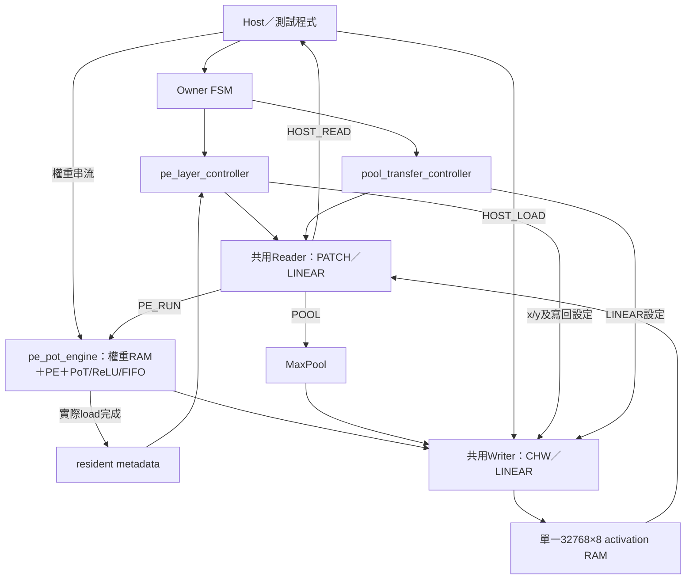
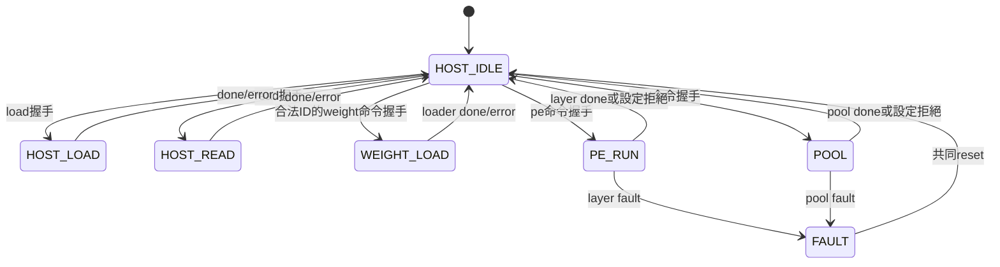

# S3：共享PE／Pool資料路徑與真實軟體Golden驗證

日期：2026-10-04。S3功能模擬通過；不是全CNN推論、Vivado或板測通過。
架構基準仍為 [SINGLE_BUFFER_ARCHITECTURE.md](SINGLE_BUFFER_ARCHITECTURE.md)。

## 1. 本次檔案與順序

| 動作 | 檔案 | 工作 |
|---|---|---|
| 修改 | `rtl/integration/kws_activation_path.sv` | 加入PE/weight操作、內部resident metadata、共用Reader/Writer切換 |
| 新增 | `scripts/generate_activation_path_vectors.py` | 檢查真實匯出資料，獨立數學預檢，產生hex與manifest |
| 新增 | `scripts/test_activation_path_vectors.py` | 正常資料及暫存副本的錯誤注入，原始匯出檔不改動 |
| 新增 | `tb/integration/tb_pe_conv1_pool_memory.sv` | 公開介面端到端載入、執行、全RAM讀回與軟體比對 |
| 修改 | `tb/integration/tb_kws_activation_path.sv` | 明確將新命令接0，保留原S2測試 |
| 修改 | `Makefile`及架構／控制文件 | 增加來源、指令、狀態與驗證結果 |

原S3清單只列新增控制器及端到端TB，漏列了「修改既有integration檔」。本次補齊這項必要連線，不新增階段、不提前S4全層FSM、不增加Argmax前置。
`pe_layer_controller`、PE乘加器、Pool、Reader、Writer、RAM本體沒有在本次改寫。

## 2. 硬體架構



只有一份activation RAM，權重RAM獨立位於PE內。Reader/Writer沒有複製；無AXI、DMA、DDR、DCIM或Argmax。
PE是固定PE8 zp128，`RESULT_PIPELINED=0/1`為合成參數；`POSTPROCESS_PIPELINED`保留參數，這次端到端測試固定為1。

### Owner狀態與互斥

| 狀態 | 工作 | 返回條件 |
|---|---|---|
| HOST_IDLE | 接受至多一個命令 | 依成功握手決定owner |
| HOST_LOAD | Writer接外部activation | wc_done/error |
| HOST_READ | Reader送外部讀回 | rc_done/error |
| WEIGHT_LOAD | PE loader接INT8權重，activation RAM不使用 | el_done/error |
| PE_RUN | Reader→PE→Writer | lc_done/error；fault則鎖定 |
| POOL | Reader→MaxPool→Writer | ctrl_done/error；fault則鎖定 |
| FAULT | 不接受命令，禁止RAM寫入 | 全路徑reset |

同拍命令优先序：**weight > PE > pool > host load > host read**。只在IDLE仲裁，沒有搶占或命令佇列。
未接受命令可保持valid等待或撤回，但不能當成已完成。busy時所有命令ready為0；正在載入的data-ready另行運作。
原pool>load>read的相對優先序不變。外部看到正常done時owner已釋放；子模組done由top再登錄一拍。
非法weight layer ID>4在握手後直接回報weight_load_error，不送入PE loader；K/channels合法性由既有loader檢查。



### Metadata不是由TB直接宣告有效

weight命令握手：清resident_valid，保存pending_layer/k/channels。只有真實loader成功且layer_ready有效後才更新resident metadata。
失敗的新load會使舊resident失效；reset取消部分load並清metadata。PE運算時weight命令不會被接受。
`resident_valid`是對外觀察輸出，layer/k/channels是內部暫存器；PE controller再核對命令。
metadata只能核對宣告的身分與shape，硬體不會計算檔案SHA或判斷傳入bytes是否來自指定checkpoint，這由軟體資料檢查保證。

## 3. 外部介面變更與舊測試遷移

保留原load/read/pool埠。新增：

| 訊號群 | 規格 |
|---|---|
| weight_load_valid/ready | 開始載入一層；weight_layer_id[2:0]、weight_k[7:0]、weight_channels[5:0] |
| weight_valid/ready/weight_i8 | signed 8-bit，按output-channel再k排列 |
| weight_load_done/error | 成功／失敗單拍，成功後resident_valid=1 |
| pe_cmd_valid/ready | 開始一層Conv或FC |
| pe_is_fc、pe_layer_id、pe_relu_enable | 模式、0..4 PoT ROM ID、ReLU開關 |
| pe_src_base/dst_base | 15-bit activation位址 |
| pe_width/height、pe_input/output_channels | 8-bit W/H，6-bit C |
| pe_vector_length | FC的8-bit K，Conv由9×Cin推導 |
| pe_done/error | 整層寫回完成／設定或執行錯誤 |

共同同步active-high reset；外部命令/data必須遵守valid/ready。忙碌期間不允許改寫正在使用的activation/weights。
**舊实例必須把新增valid輸入接0及配置接常數，不能浮接。** 原S2 TB已修改；外部自行使用者需同樣更新。
編譯來源新增pe_layer_controller與pe_pot_engine相依檔；Makefile已管理，不能只加入原來Pool的幾份SV。
此top是內部寬介面，不應直接把所有ports綁成PYNQ-Z2實體I/O；板級wrapper另行規劃。

## 4. Python資料準備

預設來源：

```text
/home/LAB505/projects/KWS/layer_activation_uint8_pot_ceil_zp128
/home/LAB505/projects/KWS/layer_weights_int8_pot_ceil_zp128
```

樣本6988，checkpoint SHA256：
`f5d5b047773f9efc2af9e80945927eba7d4edd7c66e8a88ee3e4d6fcff82b407`。

`generate_activation_path_vectors.py`按順序：

1. 檢查metadata：shape/count、checkpoint、sample、UINT8 zp128、INT8二補數、無bias、weight zp0、CHW/weight排列。
2. binary檔必須恰好每筆8個0/1，筆數正確；解碼後與原decimal檔逐值一致。
3. Python用獨立INT64 MAC、sign/magnitude除法與nearest-even、飽和、ReLU/Pool，確認原軟體輸出可重現；不執行checkpoint、不訓練。
4. 檢查PoT multiplier精確為2的負次方、shift 0..31，與RTL ROM的Conv1/FC1/FC2參數相符。
5. 全部驗證成功後，將**原軟體bytes**轉成兩位hex `.mem`；golden不是採用RTL計算值。
6. manifest保存原始檔案及生成檔SHA256、shape/count、scale/zp、shift、sample與memory map。

生成於 `build/activation_path_vectors/`：quant_input、pool1、conv1、relu1、pool2、flatten、fc1、relu4、fc2，加上conv1_weights/fc1_weights/fc2_weights共12個mem及manifest.json。
負INT8以二補數hex儲存，在TB送入weight_i8時使用signed解讀；activation同樣byte不作signed解讀。
原始匯出檔不修改也不提交；build生成檔不入Git。新機器需另有相同匯出資料。

## 5. 真實資料驗證流程

```text
quant_input → Host載入RAM → 全RAM讀回比對
                         ↓
硬體Pool1 → RAM → 比對軟體pool1
                         ↓
載入108筆Conv1權重 → 硬體Conv1（關ReLU診斷）→ 比對conv1
                         ↓ 重新運算、重用同一份權重及Pool1輸入
硬體Conv1＋ReLU → RAM → 比對relu1
                         ↓ 不載入軟體relu1
硬體Pool2 → RAM → 比對pool2
```

另外一條FC分支：

```text
軟體flatten → Host載入RAM
       ↓
載入4608筆FC1權重 → 硬體FC1診斷 → 比對fc1
       ↓
硬體FC1＋ReLU → RAM → 比對relu4
       ↓ 不載入軟體relu4
載入256筆FC2權重 → 硬體FC2 → 比對fc2
```

FC1重播144筆activation三次，channel分組12+12+8。此分支由軟體flatten開始，**沒有宣稱Conv2/3/DCIM或完整CNN已接通**。

| 結果 | Base | 筆數 | 軟體golden |
|---|---:|---:|---|
| 初始UINT8輸入 | 0 | 8064 | quant_input |
| Pool1 | 8064 | 2016 | pool1 |
| Conv1診斷／ReLU | 10080 | 21960 | conv1／relu1 |
| Pool2 | 0 | 5400 | pool2 |
| FC輸入 | 0 | 144 | flatten |
| FC1診斷／ReLU | 144 | 32 | fc1／relu4 |
| FC2 | 0 | 8 | fc2 |

TB只有初始化A5、原始quant_input及FC分支flatten等host輸入會寫進DUT；golden中間結果只放TB參考陣列。
所有運算與讀回都經正式top命令/data介面；monitor僅觀察內部交易，不替換任何子元件或繞過控制器。
8個成功運算包含故障注入後重新載權重／FC2恢復；故障注入本身不計為成功運算。

### 檢查項目

- 各階段真實RAM讀取地址、寫入地址、值、次數，PE activation握手值。
- Conv1每次1830 patches、1830 replays、16470 activation reads、21960 outputs；Writer整層命令一次。
- FC1每次1個compute、3個replays、432 activation reads、32 outputs。
- 每個檢查點完整32768位址讀回，共10次；來源、目的區外sentinel/舊資料都比較。
- Host載入與權重有隨機空拍、Host讀回有隨機反壓並檢查data/last保持；兩種固定seed。
- 同時送命令驗證weight>PE>pool/host的優先權；busy時提出其他命令但不能被接受。
- 接受後改動外部設定，核對保存的weight metadata與PE命令不受影響。
- 8次預期拒絕：無權重、非法weight ID、零K、layer ID不符、成功後失敗reload、失敗後compute、FAULT reset後compute、部分weight load被reset後compute。
- 執行中注入PE out_error，檢查所有命令鎖定、共同reset清resident，重新載權重後恢復；RAM不因reset清除。
- 額外負向run翻轉一筆relu1 golden，必須非零結束且報`Commit mismatch`，證明比較器確實能抓錯。

## 6. 執行與結果

```bash
cd /home/LAB505/projects/KWS/KWS_DNN_Hybrid/HYBRID_SYSTEM
make test-activation-path-vectors
make test-pe-conv1-pool-memory
make lint-activation-path
```

替換資料位置：

```bash
make test-pe-conv1-pool-memory \
  SOFTWARE_ACTIVATION_DIR=/absolute/path/activations \
  SOFTWARE_WEIGHT_DIR=/absolute/path/weights
```

資料產生器接受路徑覆寫；Python負向單測使用預設KWS資料集（含樣本6988）。模型shape/ROM不符時必須停止，不能只替換檔名。
新真實資料target不加入一般`make test`，避免repo外資料不存在時破壞一般回歸；需明確執行上述命令。

Verilator 5.030、PoT pipeline=1：

| PE結果管線 | seed | 運算操作 | 預期拒絕 | 成功權重載入 | RAM比對 | 結果 |
|---|---:|---:|---:|---:|---:|---|
| 0 | 505 | 8 | 8 | 5 | 327680 | PASS |
| 0 | 128 | 8 | 8 | 5 | 327680 | PASS |
| 1 | 505 | 8 | 8 | 5 | 327680 | PASS |
| 1 | 128 | 8 | 8 | 5 | 327680 | PASS |

共1310720筆全RAM比對，不代表有這麼多獨立音訊樣本。兩seed只改握手空拍，仍是同一份軟體樣本。
Python三個測試方法（含多個負向子案例）通過；原S1/S2、軟體四Pool golden及PE layer controller兩配置回歸/lint通過。
RTL不一致數為0；刻意損壞golden的獨立run正確失敗。

log位置：`build/pe_conv1_pool_0/seed_505.log`、`seed_128.log`及對應`pe_conv1_pool_1/`；负向為`pe_conv1_pool_0/negative_golden.log`。
使用Makefile會先重新驗證/產生資料再模擬，避免手動直接執行舊binary與舊向量。

## 7. 限制與下一步

2026-10-05中斷後重新確認：上述Python檢查、四次S3整合測試、golden損壞負向測試、S2一般及軟體Pool測試、PE layer controller兩配置、Reader／Writer／RAM回歸與相關lint全部重跑通過。未修改RTL演算法；補齊文件及Git提交。這是本次修改所影響路徑的回歸，不是整個儲存庫所有PE/DCIM測試的全面重跑。

S3完成的是目前樣本與上述分支的bit-exact功能模擬，不是任意模型/輸入永遠無錯的數學證明。
目前無Vivado工具，沒有量測LUT/FF/BRAM、最高頻率、CDC、板級IO或板測；寬介面不直接作實體pin top。
下一階段依原基準進入S4，先規劃layer_descriptor_rom與layer_controller；DCIM backend仍在S5，不增加新的Argmax前置。
