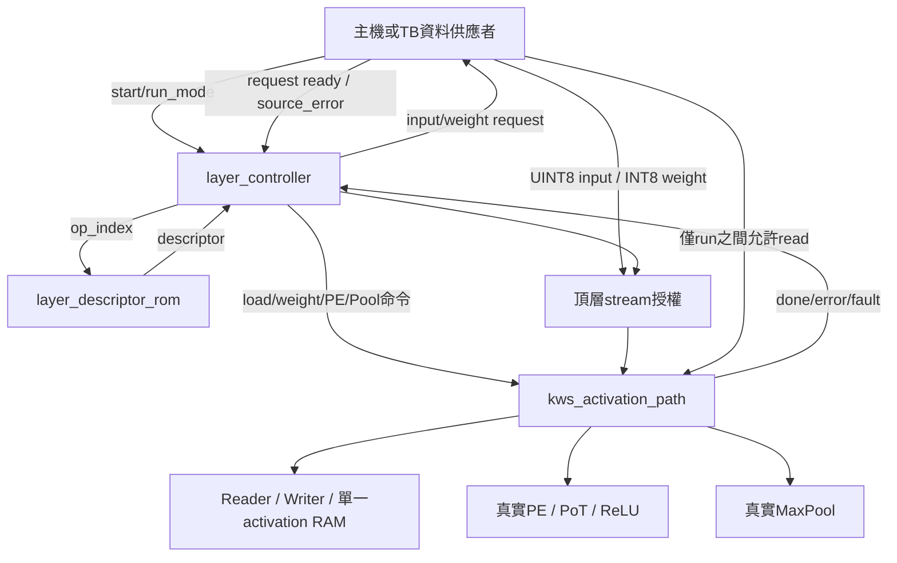
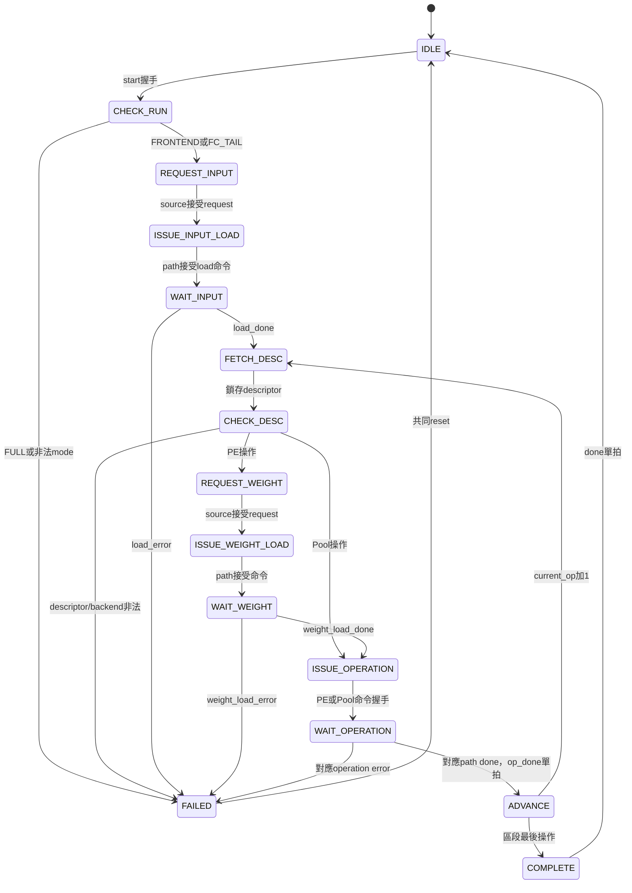

# S4：固定層描述與自動跨層排程

日期：2026-10-05。基準：[SINGLE_BUFFER_ARCHITECTURE.md](SINGLE_BUFFER_ARCHITECTURE.md)。
本文件區分「已接上的PE／Pool區段」與「未接入的完整DCIM推論」。不改S1～S3記憶體、PE算術或Pool算法。

## 1. 檔案與責任

| 檔案 | 責任 |
|---|---|
| `rtl/kws_system_pkg.sv` | 新增run mode、operation/backend、descriptor struct、error enum；原有型別不變 |
| `rtl/control/layer_descriptor_rom.sv` | 九筆固定設定，組合lookup；不是weight ROM或activation RAM |
| `rtl/control/layer_controller.sv` | 跨層FSM，保存run mode與descriptor，要求載入、發命令、等待commit完成 |
| `rtl/integration/kws_inference_top.sv` | S4串流整合頂層，連接真實path並封鎖整段執行中的外部read |
| `tb/control/tb_layer_descriptor_rom.sv` | 九筆逐欄位比對及七個非法地址 |
| `tb/control/tb_layer_controller.sv` | 受控ready/done/error的協定單測，不用來聲稱數值正確 |
| `tb/integration/tb_kws_s4_software.sv` | 真實RTL端到端軟體golden驗證，由controller自動發出各層命令 |
| `Makefile` | 編譯相依、測試與lint；軟體資料測試需明確呼叫 |

為完成真實整合驗證，同時建立原S4已規劃的`kws_inference_top`。目前是內部寬串流介面，非板級pin top；沒有AXI／DMA、DCIM或Argmax，不把名稱中的inference解讀成完整CNN已完成。

## 2. 元件關係



`layer_controller`管跨層；`pe_layer_controller`管單層patch／replay；path owner管單次操作互斥。新控制器不複製patch計數器、weight RAM或乘加器。

## 3. Descriptor

組合`case`給出`descriptor`及`descriptor_valid`。非法op_index=9..15時valid=0、資料全0。Controller在FETCH_DESC上升緣保存查詢結果，CHECK_DESC再判斷；不依賴descriptor長組合路徑直接驅動跨層決策。

| op | 工作 | backend | src→dst | W/H/Cin | Cout | K | layer_id | ReLU |
|---:|---|---|---|---|---:|---:|---:|---:|
| 0 | Pool1 | POOL | 0→8064 | 126/64/1 | 1 | 0 | 0（忽略） | 0 |
| 1 | Conv1 | PE | 8064→10080 | 63/32/1 | 12 | 9 | 0 | 1 |
| 2 | Pool2 | POOL | 10080→0 | 61/30/12 | 12 | 0 | 0（忽略） | 0 |
| 3 | Conv2 | DCIM，未接 | 0→5400 | 30/15/12 | 12 | 108 | 1 | 1 |
| 4 | Pool3 | POOL | 5400→0 | 28/13/12 | 12 | 0 | 0（忽略） | 0 |
| 5 | Conv3 | DCIM，未接 | 0→1008 | 14/6/12 | 12 | 108 | 2 | 1 |
| 6 | Pool4 | POOL | 1008→0 | 12/4/12 | 12 | 0 | 0（忽略） | 0 |
| 7 | FC1 | PE | 0→144 | 0/0/0（忽略） | 32 | 144 | 3 | 1 |
| 8 | FC2 | PE | 144→0 | 0/0/0（忽略） | 8 | 32 | 4 | 0 |

注意op_index不是weight/PoT layer_id。Flatten不搬移資料；ReLU已在PE內；各channel的PoT shift仍由既有ROM供應，不重複存到descriptor。
新增struct保存15-bit src/dst、8-bit W/H/K、6-bit Cin/Cout、3-bit layer_id、operation/backend enum與ReLU。

## 4. 頂層使用契約

共同clk及同步active-high rst；無CDC。只支援UINT8 zp128、signed INT8 weight、無bias及既有PoT ROM。

1. `start_valid && start_ready`接受一次run，保存`run_mode`，之後外部run_mode變動不影響此次執行。
2. `input_request_valid`保持到`input_request_ready`，`input_is_flatten`及`input_count`告知輸入種類／筆數。
3. Controller送出RAM load命令；供應者可提早保持`input_valid`，但只能在`input_valid && input_ready`時前進一筆。
4. 每個PE層前輸出`weight_request_valid`與layer_id/K/channels。供應者接受請求後，按output channel再k的順序送恰好K×Cout筆INT8。
5. `weight_valid && weight_ready`才代表接受一筆；ready=0時必須保持valid/data。loader的真正完成才允許PE命令。
6. `op_done`為單操作完成單拍，該拍`current_op`仍是剛完成者；不提供逐層暫停功能。
7. `done`為整段成功單拍，此時可開始下一段或read結果。不是分類結果valid，Argmax未接。
8. 發生`error`後busy保持1、error_code保存，必須對controller/path共同reset；RAM不清空、不rollback。

| run_mode | 行為 | 初始資料 | 結果 |
|---|---|---|---|
| RUN_FRONTEND=0 | op0→1→2 | base0，8064筆quant_input | base0，5400筆pool2 |
| RUN_FC_TAIL=1 | op7→8 | base0，144筆flatten | base0，8筆fc2 |
| RUN_FULL=2 | 在CHECK_RUN拒絕 | 不發出資料請求 | LERR_MODE |
| 3 | 非法模式，同樣拒絕 | 不搬資料 | LERR_MODE |

FC_TAIL的flatten由外部軟體供應，不能宣稱它接上FRONTEND輸出。FULL不可藉由跳過DCIM、使用假值或改成PE悄悄通過。

### 外部讀取與所有權

`read_valid/ready`、base/count、`read_out_valid/ready/data/last`、read_done/error沿用path語义，只允許run之外的讀回。start與read同拍時start優先；已有read執行時start_ready=0。
即使path在兩層之間busy=0，只要controller_busy=1仍禁止read。頂層busy是controller_busy OR path_busy。
read錯誤由read_error回報，不當成推論錯誤。Idle的source_error不是有效事件，供應者必須在請求處理期间回報且開始前清除。

沒有串流last腳位、資料檔案解析器、CRC或timeout。外部必須恰好提供要求筆數，停止供應會等待而不是自動成功；資料內容／checkpoint由軟體匯出檢查保證。未握手的額外資料不會被接收，但硬體不能辨認相同長度的錯誤權重檔。

## 5. FSM



所有非IDLE/FAILED狀態遇source_error或path_fault優先進FAILED；同時出現done/error以error優先。錯誤不是每拍重複脈波。
ISSUE與REQUEST在ready=0時保持原狀態與欄位。WAIT只監看該操作的terminal訊號，不把無關backend的done當作完成。path terminal已含最後RAM commit，因此WAIT_OPERATION包含排空，不另外重複實作Writer drain。

| error_code | 原因 |
|---|---|
| 0 NONE | 無錯誤 |
| 1 MODE | FULL未支援或非法run_mode |
| 2 DESCRIPTOR | 無效descriptor／不支援backend或非法FSM恢復 |
| 3 SOURCE | 外部source_error |
| 4 INPUT | activation載入錯誤 |
| 5 WEIGHT | 權重載入錯誤 |
| 6 OPERATION | PE或Pool操作錯誤 |
| 7 PATH | path fault，優先於source_error |

## 6. 驗證方法

```bash
cd /home/LAB505/projects/KWS/KWS_DNN_Hybrid/HYBRID_SYSTEM
make test-layer-descriptor test-layer-controller lint-s4
make test-s4-software
```

`test-s4-software`先重跑既有向量產生器：驗metadata、binary/decimal、PoT ROM與獨立整數數學，再產生mem。來源是KWS下`layer_activation_uint8_pot_ceil_zp128`與`layer_weights_int8_pot_ceil_zp128`，sample6988；詳[S3來源規格](S3_SHARED_PATH_VERIFICATION.md)。來源路徑可用SOFTWARE_ACTIVATION_DIR／SOFTWARE_WEIGHT_DIR覆寫，模型規格不符會拒絕。

### ROM與控制器單測

- ROM：9筆所有欄位及7個非法地址。
- Controller：FRONTEND及FC_TAIL，合計5操作；命令ready刻意延遲4拍，等待done延遲5拍。
- 檢查mode握手後保存、request/config穩定、不重複命令、無關backend done不推進、done/error互斥單拍。
- 錯誤案例：FULL、非法mode、source、input、weight、Pool、PE、path fault、descriptor故障注入；error與done同時時error優先；reset取消等待狀態。
- 單測回覆是假協定端點，僅測控制。下面數值整合全部使用真實RTL。

### 真實資料整合

每個RESULT_PIPELINED=0/1，各使用seed505/128。POSTPROCESS_PIPELINED固定1。
每次執行FRONTEND、FC_TAIL、FULL拒絕、真實輸入載入中source_error、共同reset後FC_TAIL恢復。
供應者僅提供quant_input／flatten與權重；每層PE/Pool命令由controller發出。軟體pool1/relu1/pool2/relu4/fc2只在TB參考陣列內。

| 操作 | 真實RAM讀取 | 真實結果commit |
|---|---:|---:|
| Pool1 | 8064 | 2016 |
| Conv1＋ReLU | 16470 | 21960 |
| Pool2 | 21960 | 5400 |
| FC1＋ReLU | 432（144×3 replay） | 32 |
| FC2 | 32 | 8 |

Monitor以獨立地址公式／golden比對每一個commit與read地址、次數及op_done；不是從DUT實際地址推導golden。Conv1仍以patch位置順序輸出、writer轉CHW。
每段後透過公開read掃描32768位址；對已初始化的0..32039共32040筆逐值檢查，未初始化的728筆不假設為0。三次掃描合計98304筆讀取／96120筆有效資料比較；不稱為全部98304筆都有定義的golden。
外部read在run中持續請求，包含path短暫idle也不能插入；讀回有隨機反壓並檢查data/last保持。權重/input有隨機空拍，request有固定延遲。
額外獨立run只翻轉TB一筆relu1 golden，必須以`S4 commit mismatch`非零結束，證明checker能抓錯。

結果紀錄與尚未完成事項見下節；模擬不保證FPGA資源／時序。

## 7. 結果及限制

Verilator 5.030：ROM 16地址檢查通過；controller協定單測2成功區段／5操作／9錯誤案例通過；整合lint通過。

| RESULT_PIPELINED | seed | 成功區段 | 操作 | 權重請求 | RAM讀回 | 有效資料比較 | 結果 |
|---|---:|---:|---:|---:|---:|---:|---|
| 0 | 505 | 3 | 7 | 5 | 98304 | 96120 | PASS |
| 0 | 128 | 3 | 7 | 5 | 98304 | 96120 | PASS |
| 1 | 505 | 3 | 7 | 5 | 98304 | 96120 | PASS |
| 1 | 128 | 3 | 7 | 5 | 98304 | 96120 | PASS |

合計384480筆有效RAM比對；同一個音訊樣本，不是384480個樣本。Golden損壞負向run正確失敗。各run另檢查每筆輸入與運算commit、read地址及次數。
log在`build/s4_0/seed_505.log`、`seed_128.log`及對應`s4_1/`；負向在`build/s4_0/negative_golden.log`。生成資料與build不提交Git。

2026-10-05回歸亦通過：Python向量三項測試、S3兩配置×兩seed真實資料、S2一般及四Pool軟體golden、PE層控制器兩配置、Reader／Writer／activation RAM及其lint。沒有重跑整個儲存庫的所有CIM或板級測試。初次controller TB編譯因未使用的觀察訊號被lint拒絕，補上input mode/count檢查並修正比較寬度後通過；未以關閉此警告取代檢查。

未執行Vivado synthesis/implementation、BRAM實際推導、板測或全資料集準確率。本版無DCIM/Argmax/分類輸出；下一步依S5規劃DCIM backend與共享路徑的接口擴充，不能直接開放FULL。板級wrapper與時脈約束仍另行規劃。
