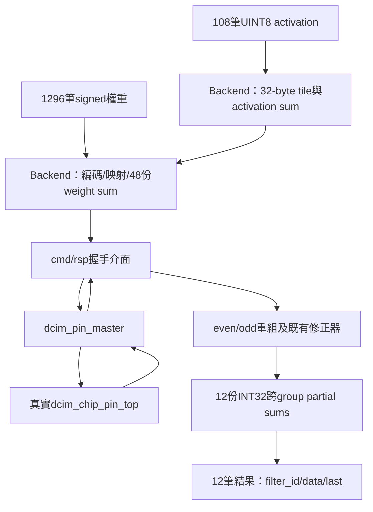
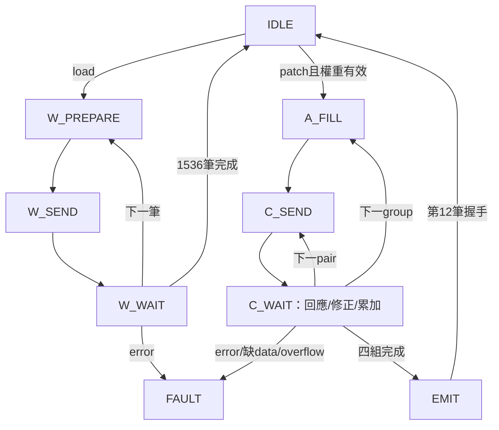

# S5-A：單筆權重寫入與單patch DCIM backend

日期：2026-10-13。這是固定K=108、12 filters、UINT8 zp128、signed INT8權重、無bias的第一版。S5-B CDC、S5-C整層Reader/Writer/後處理、S5-D FULL仍未完成。不是已通過Vivado或板測的宣告。

## 1. 本次檔案與邊界

- 新增 `rtl/dcim_adapter/kws_dcim_backend.sv`：九狀態控制與資料暫存。
- 新增 `tb/integration/tb_kws_dcim_backend.sv`：真正master與chip，無cell預載、無算術回應stub。
- 更新Makefile與架構基準；原有測試保留。
- 沿用 `dcim_u8_offset_correction.sv`；不改chip、master、CDC及FULL控制器。
- 工作樹中原有其他修改不屬本次提交。

## 2. 整體連接



Backend本身不實例化master/chip，不綁定時脈頻率。TB的同時脈轉接器保存/延遲真實master回應；S5-B才改接既有CDC。此TB不是CDC驗證。CIM chip input buffer僅32 bits；backend tile則32 bytes，不得混稱。Backend為同步reset，原master/chip包含非同步reset，因此整合TB針對共同reset關閉SYNCASYNCNET警告；獨立backend lint不關閉此警告。

## 3. 外部協定

| 介面 | 規格 |
|---|---|
| clk/rst | backend同步active-high reset；transport/master/chip須共同reset，不能只reset backend後接舊回應 |
| load_valid/ready | 開始整層載入；同時load與patch時load優先 |
| weight_valid/ready/data | signed8，filter→channel→kernel row→kernel col，1296筆；valid等待ready時資料必須穩定 |
| load_done | 最後padding寫入成功回應的正緣後脈衝，不是外部第1296筆接受時 |
| weights_ready | 只有整層1536筆write成功後有效；load開始/reset/fault失效 |
| patch_valid/ready | 只有權重有效且IDLE才接受；沒有權重時ready=0，並非自動進FAULT |
| activation_valid/ready/data | UINT8，c→u→v，108筆；計算期間ready=0 |
| result_valid/ready/data/filter_id/last | signed32、filter0→11；反壓時保持；last只在valid時解讀 |
| patch_done | 第12筆結果握手後脈衝；不代表後處理或RAM commit |
| source_error | sticky FAULT入口，停止新傳輸；已發出的master操作可能完成，需共同reset清除 |
| busy/error | 非IDLE為busy；FAULT的error保持至reset |
| cmd/rsp | 一筆在途；operation=0 write、2 CIM；欄位對齊既有CDC；不使用SRAM read回應欄位 |

固定計數協定沒有tlast：上層須恰好提供1296/108筆。缺資料會等待；額外資料不會在非接收狀態握手。未加入硬體timeout/長度錯誤偵測；TB有watchdog。下一階段若需可變長度或timeout須另外規劃。

## 4. Mapping、padding及運算

有效權重 `k=9c+3u+v`，實體row=k、pair=f。每個filter依序寫row0..107，再自行寫row108..127=128，然後換filter。共1296有效bytes+240 padding=1536次單筆write；pair12..15不使用。

`Wu=Ws+128` 在8-bit二補數編碼等價於反轉MSB；不是直接reinterpret signed byte。每個write成功回應才將byte加進對應group/filter的13-bit ΣWu（最大8160）。write成功可以沒有rsp_data_valid；CIM成功必須有rsp_data_valid。

每patch：讀32、算12pairs→讀32、算12pairs→讀32、算12pairs→讀12補20、算12pairs。48次CIM命令；同一tile在backend保留，但每次master命令仍完整LOAD八個planes。每組ΣAu也是13-bit。

進最後group時tile[12..31]平行設128，ΣAu初始化2560；不花20拍填activation padding。這是FF tile設計，不宣稱能以單埠BRAM同拍写20地址。

$$U=odd+(even\ll4)$$

先將兩份18-bit结果zero-extend到32位再左移。修正器計算：

$$P=U-128\Sigma A_u-128\Sigma W_u+16384\times32.$$

12份signed32 ACC各自累加四個P，等於 `Σ(Au−128)Ws`。33-bit加法檢查signed overflow，任何修正/累加overflow進FAULT。輸出raw INT32，不做量化或ReLU。

## 5. 九個主要狀態

| 狀態 | 動作／轉移 |
|---|---|
| IDLE | 接受load時清sum/index；接受patch時清12份ACC/index；沒有獨立INIT拍 |
| W_PREPARE | 接收有效權重，或產生一筆padding byte |
| W_SEND | 保持write命令到握手 |
| W_WAIT | 等成功回應，更新sum與row/filter；最後一筆直接done+IDLE |
| A_FILL | 接收一個tile；最後group只接12筆 |
| C_SEND | 保持CIM命令至握手 |
| C_WAIT | 先等回應、再等registered修正結果；correction_pending區分兩階段 |
| EMIT | 按ready輸出12筆；最後一筆直接done+IDLE |
| FAULT | 停止新操作並撤銷weights_ready，直到reset |



減少的是獨立INIT/NEXT/DONE狀態；C_WAIT旗標仍是控制狀態，不因enum少就保證省FF。沒有未精簡版本的實測對照，因此不宣稱特定面積或加速率。既有修正器無ready，C_WAIT保證逐筆接收它的valid。

## 6. 驗證方式

```bash
cd /home/LAB505/projects/KWS/KWS_DNN_Hybrid/HYBRID_SYSTEM
make lint-dcim-backend
make test-dcim-backend
```

固定兩個seed：505、128，同時傳入`+verilator+seed+N`讓不同process的隨機串流使用指定全域seed。命令隨機停頓，真實master回應再延遲0..4拍，權重/activation來源插入空拍，結果端插入反壓。driver在negedge改訊號，monitor在posedge檢查握手；watchdog拒絕永久等待。另有`+CORRUPT_GOLDEN`將參考結果故意加1，必須以result mismatch失敗，不能把任意失敗當成通過。

每seed驗證：

- 3次成功整層load：每次1296外部權重、1536實際write回應；每一命令檢查地址與編碼。
- 前兩層逐byte透過真實SRAM read讀回1536筆，共3072筆，包含padding。debug read僅在backend閒置、master完成時使用TB mux，不是新硬體介面。
- 6個patch：圖樣、zp128全零、activation全0/255、隨機；權重涵蓋−128、127、0與隨機負值。
- 每patch48次CIM，全部比對group/pair、32 bytes、raw even/odd；12筆INT32對獨立108項signed dot product，不以DUT修正公式作唯一golden。
- 一份權重連續計算多patch；整層重載改變權重。
- stalled命令及結果穩定；load/patch互斥；load_done與patch_done不可提前。
- source_error、真實write完成後注入transport error、CIM缺data_valid、在途write共同reset及重新載入恢復。

測試使用合成可執行的真實chip RTL，不預載cell、不force內部狀態。這批為演算法/協定測試資料，尚非軟體模型checkpoint的端到端Conv2/3 golden。

## 7. 驗證結果與限制

2026-10-13實測：

| 檢查 | 結果 |
|---|---|
| `make lint-dcim-backend` | PASS，獨立backend與修正器的`-Wall` lint |
| `make test-dcim-backend` seed505 | PASS：3 loads、3072 byte readbacks、6 patches、288成功CIM命令、72筆INT32 |
| 同上seed128 | PASS：相同檢查數量、不同隨機停頓/資料 |
| corrupted golden | 正確以`result mismatch`拒絕；Make入口整體成功 |
| `make test-dcim-offset` | PASS：302筆輸出及reset/bubble |
| CIM_CHIP的`make test-bitserial-accumulator test-dcim-pin-master` | PASS：既有ACC/serial及write/read/burst/A4/A8 master整合回歸 |

成功完整案例兩seed合計：6次load、9216次成功write、6144筆readback、12個patch、576次成功CIM、144筆INT32。另有故障注入及中斷交易，不混入成功計數。

| seed | 三次load clocks | 六個patch clocks（依測試順序） |
|---|---|---|
| 505 | 15788 / 15793 / 15729 | 5017 / 4994 / 5012 / 4999 / 5038 / 5035 |
| 128 | 15905 / 15861 / 15821 | 4998 / 5017 / 4995 / 5016 / 5030 / 5022 |

以上是TB从發起操作到觀察完成的同時脈cycle數，包含隨機source/transport/result停頓與測試取樣邊界；不是無停頓最低延遲，更不是125/53MHz的跨域量測。沒有舊backend比較基線，不宣稱精簡FSM降低了多少面積/時間。

Vivado synthesis/implementation、PYNQ-Z2上板與真正軟體Conv2/3完整golden尚未執行。報告不得將lint當成Vivado合成，或單時脈test當成CDC通過。

S5-B：接既有CDC、雙時脈reset與握手驗證。S5-C：真實軟體Conv2/3完整patch、PoT/ReLU/Pool與CHW commit。S5-D：FULL及Argmax。目前不開放FULL。

## 8. 2026-10-13追加：計算／輸出reset與無額外停頓

僅修改TB與文件，不修改backend/master/chip RTL。原有隨機測試及負向golden保留，`make test-dcim-backend`會接續執行本節案例。

### 無額外停頓的定義

`no_stalls=1`時，關閉source的隨機空拍、cmd gate的隨機封鎖與transport的隨機回應延遲，result_ready從patch開始即保持1。每次輸入握手後下一筆立即準備，ready=0時仍遵守資料保持規則。

這不是讓cmd_ready違反master busy而強制為1；單筆命令的正常往返、TB轉接器的固定暫存拍與chip的LOAD/SAMPLE/serial時間仍存在。此數據只代表本同時脈測試連接的無額外停頓基準，不是CDC或物理最高吞吐率。

### 定點reset案例

| phase | 觸發條件（在negedge觀察並assert reset） | 檢查目的 |
|---|---|---|
| 0 | master_busy、mode_sel、clk_en有效 | 真正CIM LOAD途中中止 |
| 1 | master_busy、output_en有效 | SAMPLE正緣前中止，不再接受舊sample |
| 2 | correction_pending與correction_valid同時有效 | 修正結果已產生、尚未累加時中止 |
| 3 | result_valid保持、result_ready=0達20拍 | 輸出第一筆反壓時中止，不能漏出舊結果 |

TB用既有命令與activation串流抵達目標；phase2僅觀察修正器valid，沒有force內部狀態。32筆可觸發前三種案例，phase3送完整108筆並完成48次CIM後才reset。中止前沿用原始命令/raw/result scoreboard，reset期間清除其stalled追蹤以符合reset可撤销valid的協定。

每個phase都對backend/transport/master/chip共同reset，接著觀察120 clocks：不得出現cmd_valid、rsp_valid、master_done、result_valid、patch_done或load_done；weights_ready與patch_ready保持0。然後重新寫入整層權重，再跑完整patch，12筆結果逐值對獨立golden。

本節每seed新增5次load、6個完整成功patch、4個中止patch；中止patch的部分CIM命令不算進成功patch統計。沒有測試单邊reset；那不屬目前協定。

追加結果：`make lint-dcim-backend`及`make test-dcim-backend`均PASS，seed505/128均到達四個reset觸發位置，reset後120拍無殘留，四次reload/recompute recovery均通過。原有隨機案例與corrupted-golden拒絕亦再次通過。

| 新增案例（兩seed合計） | 結果 |
|---|---|
| 四種定點reset | 8次通過；未以force略過控制流程 |
| 無额外停頓load | 10次通過；每次1536次write，12289 clocks |
| 無額外停頓完整patch（含恢復） | 12次通過；每次48 CIM／12 INT32，4729 clocks |

本次總回歸含原案例：每seed8 loads、12成功patch及4中止patch；兩seed共16 loads、24成功patch／288筆INT32，既有6144筆SRAM讀回保留。中止案例的CIM不計入成功patch的1152次CIM統計。

Cycle沿用TB從操作發起至觀察完成的計數邊界，含固定轉接器與觀察開銷，不是純chip核心cycle；沒有改RTL，因此不能將它與先前帶隨機停頓的約5000 clocks比較成硬體加速成果。日志：`build/dcim_backend/seed_505.log`、`seed_128.log`與`negative_golden.log`，build輸出不提交Git。
