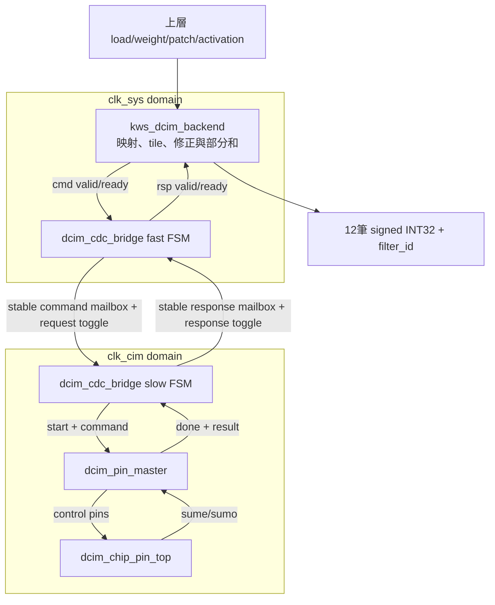
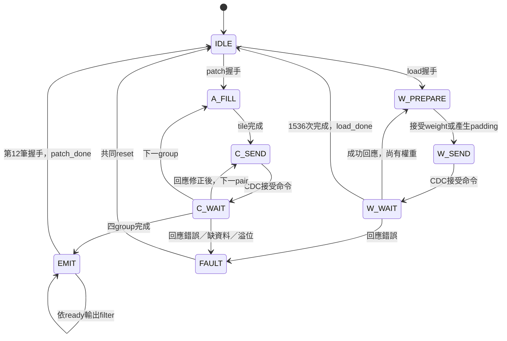

# S5-B：kws_dcim_subsystem 雙時脈整合

日期：2026-10-15。固定 K＝108、12 filters、UINT8 activation/zp128、signed INT8 weight、無 bias。本階段將 S5-A backend 接上真正 CDC、pin master 與 FPGA chip 模型，不修改四個既有模組的運算與協定。

**範圍：功能整合與 RTL 驗證。不是完整 Conv2／Conv3、Vivado CDC 簽核、時序通過或板測完成的宣告。**

## 1. 檔案與撰寫順序

| 順序 | 檔案／工作 | 目的 |
|---|---|---|
| 1 | 核對 backend、bridge、master、chip ports | 確認資料寬度、signed、reset 與 done 語義 |
| 2 | `rtl/integration/kws_dcim_subsystem.sv` | 四模組連接封裝；沒有新運算 FSM、FIFO、MMCM |
| 3 | `tb/integration/tb_kws_dcim_subsystem.sv` | 公開介面驅動、真正雙時脈全 chip、獨立數學 golden |
| 4 | `Makefile` | 新增 test/lint 專用入口，保留 S5-A；負向測試以 grep 取代 rg |
| 5 | 本文件與 `SINGLE_BUFFER_ARCHITECTURE.md` | 記錄介面、reset、測試、剩餘實體驗證工作 |

不覆寫使用者原有 cell／時脈／PE／後處理修改。測試執行於目前工作樹，因此包含那些既有版本；提交不包含它們。

## 2. 元件與時脈關係



所有公開資料、valid/ready、done/status 都屬 clk_sys。clk_cim 只供 bridge slow side、master 與 chip。時脈在外層產生；不在本模組改寫既有 MMCM。CDC 既有 port 名稱 clk_125m/clk_50m 只是名字，wrapper 分別接 clk_sys/clk_cim。

這是同片 FPGA 內含 chip RTL 模型的版本。外接實體 CIM 的 IO／時序／電氣 wrapper 不在本階段。

## 3. 外部介面與資料契約

| 介面 | 說明 |
|---|---|
| `clk_sys/rst_sys` | 系統時脈、active-high reset |
| `clk_cim/rst_cim` | CIM 時脈、active-high reset |
| `load_valid/load_ready` | 接受一層載入命令；與 patch 同時出現時 load 優先 |
| `weight_valid/ready/data` | signed8，恰好1296筆，filter→channel→u→v |
| `load_done/weights_ready` | 1536次真實 write 全部成功回應後完成／標記有效 |
| `patch_valid/patch_ready` | 權重有效且閒置才能接受；一次一個 patch |
| `activation_valid/ready/data` | UINT8 zp128，恰好108筆，channel→u→v |
| `result_valid/ready/data` | signed32；反壓時保持，fault/reset 是取消例外 |
| `filter_id/result_last` | 依序0～11；last只在valid時解讀 |
| `patch_done` | 第12筆結果握手的同一正緣之後拉高一個sys週期 |
| `busy/weights_ready/error` | 沿用 backend；FAULT 時 busy/error 保持、weights_ready 清除 |
| `source_error` | clk_sys 域上游錯誤；鎖定至共同 reset |

沒有 layer_id、x/y、K、channels 設定：本版本專門服務相同108×12尺寸的Conv2／3。層身分與空間位置由下一階段外部控制器保存。也沒有 input last、timeout 或自動 retry；資料缺少時會等待，不宣稱能識別所有主機輸入錯誤。

上層提供原始 signed weight 與 UINT8 activation，**不要先加／減128或自行補padding**。Backend既有邏輯負責：

- W_u＝W_s＋128，row=k、pair=filter；1296有效bytes＋240 padding＝1536 writes。
- 每個filter配置128 rows，四個group；最後20個weight、activation都補128。
- 每patch按group優先，4×12＝48次CIM；每次仍載入八個bit planes。
- 結果 U＝odd＋(even<<4)，先擴位再左移。
- 每group修正 P＝U−128ΣA_u−128ΣW_u＋32×16384。
- 四group部分和累加，輸出 Σ(A_u−128)W_s。

輸出是 raw INT32，不是UINT8，也尚未進行PoT/ReLU或RAM commit。

## 4. RTL 如何撰寫

Wrapper分成三段連線宣告、四個具名實例：

1. **backend ↔ CDC**：保留 cmd/rsp valid-ready；命令278 bits，回應包含46 bits（含本階段不用的read byte）。
2. **CDC ↔ master**：start、operation、地址、activation及done/error/raw result，全在clk_cim協定下使用。
3. **master ↔ chip**：逐一連接控制腳位與sume/sumo；不直接將backend連到chip。
4. **u_backend**：signed weight/result 宣告保持；修正器已在backend內，不再新增一份。
5. **u_cdc**：維持mailbox單筆在途，寬資料不用逐bit雙FF同步。
6. **u_pin_master**：burst length=0、valid=0、data=0；unused outputs具名標示。
7. **u_chip**：clk接clk_cim，reset腳位由master驅動；不能把model_rst_n/reset1/reset2全部直接接同一條reset。

不增加always_ff、always_comb運算邏輯，不增加一份「等待子模組」FSM。未使用的輸出保留在內部unused wires，不擴大頂層port。

Write的完成不是data-valid：master write成功時done=1、result_valid=0，backend只檢查回應成功；CIM則必須data_valid=1。這是既有協定，wrapper不改成一律等待result_valid。

## 5. 控制狀態與操作流程

以下是既有FSM的合作，不是wrapper新增狀態。



source_error也可使任何正常backend狀態進FAULT。

每筆跨域命令：

```text
cmd握手 → fast保存mailbox並翻轉request
       → request經slow同步器 → S_START_MASTER（start一拍）
       → master執行真正chip腳位時序 → master_done
       → slow保存response並翻轉response toggle
       → fast同步並保存回應 → rsp握手 → backend繼續
```

Fast FSM為F_IDLE→F_WAIT_RESPONSE→F_RESPONSE→F_IDLE；slow FSM為S_WAIT_REQUEST→S_START_MASTER→S_WAIT_MASTER→S_WAIT_REQUEST。跨域延遲與clock比例／相位有關，不把單時脈4729 cycles當作本系統固定時間。

## 6. Reset與錯誤契約（必要整合條件）

外層負責一個共同reset原因，再為兩個domain各建立一份非同步assert／同步release的reset產生電路。板級reset原因應包括外部reset與所用clock source的lock失效；本wrapper沒有MMCM，不自行取某個locked訊號。

```text
共同reset原因
 ├─ sys reset同步器 → rst_sys → backend + CDC fast
 └─ cim reset同步器 → rst_cim → CDC slow + master
                                      └→ chip_model_rst_n/reset1/reset2
```

- backend是同步reset，rst_sys須保持到clk_sys確實採樣；若clock停止，必須保持到clock恢復且完成解除程序。
- 同一domain共用同一條local reset，尤其slow bridge/master不能獨立解除。
- 兩domain解除可有先後；fast先解除並送命令時，mailbox需保留到slow恢復。
- 不支援單側reset。短外部reset必須符合元件最小pulse要求並由reset電路伸長；普通同步資料FF不能保證捕捉任意短pulse。
- reset後weights_ready=0，必須重新載入；現有FF cell model也由model reset清除。
- source_error時可留下尚未完成的CIM或尚未消費的CDC回應；系統鎖定，靠共同reset清除，不自行retry。
- 若已輸出部分filter，沒有rollback。S5-C下游PoT/FIFO/writer需共同取消或reset，目的patch/layer資料視為無效，不能只看已寫入幾筆就繼續下一層。

## 7. 測試架構與scoreboard

TB直接實例化本wrapper，從公開介面載入全部權重，不force內部狀態、不預載cells、不替換chip算術回應。

階層讀取僅用於觀察：

| 檢查層 | 驗證內容 |
|---|---|
| sys接受命令 | 正確row/pair/weight、group/pair順序、activation tile及padding |
| slow master_start | 與sys保存的整筆命令完全一致；每筆只啟動一次 |
| chip write edge | 由實際din高低nibble重組byte，核對write controls、row、pair、資料 |
| master_done | raw even/odd與獨立unsigned nibble乘加一致 |
| sys回應握手 | 回應次數、data_valid類型、CDC前後raw結果一致 |
| 最終結果 | 直接用Σ(A−128)W_s計算golden，不複製DUT修正公式作唯一參考 |
| 完成訊號 | load_done須1536writes/1296inputs；patch_done須48CIM/108inputs/12results |

本wrapper沒有SRAM read debug port，因此**不宣稱重跑S5-A的3072筆讀回**。本測試檢查真正寫入腳位與後續CIM結果；既有S5-A仍保留獨立readback回歸。

跨域計數不能每拍相等；只要求沒有多餘start/completion，且正常交易排空後accepted＝starts＝completions＝responses。Reset取消的交易不算成功交易。

Mailbox穩定檢查允許接受命令後的NBA更新；不能用更新後的非IDLE狀態直接判斷那次更新非法。結果及命令的valid保持契約在reset/source_error時明確取消；CDC保留回應直到reset或握手。

## 8. 測試操作與案例

```bash
cd /home/LAB505/projects/KWS/KWS_DNN_Hybrid/HYBRID_SYSTEM
make lint-dcim-subsystem
make test-dcim-subsystem
# 保留舊有S5-A完整讀回與數值回歸
make test-dcim-backend

cd ../CIM_CHIP
make test-dcim-cdc-bridge test-dcim-cdc-integration
```

新測試只在完成後顯示摘要，完整log保留於`HYBRID_SYSTEM/build/dcim_subsystem/`。

| sys clock | CIM half period | CIM約略頻率 | 起始phase | seed |
|---|---:|---:|---:|---:|
| 125MHz | 10000ps | 50MHz | 1300ps | 505 |
| 125MHz | 9434ps | 53MHz | 2700ps | 128 |
| 125MHz | 4000ps | 125MHz | 0ps | 505 |
| 125MHz | 3000ps | 166.667MHz | 1900ps | 128 |

同頻同相與CIM較快是功能壓力測試，不代表chip在那些頻率通過實體時序。各設定直接用TB產生clock，未使用原有名稱50但目前參數75MHz的MMCM檔。

正常案例包含：load/patch競爭時load優先、全0實數activation（UINT8=128）、UINT8 0/255、隨機資料、weight −128/127/0、重載、常駐多patch、random valid gaps、輸出停頓、無額外停頓、兩種reset解除順序且sys解除後立即load。

五個中斷位置分別測共同reset與source_error：

1. slow同步器已觀察request、尚未啟動master。
2. CIM sample正在等待擷取。
3. master_done回應已寫入slow mailbox，尚未跨回fast。
4. fast rsp_valid等待backend下一個接受edge。
5. EMIT：reset測第一筆結果反壓；source_error測已接受3筆的部分輸出。

每次reset後兩個domain各觀察至少120個clock無殘留，再重新載入完整權重並算一個patch。Fault先等在途命令有足夠時間結束，確認沒有新cmd、沒有成功done，再reset恢復。

另有`+CORRUPT_GOLDEN`故意改錯expected[0]；必須非零結束且log含`result mismatch`才算負向測試通過，不能把timeout或build failure當成通過。

Lint沿用既有完整chip的unused/pin警告豁免；SYNCASYNCNET僅因同一reset同時供同步backend與非同步CDC使用。這不是CDC物理驗證。測試不注入類比metastability或同步器隨機額外延遲，也不承諾單邊reset可恢復。

## 9. Vivado與CDC實體驗證：尚待執行

本次不產生假定clock pin／hierarchy名稱的全面false-path XDC。最終板級clock來源與頻率確認後，必須：

1. 正確建立primary/generated clocks，保留同源MMCM clock關係。
2. 確認request/response雙FF同步器的ASYNC_REG與實際placement。
3. 找出command mailbox→master command registers、response mailbox→fast response registers的實際endpoint，依最早可能擷取時刻與margin設定資料路徑延遲界限。
4. 可使用有根據的`set_max_delay -datapath_only`，必要時補bus skew；不直接認為所有路徑都固定8ns。
5. 同步器第一級的例外與第二級本地timing分開處理。不能讓整個clock-group false path覆蓋上述mailbox max-delay。
6. 檢查reset同步解除與recovery/removal；測試clock-lock/reset行為。
7. 執行report_cdc、report_clock_interaction、report_exceptions、report_methodology及routed timing，逐項解釋intentional mailbox crossing，而非隱藏所有警告。

尚未執行Vivado，不宣稱所有port皆受約束，也不保證backend 125MHz／chip 53MHz。來源：[AMD UG949 CDC例外優先權](https://docs.amd.com/r/2021.2-English/ug949-vivado-design-methodology/Clock-Exceptions-Precedence-Over-set_max_delay)。

## 10. 本次實測結果

2026-10-15，Verilator 5.030：`make lint-dcim-subsystem`及`make test-dcim-subsystem`通過。

| 項目 | 實測結果 |
|---|---|
| 上表四組clock/phase/seed | 全部PASS |
| 每組完整載入／完整patch／結果 | 13／16／192 |
| 每組指定位置reset／source_error | 5／5，均恢復後重新計算成功 |
| 四組完整結果合計 | 768筆INT32逐值一致 |
| 故意損壞golden | 正確以`result mismatch`拒絕 |
| 既有CDC bridge回歸 | 36命令、reset無幽靈交易、response保持：PASS |
| 既有CDC/master/chip整合 | SRAM、A4W8、A8W8、非法burst：PASS |
| 既有S5-A backend回歸 | seed505/128各5次載入、6個patch/72結果、4個reset恢復：PASS；負向golden亦PASS |

125MHz／約53MHz、phase=2700ps、seed128的無額外停頓patch案例為11213～11216個sys cycles（89.704～89.728µs）；第一次載入為36259 cycles（290.072µs，含slow reset仍保持的等待）。這些是TB任務量測的交易時間，含握手／phase影響，不是純MAC時間，也不是硬體頻率可達性的證據。

測試由公開串流輸入資料，內部訊號只作唯讀監測，沒有force結果或用golden取代計算。新TB使用獨立整數公式與固定／隨機向量，**不是完整軟體Conv2/3資料集測試**；那是S5-C的驗收。Vivado synthesis/implementation、實體CDC及板測尚未執行。

## 11. 下一步

功能驗證通過後接續S5-C：整層Reader→DCIM subsystem→PoT/ReLU→Writer，使用真實軟體Conv2/3權重與activation逐值比較。S5-D才接FULL與Argmax。板級reset/clock產生器、CDC約束與實體簽核仍是上板前必要工作，不因功能整合完成而省略。
