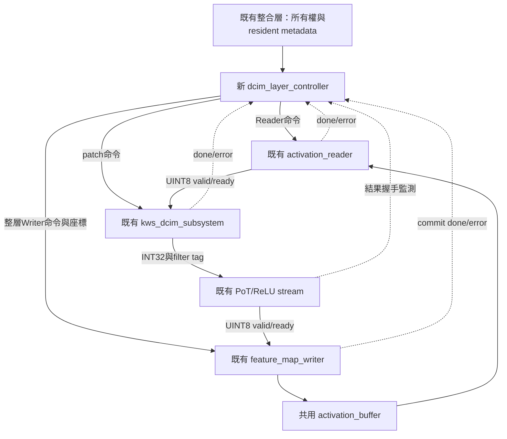
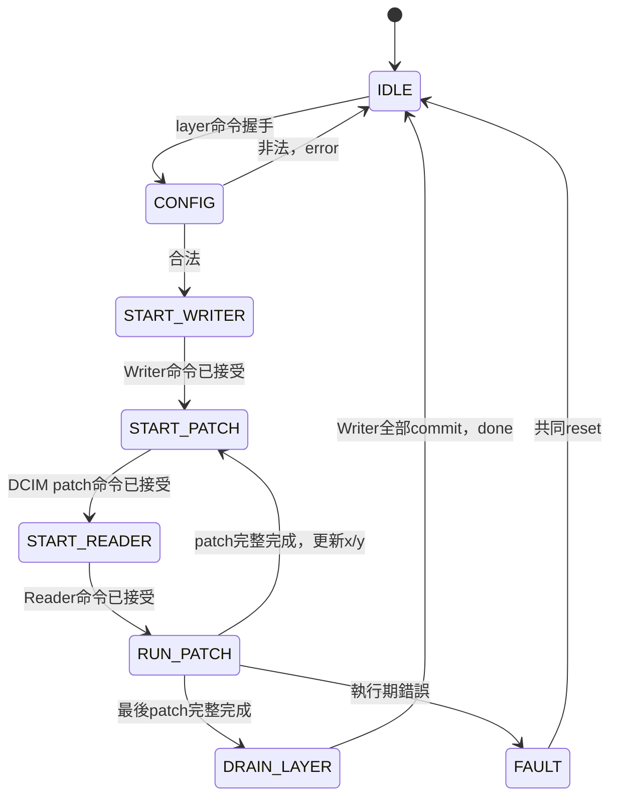

# S5-C 規劃書：DCIM 整層控制與低冗餘架構審查

日期：2026-10-15。狀態：**待審查提案，尚未實作、尚未驗證**。
本文件承接已完成功能模擬的S5-B，不改變單一activation buffer基準。請Claude先審查，再由使用者決定是否開始撰寫；不要將本提案視為已通過的架構。

## 1. 可直接交給 Claude 的任務

> 請依本規劃與目前實際RTL，審查S5-C是否能正確完成Conv2/Conv3整層運算，並找出不必要的狀態、重複暫存器、重複計數、過多介面與可重用模組。先只分析，不修改程式或提交。每項建議請說明功能等價條件、握手與反壓影響、可能增加的組合路徑，以及需要的測試；不要單憑狀態數少就宣稱面積較小。請區分確定缺陷、必要防護、可選偵錯、效能最佳化及未定案事項。最後提出你推薦的最小完整架構與實作順序，並列出是否有阻擋開始實作的問題。

專案：`/home/LAB505/projects/KWS/KWS_DNN_Hybrid`。以下程式路徑相對專案根目錄。

## 2. 必讀材料與順序

1. `AGENTS.md`與[SINGLE_BUFFER_ARCHITECTURE.md](SINGLE_BUFFER_ARCHITECTURE.md)：單buffer、階段順序、延後最佳化邊界。
2. [S5B_DCIM_CDC_INTEGRATION.md](S5B_DCIM_CDC_INTEGRATION.md)、[S5B_CLAUDE_REVIEW_HANDOFF.md](S5B_CLAUDE_REVIEW_HANDOFF.md)：現有subsystem契約及未完成實體驗證。
3. `HYBRID_SYSTEM/rtl/integration/kws_dcim_subsystem.sv`、`rtl/dcim_adapter/kws_dcim_backend.sv`（後者也位於HYBRID_SYSTEM）：load/patch握手、固定108×12、error/reset、raw INT32結果。
4. `HYBRID_SYSTEM/rtl/datapath/activation_reader.sv`：PATCH模式、108筆展開、最後輸出握手與done時間。
5. `HYBRID_SYSTEM/rtl/control/feature_map_writer.sv`：CHW、輸入接受與RAM commit分離、done/error。
6. `HYBRID_SYSTEM/rtl/datapath/pe_pot_result_stream.sv`、`kws_pot_shift_rom.sv`（同目錄）：layer/channel對應、FIFO、反壓、pipeline與comb配置。
7. `HYBRID_SYSTEM/rtl/control/pe_layer_controller.sv`：可參考控制風格，但不得照抄FC/replay等不需要的流程。
8. `HYBRID_SYSTEM/rtl/integration/kws_activation_path.sv`、`rtl/control/layer_descriptor_rom.sv`、`rtl/control/layer_controller.sv`（均在HYBRID_SYSTEM）：既有所有權、descriptor、層ID與路由。
9. `HYBRID_SYSTEM/scripts/generate_activation_path_vectors.py`、現有軟體整合TB：確認如何重用向量工具，不另建立不同格式。

請先用git status記錄工作樹差異；現有後處理等檔案含使用者修改，須保留。文中簡寫的同目錄檔名不代表另建檔案。

## 3. 功能目標與明確不做的內容

本階段把「單patch DCIM計算」提升為「完整一層讀RAM、計算、量化、寫RAM」。

| 項目 | 第一版方向 |
|---|---|
| 資料 | UINT8 activation/zp128、signed INT8 weight、INT32累加、無bias |
| 模型 | Conv2/3；3×3、stride1、padding0、Cin=Cout=12、K=108 |
| 記憶體 | 沿用單一32KiB activation buffer；同層來源/目的不重疊 |
| 運算 | 一次一個patch；不做patch之間重疊與預取 |
| 權重 | 每層載入一次，全部patch重用；仍採單筆write |
| 後處理 | 重用既有PoT/ReLU串流及FIFO，先不改pipeline選擇 |
| 時脈 | Reader/控制器/後處理/Writer在sys域；subsystem處理跨域 |
| 完成 | 以最後RAM寫入提交為準，不以raw結果產生為準 |

不新增第二份activation RAM、im2col矩陣、108-byte控制器buffer、第二個CDC、bit-plane FSM、ΣW修正器、AXI/DMA或NV功能。S5-D才接FULL及Argmax。實體CDC／時序仍需另行簽核。

## 4. 建議分工與關係圖

新控制器不傳送資料payload，只控制命令、座標與路由使能。payload由整合層直接接線。權重載入及resident metadata由整合層唯一持有，不在controller與subsystem各建一份層ID狀態機。

### 權重有效性

`weights_ready`只表示有一份完整權重，不能分辨Conv2/3。整合層應在load命令接受時撤銷resident_valid、保存pending_layer_id；只有load_done且無error才發布resident_layer_id/valid。reset/fault撤銷有效性。busy整層期間禁止weight reload及host/PE/pool插入。

controller只核對resident_valid及ID匹配，不自己重新計算1296筆載入計數。resident ID、PoT layer ID、descriptor operation index不一定同一編碼；必須核對實際ROM，不用數字猜測。

## 5. 輸入輸出提案（尚未鎖定port名稱）

| 介面群組 | 最小需求 | 避免冗餘 |
|---|---|---|
| clock/reset | sys clk、active-high rst | 不把cim clk送入controller |
| 整層命令 | valid/ready、layer_id、src/dst base、輸入W/H、ReLU設定 | 固定K=108/Cin=Cout=12，不再傳可變K/channels |
| resident | valid、layer_id；subsystem error/ready狀態 | 不傳整份權重或ΣW |
| Reader | command valid/ready、base/W/H/x/y、done/error；資料握手及last監測 | PATCH/count/channels固定值可在wrapper接常數，不必都變port |
| DCIM | patch valid/ready、patch_done、error；activation握手使能 | 不暴露group、pair或plane計數 |
| 後處理 | 結果valid/ready、channel、last/error；layer/ReLU配置 | controller不存INT32/UINT8 payload |
| Writer | command valid/ready、base/輸出W/H、done/error、輸入ready；channel/x/y及valid | CHW/12channels可接常數 |
| 對上層狀態 | busy、done、error；是否另需fault待核對既有介面 | 若error已sticky，不再無意義複製fault輸出 |

層命令可採「layer_id查固定尺寸」或「輸入W/H並驗證」；目前建議沿用既有descriptor提供W/H，方便測試小圖，但不得另存兩套尺寸ROM。是否只接受正式Conv2/3尺寸須審查後明確決定。這是待定介面，不能同時宣稱通用尺寸與固定層尺寸都已支持。

## 6. 數學、地址與資料順序

\[
W_o=W_i-2,\quad H_o=H_i-2,\quad N_{patch}=W_oH_o.
\]

| 層 | 輸入CHW | 輸出CHW | patches | UINT8輸出數 |
|---|---|---|---:|---:|
| Conv2 | 12×15×30 | 12×13×28 | 364 | 4368 |
| Conv3 | 12×6×14 | 12×4×12 | 48 | 576 |

Reader從patch(x,y)讀取：

\[
addr=src+d(H_iW_i)+(y+u)W_i+x+v,\quad i=9d+3u+v.
\]

subsystem輸出每filter：

\[
ACC_c=\sum_{i=0}^{107}(A_i-128)W_{c,i}.
\]

PoT依該層/channel參數重新量化並按配置ReLU；Writer使用：

\[
addr=dst+c(H_oW_o)+yW_o+x.
\]

計算輸出是patch優先/channel次之，RAM排列是CHW；不用另建transpose buffer。地址乘法沿用Reader/Writer，不在controller再複製；CONFIG的尺寸與端點計算需擴位後驗界，不能截位後檢查。

## 7. 第一版FSM提案與必要性

所有執行期狀態均須處理錯誤；圖只示範一條FAULT邊。

| 狀態 | 保留理由／可審查合併點 |
|---|---|
| IDLE | 唯一接受新整層命令的入口 |
| CONFIG | 保存命令後驗界、resident與尺寸；可用phase預計算，不強制單拍大乘法 |
| START_WRITER | 每層只啟動一次Writer；等待命令握手 |
| START_PATCH | DCIM先接受patch，避免Reader無消費者 |
| START_READER | Reader命令可反壓，須保持直到接受 |
| RUN_PATCH | 資料流與完成事件匯合；下一patch直接更新座標，不另加NEXT狀態 |
| DRAIN_LAYER | 最後資料被Writer接收不等於RAM commit；可評估併入RUN但需等價證明 |
| FAULT | 部分結果不可當成功；鎖定至共同reset |

不額外加入DONE狀態、固定等待N拍、replay或下一filter FSM。START_WRITER後是否需WAIT_WRITER_READY，應依現有Writer錯誤回報及後處理反壓證明；若資料路徑可安全停住且持續監測writer_error，就不為等待而新增狀態。

若合併START_PATCH/START_READER成單一ISSUE狀態，必須增加各自issued旗標，避免另一端尚未接受時重發；請比較「少一狀態但多旗標與控制路徑」是否真的值得，不預設一定省面積。

## 8. 最重要的完成、tag與反壓規則

三個完成事件不同：Reader輸入完、DCIM raw輸出完、Writer提交完。需要明確定義：

- `activation_fire = reader_valid && reader_ready`。
- `post_fire = post_valid && post_ready`，同一事件必須等於Writer合法接受事件。
- 每patch 108次activation_fire、12次post_fire；channel為0..11，last僅最後一筆。
- 保存reader_done與patch_done脈波，或證明可由最後一次握手推導；不可要求脈波同拍。
- 更新patch_x/y前，當前patch的12筆後處理輸出都已被Writer接受，且Reader/DCIM已完成。
- 最後一次post_fire尚可能只寫進Writer暫存器；整層done仍等writer_done。
- writer_done若比進入DRAIN_LAYER早，必須保存事件或把當拍事件納入條件，不能漏脈波。
- 所有計數／完成判斷需納入當拍fire，避免nonblocking更新造成少一筆或多等待／漏判。
- 錯誤tag不得先握手寫入再檢查；先驗證tag並抑制非法交易。

第一版不做跨patch重疊，因此不必在PoT FIFO中新增x/y tag。只有待前patch排空再移動座標這個前提成立時，這項省略才安全。

反壓鏈：Writer ready→PoT FIFO消費；FIFO容量控制raw ready→DCIM；DCIM activation_ready→Reader。不可因控制器狀態切換過早關閉結果通道而讓尚未排空FIFO死鎖。

## 9. 暫存器與冗餘審查清單

| 項目 | 建議 | 請Claude判斷 |
|---|---|---|
| 命令設定暫存 | 保留，避免外部改動污染正在執行命令 | 哪些可由常數或已保存值推導？ |
| patch x/y | 保留 | 不另存重複patch_index，除非必要 |
| activation_count | 候選：7bits可表示0..108 | 是必要硬體防護，還是僅TB assertion足夠？ |
| output_count | 候選：4bits可表示0..12 | 可同時用作期望channel，避免第二個channel counter |
| reader/DCIM done_seen | 候選各1bit | 是否可安全由last握手推導？須核對實際done時序 |
| writer_done_seen | 候選1bit | 依done相對最後輸出時序，是否可能早到？ |
| 全層結果計數 | 預設不新增 | Writer已有commit計數，避免重複 |
| resident metadata | 整合層唯一持有 | 不要controller與wrapper各自保存權重版本 |
| activation/weight buffer | 不新增 | Reader及backend已各有必要暫存 |
| PoT/FIFO | 沿用 | 不因名稱含PE就複製一份RTL |

必要檢查不是自動等於冗餘。若刪除硬體計數而改成外部契約，請同時列出失去的故障偵測能力。狀態少、port少或模組合併不保證LUT更少；最終需同約束合成比較。

## 10. Reset、錯誤與所有權

CONFIG非法在子模組啟動前拒絕；執行期錯誤進FAULT。busy期間不接受新整層命令、不允許RAM所有權變更或重載權重。

錯誤可能發生在部分結果已寫RAM之後，因此沒有rollback；目的層標記無效，不觸發下一層。上層需停止PoT到Writer的有效傳輸、通知backend source_error並依共同reset流程清理Reader、Writer、PoT FIFO與DCIM兩域。不能只reset controller或任意只reset慢域。

**待定但實作前必須解決**：error pulse與sticky fault的對外語義、整合層如何統一仲裁錯誤、故障當拍已接受的合法pending write如何記錄。不可假設本拍拉低valid能撤銷上一拍已接受的Writer資料。

## 11. 檔案與逐步驗收

| 順序 | 工作 | 狀態／驗收 |
|---|---|---|
| 1 | 新增`HYBRID_SYSTEM/rtl/control/dcim_layer_controller.sv` | 待審查後撰寫；介面、FSM與計數 |
| 2 | 新增`HYBRID_SYSTEM/tb/control/tb_dcim_layer_controller.sv` | 受控端點測協定；不能稱計算驗收 |
| 3 | 新增`HYBRID_SYSTEM/tb/integration/tb_dcim_layer_memory.sv`（候選名） | 真實RAM/Reader/subsystem/PoT/Writer；不是golden回應stub |
| 4 | 擴充現有向量工具及測試 | 固定checkpoint/樣本，權重與輸入/golden格式一致 |
| 5 | 修改既有`kws_activation_path.sv`及相關TB | 共享RAM所有權、resident與錯誤仲裁；不另複製RAM |
| 6 | Makefile與架構文件更新 | 保留S1～S5-B回歸；不得把未跑測試寫PASS |

步驟3的TB可先直接整合真實元件，不要求先新增另一個永久整層wrapper；是否需要可重用wrapper由審查決定，避免產生兩套相同整合邏輯。第5步擴充clk_cim/rst_cim對既有上層的影響須列清單再實作，不悄悄改掉原測試介面。

### 驗證矩陣

- 協定：command ready延遲、valid保持、各完成脈波不同拍、結果反壓、最後一筆停頓、load/compute互斥。
- 配置：resident無效/錯層、W/H非法、來源/目的重疊、端點超32768、邊界合法；錯誤不產生任何運算或寫入。
- 計數：每patch108/12、正確last與channel、Reader命令數、patch數；對多/少筆故障的預期處置明確。
- 資料：獨立公式計算RAM地址與INT32；PoT輸出對軟體golden；不以DUT輸出回填expected。
- 真實層：Conv2 364patch/4368筆、Conv3 48patch/576筆，全RAM或目的區外sentinel確認無越界。
- Reset/fault：啟動、輸入、CIM等待、後處理FIFO、部分Writer commit、DRAIN各階段；共同reset後重新載權重恢復。
- 資料集：先各層獨立用其軟體輸入驗收，再驗Conv2→Pool3→Conv3鏈路；鏈路中不可重新灌入中間golden冒充硬體輸出。
- Negative golden：故意破壞一筆expected，必須因數值不一致失敗，不接受timeout作為成功。
- 保留既有S5-B雙時脈測試；新整層TB至少含sys125/CIM約53MHz與不同phase，但不據此保證實體時序。

## 12. 請Claude最後交付的審查結果

1. 功能是否完整，以及會導致死鎖、錯誤座標、漏done或錯資料的具體情境。
2. 推薦FSM與每個狀態保留／合併的理由。
3. 最小port與register表，標明必要、可推導、僅偵錯、可延後。
4. 對既有RTL的相容性：附檔案與行號，不只評論本提案。
5. 待決事項清單：尺寸策略、layer ID對應、done/error契約、錯誤清理、PoT重用及共享RAM接入方式。
6. 驗證缺口與「可以開始實作／需先修正規劃」結論。

請勿宣稱無任何冗餘或保證125MHz；可給出邏輯必要性分析，面積與時序則等待實測。也不要以重構所有既有模組作為第一版的前置要求，除非找到具體功能阻礙。
