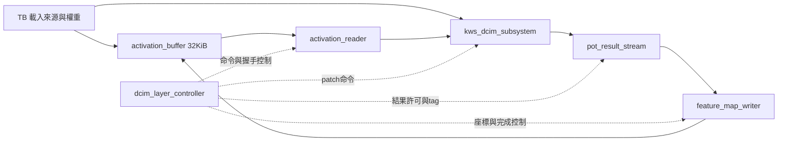
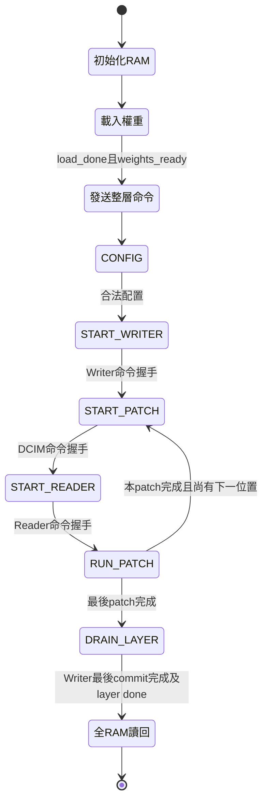

# S5-C：真實 DCIM 整層記憶體路徑驗證

本次範圍是將既有 RTL 在測試平台內真正串接，並以軟體匯出數據驗收；**不是新增共享系統 top，也尚未開放 FULL 推論**。不修改計算 RTL、CDC 或 chip 接腳。

## 1. 元件關係



DCIM 內部仍為 backend → mailbox CDC → pin master → 真實 chip RTL；TB 沒有用 Golden 假造 DCIM 回應。系統時脈模擬125 MHz，CIM半週期9434 ps（約53 MHz），起始相位2700 ps。共同 reset 事件在各 domain 兩級同步解除；這不是實體 CDC 或 STA 驗證。

記憶體的 host/run mux 僅是測試接線：初始化與讀回時由 host 使用，執行時由 Reader/Writer 獨占。不代表已將仲裁接進 `kws_activation_path`。

## 2. 控制流程



圖中初始化、載入、讀回是 TB 階段；CONFIG 至 DRAIN_LAYER 是既有 controller 狀態。非法配置及 FAULT 分支見 `DCIM_LAYER_CONTROLLER.md`，本次正常算術整合不取代原有錯誤/reset協定測試。

1. 載入1296筆 signed INT8 權重；backend 自行做偏移與padding，不由TB直接初始化cell。
2. `load_done` 且 `weights_ready` 後才公布 resident layer。
3. Controller 啟動 Writer，逐 `(y,x)` 啟動一個 DCIM patch 與 Reader。
4. Reader 按 channel→kernel-y→kernel-x 從 RAM 取108筆 UINT8。
5. Backend 分32/32/32/12（尾組補零碼）處理，讀回各group/pair結果並完成 signed修正與跨group加總。
6. 每patch輸出12筆 INT32，PoT/ReLU轉UINT8，Writer按 channel tag 與固定patch座標寫成CHW。
7. 本patch條件全部完成才前進；最後須等真正 RAM commit，不把 PoT last 當作整層完成。

Raw path 必須同時 gate `valid` 與回傳 `ready`，避免一端誤認資料已被接受。TB對 Writer 加週期性停頓時，也同時gate valid/ready，不只擋其中一端。

## 3. 數學與資料來源

來源是 `KWS/layer_activation_uint8_pot_ceil_zp128` 與 `KWS/layer_weights_int8_pot_ceil_zp128` 的 sample 6988。

\[
ACC_{c,y,x}=\sum_{d,u,v}(A_{d,y+u,x+v}-128)W_{c,d,u,v}
\]

\[
Q=\max\left(128,\operatorname{clip}_{0,255}
  (\operatorname{RNE}(ACC/2^{k_c})+128)\right)
\]

本次案例開啟 ReLU，無bias。產生器先以INT64獨立計算MAC和整數RNE，確認等於軟體匯出；再輸出24份hex與來源hash manifest。Conv2/3 `_acc.mem` 是獨立計算的INT32參考，`relu2/3.mem` 則直接保留軟體輸出。`_shift.mem` 從軟體scale推導並交叉核對ROM，不用DUT輸出產生Golden。

## 4. 測試內容

| 案例 | 輸入 CHW | patch數 | INT32／UINT8筆數 | 來源／目的base |
|---|---|---:|---:|---|
| 單patch | 12×3×3 | 1 | 12 | 0／108 |
| 多patch跨列 | 12×4×5 | 6 | 72 | 0／240 |
| 真實Conv3 | 12×6×14 | 48 | 576 | 0／1008 |
| 真實Conv2 | 12×15×30 | 364 | 4368 | 0／5400 |

前兩項使用公式產生的activation與真實Conv2權重；後兩項使用軟體pool3/pool2輸入。每項獨立載入，不是Conv2→Pool→Conv3硬體連續鏈。

每種 `POSTPROCESS_PIPELINED=0/1` 都執行四項。檢查層次：

1. Reader命令 `(x,y)`；每筆RAM read address對獨立CHW公式。
2. 每筆activation資料與第108筆last。
3. 每筆raw INT32同時對Python參考與SV獨立內積，並檢查filter_id/last。
4. 每筆PoT UINT8對Golden，並檢查channel/last/error。
5. 每筆RAM commit地址/值、總數和done時機。
6. 全32768地址同步讀回，包含來源區及目的區外A6 sentinel，偵測誤寫。
7. 獨立負向執行故意損壞第一筆Golden；必須以指定的`post UINT8 mismatch`失敗，任意crash不算負向通過。

權重來源每19筆加入空拍；Writer每173拍有45拍停頓。此週期停頓不保證填滿PoT FIFO，不能據此宣稱已覆蓋FIFO滿；FIFO與controller反壓極端案例沿用既有單測。

## 5. 重跑

```bash
cd /home/LAB505/projects/KWS/KWS_DNN_Hybrid/HYBRID_SYSTEM
make test-activation-path-vectors
make test-dcim-layer-memory > build/s5c_real.log 2>&1
make test-dcim-layer-controller lint-dcim-layer-controller
```

各配置log：`build/dcim_layer_memory_0/software.log`、`build/dcim_layer_memory_1/software.log`；負向為同目錄`negative.log`。編譯啟用Wall，未關閉UNOPTFLAT檢查。TB不加入合成來源。

log中的`cycles`從層命令前開始計算，包含最後全RAM讀回、不含先前權重載入；僅供測試診斷，**不能直接當作純卷積延遲或公平效能比較數據**。後續效能量測應分開weight-load、compute及host-readback區間。

## 6. 驗證結果與界線

2026-10-15實測（Verilator 5.030）：

| 配置 | 案例 | patches | raw／PoT／commit各自筆數 | 全RAM讀回 | 結果 |
|---|---:|---:|---:|---:|---|
| POSTPROCESS_PIPELINED=0 | 4 | 419 | 5028 | 131072 | PASS |
| POSTPROCESS_PIPELINED=1 | 4 | 419 | 5028 | 131072 | PASS |

兩配置的Golden破壞測試都在第0筆以`post UINT8 mismatch`正確拒絕，完整make命令exit=0。Python三組單測及24份測資生成PASS。Controller原回歸與lint通過：layers=9、rejected=10、faults=11、resets=7；補充nonrun_faults=20、duplicate_done=3、excess=2、boundaries=3、busy_probes=6，以及兩項座標負向測試均PASS。

初次整合執行在多patch寫回n=61失敗：TB在posedge增加週期計數，使組合的反壓條件在取樣邊緣改變。修正為negedge更新刺激後，兩配置全量通過；未修改Writer/controller RTL，也未移除失敗檢查。

尚未驗證本整合top的Vivado、BRAM推導、125/53 MHz實體時序、CDC constraints、板測、分類準確率或完整九操作推論。本測試不新增整合reset/fault案例；相關契約仍由既有controller與subsystem測試覆蓋。

下一步：先規劃共享 `kws_activation_path` 的DCIM owner、權重resident與Reader/Writer mux，再接層排程／Pool／Argmax，最後以整條真實資料鏈驗收FULL；不因本測試通過直接解除FULL拒絕。
