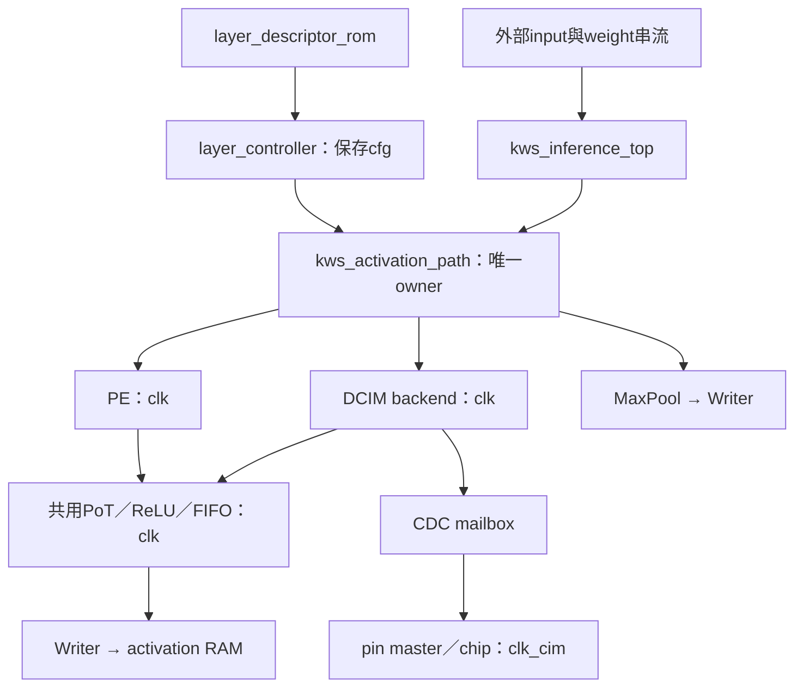
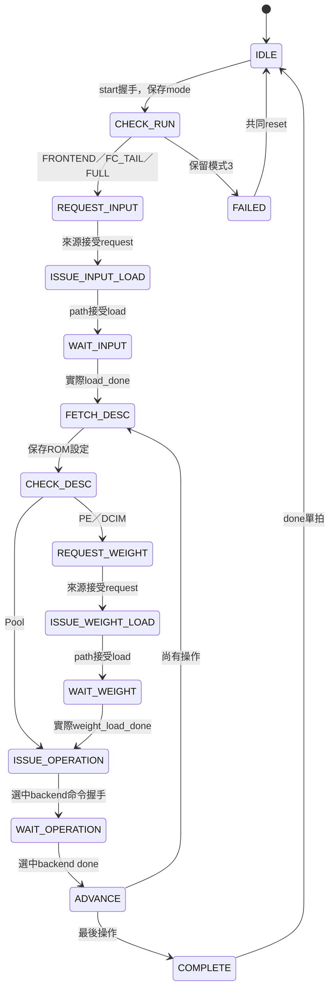

# S5-D1：全段 PE／DCIM 自動排程

日期：2026-10-17。S5-D1在提交5f35849已由Claude獨立功能驗證通過（使用者回傳報告）；本頁下文保留當時架構與作者檢查紀錄。最新S5-D2的分類與done語意見[S5D2_ARGMAX.md](S5D2_ARGMAX.md)，不可將舊PASS直接套用到新RTL。

Claude回報：lint、controller/ROM、shared全層、S4回歸及負測全部通過；FULL的PIPE/POST=00、01、10、11各通過九操作、五次權重要求、32040筆有效RAM比較，另通過CIM half/phase=10000/1300ps。標準9434/2700ps配置各run總cycles為4858406、4865443、4860233、4867279；含TB初始化、來源停頓及最後RAM掃描，並非純推論延遲。逐層讀寫數與本頁表格一致。log來源：`HYBRID_SYSTEM/scratchpad/s5d1/<編號>.log`及`build/inference_p<PIPE>_post<POST>/`，本次作者未重跑上述長測試。Claude的錯誤done mux、錯誤weight_backend突變均被抓到。尚無Vivado／STA／板測證據。
本文件取代早期S4「FULL拒絕」的現行規格；舊文件保留為歷史紀錄。

## 1. 範圍與完成定義

一份8064-byte UINT8（zp128）輸入 → Pool1 → Conv1/PE → Pool2 →
Conv2/DCIM → Pool3 → Conv3/DCIM → Pool4 → FC1/PE → FC2/PE。
權重為signed INT8，無bias，沿用唯一PoT/ReLU/FIFO及單一32KiB activation RAM。
FULL的done代表FC2八筆UINT8已提交RAM[0..7]；**不代表已產生Argmax分類，也不含音訊/Mel前端**。
Pool4的144筆CHW資料直接作為FC1向量，不增加Flatten搬移。

## 2. 修改檔案與沿用邊界

| 檔案 | 修改 |
|---|---|
| rtl/control/layer_controller.sv | 增加DCIM valid/ready/done/error；FULL接受0..8；完成/錯誤以三backend明確選擇 |
| rtl/integration/kws_inference_top.sv | 新增clk_cim/rst_cim；接上DCIM命令、設定與完成；weight_backend由cfg選擇 |
| tb/control/tb_layer_controller.sv | FULL九操作、DCIM停頓／完成／錯誤，非owner done/error隔離 |
| tb/integration/tb_kws_s4_software.sv | 補雙時脈port（局部測試仍同頻）；非法模式改保留值3 |
| tb/integration/tb_kws_inference_top.sv | 新增真實雙時脈完整九操作TB |
| Makefile | 新增build-inference-top、test-inference-top、test-inference-negative、lint-inference-top |
| docs/SINGLE_BUFFER_ARCHITECTURE.md | 更新當前S5-D1進度，不覆寫歷史測試結論 |

descriptor ROM與package已有完整定義，沒有修改。共享path、CDC、backend、PE、PoT、Reader/Writer、MaxPool全部沿用。
工作樹原有cell、clock、board、argmax、PoT空白等變更不是本次修改；審查需記錄其diff，不能把它們歸入本次提交。

## 3. 連接與外部介面



- `clk/rst`：system domain。`clk_cim/rst_cim`：CIM domain；新增必要輸入，不可懸空。
- 兩域必須共同reset事件、各自同步解除；不支援推論中只reset單一domain。頂層不新增MMCM或reset synchronizer，板級wrapper負責。
- 模擬預設clk=125MHz，clk_cim半週9434ps約53MHz、初始相位2700ps；這不是STA保證。
- 外部input/weight介面不變：request握手只表示來源同意供應，非資料已載入。接著用valid/ready逐byte傳送，valid等待ready時payload須保持。
- weight_layer_id依序0、1、2、3、4；K×C分別108、1296、1296、4608、256 bytes，filter-major（channel輸出優先、k在內）。DCIM padding仍由backend自行產生，來源不多送padding。
- 不增加外部weight_backend腳位，已有layer_id足夠識別來源檔案；內部cfg.backend選擇PE/DCIM。
- cfg於FETCH_DESC保存，直到操作結束才更換；不能將live ROM或外部run_mode直接用於正在執行的交易。
- start優先於同拍debug read；整段busy包含層間空檔，禁止debug read插入。錯誤鎖定後需要共同reset重新開始。

## 4. 狀態機（仍15個狀態）



錯誤轉移：source_error/path_fault在活動狀態優先進FAILED；WAIT_INPUT/WAIT_WEIGHT/WAIT_OPERATION各檢查對應error，error與done同拍時error優先。
其他backend的done/error不驅動目前操作；共享path總fault仍有全域優先權。
不在此階段加入timeout、跨層重疊、A/B buffer或額外scheduler。

| 操作 | backend | 來源base | 目的base | 預期RAM讀請求 | 預期commit |
|---|---|---:|---:|---:|---:|
| 0 Pool1 | Pool | 0 | 8064 | 8064 | 2016 |
| 1 Conv1 | PE | 8064 | 10080 | 16470 | 21960 |
| 2 Pool2 | Pool | 10080 | 0 | 21960 | 5400 |
| 3 Conv2 | DCIM | 0 | 5400 | 39312 | 4368 |
| 4 Pool3 | Pool | 5400 | 0 | 4368 | 1008 |
| 5 Conv3 | DCIM | 0 | 1008 | 5184 | 576 |
| 6 Pool4 | Pool | 1008 | 0 | 576 | 144 |
| 7 FC1 | PE | 0 | 144 | 432 | 32 |
| 8 FC2 | PE | 144 | 0 | 32 | 8 |

FC1讀取432=144×3，對應12+12+8 outputs的replay。DCIM每patch讀108有效activation，padding在backend內，不從RAM讀128筆。

## 5. 測試實作與驗收規格

### 協定TB

`make test-layer-controller`使用受控端點，不代表算術驗證：

- 保留FRONTEND、FC_TAIL及失敗/reset測試，增加FULL九操作。
- valid等待ready四拍，設定保持；等真正load_done才發運算命令。
- 非owner done與error拉高五拍不得前進或報錯，三種backend均涵蓋。
- DCIM error與done同拍必須失敗，沿用PE/Pool對應案例。
- 預期summary：successes=3、operations=17、failures=9。17含三個在預期失敗run之前已完成的操作，非17個完整推論。

### 真實全鏈TB

`tb_kws_inference_top`只從公開頂層port送初始輸入與權重；被動觀察內部交易作scoreboard，**沒有force、stub或中間Golden回灌**。

1. 一次FULL、五次weight request，run_mode在start後改成FC_TAIL，仍必須跑原先保存的FULL。
2. 輸入／權重插入可重現seed空拍；送出valid後保持資料至握手。
3. 九個操作backend與順序；每筆RAM讀位址用獨立CHW/patch公式核對，禁止讀未初始化區。
4. 每筆RAM commit核對位址、UINT8 Golden、數量與順序；Conv用patch-major串流轉CHW位址。
5. op_done必須等全部讀寫及PoT排空；非owner raw ready不可開啟，兩來源不可同時ready。
6. 完成後公開read掃描全部32768位址，核對已初始化的32040 bytes；未初始化728 bytes不假定為0。八個FC2值包含在此讀回內。
7. read反壓時data/last保持；start不得搶占read。done單拍；各層log帶PIPE/POST與累計cycles。
8. `+CORRUPT_GOLDEN`只翻轉Conv2 Golden第一筆，必須非零退出且命中`S5D commit mismatch op=3`，不能只以任意失敗視為通過。

此TB不是raw INT32逐筆算術測試；該層證據由既有共享path/DCIM整層測試提供。本TB重點是**真實串接全鏈的逐層寫回**。
目前完整頂層TB沒有中途reset、來源錯誤或內部backend錯誤注入；協定單測／既有局部TB提供部分證據，不將其等同完整頂層覆蓋。

## 6. 可重現指令與結果狀態

```bash
cd /home/LAB505/projects/KWS/KWS_DNN_Hybrid/HYBRID_SYSTEM
make lint-inference-top
make test-layer-descriptor test-layer-controller
make test-shared-postprocess
make test-inference-top S5D_PIPE=0 S5D_POST=0 S5D_SEED=505
make test-inference-top S5D_PIPE=0 S5D_POST=1 S5D_SEED=128
make test-inference-negative S5D_PIPE=0 S5D_POST=0
make test-s4-software
```

先跑上述最小驗收矩陣。要宣稱RESULT_PIPELINED兩種配置全段都通過，另跑PIPE=1、POST=0/1；本次不預設它們通過。
第二時脈相位案例可重用binary，以`S5D_PHASE_PS=1300 S5D_HALF_PS=10000`執行test-inference-top，勿覆蓋原log。
Makefile將每次run輸出存於`build/inference_p<PIPE>_post<POST>/seed_*_half_*_phase_*.log`，等完成後看摘要，不反覆輪詢。

作者本次只做lint／靜態檢查，未執行上述功能模擬。Claude需回傳實際工具版本、commit/diff、命令、exit code、summary與log路徑。
沒有Vivado合成／布局繞線、時序、BRAM推導、CDC實體報告或板測證據；不得據此宣稱125MHz/53MHz實體通過。

作者檢查紀錄（Verilator 5.030）：

| 檢查 | 結果 |
|---|---|
| `make lint-inference-top` | exit 0；沿用PATH_LINT_FLAGS與既有unused/empty-pin例外，無新增警告；log `/tmp/s5d-lint.log` |
| 完整新TB的`--lint-only --timing`（預設PIPE=0、POST=0） | exit 0；log `/tmp/s5d-tb-lint.log`；未編譯執行binary |
| controller TB的`--lint-only --timing` | exit 0；未執行模擬 |
| 本次提交範圍的`git diff --check` | 通過；原有未提交cell/PoT空白問題不在此範圍，未修改 |

lint不執行assertion或scoreboard；以上不能取代Claude的功能驗證。
