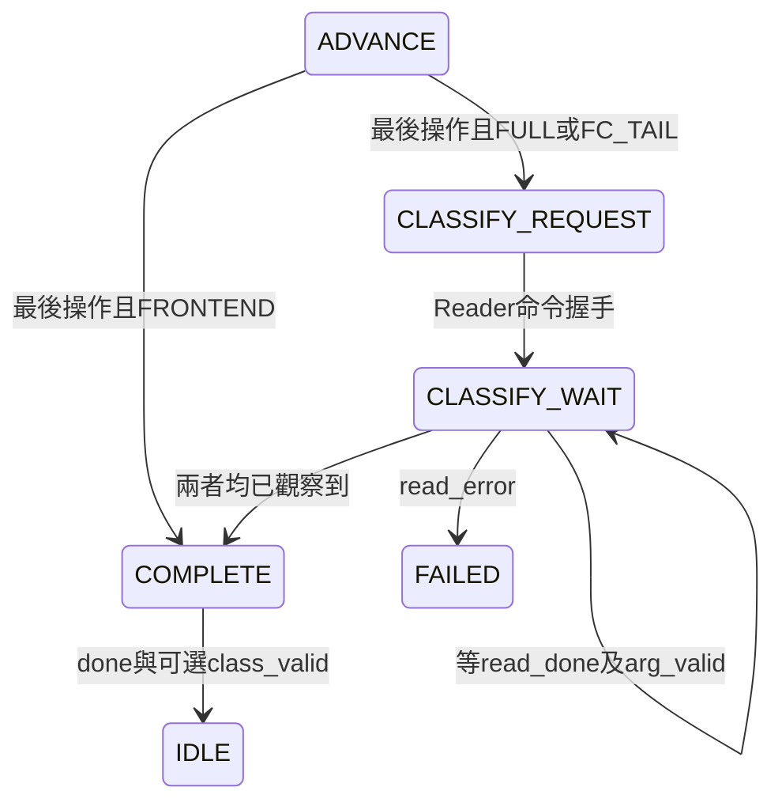

# S5-D2：FC2記憶體讀回與分類

日期：2026-10-17。RTL已撰寫；全鏈驗證交Claude，未宣稱全鏈或實體驗證通過。

更新：使用者回傳Claude對`3f78310`的審查，S5-D2 PIPE0/POST0、PIPE0/POST1及輸入reset恢復、S4四組回歸、正式DCIM_WEIGHT/RAW/COMMIT負測均通過；分類index=6、score=183，八筆讀取/輸出、FULL九操作及32040筆RAM比較正確。log在`scratchpad/s5d2/`與`build/inference_p0_post*/`。分類中reset在scratchpad亦通過，但當時未納入正式TB。作者未重跑上述長測試。本頁較早「尚未執行」指當時提交狀態；最新測試補強見[S5D2_TEST_COVERAGE.md](S5D2_TEST_COVERAGE.md)，新增案例尚待Claude執行。

## 架構與契約

```text
FC2 → 共用PoT → Writer → RAM[0..7]
                              ↓ 完成寫回後
layer_controller → 共用Reader（LINEAR，base=0，count=8）
                              ↓ 依類別0..7輸出UINT8
                           argmax_8
                              ↓
              class_index / class_score / class_valid + done
```

沒有新增RAM、第二份Reader、PoT或分類控制器。`argmax_8.sv`本身不修改，保留使用者原有空白變更。
八筆FC2共用同一輸出scale及zp128，故可直接比較UINT8；同值選最小index。
這是**量化後八個分數**的argmax，飽和/捨入可能造成平手，不能保證等於FP32分類，也不是新準確率量測。

### 外部介面變更

| 訊號／模式 | 新契約 |
|---|---|
| class_valid | FULL或FC_TAIL成功時與done同拍的單拍脈波，沒有ready/backpressure |
| class_index[2:0] | 類別0..7；只在class_valid時有有效性保證 |
| class_score[7:0] | UINT8最大值，不是機率或FP32分數 |
| FULL／FC_TAIL done | 九操作或FC尾段完成後，再等八筆讀取及Argmax輸出完成 |
| FRONTEND done | 原本Pool2完成；class_valid=0，不讀取分類資料 |
| op_done/current_op | 仍只對應九個模型操作；分類不是op9，FC2後current_op保持8 |
| debug read | 分類期間ready/out_valid/done/error不外露，資料無效時read_data可變 |
| reset | 共同reset取消Reader/Argmax及兩個完成旗標，不清RAM，不送取消交易的done |

class輸出由系統clk域產生，不加CDC。外部須在class_valid採樣；本版不提供結果queue。

## 狀態與完成條件

既有layer_controller增加兩個狀態，共17個，enum由4-bit改5-bit（Vivado實際FSM編碼仍由工具決定，不能由此推定FF數）。



- 新操作start及分類read命令握手時clear Argmax，避免上一筆分類殘留。
- 分類期間Reader的out_ready固定1，Argmax本身每拍可接受一筆，無需新增FIFO。
- `read_seen`與`arg_seen`分別保存完成脈波；兩脈波不必同拍。新start/read命令先清旗標。
- source_error/path_fault沿用全域錯誤優先；read_error映射LERR_OPERATION，FAILED鎖定到共同reset。
- 完成前controller_busy持續為1，避免FC2 done到分類啟動之間被host read或下一筆start插入。

## 變更清單

- layer_controller.sv：classify valid/ready/active/done/error介面與兩個狀態。
- kws_inference_top.sv：Reader命令/回應路由、argmax實例、完成旗標、三個class輸出。
- tb_layer_controller.sv：分類request停頓、等完成、error與done同拍；預期successes=3、operations=19、failures=10。
- tb_kws_inference_top.sv：分類的8個讀位址、8筆data/last與class/score比較；+MAX_CYCLES；+CORRUPT_CLASS；+RESET_BEFORE_FULL。
- tb_kws_s4_software.sv：FRONTEND不得分類、FC_TAIL必須分類，保留所有原有回歸。
- tb_kws_shared_postprocess.sv：+DCIM_WEIGHT正式覆蓋，檢查DCIM load_valid/weight_valid未洩漏。
- Makefile：加入argmax來源、TB lint、分類負測及watchdog/extra args；test-shared-review增加DCIM_WEIGHT兩POST。
- 基準及S5-D1文件：記錄Claude既有驗收，明確區分新RTL待驗證。

## 測試內容與限制

全鏈TB仍僅提供原始UINT8與權重，不回灌中間Golden。模型操作的read/commit數不變，分類另外計8讀/8輸出，無RAM寫入；RAM掃描仍32040筆有效內容。
期望class由TB對軟體fc2.mem用嚴格大於計算，不能從DUT最大值反推答案。
`+CORRUPT_CLASS`只破壞期望index，必須命中`S5D classification mismatch`才算負測通過。
`+RESET_BEFORE_FULL`先真正啟動FULL、握手16筆input，進行共同reset，觀察10拍沒有殘留交易，再重跑完整FULL。這是輸入載入中reset，不是DCIM計算中reset，不能混稱。
`S5D_MAX_CYCLES`預設20000000；慢時脈須手動提高，未實作自動頻率推估。

作者僅執行短單測與lint，結果由交接時的實際log提供；長回歸交Claude。已知未覆蓋：完整頂層DCIM計算中reset/backend錯誤、PoT滿反壓、多樣本分類準確率、實體CDC/STA/BRAM/板測。

## 作者已完成的檢查（中斷後核對）

Verilator 5.030；下列命令均exit 0，恢復工作時核對既有完整log，沒有重跑長模擬。

| 命令 | 結果／log |
|---|---|
| make lint-inference-top | 通過，沿用既有警告例外；`/tmp/s5d2-lint.log` |
| make lint-inference-tests | 新FULL及舊S4 TB均通過lint；`/tmp/s5d2-tb-lint.log` |
| make test-layer-controller test-argmax | controller successes=3 operations=19 failures=10；ALL ARGMAX TESTS PASSED；`/tmp/s5d2-unit.log` |

尚未執行：S5-D2的test-s4-software、test-inference-top、class負測、RESET_BEFORE_FULL及新增DCIM_WEIGHT正式案例。這些測試已撰寫，不等於已PASS；請依Claude交接文件執行。
