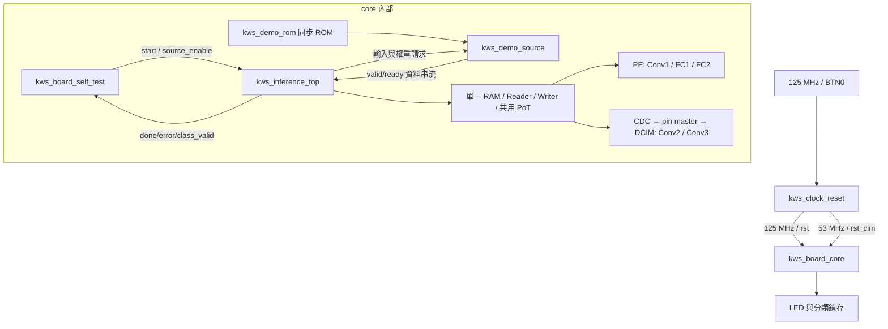
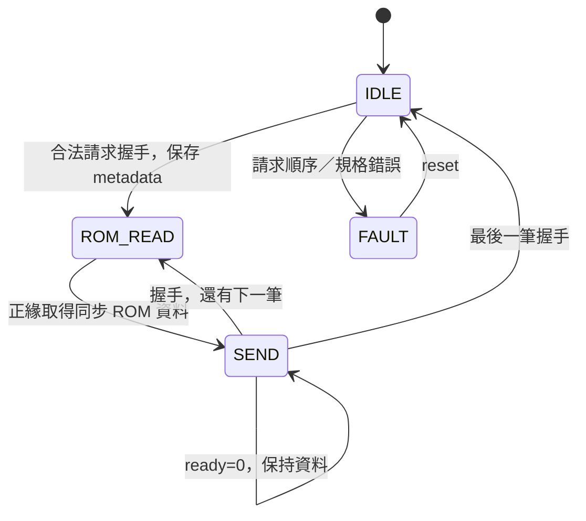
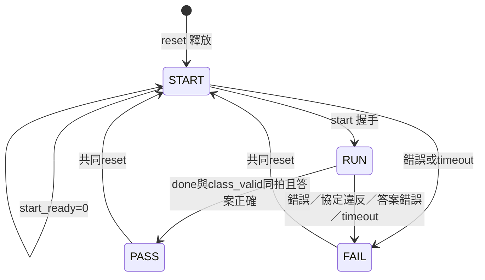

# S6 固定樣本全段推論板級整合

## 狀態與目的

本次建立 RTL、TB 與 Vivado 匯入流程。**新模擬、lint、資料生成、Vivado、板測均尚未執行，依使用者要求交由 Claude 驗證。** 既有 S5-D2 的 PASS 不代替本次驗證。

維持單一 activation RAM、PE/DCIM 共用 PoT、既有 layer controller 與 CDC，不新增 AXI/DMA、DDR 或 A/B buffer。固定 sample 6988、zp128、無 bias；只從 ROM 提供輸入和權重，所有中間 activation 由硬體實算。

## 元件關係



仍執行 Pool1 → Conv1 → Pool2 → Conv2 → Pool3 → Conv3 → Pool4 → FC1 → FC2 → 八筆讀取 → Argmax。

| 新檔（board/kws/） | 功能 |
|---|---|
| kws_demo_rom.sv | 16384×8 同步讀 ROM，readmemh 初始化，不 reset 整個記憶體 |
| kws_demo_source.sv | 請求檢查、逐筆供應、反壓保持、非法請求鎖定 |
| kws_board_self_test.sv | 自動啟動一次、保存答案、timeout、sticky PASS/FAIL |
| kws_board_core.sv | 連接真正推論 top，可用獨立雙時脈模擬 |
| kws_clock_reset.sv | IBUF/BUFG/MMCM、按鍵同步、穩定釋放、雙域 reset |
| kws_board_top.sv | 實體腳位與 LED |
| kws_board_pynq_z2.xdc | 板級腳位與時脈 |
| pre_opt.tcl | 合成後／opt_design 前的 CDC 限制，找不到物件立即報錯 |
| create_project.tcl | 只匯入正常頂層專案，不使用 OOC，不自動合成 |
| report.tcl | 資源、setup/hold、CDC、DRC、例外報告 |

## ROM 與來源狀態

| 區域 | 起始 byte | 長度 |
|---|---:|---:|
| quant_input | 0 | 8064 |
| Conv1 weights | 8064 | 108 |
| Conv2 weights | 8172 | 1296 |
| Conv3 weights | 9468 | 1296 |
| FC1 weights | 10764 | 4608 |
| FC2 weights | 15372 | 256 |
| padding | 15628 | 756 |

權重沿用軟體匯出順序。**DCIM 仍透過 backend／CDC／master 真正寫入 cell，不是直接 readmemh 預載 cell。**



無反壓約每兩拍一個 byte，第一版不追求來源每拍一筆。先接一次8064筆輸入，再接 layer0..4 權重；不支援不 reset 的重跑或通用 FC-tail。

## 測試 supervisor 狀態



class_valid 沒有 ready，該拍保存 index/score。預期 index=6、score=183。預設 timeout=125000000 系統拍（125 MHz約一秒，包含 START 等待）。錯誤碼：1 engine error、2 source fault、3 timeout、4 done/class_valid 協定錯誤、5 答案不符；同拍多錯依 RTL 優先順序。

FAIL 停止供應但不代表 engine 已排空或 reset，重跑必須按 BTN0。LED busy 是 supervisor 狀態，不保證 timeout 後 engine 完全沒有活動。

## 時脈／reset／LED

- 系統125 MHz經BUFG；MMCM：125×6.625=828.125 MHz VCO，再除15.625得53 MHz，經BUFG給DCIM。
- BTN0高有效，**不是 SRST**。立即共同 assert reset；放開、LOCKED 穩定約20ms後，各域同步 deassert。
- `VERILATOR` 分支只是行為振盪器，不是 UNISIM/MMCM 電性驗證。
- LED0=雙域reset解除且locked；LED1=busy；LED2=pass；LED3=fail。成功 `led[3:0]=0101`，LED1可能短暫閃過。
- 分類、錯誤碼、cycles 有 MARK_DEBUG 保留，沒有實例化 ILA；外殼成本不能當作純核心面積。

CDC 首級 toggle 同步器例外與 mailbox 6ns datapath budget 分開設定。6ns 是設計選擇，不是實測結果。不要另加 blanket clock_groups/false_path 覆蓋資料限制，參見 [AMD 例外優先權](https://docs.amd.com/r/2020.2-English/ug1387-acap-hardware-ip-platform-dev-methodology/Clock-Exceptions-Precedence-Over-set_max_delay)。hook 的合成後名稱及 reset 例外必須經 netlist／CDC／STA 審查，不能刪掉報錯來繞過。

## 資料與 Vivado 操作

由 Claude 在 Docker 執行：

```bash
cd /home/LAB505/projects/KWS/KWS_DNN_Hybrid/HYBRID_SYSTEM
make generate-kws-board-vectors
```

生成 `build/kws_board_vectors/{kws_demo.mem,manifest.json,sources.txt}`。核對軟體來源 hash、樣本及 scale ROM；FC2 golden 不供應給運算引擎。RTL改動後重新生成 manifest。Tcl引用live RTL、不自行核對hash，不是凍結快照。

Windows Vivado 2023.2（先關其他專案）：

```tcl
set kws_pipe 0
set kws_post 1
source {C:/Windows/System32/aoc-workspace/projects/KWS/KWS_DNN_Hybrid/HYBRID_SYSTEM/board/kws/create_project.tcl}
```

專案預設在 `HYBRID_SYSTEM/build/kws_board`。存在時開XPR，或事先設定不同 `kws_destination`，不覆寫。Windows須看得到生成的mem。GUI Run Synthesis → Run Implementation → Open Implemented Design，再執行：

```tcl
source {C:/Windows/System32/aoc-workspace/projects/KWS/KWS_DNN_Hybrid/HYBRID_SYSTEM/board/kws/report.tcl}
```

功能、容量、時脈/reset/CDC、setup/hold及DRC審查通過後才產生bitstream上板。**尚不保證完整系統放得進PYNQ-Z2或達成125/53MHz。** 正常top只是移除OOC邊界假設，不能自動解決真實長路徑。

驗證與回傳格式見 [S6_CLAUDE_REVIEW_PROMPT.md](S6_CLAUDE_REVIEW_PROMPT.md)。
