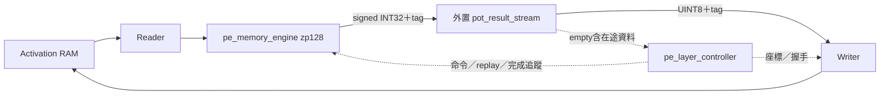
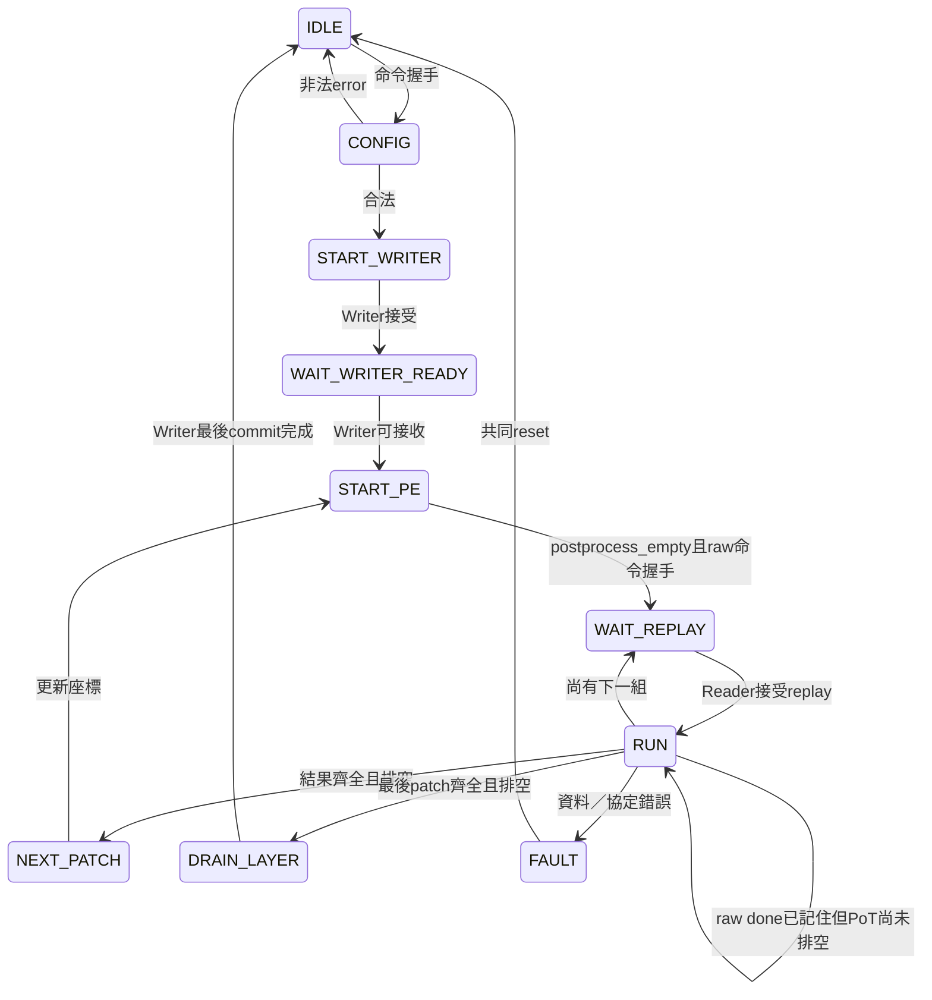

# 共用後處理第一步：PE raw engine＋外置 PoT

使用者已授權改變原先保留PE內部後處理的整合邊界。本次只完成第一步；DCIM尚未接入共享path、不新增DCIM owner、不開放FULL。外部path介面、RAM配置、算術及資料格式不變。

## 架構



`kws_activation_path`原先例化`pe_pot_engine`，現在直接例化`pe_memory_engine(INPUT_ZERO_POINT=128)`與一個外置`pot_result_stream`。raw valid/ready同時以PE owner、reset與fault限定。layer_id/ReLU由controller保存的設定提供，不能由會變動的外部命令直接提供。舊`pe_pot_engine`保留作獨立封裝與回歸基準。

## 完成與狀態

`pe_layer_controller`新增`postprocess_empty`輸入。`pe_compute_done`現在可表示raw端完成，`pe_out_*`仍表示量化後結果，兩者不能混淆。

狀態數仍10個：IDLE、CONFIG、START_WRITER、WAIT_WRITER_READY、START_PE、WAIT_REPLAY、RUN、NEXT_PATCH、DRAIN_LAYER、FAULT。



RUN記住raw done，保持結果通路開啟。不再因PoT尚在輸出而報缺資料；當empty成立仍缺結果，則是真正短輸出錯誤，進FAULT。raw done時Reader仍未完成、replay組數不足仍屬錯誤。結果tag、超量、last、來源錯誤檢查保留。結果計數採已註冊值，最後輸出被接受後下一拍判定排空，不搶在同拍切換座標。

`empty`在reset為0；解除reset後，comb模式由count==0判定，pipeline模式由reserved==0判定。reserved涵蓋FIFO與在途量化資料，不增重複計數器。empty不等於Writer commit完成。

原封裝`pe_pot_engine`也接empty，完成時要求core_finished、retired==channels和empty；原有輸出與完成契約保留。

## 修改檔案

- RTL：`rtl/integration/kws_activation_path.sv`、`rtl/control/pe_layer_controller.sv`、`rtl/datapath/pot_result_stream.sv`、`rtl/integration/pe_pot_engine.sv`。
- 新腳位相容：`board/postprocess/postprocess_self_test.sv`、`tb/integration/tb_dcim_layer_memory.sv`明確將未使用empty接空，不改運算。
- 測試：`tb/control/tb_pe_layer_controller.sv`改接真實raw＋外置PoT；`tb/datapath/tb_pot_result_stream.sv`逐拍檢查empty；`tb/integration/tb_pe_conv1_pool_memory.sv`新增PoT配置參數。
- `Makefile`新增四配置`test-pe-external-post`；更新本文件與架構基準。

## 驗證方法

```bash
cd /home/LAB505/projects/KWS/KWS_DNN_Hybrid/HYBRID_SYSTEM
make test-pe-external-post > /tmp/pe-external-review.log 2>&1
make test-pot-stream test-pot-engine
make test-s4-software lint-s4 lint-pe-layer-controller
```

1. 原controller真實RAM/Reader/Writer/PE數學scoreboard保留，覆蓋完整Conv1、FC1三次replay、FC2、非法配置、fault與reset。
2. RESULT_PIPELINED×POSTPROCESS_PIPELINED四配置。檢查raw done先於後處理排空確實出現，等待時不得開始下一patch、done或fault。
3. FC2在PE啟動後停止Writer接收，讓八筆填入PoT；raw完成後維持停頓10拍，再共同reset。檢查無舊valid/done並重新載入執行恢復。
4. 真實軟體sample6988的Conv1/Pool、FC1/FC2對比；不以DUT輸出產生Golden。四配置各執行seed505；既有PoT管線版另保留seed128回歸。
5. PoT單測以sent-received檢查empty，涵蓋pipeline在途、FIFO滿、混合tags、reset、768筆輸出。
6. 原pe_pot_engine六配置回歸，以及S4 FRONTEND/FC_TAIL回歸；不是逐拍雙DUT等價證明。

測試曾因在Writer就緒之前施加全停頓而卡住；已改在PE命令接受後停止接收，確保測到raw-done等待而非初始化等待。未修改RTL繞過此測試。

## 結果

### Claude F1～F3審查修正

- F1：保留empty gate，在operation_phase內拒絕非compute_phase的pe_out_valid，避免多餘結果造成START_PE永久等待。IDLE/CONFIG不屬此項檢查範圍；共享top的殘留保護另處理。正式TB在真實NEXT_PATCH注入一拍PoT raw輸入，並在DRAIN_LAYER注入量化結果valid，要求20拍內error/FAULT與鎖定，兩種PoT配置均重跑。
- F2：Makefile三處負向測試改用grep，不再依賴rg。
- F3：external-post入口加入指定Commit mismatch的Golden破壞測試；log增加POST；排空檢查包含raw done當拍。原stalls實際是host read的valid&&!ready觀察計數，不是PE後處理反壓，也不是單純刺激次數，改名顯示host_read_stall_cycles以免誤解。

2026-10-16確認正式回歸完成：`make test-pe-external-post test-s4-software lint-s4 lint-pe-layer-controller` exit 0。四種配置均通過新增的兩項late-result fault測試、正常運算與pending reset；external與S4損壞Golden均被指定訊息拒絕。完整暫存log為`/tmp/review-fixes.log`，可使用上述命令重建，不將scratchpad結果算入正式驗收。

擴大排空monitor到raw done當拍後，四種配置的`drain_wait`分別為3402、2852、8979、9290（下表順序）；相較原表每項增加1841，正好是先前漏計的raw done當拍。此變化是驗證計數範圍修正，不是RTL增加了1841拍延遲。每配置另新增2個故障案例，獨立印出`PASS late-result`，原summary的`faults=2`仍只指原有案例。

2026-10-15，Verilator 5.030實測全部通過：

| raw pipeline | PoT pipeline | raw提早完成次數 | 等待排空拍數 | controller結果 |
|---:|---:|---:|---:|---|
| 0 | 0 | 1841 | 1561 | PASS |
| 1 | 0 | 1841 | 1011 | PASS |
| 0 | 1 | 1841 | 7138 | PASS |
| 1 | 1 | 1841 | 7449 | PASS |

每配置controller測試包含7個正常層、12個非法配置、2個fault、229376筆RAM讀回及新增pending reset案例。每配置共享path軟體測試含8操作、8拒絕、5次權重載入、327680筆RAM讀回。這些等待拍數是指定刺激下的覆蓋計數，不是效能比較。

原pe_pot_engine六配置各7 jobs／109 outputs通過；PoT兩配置各768筆與empty檢查通過。S4兩種raw pipeline×兩seed各3 runs／7操作／96120筆檢查通過，損壞Golden正確拒絕。原共享path Host/Pool回歸9 cases／11拒絕／294912筆RAM檢查通過。共享path、S4與PE controller lint通過。

執行摘要log：`/tmp/pe-external-full.log`、`/tmp/pe-external.log`、`/tmp/pe-external-pool.log`；這些是本機暫存，不隨git提交，請使用上列命令重建。測試使用當時工作樹，其他使用者修改未納入本次提交。未重跑耗時的完整DCIM整層測試，此步只為其TB補empty空接。

未執行Vivado、STA、BRAM利用率或上板；不宣稱面積或頻率改善。DCIM共享mux、owner切換與完整混合推論留待第二／三步。
