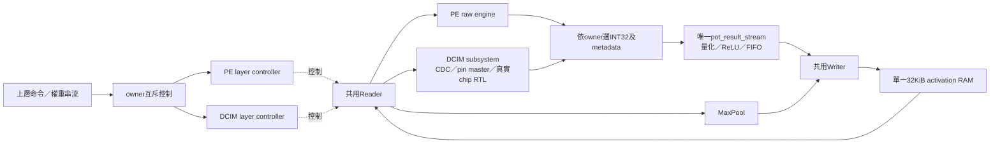
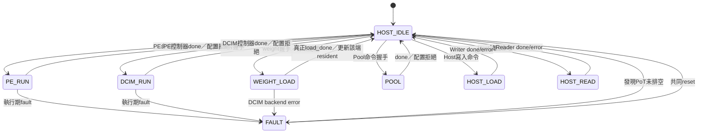

# 共用後處理第二步：PE／DCIM接入單一activation path

日期：2026-10-16。前置F1～F3修正已於`4538316`提交。本文說明第二批，不將測試平台的串接誤稱為FULL推論已開放。

## 1. 範圍與關係圖



沒有新增activation RAM、line buffer或第二份PoT。DCIM已有的activation暫存／CDC mailbox與PE權重BRAM保持原設計。`pe_data/pe_channel`是沿用的內部名稱，在此top代表共用後處理輸出，不代表僅供PE；避免本次夾帶無關全面改名。

## 2. 新增外部介面

| 訊號 | 規格 |
|---|---|
| `clk_cim/rst_cim` | 傳給既有DCIM subsystem；原`clk/rst`為系統域 |
| `weight_backend` | 命令握手時保存，0=PE、1=DCIM；資料傳送中改動此輸入不切換目的端 |
| `dcim_cmd_valid/ready` | 整層DCIM命令；不與PE/Pool/Host並行 |
| `dcim_layer_id` | 1=Conv2、2=Conv3 |
| `dcim_relu_enable` | 保存至層結束，傳給共用PoT |
| `dcim_src_base/dst_base` | 15-bit byte address；來源與目的不得重疊 |
| `dcim_width/height` | 8-bit輸入尺寸；固定Cin=Cout=12、3×3、stride1、無padding |
| `dcim_done/error` | 層完成／拒絕或執行期錯誤單拍；fault需整條路徑reset |
| `dcim_resident_valid` | 成功載入DCIM權重後有效；原`resident_valid`仍表示PE |

權重共用輸入`weight_layer_id/k/channels/valid/ready/i8`：DCIM只接受layer1/2、K108、channels12；1296筆signed INT8依filter→k順序。Backend自行補零至每filter128列，不要求Host傳padding。非法配置不啟動backend，但只要載入命令已握手，就清除該端resident；即使配置非法也必須重新載入，不能直接沿用舊權重。這是維持PE／DCIM一致的保守策略，另一端resident不受影響。

所有公開命令／資料介面屬系統clk域。兩個reset必須來自同一事件，各域同步解除；不支援單邊reset。這層不產生MMCM，也不代替板級CDC實體約束。

## 3. owner與控制流程



八個owner狀態仍使用3-bit enum；舊狀態編碼保留，DCIM_RUN加在最後。接受優先序：Weight > PE > DCIM > Pool > Host Load > Host Read。不搶占。valid在busy期間保持到ready才代表下一筆命令；只打一拍且ready=0不會排隊。

DCIM controller仍是原八狀態：

```text
IDLE → CONFIG(4拍) → START_WRITER
     → START_PATCH(等PoT empty與backend ready)
     → START_READER → RUN_PATCH
                       ├─ Reader done + DCIM done + 12個輸出 + PoT empty
                       │    ├─ 尚有patch → 更新x/y → START_PATCH
                       │    └─ 最後patch → DRAIN_LAYER
                       └─ 執行期異常 → FAULT
DRAIN_LAYER → Writer真正commit完成且PoT empty → done → IDLE
```

新增`postprocess_empty`輸入，只加在START_PATCH、RUN_PATCH完成與DRAIN_LAYER完成的條件，不新增FSM狀態。最後一筆output握手當拍empty通常仍為0，下一拍才確認排空；此為保守邊界，不宣稱零額外cycle。

## 4. 為何不會混入前一筆

1. 只有owner選中的raw來源能同時得到valid gate與ready；非owner ready=0。
2. INT32、channel、last、error及保存的layer/ReLU一併選擇，不只切換data。
3. PoT輸出valid只給當前controller；ready選該controller，Writer座標亦來自同一controller。
4. empty包含FIFO及pipeline在途資料。PE與DCIM都必須等待排空，最後還需Writer commit完成才釋放owner。
5. Idle若仍有PoT殘留或任一raw valid，禁止所有命令握手並進FAULT。ready與FSM使用同一idle_residue條件，避免新命令與FAULT在同一上升緣同時發生。
6. fault不做rollback；已寫記憶體不撤銷，必須共同reset、重載權重及失效資料。

限制：不是通用timeout或自動丟棄機制。未選中來源在其他owner執行時被阻擋；若持續至HOST_IDLE，新的殘留檢查會FAULT。若非法raw在已離開IDLE後才出現，仍依既有controller／backend協定處理，本次不宣稱涵蓋所有非同步故障注入時刻。reset是故障恢復方式。

## 5. 修改檔案

| 檔案（相對HYBRID_SYSTEM） | 修改 |
|---|---|
| `rtl/integration/kws_activation_path.sv` | 加DCIM owner、權重路由、resident、raw/PoT/Reader/Writer mux與subsystem |
| `rtl/control/dcim_layer_controller.sv` | empty完成契約 |
| `rtl/integration/kws_inference_top.sv` | S4相容：明確關閉新增DCIM命令，FULL仍拒絕 |
| `tb/control/tb_dcim_layer_controller.sv` | 協定端點提供empty |
| `tb/integration/tb_dcim_layer_memory.sv` | 真實PoT empty接controller |
| `tb/integration/tb_kws_activation_path.sv` | 舊Host/Pool測試新增port tie-off |
| `tb/integration/tb_pe_conv1_pool_memory.sv` | 舊PE測試新增port tie-off |
| `tb/integration/tb_kws_shared_postprocess.sv` | 新增真實共用路徑測試 |
| `Makefile` | 路徑來源含DCIM hierarchy、新增整合目標 |

`pot_result_stream`的算術／FIFO、CIM cell／master／CDC本次均未改。

## 6. 驗證方法與重驗命令

```bash
cd /home/LAB505/projects/KWS/KWS_DNN_Hybrid/HYBRID_SYSTEM
make test-shared-postprocess > /tmp/shared-post.log 2>&1
make lint-activation-path lint-s4 test-dcim-layer-controller \
  test-pe-external-post test-s4-software test-activation-path \
  > /tmp/shared-regression.log 2>&1
```

等待命令結束再讀PASS／ERROR摘要。新TB用125MHz系統、約53MHz CIM與非零相位。PoT pipeline=0/1各跑一次，真實cell/adder/accumulator，不以算術stub替換。

- 真實軟體sample6988；FC2使用relu4／weights／fc2 Golden。這是獨立分支輸入，不聲稱與Conv3連成完整CNN。
- 載入Conv2之前與之後執行PE FC2，確認resident不互相清除。
- Conv2→PE→Pool3→Conv3→PE→Pool4：Conv3使用硬體Pool3記憶體，不重載中間Golden。
- RAW INT32先比獨立整數MAC；Conv2/3另比軟體匯出ACC，PoT比UINT8，Writer比CHW地址與值。
- 全RAM Host讀回包含目的區之外的sentinel及來源，避免只驗done。
- 四次PE/DCIM切換檢查empty、非owner ready與逐筆結果；Host讀回施加反壓。
- `+CORRUPT_GOLDEN`破壞Conv2第一個期望byte，必須非零退出且出現`shared post mismatch`。

2026-10-16，`test-shared-postprocess` exit 0，Verilator 5.030：

| PoT pipeline | 成功計算命令 | PE/DCIM切換 | Conv2 patches | Conv3 patches | 全RAM讀回檢查 |
|---:|---:|---:|---:|---:|---:|
| 0 | 6（4次FC2＋2次DCIM層） | 4 | 364 | 48 | 131072 |
| 1 | 6（4次FC2＋2次DCIM層） | 4 | 364 | 48 | 131072 |

每配置DCIM 4944筆結果、PE 32筆結果逐筆檢查RAW／PoT／commit；另有兩次Pool與四次全RAM掃描。Host讀回反壓65534拍。損壞Golden測試正確以`shared post mismatch`拒絕。原始本地摘要：`/tmp/shared-post.log`；逐配置log：`build/shared_post_0/software.log`、`build/shared_post_1/software.log`。暫存與build不提交，可用上述命令重建。

修正前的既有回歸已完成：作者`/tmp/shared-regression.log`包含兩個lint、DCIM controller、external PE四配置、S4與Host/Pool（最後294912筆RAM檢查）通過。另依使用者提供的Claude審查報告，Claude在scratchpad重驗上述目標及`test-dcim-layer-memory`均exit 0；後者兩配置各4案例／5028筆，為Claude回報，非本次作者重新執行。本段記錄修正前版本，不冒稱為下列防護修正後的整套回歸。

測試邊界：共享top尚未逐狀態注入運算中途reset或兩個命令同拍競爭；既有PE/DCIM controller與CDC單測的reset/fault覆蓋不能代替新增top的每一種交互組合。PoT極端反壓仍由單元／controller測試負責，新top正常運算時Writer本來即持續接收；Host讀回反壓不可誤稱PoT FIFO-full覆蓋。不以模擬宣稱Vivado時序、面積、CDC實體sign-off或板測通過。S4雖例化DCIM且停用其命令，綜合可能移除不可觀察邏輯；是否保留整顆chip須看實測階層資源，不可只由RTL例化推定。

### 2026-10-17 Claude審查後的定向修正

- `idle_residue = !postprocess_empty || raw_valid || d_raw_valid`，同時驅動ready阻擋與IDLE的FAULT判斷，不新增狀態。
- DCIM WRITE_CHW的`cmd_count`明確接0，不改地址／筆數運算。
- 保留非法權重命令使該端resident失效的行為，只補充文件。
- `test-shared-review`：PoT=0/1，每配置18個殘留來源×命令案例（PE raw／DCIM raw／PoT nonempty，各對Weight／PE／DCIM／Pool／Host Load／Host Read），確認同拍ready全低、子模組不接受命令、不產生RAM交易、FAULT保持；共同reset後真實FC2八筆恢復。
- 明確使用force注入非法valid/empty，不force FSM或運算結果；正常FC2仍用真實RTL與軟體Golden。
- `CORRUPT_RAW`只破壞FC2 raw期望；`CORRUPT_COMMIT`只破壞首筆commit期望地址，要求指定錯誤訊息，避免其他失敗被誤當負測通過。

```bash
make test-shared-review lint-activation-path > /tmp/shared-review-fix.log 2>&1
```

2026-10-17作者實測：上述命令exit 0；PoT=0/1各18個殘留案例、reset後FC2的8筆raw／PoT／commit、RAW與COMMIT指定訊息負測全部PASS；activation path lint通過。本次未重跑完整Conv2/3。原始log為`/tmp/shared-review-fix.log`，逐配置結果在`build/shared_post_{0,1}/review.log`與`negative_RAW.log`、`negative_COMMIT.log`，不納入git。

## 7. 下一步

此top提供可直接命令的共享路徑；S4 `layer_controller/kws_inference_top`尚未排程DCIM。下一里程碑才連接權重需求的backend選擇、Conv2/3 descriptor與完整順序，最後接Argmax並驗證全段推論。不得只把FULL拒絕條件刪掉就當完成。
