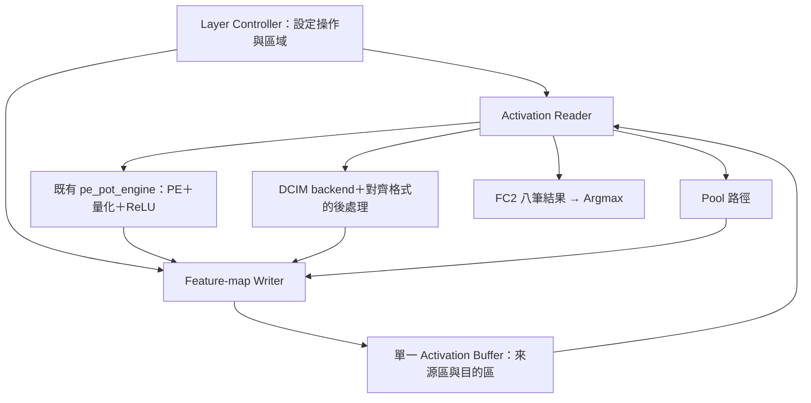
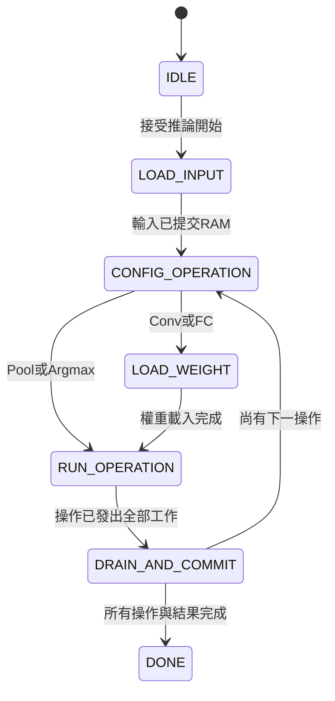

# KWS 單一 Activation Buffer：架構基準與分階段實作清單

基準版本：v1.0（2026-10-03）

狀態：規劃已記錄；本次僅新增文件，**尚未實作下列新 RTL／TB**。

## 0. 本文件的目的與使用規則

本文件記錄使用者要求保留的架構，避免每次回顧後悄悄改變模組分工、名稱、資料格式或驗證範圍。

後續進行本子系統工作時：

1. 先閱讀本文件，確認目前階段與既有 RTL，不依對話記憶自行重新定義架構。
2. 回覆明確說明「這次處理哪個階段、哪些檔案」，區分新增、修改與沿用。
3. 完成後更新本文件的進度、介面決定、測試命令／結果與限制；舊的測試須保留。
4. 若需變更本基準，先提出原設計、問題、建議變更、影響與驗證方法，經使用者同意後再修改。不得以重構或效能最佳化名義直接替換架構。
5. 使用者後續明確指示優先於此文件；把新決定記入變更紀錄，不把舊決定與新決定混寫。
6. 討論過的選項不等於採用；未實作不等於不存在規劃；RTL 模擬通過不等於 Vivado 時序通過或已上板。

## 1. 固定的第一版方向

| 項目 | 基準 |
|---|---|
| Activation 儲存 | 單一邏輯 buffer，32 KiB，32768 筆 UINT8 |
| 資料格式 | activation UINT8、zero-point=128；weight signed INT8；MAC signed INT32；無 bias；PoT 後處理 |
| 排列 | CHW，x 最快，接著 y，最後 channel |
| 存取方向 | 一讀一寫、同步讀取；不是限制只能使用一顆實體 BRAM |
| 區域分配 | 同階段輸入與輸出位址不得重疊；已失效資料的區域才可重用 |
| 排程 | 逐操作／逐層完成，第一版不做跨層重疊執行 |
| 權重 | 沿用既有 weight memory，與 activation buffer 分開 |
| 卷積第一版 | 目前模型的 3×3、stride 1、padding 0；不先擴充任意卷積模式 |
| MaxPool | 先沿用現有 `maxpool2x2_uint8.sv`；不在本里程碑自行改 BRAM 或改成四值比較器 |
| 第一個里程碑 | 交錯 channel 資料寫成 CHW → RAM 讀取 → 真正 MaxPool → 另一區域寫回 → 全結果比對 |
| 後續順序 | 先記憶體與後處理，再真實 PE，再 DCIM backend，再完整混合推論 |
| 最終計算分配方向 | Conv1／FC1／FC2 使用 PE；Conv2／Conv3 使用 DCIM；backend 尚需實作驗證 |
| A/B buffer | 完成單一 buffer 基準並量測後才另行評估，不在此版偷偷加入 |

「單一 buffer」與「同一位址原地覆寫」不同。本版不依賴特殊原地池化／卷積排程。
Activation buffer 保存層間 feature map；MaxPool line buffer 保存上一列。兩者不得混稱或因名稱相似而刪除。

## 2. 已有模組及重用邊界

| 既有檔案 | 重用方式／限制 |
|---|---|
| `rtl/integration/pe_pot_engine.sv` | 初版真實 PE 入口，已含 weight engine、PoT、ReLU、輸出 FIFO；UINT8 結果直接接 writer，不再次量化 |
| `rtl/integration/pe_memory_engine.sv` | raw INT32 engine；不是本階段預設替換目標，若改為共用後處理須另列架構變更 |
| `rtl/control/pe_group_controller.sv` | 每命令一個 patch/vector，channels 以12為一組，可能要求 replay |
| `rtl/datapath/pe_pot_result_stream.sv` | 量化、ReLU、FIFO；有 valid/ready |
| `rtl/datapath/maxpool2x2_uint8.sv` | CHW串流、可變W/H/C；無 out_ready；pool_done不是最後一次記憶體提交 |
| `rtl/datapath/argmax_8.sv` | 八類按0～7輸入；首次輸入前clear；同值選最早index |
| `rtl/integration/postprocess_tail.sv` | pool／argmax分流，無輸出反壓；不是完整activation-memory管理器 |
| `rtl/dcim_adapter/dcim_u8_offset_correction.sv` | DCIM unsigned結果修正的邊界元件，不等於完整backend |
| `../CIM_CHIP/fpga/dcim_pin_master.sv` | DCIM pin命令執行器，backend需配合現有規格 |
| `../CIM_CHIP/fpga/dcim_cdc_bridge.sv` | 不同時脈時重用；不能因buffer新增而任意取消CDC |

PE通常以patch位置為外層、channel為內層輸出；MaxPool要求CHW。必須透過writer定址排列再讀出，不能直接把PE交錯channel串流當成空間相鄰pixel。

## 3. 架構圖與位址約定

資料位址以byte為單位；初版每筆UINT8占一個邏輯位址。

- CHW寫入：`base + c*(H*W) + y*W + x`。
- 卷積patch讀取：`base + c*(Hin*Win) + (y+u)*Win + (x+v)`。
- Linear模式：`base + index`。
- 地址乘法可在設定階段預計算stride，實際讀寫使用計數／累加，避免每cycle形成長組合路徑。
- 位址為15 bits，但長度需能表示32768，至少16 bits；範圍加法須擴位再檢查，不可先截斷導致越界未被偵測。
- 未來如改32-bit資料打包，必須另記byte-lane／對齊／write-enable契約，不自行變更本版8-bit介面。

### 模型與初始位址規劃

依目前討論的模型尺寸。此表是規劃，不是已實作的descriptor；若實際checkpoint／shape不同，需先核對更新。

| 操作 | 來源base／筆數 | 目的base／筆數 |
|---|---|---|
| 初始Pool（1×64×126 → 1×32×63） | 0／8064 | 8064／2016 |
| Conv1（輸出12×30×61） | 8064／2016 | 10080／21960 |
| Conv1後Pool（12×15×30） | 10080／21960 | 0／5400 |
| Conv2（輸出12×13×28） | 0／5400 | 5400／4368 |
| Conv2後Pool（12×6×14） | 5400／4368 | 0／1008 |
| Conv3（輸出12×4×12） | 0／1008 | 1008／576 |
| Conv3後Pool（12×2×6） | 1008／576 | 0／144 |
| FC1（144→32） | 0／144 | 144／32 |
| FC2（32→8） | 144／32 | 0／8 |

最高位址32039，未超過32767。每個操作需先完成讀取、計算與寫入，才可重用舊區域。容量不含weight／psum／FIFO，也不代表BRAM數量已測得。

## 4. 分階段檔案與驗收清單

以下所有新檔案都相對於 `HYBRID_SYSTEM/`。狀態統一為：**未開始／實作中／模擬通過／Vivado通過／板測通過**，不得混用。

### S1：記憶體、資料排列與讀取（第一批）

| 狀態 | 新增檔案 | 工作 |
|---|---|---|
| 未開始 | `rtl/kws_system_pkg.sv` | 共用操作種類、地址／長度格式、配置定義 |
| 未開始 | `rtl/memory/activation_buffer.sv` | 32KiB同步記憶體，一讀一寫；不管理CNN座標 |
| 未開始 | `rtl/control/feature_map_writer.sv` | LINEAR／CHW定址、握手、成功寫入計數與完成通知 |
| 未開始 | `rtl/datapath/activation_reader.sv` | LINEAR／PATCH位址、同步讀取對齊、輸出反壓與replay支援 |
| 未開始 | `tb/memory/tb_activation_buffer.sv` | 邊界位址、不同資料、同時讀寫、讀取延遲 |
| 未開始 | `tb/control/tb_feature_map_writer.sv` | 交錯channel輸入轉CHW、非零base、越界／重疊設定、commit計數 |
| 未開始 | `tb/datapath/tb_activation_reader.sv` | patch索引、跨列／channel、停頓、不重複不漏資料 |

驗收：資料可正確寫入／讀回；writer與reader用獨立scoreboard核對地址及資料，不只檢查done。同步RAM回應遭遇ready=0時不掉資料。記憶體內容未初始化時不能當作0。

### S2：記憶體 → MaxPool → 記憶體（第一個系統里程碑）

| 狀態 | 新增檔案 | 工作 |
|---|---|---|
| 未開始 | `rtl/control/pool_transfer_controller.sv` | 保存來源／目的／W/H/C，管理串流、排空及最後寫入 |
| 未開始 | `rtl/integration/kws_activation_path.sv` | 整合buffer／reader／writer／pool／argmax；各階段分配埠所有權 |
| 未開始 | `tb/integration/tb_kws_activation_path.sv` | 寫入整張圖、讀取池化、寫回、讀回完整結果比較 |

驗收：包含5×3奇數尺寸、61／28／12／126寬度、多channel、非零base；比對所有輸出與目的區外sentinel。pool最後結果產生後仍需消費奇數尾列，完成條件同時涵蓋輸入消費與輸出commit。

第一版pool階段獨占記憶體寫入埠，保證接收每個pool valid pulse；若無法保證，必須先補完整FIFO容量／反壓規劃，不得讓writer拒收導致掉資料。此階段不強迫改MaxPool內部儲存方式。

### S3：真實 PE 的 Conv1 → Pool

| 狀態 | 新增檔案 | 工作 |
|---|---|---|
| 未開始 | `rtl/control/pe_layer_controller.sv` | patch/vector調度、保存空間位置、PE命令／replay、結果完成追蹤 |
| 未開始 | `tb/integration/tb_pe_conv1_pool_memory.sv` | 真實PE、RAM、量化、writer與pool端到端比較 |

驗收：必須接真正 `pe_pot_engine`，不得用輸出Golden的假PE取代。分別讀回Conv1量化結果及Pool結果比對。下一patch需等本patch資料／結果契約完成。額外測FC1的12＋12＋8分組及144筆activation replay；相關TB可於該步細化，但不得漏測。

### S4：層設定與 PE 端系統排程

| 狀態 | 新增檔案 | 工作 |
|---|---|---|
| 未開始 | `rtl/control/layer_descriptor_rom.sv` | 各操作尺寸／base／K／channels／backend／後處理設定 |
| 未開始 | `rtl/control/layer_controller.sv` | 載入、配置、執行、排空、區域重用與整體done |
| 未開始 | `rtl/integration/kws_inference_top.sv` | 連接正式系統，外部輸入／權重／啟動／分類結果介面 |
| 未開始 | `tb/control/tb_layer_controller.sv` | 操作順序、握手、錯誤處理、禁止提早重用來源區 |

S4可先驗證PE支援的路徑與排程。Conv2／3尚未接上DCIM前，不稱為完整混合推論完成。控制器單測可使用受控stub測協定，但最終系統驗收必須使用真實RTL。

### S5：DCIM backend 與完整混合推論

| 狀態 | 新增檔案 | 工作 |
|---|---|---|
| 未開始 | `rtl/dcim_adapter/kws_dcim_backend.sv` | 寫權重、mapping、tile、pin命令、原始結果重組與數值修正 |
| 未開始 | `tb/integration/tb_kws_dcim_backend.sv` | 真實master／chip模型，權重寫入到INT32結果驗證 |
| 未開始 | `tb/integration/tb_kws_inference_top.sv` | 全層記憶體結果及最後分類比對 |

backend詳細mapping、sum統計、tile邊界與CDC時脈需另一步確認；不得把單一offset correction模組稱為完整backend。最終正式分配仍為Conv1／FC1／FC2在PE，Conv2／Conv3在DCIM。

### 共用驗證／文件／Vivado工作

| 狀態 | 檔案 | 工作 |
|---|---|---|
| 未開始 | `scripts/generate_activation_path_vectors.py`（新增） | 獨立Python陣列／數學Golden、固定seed、記憶體初始化與預期輸出 |
| 規劃已記錄 | `docs/SINGLE_BUFFER_ARCHITECTURE.md`（本檔） | 唯一的本子系統架構基準、決定與進度 |
| 待修改 | `Makefile` | 增加各層可單獨執行的test target，保留既有測試 |
| 未開始 | `vivado/create_activation_path_project.tcl`（新增） | S2後建立統一匯入／資源／時序驗證流程；具體top與板級wrapper先規劃再實作 |

## 5. 介面語義：已定方向與仍待細化

### 已定方向

- RAM介面方向：`wr_en/wr_addr/wr_data`、`rd_en/rd_addr/rd_valid/rd_data`。
- Writer輸入使用`in_valid/in_ready`，UINT8資料與必要的channel/y/x；設定base、尺寸、LINEAR或CHW模式。
- Writer的committed_count只在實際RAM寫入時增加；輸入握手若先進暫存器，不能直接等同commit。
- Reader輸出使用valid/ready，必須有足夠response暫存或限制在途讀取，避免RAM回應時無處存放。
- LINEAR依地址遞增；PATCH按與weight一致的展開順序。暫定契約須在實作前與軟體／weight loader核對。
- PE目前已量化的結果接writer；controller保存patch位置直到結果被正確歸屬，不把FIFO channel tag當成x/y。
- `out_group_last`不是frame/layer_last；`compute_done`不是記憶體commit；`pool_done`不是整個pool搬移完成。
- FC2先把八筆量化結果存RAM，再以0～7類別順序讀入Argmax；比較共同輸出尺度。
- reset清控制與valid，不全清activation RAM；reset後重新載入或標記哪些區域有效。

### 必須在對應階段開始前明確決定

| 項目 | 尚未決定的細節 |
|---|---|
| RAM模板 | inferred BRAM或vendor IP、精確讀取延遲、是否使用額外輸出FF |
| 讀寫碰撞 | 本版預設禁止有效交易同位址讀寫；具體assertion／錯誤回報及RAM模式仍需定義 |
| 反壓 | Readerresponse buffer深度、在途數；不預設能任意無限接收 |
| 命令協定 | cmd欄位精確位寬、接受時機、非法設定／abort行為 |
| 系統時脈 | 不在本文件鎖死100／125／150MHz；整合後另驗證，不沿用獨立結果當保證 |
| 主機介面 | 先用可驗證串流介面；AXI/UART/DMA與txt解析由後續系統介面規劃決定 |
| MaxPool最佳化 | line buffer BRAM、四值比較器或保留原版，尚未選擇；不得在S1/S2順便改動 |
| ASIC版本 | 與本FPGA基準分開規劃，不以BRAM直接等同ASIC SRAM |

## 6. 狀態流程與完成條件

必要的不變條件：

1. 所有計數在對應成功交易時才前進，ready=0時資料／tag保持。
2. 來源與目的有效區域在同階段不重疊；位址不越界。
3. 下一層只能在前一層需要的最後資料已寫入、在途交易排空後開始。
4. 不多寫、不漏寫、不重複讀；Golden須比對數值、位址、次數、順序與done。
5. SRAM/BRAM沒清除不代表內容為0；未初始化區不能被當成有效activation。
6. 模擬正確／memory mapping正確／routed timing通過／板測正確是四個不同驗收項目。

## 7. 未來 A/B 比較：保留但不實作

必須先有完整單buffer基準。比較時保持模型、計算核心、後處理、資料格式、頻率與工作負載一致，列出總容量與埠數差異。
量測LUT／FF／BRAM、每層cycles、memory stalls、推論延遲及routed timing。單buffer一讀一寫原本就能同時存取，因此不得預先宣稱A/B必然加速。

## 8. 進度與變更紀錄

| 日期 | 版本／階段 | 內容 | 驗證狀態 |
|---|---|---|---|
| 2026-10-03 | v1.0／規劃 | 記錄單buffer基準、分階段檔案、介面邊界、測試與未決事項 | 文件檢查；沒有新增RTL、TB或Vivado執行結果 |

下一步固定為 **S1：先確認並實作pkg與activation buffer的精確介面／同步讀取契約，再逐步完成writer與reader**。未得到新的實作指示前，本文件不代表已授權開始全部階段。
