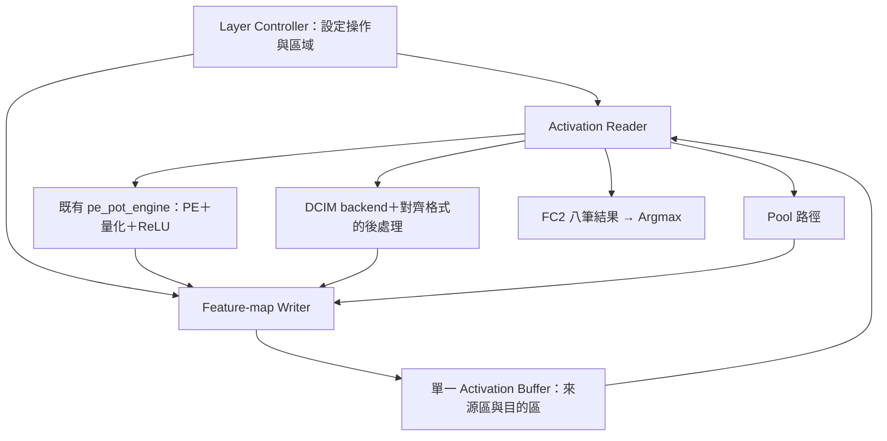
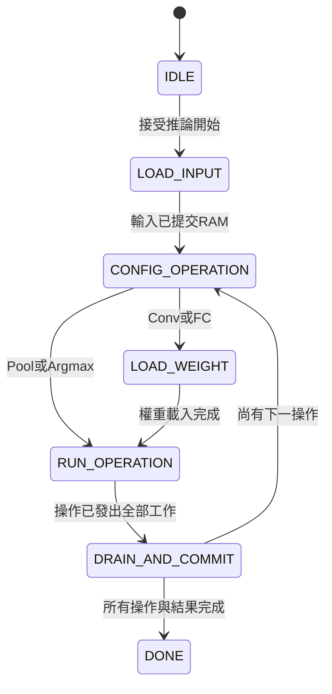
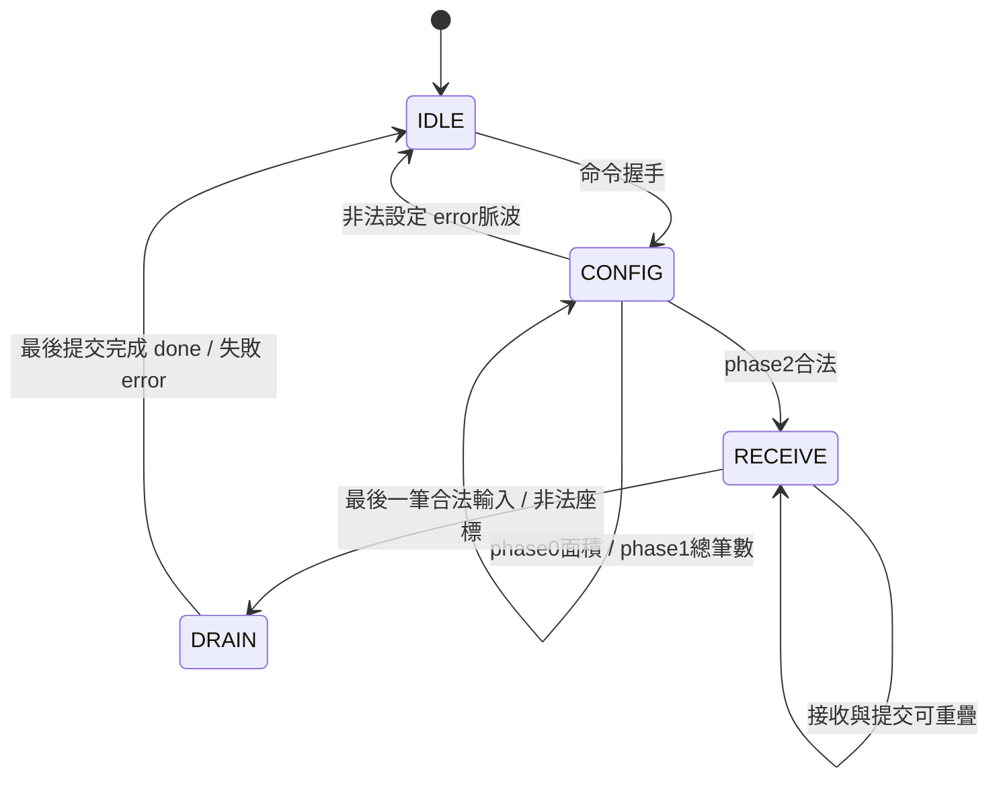
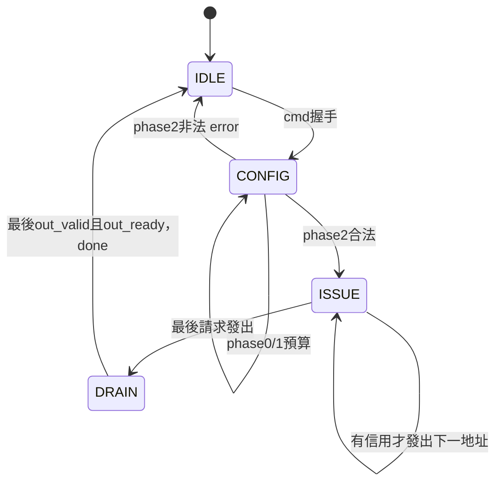

# KWS 單一 Activation Buffer：架構基準與分階段實作清單

基準版本：v1.0（2026-10-03）

狀態：S1/S2及S3共享PE/Pool路徑功能模擬通過；真實軟體樣本的Pool1→Conv1/ReLU→Pool2及獨立FC1→FC2分支逐值一致。S4/S5、Argmax、完整推論及Vivado/板測尚未完成。見[控制指南](ACTIVATION_PATH_CONTROL_GUIDE.md)與[S3驗證](S3_SHARED_PATH_VERIFICATION.md)。

## 0. 本文件的目的與使用規則

本文件記錄使用者要求保留的架構，避免每次回顧後悄悄改變模組分工、名稱、資料格式或驗證範圍。

後續進行本子系統工作時：

1. 先閱讀本文件，確認目前階段與既有 RTL，不依對話記憶自行重新定義架構。
2. 回覆明確說明「這次處理哪個階段、哪些檔案」，區分新增、修改與沿用。
3. 完成後更新本文件的進度、介面決定、測試命令／結果與限制；舊的測試須保留。
4. 若需變更本基準，先提出原設計、問題、建議變更、影響與驗證方法，經使用者同意後再修改。不得以重構或效能最佳化名義直接替換架構。
5. 使用者後續明確指示優先於此文件；把新決定記入變更紀錄，不把舊決定與新決定混寫。
6. 討論過的選項不等於採用；未實作不等於不存在規劃；RTL 模擬通過不等於 Vivado 時序通過或已上板。

## 1. 固定的第一版方向

| 項目 | 基準 |
|---|---|
| Activation 儲存 | 單一邏輯 buffer，32 KiB，32768 筆 UINT8 |
| 資料格式 | activation UINT8、zero-point=128；weight signed INT8；MAC signed INT32；無 bias；PoT 後處理 |
| 排列 | CHW，x 最快，接著 y，最後 channel |
| 存取方向 | 一讀一寫、同步讀取；不是限制只能使用一顆實體 BRAM |
| 區域分配 | 同階段輸入與輸出位址不得重疊；已失效資料的區域才可重用 |
| 排程 | 逐操作／逐層完成，第一版不做跨層重疊執行 |
| 權重 | 沿用既有 weight memory，與 activation buffer 分開 |
| 卷積第一版 | 目前模型的 3×3、stride 1、padding 0；不先擴充任意卷積模式 |
| MaxPool | 先沿用現有 `maxpool2x2_uint8.sv`；不在本里程碑自行改 BRAM 或改成四值比較器 |
| 第一個里程碑 | 交錯 channel 資料寫成 CHW → RAM 讀取 → 真正 MaxPool → 另一區域寫回 → 全結果比對 |
| 後續順序 | 先記憶體與後處理，再真實 PE，再 DCIM backend，再完整混合推論 |
| 最終計算分配方向 | Conv1／FC1／FC2 使用 PE；Conv2／Conv3 使用 DCIM；backend 尚需實作驗證 |
| A/B buffer | 完成單一 buffer 基準並量測後才另行評估，不在此版偷偷加入 |

「單一 buffer」與「同一位址原地覆寫」不同。本版不依賴特殊原地池化／卷積排程。
Activation buffer 保存層間 feature map；MaxPool line buffer 保存上一列。兩者不得混稱或因名稱相似而刪除。

## 2. 已有模組及重用邊界

| 既有檔案 | 重用方式／限制 |
|---|---|
| `rtl/integration/pe_pot_engine.sv` | 初版真實 PE 入口，已含 weight engine、PoT、ReLU、輸出 FIFO；UINT8 結果直接接 writer，不再次量化 |
| `rtl/integration/pe_memory_engine.sv` | raw INT32 engine；不是本階段預設替換目標，若改為共用後處理須另列架構變更 |
| `rtl/control/pe_group_controller.sv` | 每命令一個 patch/vector，channels 以12為一組，可能要求 replay |
| `rtl/datapath/pe_pot_result_stream.sv` | 量化、ReLU、FIFO；有 valid/ready |
| `rtl/datapath/maxpool2x2_uint8.sv` | CHW串流、可變W/H/C；無 out_ready；pool_done不是最後一次記憶體提交 |
| `rtl/datapath/argmax_8.sv` | 八類按0～7輸入；首次輸入前clear；同值選最早index |
| `rtl/integration/postprocess_tail.sv` | pool／argmax分流，無輸出反壓；不是完整activation-memory管理器 |
| `rtl/dcim_adapter/dcim_u8_offset_correction.sv` | DCIM unsigned結果修正的邊界元件，不等於完整backend |
| `../CIM_CHIP/fpga/dcim_pin_master.sv` | DCIM pin命令執行器，backend需配合現有規格 |
| `../CIM_CHIP/fpga/dcim_cdc_bridge.sv` | 不同時脈時重用；不能因buffer新增而任意取消CDC |

PE通常以patch位置為外層、channel為內層輸出；MaxPool要求CHW。必須透過writer定址排列再讀出，不能直接把PE交錯channel串流當成空間相鄰pixel。

## 3. 架構圖與位址約定



資料位址以byte為單位；初版每筆UINT8占一個邏輯位址。

- CHW寫入：`base + c*(H*W) + y*W + x`。
- 卷積patch讀取：`base + c*(Hin*Win) + (y+u)*Win + (x+v)`。
- Linear模式：`base + index`。
- 地址乘法可在設定階段預計算stride，實際讀寫使用計數／累加，避免每cycle形成長組合路徑。
- 位址為15 bits，但長度需能表示32768，至少16 bits；範圍加法須擴位再檢查，不可先截斷導致越界未被偵測。
- 未來如改32-bit資料打包，必須另記byte-lane／對齊／write-enable契約，不自行變更本版8-bit介面。

### 模型與初始位址規劃

依目前討論的模型尺寸。此表是規劃，不是已實作的descriptor；若實際checkpoint／shape不同，需先核對更新。

| 操作 | 來源base／筆數 | 目的base／筆數 |
|---|---|---|
| 初始Pool（1×64×126 → 1×32×63） | 0／8064 | 8064／2016 |
| Conv1（輸出12×30×61） | 8064／2016 | 10080／21960 |
| Conv1後Pool（12×15×30） | 10080／21960 | 0／5400 |
| Conv2（輸出12×13×28） | 0／5400 | 5400／4368 |
| Conv2後Pool（12×6×14） | 5400／4368 | 0／1008 |
| Conv3（輸出12×4×12） | 0／1008 | 1008／576 |
| Conv3後Pool（12×2×6） | 1008／576 | 0／144 |
| FC1（144→32） | 0／144 | 144／32 |
| FC2（32→8） | 144／32 | 0／8 |

最高位址32039，未超過32767。每個操作需先完成讀取、計算與寫入，才可重用舊區域。容量不含weight／psum／FIFO，也不代表BRAM數量已測得。

## 4. 分階段檔案與驗收清單

以下所有新檔案都相對於 `HYBRID_SYSTEM/`。狀態統一為：**未開始／實作中／模擬通過／Vivado通過／板測通過**，不得混用。

### S1：記憶體、資料排列與讀取（第一批）

| 狀態 | 新增檔案 | 工作 |
|---|---|---|
| 模擬通過 | `rtl/kws_system_pkg.sv` | 共用讀寫模式、地址／長度格式、配置定義 |
| 模擬通過 | `rtl/memory/activation_buffer.sv` | 32KiB同步記憶體，一讀一寫；不管理CNN座標 |
| 模擬通過 | `rtl/control/feature_map_writer.sv` | LINEAR／CHW定址、握手、成功寫入計數與完成通知 |
| 模擬通過 | `rtl/datapath/activation_reader.sv` | LINEAR／PATCH位址、同步讀取對齊、輸出反壓與重送命令式replay |
| 模擬通過 | `tb/memory/tb_activation_buffer.sv` | 全地址讀回、固定種子隨機交易、reset與碰撞負向測試 |
| 模擬通過 | `tb/control/tb_feature_map_writer.sv` | 交錯channel輸入轉CHW、非零base、越界、commit計數；來源區重疊由未來上層檢查 |
| 模擬通過 | `tb/datapath/tb_activation_reader.sv` | patch索引、跨列／channel、停頓、不重複不漏資料 |

驗收：資料可正確寫入／讀回；writer與reader用獨立scoreboard核對地址及資料，不只檢查done。同步RAM回應遭遇ready=0時不掉資料。記憶體內容未初始化時不能當作0。

### S2：記憶體 → MaxPool → 記憶體（第一個系統里程碑）

| 狀態 | 新增檔案 | 工作 |
|---|---|---|
| 模擬通過 | `rtl/control/pool_transfer_controller.sv` | 保存來源／目的／W/H/C，管理串流、排空及最後寫入 |
| 池化路徑模擬通過 | `rtl/integration/kws_activation_path.sv` | 整合buffer／reader／writer／pool及host互斥；Argmax為後續分類整合，不是S3前置 |
| 模擬通過 | `tb/integration/tb_kws_activation_path.sv` | 交錯channel載入、池化、寫回、全RAM讀回比較 |

驗收：包含5×3奇數尺寸、61／28／12／126寬度、多channel、非零base；比對所有輸出與目的區外sentinel。pool最後結果產生後仍需消費奇數尾列，完成條件同時涵蓋輸入消費與輸出commit。

第一版pool階段獨占記憶體寫入埠，保證接收每個pool valid pulse；若無法保證，必須先補完整FIFO容量／反壓規劃，不得讓writer拒收導致掉資料。此階段不強迫改MaxPool內部儲存方式。

### S3：真實 PE 的 Conv1 → Pool

| 狀態 | 新增檔案 | 工作 |
|---|---|---|
| 模擬通過 | `rtl/control/pe_layer_controller.sv` | patch/vector調度、保存空間位置、PE命令／replay、結果完成追蹤 |
| 模擬通過 | `tb/control/tb_pe_layer_controller.sv` | 真實Reader/RAM/PE/Writer、完整Conv1尺寸與FC replay、拒絕/FAULT/reset；不是完整Conv1→Pool TB |
| 模擬通過 | `tb/integration/tb_pe_conv1_pool_memory.sv` | 真實PE、RAM、量化、writer與pool端到端比較；同checkpoint軟體golden |
| 模擬通過（修改既有檔案） | `rtl/integration/kws_activation_path.sv` | S3新增PE/weight所有權、resident metadata、Reader/Writer mux；原表只列新增檔案，補齊必要修改項 |

驗收：必須接真正 `pe_pot_engine`，不得用輸出Golden的假PE取代。分別讀回Conv1量化結果及Pool結果比對。下一patch需等本patch資料／結果契約完成。額外測FC1的12＋12＋8分組及144筆activation replay；相關TB可於該步細化，但不得漏測。

### S4：層設定與 PE 端系統排程

| 狀態 | 新增檔案 | 工作 |
|---|---|---|
| 未開始 | `rtl/control/layer_descriptor_rom.sv` | 各操作尺寸／base／K／channels／backend／後處理設定 |
| 未開始 | `rtl/control/layer_controller.sv` | 載入、配置、執行、排空、區域重用與整體done |
| 未開始 | `rtl/integration/kws_inference_top.sv` | 連接正式系統，外部輸入／權重／啟動／分類結果介面 |
| 未開始 | `tb/control/tb_layer_controller.sv` | 操作順序、握手、錯誤處理、禁止提早重用來源區 |

S4可先驗證PE支援的路徑與排程。Conv2／3尚未接上DCIM前，不稱為完整混合推論完成。控制器單測可使用受控stub測協定，但最終系統驗收必須使用真實RTL。

### S5：DCIM backend 與完整混合推論

| 狀態 | 新增檔案 | 工作 |
|---|---|---|
| 未開始 | `rtl/dcim_adapter/kws_dcim_backend.sv` | 寫權重、mapping、tile、pin命令、原始結果重組與數值修正 |
| 未開始 | `tb/integration/tb_kws_dcim_backend.sv` | 真實master／chip模型，權重寫入到INT32結果驗證 |
| 未開始 | `tb/integration/tb_kws_inference_top.sv` | 全層記憶體結果及最後分類比對 |

backend詳細mapping、sum統計、tile邊界與CDC時脈需另一步確認；不得把單一offset correction模組稱為完整backend。最終正式分配仍為Conv1／FC1／FC2在PE，Conv2／Conv3在DCIM。

### 共用驗證／文件／Vivado工作

| 狀態 | 檔案 | 工作 |
|---|---|---|
| 驗證通過 | `scripts/generate_activation_path_vectors.py` | 依使用者要求整理真實軟體匯出、獨立數學預檢、hex與manifest；隨機握手seed在TB控制 |
| 驗證通過 | `scripts/test_activation_path_vectors.py` | 匯出檔格式/metadata/signedness及錯誤資料拒絕，原檔不修改 |
| 規劃已記錄 | `docs/SINGLE_BUFFER_ARCHITECTURE.md`（本檔） | 唯一的本子系統架構基準、決定與進度 |
| S3已更新 | `Makefile` | S1/S2/S3 test/lint及真實資料專用入口；保留既有測試 |
| 未開始 | `vivado/create_activation_path_project.tcl`（新增） | S2後建立統一匯入／資源／時序驗證流程；具體top與板級wrapper先規劃再實作 |

## 5. 介面語義：已定方向與仍待細化

### 已定方向

- RAM介面方向：`wr_en/wr_addr/wr_data`、`rd_en/rd_addr/rd_valid/rd_data`。
- Writer輸入使用`in_valid/in_ready`，UINT8資料與必要的channel/y/x；設定base、尺寸、LINEAR或CHW模式。
- Writer的committed_count只在實際RAM寫入時增加；輸入握手若先進暫存器，不能直接等同commit。
- Reader輸出使用valid/ready，必須有足夠response暫存或限制在途讀取，避免RAM回應時無處存放。
- LINEAR依地址遞增；PATCH按與weight一致的展開順序。暫定契約須在實作前與軟體／weight loader核對。
- PE目前已量化的結果接writer；controller保存patch位置直到結果被正確歸屬，不把FIFO channel tag當成x/y。
- `out_group_last`不是frame/layer_last；`compute_done`不是記憶體commit；`pool_done`不是整個pool搬移完成。
- FC2先把八筆量化結果存RAM，再以0～7類別順序讀入Argmax；比較共同輸出尺度。
- reset清控制與valid，不全清activation RAM；reset後重新載入或標記哪些區域有效。

### 必須在對應階段開始前明確決定

| 項目 | 尚未決定的細節 |
|---|---|
| RAM模板 | S1已選 inferred BRAM，同步讀取一級，不增加第二級輸出FF；實際BRAM推導待Vivado確認 |
| 讀寫碰撞 | S1以模擬$fatal拒絕同地址同拍有效讀寫；合成不加入碰撞比較器，外部排程須保證不碰撞 |
| 反壓 | Reader已採兩筆response buffer，reserved_count包含在途回應；固定一級同步RAM、最多一筆尚未入FIFO的回應 |
| 命令協定 | cmd欄位精確位寬、接受時機、非法設定／abort行為 |
| 系統時脈 | 不在本文件鎖死100／125／150MHz；整合後另驗證，不沿用獨立結果當保證 |
| 主機介面 | 先用可驗證串流介面；AXI/UART/DMA與txt解析由後續系統介面規劃決定 |
| MaxPool最佳化 | line buffer BRAM、四值比較器或保留原版，尚未選擇；不得在S1/S2順便改動 |
| ASIC版本 | 與本FPGA基準分開規劃，不以BRAM直接等同ASIC SRAM |

## 6. 狀態流程與完成條件



必要的不變條件：

1. 所有計數在對應成功交易時才前進，ready=0時資料／tag保持。
2. 來源與目的有效區域在同階段不重疊；位址不越界。
3. 下一層只能在前一層需要的最後資料已寫入、在途交易排空後開始。
4. 不多寫、不漏寫、不重複讀；Golden須比對數值、位址、次數、順序與done。
5. SRAM/BRAM沒清除不代表內容為0；未初始化區不能被當成有效activation。
6. 模擬正確／memory mapping正確／routed timing通過／板測正確是四個不同驗收項目。

## 7. 未來 A/B 比較：保留但不實作

必須先有完整單buffer基準。比較時保持模型、計算核心、後處理、資料格式、頻率與工作負載一致，列出總容量與埠數差異。
量測LUT／FF／BRAM、每層cycles、memory stalls、推論延遲及routed timing。單buffer一讀一寫原本就能同時存取，因此不得預先宣稱A/B必然加速。

## 8. 進度與變更紀錄

| 日期 | 版本／階段 | 內容 | 驗證狀態 |
|---|---|---|---|
| 2026-10-03 | v1.0／規劃 | 記錄單buffer基準、分階段檔案、介面邊界、測試與未決事項 | 文件檢查；沒有新增RTL、TB或Vivado執行結果 |
| 2026-10-03 | S1第一批 | package、BRAM導向activation buffer、TB及DDR分層說明 | Verilator 5.030模擬108449次檢查通過，讀70607／寫37908；碰撞負向測試及lint通過。未執行Vivado／板測 |
| 2026-10-03 | S1第二批 | feature_map_writer、真實RAM整合TB及Makefile | Verilator 5.030：54946次寫入、163840筆讀回、6個成功命令與10個預期錯誤；writer lint及原RAM測試/lint通過。未執行Vivado／板測 |
| 2026-10-04 | S1第三批 | activation_reader、真實RAM反壓/PATCH TB與Makefile | Verilator 5.030：15個成功命令、10個預期拒絕、34284請求/34281輸出（3筆reset刻意取消）、889次stall保持檢查；reader lint通過 |
| 2026-10-04 | S2池化路徑 | Pool控制器、host/load/read/pool整合、元件控制指南 | 9個池化案例、11個非法命令、294912筆全RAM讀回、reset及FAULT恢復通過；整合lint及S1回歸/lint通過；Vivado/板測未執行 |

下一步為 **S4：規劃layer_descriptor_rom及layer_controller，依既定分層排程整合**。S3功能模擬已完成；不增加Argmax前置，也不宣稱DCIM或完整CNN已完成。

2026-10-04 S3第二部分：擴充既有kws_activation_path共用Reader/Writer與activation RAM，加入PE/weight owner與真實load完成後的resident metadata；原S3表格漏列的既有檔案修改已補齊。軟體sample6988，PE8 RESULT_PIPELINED=0/1×seed505/128共4次，每次8個運算、8個預期拒絕、5次成功weight load、327680筆全RAM讀回，全部PASS；中間硬體結果沒有重新載入golden。增加FC1/FC2真實分支、失敗reload/中途reset及FAULT恢复；單筆golden損壞正確被拒絕。Python格式/metadata負向測試、S1/S2/PE controller回歸及lint通過。未執行Vivado/板測，細節見[S3_SHARED_PATH_VERIFICATION.md](S3_SHARED_PATH_VERIFICATION.md)。

2026-10-04 S3第一部分：新增pe_layer_controller及真實元件連接TB。PE8 RESULT_PIPELINED=0/1各通過7個正常案例、12個非法命令、2個FAULT、229376筆全RAM讀回；包含1830個Conv1 patches、FC1 K144三次replay、FC K255/Cout24深度510邊界與reset恢復。S1/S2含軟體Pool golden回歸及相關lint通過；Vivado/板測未執行，正式共享top尚未修改。詳見 [PE_LAYER_CONTROLLER.md](PE_LAYER_CONTROLLER.md)。

2026-10-04 S2補強：以軟體 dataset_index=6988 的 quant_input→pool1、relu1/2/3→pool2/3/4 檔案直接作為輸入/golden。四組8568筆輸出與軟體完全一致，131072筆全RAM讀回通過；原測試與lint通過。操作、格式及限制見 [SOFTWARE_POOL_GOLDEN.md](SOFTWARE_POOL_GOLDEN.md)。僅增加TB模式與Makefile入口，不改RTL。同步修正先前誤把Argmax列為S3前置的文字。

## 9. S1 第一批實作：package 與 activation buffer

### 本次檔案

- 新增 `rtl/kws_system_pkg.sv`、`rtl/memory/activation_buffer.sv`、`tb/memory/tb_activation_buffer.sv`。
- 修改 `Makefile`：新增 `test-activation-buffer`、`lint-activation-buffer`，加入原本test/lint入口；既有測試保留。
- 本節記錄RAM介面。writer見第10節；reader見第11節；DDR bridge仍未實作。

### 確定的電路與時序

Package定義8-bit activation、15-bit位址、16-bit筆數、深度32768、zp128、讀取LINEAR/PATCH及寫入LINEAR/CHW。沒有先加入未決的layer descriptor或外部匯流排格式。

`activation_buffer`使用同一clk的一寫一讀同步RAM，`ram_style="block"`提示Vivado推導BRAM。介面：

| 腳位 | 功能 |
|---|---|
| `clk/rst` | 上升緣；同步active-high reset |
| `wr_en/wr_addr[14:0]/wr_data[7:0]` | rst=0且wr_en=1的上升緣寫入 |
| `rd_en/rd_addr[14:0]` | rst=0且rd_en=1的上升緣接受讀取 |
| `rd_valid/rd_data[7:0]` | 接受讀取的上升緣之後更新；下游可在下一上升緣接收 |

沒有FSM、busy/done、座標運算或量化。無讀取時rd_valid=0、rd_data保持；reset只清rd_valid並禁止交易，不清mem或rd_data。rd_valid=0時資料不可使用，未寫入的地址不可視為0。每拍最多讀一筆、寫一筆，不同地址可同拍讀寫。同地址碰撞是非法使用，並非提供特定的read-first/write-first功能。

```text
Writer（後續）── wr_en/addr/data ──→ [32768×8 BRAM backend]
Reader（後續）── rd_en/addr ───────→ [                  ]
Reader（後續）←─ rd_valid/data ──── [                  ]
```

### 為BRAM與DDR保留的分層

本模組是**本地固定延遲BRAM backend**，不是通用DDR控制器。15-bit位址是本地byte offset，不是主機實體DDR地址。

PYNQ-Z2的外部DDR由Zynq PS記憶體系統管理。未來建議先採用：

```text
PS DDR ↔ AXI/DMA搬移器（未實作） ↔ 本地activation BRAM ↔ reader/writer ↔ 運算核心
```

保留CHW資料排列與UINT8格式，搬移器負責外部較寬bus打包、byte lane、burst與DDR base address；控制器等待搬移完成後才讓本地運算使用該區域。若PS軟體共享DDR資料，還需處理配置、快取一致性與所有權。

**不能**將mem陣列加一個屬性就放到板上DDR，也不能讓DDR假裝每拍一定接受、固定一拍回應。如果未來選擇直接以DDR取代本地RAM，必須另行規劃request valid/ready、response valid/ready、寫入完成/錯誤與在途數；現有固定延遲介面不能直接替換。此改動需先確認，不在本次偷偷加入AXI或改變架構。

後續reader對運算核心維持valid/ready，在其RAM側管理回應暫存；writer完成需以實際commit為準。DDR搬移與本地讀寫的埠所有權也由外層控制，不能未經仲裁同時驅動本模組。

### 測試命令與檢查內容

```bash
cd /home/LAB505/projects/KWS/KWS_DNN_Hybrid/HYBRID_SYSTEM
make test-activation-buffer
make lint-activation-buffer
```

TB只透過公開介面測試，以獨立reference array比對；在negedge送資料、posedge後檢查，並檢查上升緣之前輸出不得因地址改變而變動。

1. Package位寬、深度、zp與模式定義。
2. 基本A5寫後讀、00/7F/80/FF資料。
3. 全32768地址填入與讀回（含0、32767邊界）。
4. 連續不同地址同拍讀寫、空拍的valid與data保持。
5. reset期間即使en拉高亦不交易、舊記憶體保留。
6. seed=0x05052026的10000筆混合讀寫，再完整掃描32768筆確認內容。
7. 獨立執行`+collision`負向案例；必須非零結束且log含`ACTIVATION_BUFFER_COLLISION`才算通過，避免把任意失敗誤判成功。

尚未驗證下游反壓（reader未實作）、DDR、全模型推論或上板。Verilator是二態模擬，因此未初始化資料的X特性不是本次驗證結論；TB以initialized表禁止未寫先讀。

### Vivado後續驗證

將`kws_system_pkg.sv`先於`activation_buffer.sv`編譯，RTL設為SystemVerilog；TB僅放Simulation Sources，不加入合成來源。本階段不需要更改現有PE/CIM專案。

Vivado綜合後檢查`report_utilization -hierarchical`與RAMB18E1/RAMB36E1實例，確認不是大量FF/LUTRAM。`ram_style`是推導要求，仍需實際報告核對，不能只憑模擬宣稱已使用BRAM。時序需在設定真實時脈、接上reader/writer的整合設計route後判定，不承諾125/150MHz。

參考：[AMD UG901 Simple Dual-Port Block RAM Examples](https://docs.amd.com/r/2022.2-English/ug901-vivado-synthesis/Simple-Dual-Port-Block-RAM-Examples)、[官方PYNQ-Z2 PS/DDR專案設定](https://github.com/Xilinx/PYNQ/blob/master/boards/Pynq-Z2/petalinux_bsp/hardware_project/pynqz2.tcl)。

## 10. S1 第二批：feature_map_writer

新增`rtl/control/feature_map_writer.sv`、`tb/control/tb_feature_map_writer.sv`，修改Makefile加入test/lint；沿用package與真正activation_buffer，不修改RAM、PE、CIM、MaxPool。這是本地BRAM寫入端，不是DDR/AXI master。

### 模組分工與介面

```text
Controller → 命令保存 → CONFIG三拍檢查
                             ↓
UINT8＋座標 → LINEAR/CHW地址計算 → 待寫入FF → activation_buffer
                接收計數                 實際commit計數 → done/error
```

| 腳位 | 寬度／規則 |
|---|---|
| clk/rst | 同步active-high reset，必須與RAM共用 |
| cmd_valid/cmd_ready | 只在IDLE且rst=0接受命令；不接受同拍第一筆資料 |
| cmd_mode/cmd_base | package模式enum／15-bit本地byte位址 |
| cmd_width/height/channels | 8/8/6 bits，CHW使用；channels可表示32 |
| cmd_count | 16 bits，LINEAR使用，CHW忽略 |
| in_valid/in_ready | RECEIVE才ready；有效握手表示提交一筆待檢查的資料 |
| in_data/channel/y/x | 8/6/8/8 bits；LINEAR忽略座標 |
| wr_en/wr_addr/wr_data | 直接接本地RAM；沒有wr_ready，寫入埠必須獨占且每拍可接受 |
| busy/done/error | busy=非IDLE；done/error互斥單拍脈波，成功只done，失敗只error |

上游在valid=1且ready=0時需保持資料；busy期間的新命令不被接受，若cmd_valid持續至回到IDLE則視為下一命令。

### RTL各段內容

1. **設定暫存**：只在命令握手時保存mode/base/W/H/C/count。後續外部配置變動不影響本命令。
2. **CONFIG phase0**：16-bit `plane_stride=W*H`，可完整表示255×255。
3. **CONFIG phase1**：32-bit `total_wide=C*plane_stride`，或LINEAR的count。
4. **CONFIG phase2**：檢查零尺寸／零筆數與`base+total<=32768`。使用32-bit運算再比較，合法後才轉16-bit expected_count。
5. **地址計算**：LINEAR=`base+accepted_count`；CHW=`base+c*plane_stride+y*W+x`。先檢查座標及寬地址，再截成15-bit。CHW允許交錯或反向channel順序，故第一版仍保留座標乘法；尚未量測面積或時序，不宣稱只用加法。設定階段的W×H已預算。
6. **一筆待寫入暫存器**：資料與地址只在合法輸入握手時保存；pending_valid限定wr_en。下一上升緣RAM寫入，並可同時接受新資料。payload不reset，只reset valid。
7. **兩個計數器**：accepted_count計合法接受；committed_count只在wr_en被RAM接受的上升緣增加。均16-bit，可表示32768。
8. **DRAIN**：成功時將本拍wr_en也納入完成判斷，所以最後一筆實際寫入的同一上升緣後拉高done；不是最後一筆輸入握手便done。

### 狀態圖



正常N筆連續輸入：命令於E0接受，E1/E2/E3配置；最早E4接收第一筆，E5提交第一筆；最後一筆於E(N+3)接受、E(N+4)提交並done。含輸入空拍時相應延後；沒有內建等待輸入的timeout。

### 錯誤與reset

- 非法配置不接受資料、不寫RAM，error後回IDLE。
- 非法CHW座標的握手會終止本命令，但該筆不寫入；之前已接受的待寫資料可在該拍提交。DRAIN後回報error，沒有rollback，目的區為部分更新，上層不得當作完整feature map。
- Reset取消尚未提交的payload，不回報done/error、不清RAM；已提交內容保留。
- 不配置座標bitmap：重複／缺漏座標由上游保證與TB檢查。筆數達標不證明座標唯一。
- Writer不知道來源區，來源／目的重疊檢查歸上層；不能把此單測稱為已驗證全系統區域安全。
- 後續MaxPool必須等writer in_ready才啟動輸入串流，且pool輸出期間寫入埠須保證可用；目前writer不直接連上pool。

### 驗證方式

```bash
cd /home/LAB505/projects/KWS/KWS_DNN_Hybrid/HYBRID_SYSTEM
make test-feature-map-writer
make lint-feature-map-writer
make test-activation-buffer lint-activation-buffer
```

TB接真正activation_buffer。stimulus獨立計算期望地址／資料並排入expected queue；每次wr_en逐筆比較，只有合法預期寫入才更新golden。之後經RAM公開同步讀取埠讀回整片32768筆，包含目的區外sentinel，不以DUT實際地址反過來產生Golden。

測試包括全深度LINEAR、非零base/12channel交錯CHW與固定seed空拍、地址32767單筆、零筆數、65535筆越界、零W/H/C、大尺寸乘積越界、非法c/y/x及部分提交、中途reset取消pending與恢復、真實Conv1尺寸12×30×61(base10080)、busy命令拒收、32channel反向順序。done/error互斥單拍並且不能早於expected queue排空。

本次只驗證writer+RAM和保留RAM單測；未驗證reader、完整推論、DDR、Vivado資源／時序或上板。

實測結果：`PASS feature_map_writer commits=54946 read_checks=163840 success=6 error=10`；writer lint通過。原activation_buffer回歸維持108449次檢查通過，碰撞負向測試與lint通過。

## 11. S1 第三批：activation_reader（2026-10-04）

### 檔案與責任

新增`rtl/datapath/activation_reader.sv`及`tb/datapath/tb_activation_reader.sv`，Makefile新增`test-activation-reader`／`lint-activation-reader`並保留既有測試。RAM與writer介面不變。

一次命令讀一份LINEAR向量或一個3×3×C patch，不負責掃描整層的patch起點、不儲存im2col矩陣、不執行MAC。Replay透過外部重送同一命令實現，不加入PE分組FSM。

### 可閱讀的程式分區

RTL分為四區：①命令與地址暫存器、②兩筆FIFO與信用計數、③RAM回應對齊/FIFO循序邏輯、④命令FSM與地址遞增；最後另列不合成的介面檢查。使用具名狀態與wire區分request/response/output交易，避免把三者都稱為read完成。

```text
命令 → CONFIG檢查 → ISSUE地址產生 → RAM讀取
                                      ↓
                               pending_last對齊
                                      ↓
                           兩筆{UINT8,last} FIFO
                                      ↓
                           out_valid/out_ready
                                      ↓
                          最後輸出握手才done
```

### 介面與資料順序

| 訊號 | 說明 |
|---|---|
| clk/rst | 同步active-high reset；與RAM共用 |
| cmd_valid/cmd_ready | IDLE接受，配置會保存；命令期間不能修改正在處理的配置 |
| cmd_mode/base/count | LINEAR/PATCH enum、15-bit本地byte位址、16-bit LINEAR筆數 |
| cmd_width/height/channels | 8/8/6-bit，PATCH的完整來源圖尺寸 |
| cmd_x/y | 8-bit，patch左上角 |
| ram_rd_en/addr | 獨占RAM讀取埠；上升緣必定接受，沒有ready |
| ram_rd_valid/data | 固定一級同步回應，不能改接任意延遲DDR |
| out_valid/ready/data/last | ready=0時valid及data/last保持；last只在valid時有意義 |
| busy/done/error | busy為非IDLE；成功done、非法配置error，皆互斥單拍 |

LINEAR：`base+i`。PATCH：`base+c*H*W+(y+u)*W+x+v`，順序c→u→v，v最快；`k=c*9+u*3+v`。數學順序已驗證，但與實際軟體權重匯出檔的端到端配對仍留待S3/S5，不能將索引TB當成模型推論通過。

PATCH CONFIG phase0計算plane_stride及start_address；phase1計算完整來源大小與9C；phase2檢查後才縮位。拒絕LINEAR零筆數/越界、PATCH W/H<3、C=0、x+3>W、y+3>H、完整來源超過RAM。檢查使用擴位數值，避免255+3繞回。

執行時保存channel_start、row_start、current_address：同行+1，換kernel row加W，換channel加plane_stride。每次真正發出ram_rd_en才更新，最後請求之後不再遞增。ISSUE路徑不重新做座標乘法。

### 兩筆緩衝如何不掉資料

`buffered_count`是已進FIFO筆數；`reserved_count`是已發出但尚未被下游消費的全部筆數（含pending回應）。發出新請求前需`reserved_count<2`，或本拍有output_fire釋放空位。request增加reserved，output減少reserved；RAM回應只是從在途移到FIFO，不再次增加reserved。

每筆RAM請求的last由pending_last與回應對齊，再和資料一起寫入FIFO。FIFO讀寫指標各1-bit，只有兩筆；同拍push/pop更新不同交易的所有權。下游突然stall後最多保留兩筆，不再繼續發出無空間的請求。

假設E0接受第一筆RAM地址：E0後RAM輸出D0，E1 Reader將D0存FIFO，E2下游最早接受D0。同時可流水發出後續請求；持續ready時首筆之後每拍一筆，這項由TB檢查，而非僅靠估算。

### FSM與完成條件



DRAIN仍接收RAM回應與輸出資料，只停止新請求。done不是請求發完，也不是RAM回完；是最後輸出被消費。reset取消命令、pending與FIFO有效狀態，不清RAM且不回報done。reset須與RAM同步，不能單獨留下舊回應；RTL模擬會檢查固定延遲/回應所有權與緩衝容量。下游永久不ready時合法地保持busy，沒有硬體timeout。

### 驗證方法與限制

```bash
cd /home/LAB505/projects/KWS/KWS_DNN_Hybrid/HYBRID_SYSTEM
make test-activation-reader lint-activation-reader
make test-feature-map-writer lint-feature-map-writer
make test-activation-buffer lint-activation-buffer
```

TB透過RAM寫入埠初始化全部32768筆；獨立用完整數學公式產生期望地址，不複製RTL的逐步加法。每次request核對地址；每次output握手核對資料、順序、last；每個stall檢查payload保持。Continuous測試從首筆輸出後檢查沒有bubble。done必須對應全部request/output且FIFO已空。

測試：32768筆LINEAR、末地址單筆及最後一筆停20拍、144筆FC重讀三次、固定seed隨機反壓、起始停25拍、2channel數學例子、Conv1上下角/Conv2上下角/Conv3右下角、32channel、10個非法命令、CONFIG/在途/緩衝三種reset中止並恢復。非法命令必須完全沒有RAM請求。整合使用真正activation_buffer，不用假RAM；未包含真實PE replay握手或完整pool路徑。

BRAM推導、最高頻率、資源與板測未驗證。後續外層須管理來源已初始化、讀寫區域不重疊、跨時脈CDC及MaxPool無out_ready的約束。本Reader不提供DDR/AXI或任意多拍RAM延遲相容性。

實測：15個成功命令、10個預期拒絕、34284次RAM請求、34281筆輸出、889次停頓保持檢查。差額3筆為reset刻意取消，TB另外檢查此差額。持續ready案例檢查首筆後每拍一筆。原writer回歸54946次commit／163840筆讀回通過；RAM回歸108449次檢查與碰撞負向測試通過；三個模組lint通過。未重跑所有PE/CIM系統回歸。

## 12. S2 池化控制與整合（2026-10-04）

詳細元件關係、狀態圖、介面、逐拍流程與波形路徑統整至[ACTIVATION_PATH_CONTROL_GUIDE.md](ACTIVATION_PATH_CONTROL_GUIDE.md)。本節保留基準決定，避免與閱讀指南的角色混淆。

- 池化控制器：IDLE→CONFIG(3拍)→START_WRITER→WAIT_WRITER_READY→START_READER→RUN→DRAIN→IDLE；執行期錯誤另進FAULT，需全路徑reset。
- Reader及Writer於Pool操作都用LINEAR，利用MaxPool輸出天然CHW順序；host載入仍可用CHW。
- W=2..126、H=2..255、C=1..31；拒絕零輸出尺寸，C=32不截位。
- 使用32-bit端點檢查範圍與來源/目的重疊，命令非法時不啟動子模組。
- Writer in_ready後才啟動Reader；首次pixel握手同拍frame_start。
- Reader ready不跟隨Writer ready；必須繼續消費奇數尾像素。兩個done各自保存，全部輸入消費及輸出commit才完成。
- 單一RAM、單一Reader、單一Writer；top管理HOST_LOAD/HOST_READ/POOL互斥，命令競爭POOL>LOAD>READ。
- 初版沒有Pool輸出FIFO，靠Writer先就緒及端口獨占；遇到pool_valid&&!writer_ready屬FAULT，不吞掉資料後回報成功。
- 本次不改MaxPool BRAM設計、不增AXI/DDR、不接PE/DCIM/Argmax。Argmax留待後續分類整合，不屬S2池化驗收門檻。
- 新增TB接所有真實RTL；正常測試不stub。FAULT案例明確注入下游不ready，與正常計算驗證分開。

驗證結果：`make test-activation-path lint-activation-path`通過，`pool_cases=9 rejected=11 memory_checks=294912`；Reader/Writer/RAM原測試與lint全部重跑通過。初次測試的early-writer布林旗標跨程序記錄失敗，改為單一monitor累計事件並比較案例前後差值，保留原本覆蓋要求，最終確認奇數尾端Writer先完成且Reader繼續讀取；未因此改動控制器。未重跑所有PE/CIM回歸，未執行Vivado。
