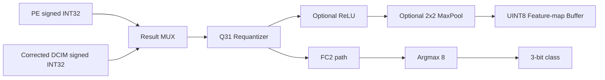
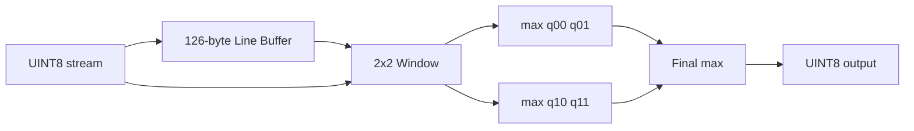

# UINT8 KWS後處理架構與驗證說明

## 1. 本次設計的邊界

硬體入口已確定為軟體`QuantStub`之後的UINT8資料：

```text
shape       = [1, 1, 64, 126]
data type   = UINT8
scale       = 0.0078431377187371254
zero-point  = 127
order       = [channel][y][x]，x最快變化
```

因此第一版硬體不需要FP32轉UINT8量化器。輸入資料可以直接使用：

```text
../../../layer_activation_uint8/quant_input/activation_uint8_binary.txt
```

本次實作處理的是運算核心之後的共同資料路徑。PE與DCIM最後都必須先提供相同定義的signed INT32 accumulator：

```text
accumulator = sum((activation_uint8 - 127) * weight_int8)
```

模型已使用`bias=false`，所以目前不加bias。

## 2. 為何PE與DCIM共用後處理

PE和DCIM的內部計算方式不同，但只要兩者對外都輸出上述INT32 accumulator，後續的量化、ReLU與Pooling就不需要重複兩套硬體。



DCIM若輸出raw unsigned partial sum，必須在進入本模組前完成：

1. Even/odd或高低4-bit重組。
2. Tile partial-sum累加。
3. Signed weight處理。
4. Activation zero-point修正。

例如DCIM先算出`sum(qx * qw)`時，adapter必須修正為：

```text
corrected_acc = raw_acc - 127 * sum(qw)
```

這些屬於`rtl/dcim_adapter/`，不放進共用後處理，以免PE路徑多出不需要的邏輯。

## 3. 已實作RTL

### 3.1 `requantizer_int32_to_uint8.sv`

位置：

```text
rtl/datapath/requantizer_int32_to_uint8.sv
```

每一個Conv/FC output channel都有不同weight scale。軟體預先計算：

```text
real_multiplier = input_scale * weight_scale[channel] / output_scale
multiplier_q31  = round(real_multiplier * 2^31)
```

硬體執行：

```text
scaled = round(accumulator * multiplier_q31 / 2^31)
qout   = saturate_uint8(scaled + output_zero_point)
```

目前模型的所有real multiplier都小於1，所以`multiplier_q31`合法範圍為：

```text
0x00000000 .. 0x7fffffff
```

Pipeline為：

```text
Cycle N    : capture accumulator and perform signed 32x32 multiply
Cycle N+1  : symmetric signed rounding and arithmetic right shift by 31
Cycle N+2  : add zero-point and saturate to 0..255
```

可以每個clock接收一筆新accumulator。乘法邏輯可由Vivado映射到DSP資源；實際DSP數量仍應由synthesis report確認。

### 3.2 `relu_uint8_zp127.sv`

位置：

```text
rtl/datapath/relu_uint8_zp127.sv
```

UINT8 code 127代表實數0，所以正確ReLU為：

```text
output = max(input, 127)
```

不能寫成`max(input, 0)`。模組為一級register，`enable=0`時保持相同一個clock latency並直接傳遞輸入。

### 3.3 `maxpool2x2_uint8.sv`

位置：

```text
rtl/datapath/maxpool2x2_uint8.sv
```

資料採channel-major順序：

```text
channel 0: y0x0, y0x1, ...
channel 0: y1x0, y1x1, ...
...
channel 1: y0x0, y0x1, ...
```

同一feature map中的值使用相同scale與zero-point，因此MaxPool可以直接比較UINT8 code，不需要反量化或減127。



只有在輸入座標`y`與`x`皆為奇數時產生輸出。奇數尺寸採floor規則：

```text
output_height = input_height / 2
output_width  = input_width  / 2
```

因此Pool2輸入寬61的最後一欄會捨棄；Pool3輸入高度13的最後一列會捨棄，與PyTorch結果相同。

`frame_start`可以和第一筆`in_valid`同時送入。設定的width、height、channels在整個frame期間必須保持穩定。

### 3.4 `argmax_8.sv`

位置：

```text
rtl/datapath/argmax_8.sv
```

依序輸入class 0到class 7的八筆FC2 UINT8結果。模組使用一個比較器與register，收到第八筆時輸出3-bit分類結果。

比較條件使用：

```text
new_value > best_value
```

而不是`>=`，因此最大值相同時保留較早的class index，與`torch.argmax`一致。

FC2各channel的weight scale不同，所以必須先requantize成共同的FC2 output scale，不能直接比較八筆raw INT32 accumulator。

### 3.5 `kws_postprocess.sv`

位置：

```text
rtl/datapath/kws_postprocess.sv
```

這是目前共用後處理的整合模組：

```text
signed INT32
    -> requantizer_int32_to_uint8
    -> relu_uint8_zp127或同延遲bypass
    -> maxpool2x2_uint8或bypass
    -> UINT8 feature-map output
```

`relu_enable`與`pool_enable`建議設定如下：

| Layer | Requant | ReLU | Pool |
|---|---:|---:|---:|
| Conv1 | 是 | 是 | 是 |
| Conv2 | 是 | 是 | 是 |
| Conv3 | 是 | 是 | 是 |
| FC1 | 是 | 是 | 否 |
| FC2 | 是 | 否 | 否 |

Pool1位於Conv1之前，路徑為：

```text
UINT8 input -> maxpool2x2_uint8 -> Conv1 PE
```

所以Pool1不經過requantizer。

整個frame運算期間，下列layer設定必須保持不變：

```text
relu_enable
pool_enable
pool_input_width
pool_input_height
pool_input_channels
```

目前介面採`valid`串流但沒有`ready`，也就是下游必須能接收所有有效輸出。未來接feature-map buffer時，如果buffer可能停頓，必須增加ready/backpressure或在中間加入FIFO。

## 4. 模型中的完整使用順序

```text
quant_input UINT8 [1,64,126]
  -> Pool1 [1,32,63]
  -> Conv1 PE -> requant -> ReLU -> Pool2 [12,15,30]
  -> Conv2 DCIM -> correction -> requant -> ReLU -> Pool3 [12,6,14]
  -> Conv3 DCIM -> correction -> requant -> ReLU -> Pool4 [12,2,6]
  -> Flatten [144]
  -> FC1 PE -> requant -> ReLU [32]
  -> FC2 PE -> requant [8]
  -> Argmax -> class[2:0]
```

## 5. 測試資料

測試資料放在：

```text
tb/data/requant_conv1_vectors.txt
tb/data/maxpool_3x5_uint8.txt
tb/data/fc2_uint8.txt
```

### 5.1 Requantization測資

`requant_conv1_vectors.txt`保存實際Conv1的：

```text
accumulator multiplier_q31 zero_point expected_uint8
```

例如dataset index 1362、Conv1 filter 0、座標y=0/x=0：

```text
accumulator    = 5872
multiplier_q31 = 4157385
zero_point     = 127
expected       = 138
```

testbench另外檢查：

- 正accumulator。
- 負accumulator。
- 不同output channel multiplier。
- accumulator為0時輸出127。
- 上飽和至255。
- 下飽和至0。

### 5.2 MaxPool測資

輸入為一個`1x3x5` feature map：

```text
  1   2   3   4   99
  5   6   7   8  100
200 201 202 203  204
```

正確floor 2x2 pooling輸出是：

```text
6 8
```

最後一欄與最後一列即使數值較大也必須捨棄。

### 5.3 Argmax測資

使用軟體實際FC2結果：

```text
91 171 142 102 80 91 104 94
```

預期輸出：

```text
class_index   = 1
maximum_value = 171
```

另外加入兩個最大值皆為200的tie case，確認保留較早的index。

### 5.4 整合測試

`tb_kws_postprocess.sv`驗證兩條路徑：

1. `requant -> ReLU -> pool bypass`：實際Conv1負值requant後為123，ReLU輸出127。
2. `requant -> ReLU -> 2x2 Pool`：四筆資料requant後為128、132、130、131，Pool輸出132。

## 6. 驗證結果

SystemVerilog testbench均已使用Verilator執行通過：

| Testbench | 驗證內容 | 結果 |
|---|---|---:|
| `tb_requantizer_int32_to_uint8` | 11組實際/邊界requant測試 | PASS |
| `tb_relu_uint8_zp127` | 小於、等於、大於127及bypass | PASS |
| `tb_maxpool2x2_uint8` | 3x5奇數尺寸與捨棄規則 | PASS |
| `tb_argmax_8` | 實際FC2與tie case | PASS |
| `tb_kws_postprocess` | bypass與pool整合路徑 | PASS |

另有Python exhaustive golden checker：

```text
scripts/verify_uint8_postprocess.py
```

它不是取代RTL testbench，而是確認RTL採用的Q31公式可重現目前PyTorch匯出結果。檢查內容包括：

- Conv1全部21,960筆requant結果。
- Conv2全部4,368筆requant結果。
- Conv3全部576筆requant結果。
- FC1全部32筆requant結果。
- FC2全部8筆requant結果。
- ReLU1到ReLU4。
- Pool1到Pool4。
- FC2 Argmax。

總共比較62,448個值，全部一致。

這代表目前Q31 rounding規則對現有匯出樣本達到bit-accurate；完整測試集仍須在軟體批次匯出後才能進一步證明所有輸入皆一致。

## 7. 執行方式

進入：

```bash
cd /home/LAB505/projects/KWS/KWS_DNN_Hybrid/HYBRID_SYSTEM
```

執行全部測試：

```bash
make test
```

個別執行：

```bash
make test-requantizer
make test-relu
make test-maxpool
make test-argmax
make test-postprocess
make test-python-golden
make lint
```

清除模擬產物：

```bash
make clean
```

## 8. 目前尚未包含的內容

本次已完成後處理算術與串流行為，但尚未完成：

1. 76組per-channel multiplier的硬體parameter ROM。
2. Layer controller依channel選取multiplier。
3. Feature-map ping-pong buffer與address controller。
4. DCIM even/odd W8重組。
5. DCIM activation zero-point correction。
6. PE/DCIM result MUX與ready/backpressure。
7. 完整8,000筆資料集的UINT8輸入匯出與準確率驗證。
8. Vivado synthesis、DSP/LUT使用量與post-route timing驗證。

因此目前可以說「共用後處理模組已完成並通過單元、整合及一筆完整軟體golden驗證」，但還不能說整個Hybrid KWS推論系統已完成。

## 2026-09-14：PE8補償前級（獨立實作，尚未整合）

新增 `rtl/datapath/pe8_result_correction.sv`，無bias，將
raw=Σ(A−128)W 加上每個channel的ΣW，還原Σ(A−127)W。
一顆33-bit加法器、INT32飽和與overflow、一級可停頓輸出暫存，
支援channel標記與valid/ready。ΣW仍由TB提供，尚未實作loader／參數RAM。

```text
pe8_core_12 → result drain → pe8_result_correction → kws_postprocess
                                 ↑ ΣW
```

上圖是未來接線規劃，不代表本次已整合。kws_postprocess保持原接口，
輸入應是補償後INT32。它沒有ready，因此接入時需確認逐拍接收能力，
frame標記也需和補償輸出握手對齊。本次不改PE core、CIM、XDC或後處理RTL。

完整接口／原理／時序／測試說明集中於
`../../PE_CHIP_8x8/docs/PE8_CORE_ARCHITECTURE.md` 的2026-09-14章節。
執行 `make test-pe8-result-correction` 和 `make lint-pe8-result-correction`；
已加入 `make test` 與 `make lint`。單元測試88筆交付、1筆reset丟棄，PASS。
