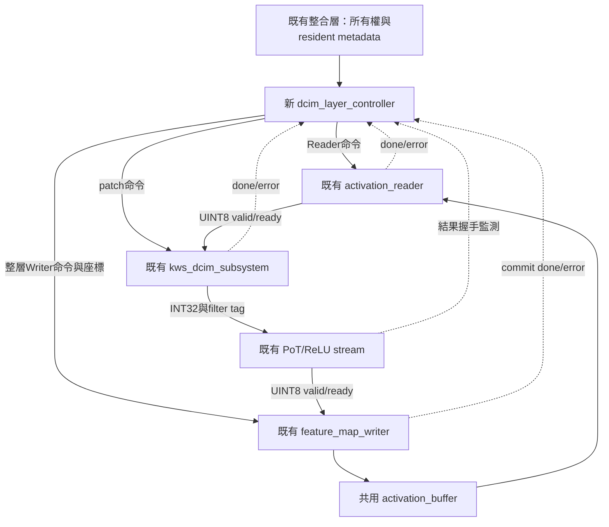
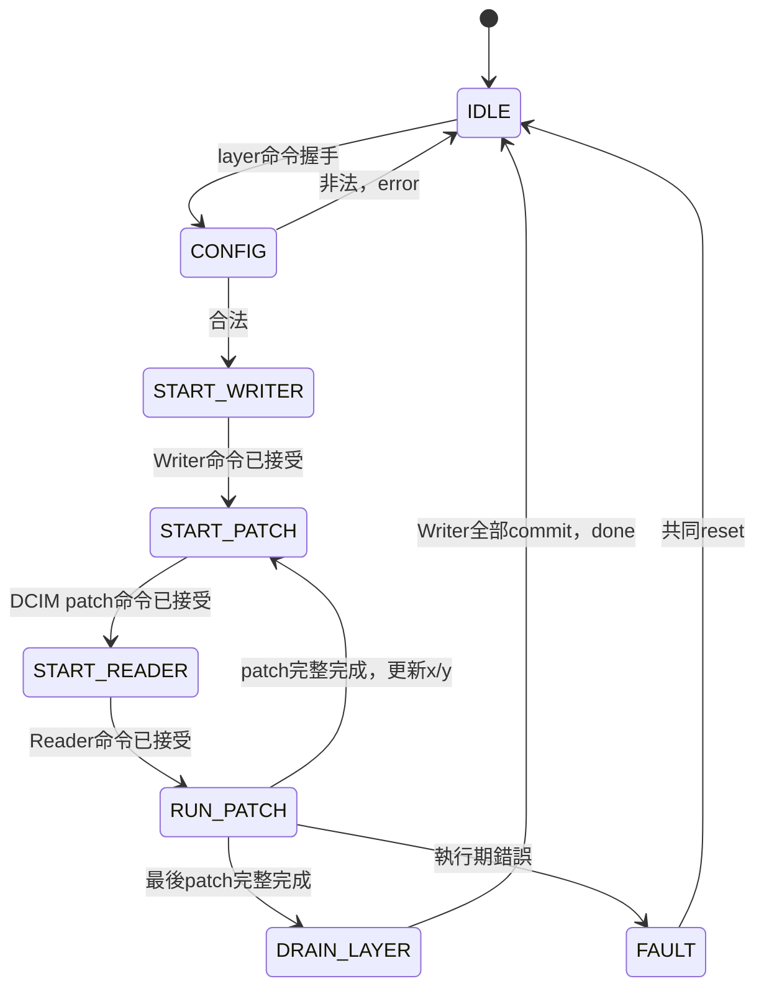

# 歷史審查與規劃交接合輯

本檔於2026-10-19將八份歷史文件完整合併。原文中的「尚未實作／尚未驗證」只代表當時狀態，不是現行進度；不因封存宣稱所有審查均已完成。現行入口見[文件索引](../README.md)。命令仍以HYBRID_SYSTEM為工作目錄，舊版本/測試數字不得套用至新RTL。

## 原檔案對照

- [S5B_CLAUDE_REVIEW_HANDOFF.md](#review-1)
- [S5C_ARCHITECTURE_REVIEW_PLAN.md](#review-2)
- [S5C_CONTROLLER_CLAUDE_REVIEW_HANDOFF.md](#review-3)
- [S5C_REAL_INTEGRATION_CLAUDE_REVIEW.md](#review-4)
- [S5D1_CLAUDE_REVIEW_PROMPT.md](#review-5)
- [S5D2_CLAUDE_REVIEW_PROMPT.md](#review-6)
- [SHARED_POSTPROCESS_STEP1_CLAUDE_PROMPT.md](#review-7)
- [SHARED_POSTPROCESS_STEP2_CLAUDE_PROMPT.md](#review-8)

---

<a id="review-1"></a>

原檔：`S5B_CLAUDE_REVIEW_HANDOFF.md`

# S5-B 獨立審查交接：給 Claude 的閱讀與驗證清單

日期：2026-10-15。審查對象：實作提交 `8cf17a370025aba38bdec697259c690163349fd8`。
本文件只整理審查材料，不代表 Claude 已經審查，也不是要求審查者認同原作者的結論。

## 1. 可直接交給 Claude 的任務

> 請獨立審查 KWS_DNN_Hybrid 的 S5-B `kws_dcim_subsystem`。先讀本文件與架構基準，再讀實際 RTL、TB 和 Makefile；不要僅根據文件或 PASS 判定正確。請只分析、不修改檔案、不 commit/push。確認薄封裝是否忠於目標、四模組介面與 reset 是否正確、CDC 在契約內有無遺失／重複交易，以及測試是否真的能捕捉錯誤。若執行工具，請記錄命令、版本、退出狀態與範圍。請將確定 bug、設計限制、缺少測試、待實體簽核分開，列出檔案與行號、觸發條件、影響與最小改善建議。不要求本階段完成 S5-C 或板級設計；但若某缺口阻礙下一階段，請明確標示。未找到 bug 時，也請列出仍無法證明的項目。

專案根目錄：`/home/LAB505/projects/KWS/KWS_DNN_Hybrid`。
以下除 Markdown 連結外的程式路徑皆相對此根目錄。

## 2. 本次目標與不可混淆的邊界

目標是把已存在的單 patch backend 接到真正雙時脈 CDC、pin master、FPGA chip RTL 模型；保持既有計算與握手協定，不新增一層調度 FSM。

| 固定條件 | 內容 |
|---|---|
| 計算 | K=108，12 filters，無 bias |
| 外部資料 | UINT8 activation、zp128；signed INT8 weight |
| 輸出 | 12筆 signed INT32，filter_id=0..11 |
| 系統域 | backend及所有公開資料握手，`clk_sys/rst_sys` |
| CIM域 | bridge slow、master、chip，`clk_cim/rst_cim` |
| 權重命令 | 單筆write；burst固定停用 |
| reset | 同一reset原因，兩域各自同步解除；不支援單域獨立reset |
| 所在階段 | S5-B功能整合；S5-C才是整層Reader/PoT/Writer |

不包含：整層Conv2/3排程、共享activation RAM接線、PoT/ReLU、Argmax、完整推論、板級MMCM/reset產生器、外接實體晶片IO、NV電性模型或Vivado實體CDC簽核。模擬頻率不等於實體可達頻率。

```text
上層（sys）
  │ load/weight/patch/activation
  ▼
kws_dcim_backend ── cmd/rsp ── dcim_cdc_bridge
  ▲                            sys │ cim
  │                               ▼
  │                        dcim_pin_master
  │                               ↕ chip pins
  │                        dcim_chip_pin_top
  └─ raw回應 → 修正／跨group累加
  │
  └─ result_valid/ready + signed INT32 → 上層（sys）
```

## 3. 本次修改清單

| 類型 | 檔案 | 審查重點 |
|---|---|---|
| 新增RTL | `HYBRID_SYSTEM/rtl/integration/kws_dcim_subsystem.sv` | 四模組具名接線；signed、位寬、時脈/reset；沒有額外FSM |
| 新增TB | `HYBRID_SYSTEM/tb/integration/tb_kws_dcim_subsystem.sv` | 真實全鏈路、獨立golden、多時脈、反壓、reset/fault |
| 修改建置 | `HYBRID_SYSTEM/Makefile` | 新test/lint入口、四組設定、負向測試判定；舊S5-A負向搜尋改grep |
| 新增設計說明 | [S5B_DCIM_CDC_INTEGRATION.md](../S5B_DCIM_CDC_INTEGRATION.md) | 完整ports、FSM、reset契約、測試結果與限制 |
| 修改架構基準 | [SINGLE_BUFFER_ARCHITECTURE.md](../SINGLE_BUFFER_ARCHITECTURE.md) | S5-B功能通過，S5-C/D與實體簽核仍待完成 |

本交接文件是後續文件補充，不屬於上述五份原始實作變更。

## 4. 建議閱讀順序與檔案用途

### A. 先確認目標

1. 根目錄 `AGENTS.md`：工作規則；本次只審查，不自動執行修改工作流。
2. [SINGLE_BUFFER_ARCHITECTURE.md](../SINGLE_BUFFER_ARCHITECTURE.md)：整體階段與不變的責任邊界，特別是S5及進度。
3. [S5A_DCIM_BACKEND.md](../S5A_DCIM_BACKEND.md)：原backend協定、mapping、單時脈驗收。
4. [DCIM_S5_FORMULAS.md](../DCIM_S5_FORMULAS.md)：數學與權重／activation順序。
5. [S5B_DCIM_CDC_INTEGRATION.md](../S5B_DCIM_CDC_INTEGRATION.md)：本次實作宣稱；需逐項對照程式，不視為獨立證據。

### B. 四個實例與必要下層

依序閱讀：

| 路徑 | 要確認什麼 |
|---|---|
| `HYBRID_SYSTEM/rtl/integration/kws_dcim_subsystem.sv` | 頂層所有連接、burst常數、未用輸出 |
| `HYBRID_SYSTEM/rtl/dcim_adapter/kws_dcim_backend.sv` | nine-state流程、load/patch優先、tile、done/error、回應接受條件 |
| `HYBRID_SYSTEM/rtl/dcim_adapter/dcim_u8_offset_correction.sv` | unsigned偏移修正與位寬 |
| `CIM_CHIP/fpga/dcim_cdc_bridge.sv` | toggle同步器、穩定mailbox、單筆在途、reset |
| `CIM_CHIP/fpga/dcim_pin_master.sv` | start/busy/done語義、W8A8組合、pin時序 |
| `CIM_CHIP/chip/dcim_chip_pin_top.sv` | master控制到macro/serializer的實際接線 |
| `CIM_CHIP/chip/dcim_macro_core.sv` | array/input buffer/accumulator路徑 |
| `CIM_CHIP/peripheral/input_buffer_32x4.sv` | 每次bit-plane資料載入方式 |
| `CIM_CHIP/peripheral/bitserial_accumulator.sv`、`serial_output.sv`（同目錄） | 位序、累加與輸出時間 |
| `CIM_CHIP/cell/fesram_cell_model.sv` | reset/write及工作樹差異對實驗的影響 |

若發現raw結果或mapping問題，再向array、segment、cell追蹤；不需先讀所有無關PE/後處理檔案。完整合成來源清單由Makefile的`DCIM_SUBSYSTEM_RTL`、`DCIM_BACKEND_RTL`、`DCIM_CHIP_RTL`提供。

### C. 測試與建置

1. 新TB：`HYBRID_SYSTEM/tb/integration/tb_kws_dcim_subsystem.sv`。
2. `HYBRID_SYSTEM/Makefile`：`test-dcim-subsystem`、`lint-dcim-subsystem`。
3. 舊backend TB：`HYBRID_SYSTEM/tb/integration/tb_kws_dcim_backend.sv`。
4. 舊CDC TB：`CIM_CHIP/tb/fpga/tb_dcim_cdc_bridge.sv`。
5. 舊全鏈路TB：`CIM_CHIP/tb/fpga/tb_dcim_cdc_bridge_integration.sv`。
6. `CIM_CHIP/Makefile`：對應CDC回歸入口。

## 5. 數學與流程驗收基準

權重輸入順序filter→channel→u→v，每filter 108筆。硬體配置 `row=k, pair=filter`，每filter補到128筆；有效1296加padding240，共1536次write。

activation順序channel→u→v，108筆按32/32/32/12分組；最後20筆補128。每group依序算12 filters，共48次CIM，不是把108筆同時塞進32筆buffer。

對每個32筆group，令 `Wu=Ws+128`：

\[
U=\sum_{j=0}^{31}A_{u,j}W_{u,j},\qquad
P=U-128\sum_j A_{u,j}-128\sum_j W_{u,j}+32\cdot16384.
\]

四組累加應為：

\[
ACC_c=\sum_{i=0}^{107}(A_i-128)W_{c,i}.
\]

需從程式核對本專案even/odd定義：文件宣稱 `U=odd+(even<<4)`，先擴位再左移；不可套用別的even/odd命名習慣。padding在修正後貢獻須為0。

Write成功是done，不需要result_valid；CIM成功則必須帶有效raw資料。最後12筆結果必須在ready接受後才算完成，不能因結果產生就提早patch_done。

## 6. 請逐項審查的風險

| 面向 | 請回答的問題 |
|---|---|
| 接線 | 有無漏接、重複驅動、截位、signed轉型錯誤、reset極性錯誤？ |
| 命令 | cmd_valid且ready=0是否保持？load與patch競爭是否只接受一個？ |
| CDC | mailbox在對方擷取前能否被覆寫？request/response toggle是否一對一？ |
| 完成 | master_done與busy的邊界會否漏啟動？response是否保持到消費？ |
| reset | 兩種解除順序是否安全？sys先送命令、cim仍reset時是否保留？ |
| fault | 在途交易與部分結果如何取消？是否只靠共同reset恢復，文件是否說清楚？ |
| 算術 | shift擴位、符號、raw重組、四組累加、padding是否正確？ |
| TB獨立性 | expected是否由輸入與獨立公式建立，而非由DUT結果倒推？ |
| TB排程 | posedge/NBA比較是否有race？各中斷位置是否真的到達，不是只跑到timeout？ |
| TB完整性 | 是否核對數量、位址、順序、資料與done，而非只看PASS或最後一筆？ |
| 範圍 | 有無把RTL功能通過混稱為時序、CDC實體或完整CNN通過？ |

特別請檢查：`check_sys`、`check_cim`兩個monitor；`reset_all`、`check_quiet`、`load_layer`、`prepare_patch`、`send_activations`、`run_patch`、`interrupt_patch`各task及最後initial測試順序。

## 7. 已執行測試與可追溯證據

原實作環境Verilator 5.030。下表是已記錄的結果，不取代審查者自行重跑。

| sys MHz | CIM half period ps | phase ps | seed | 完整載入/patch/結果 | reset/fault |
|---:|---:|---:|---:|---|---|
| 125 | 10000 | 1300 | 505 | 13/16/192 PASS | 5/5 PASS |
| 125 | 9434 | 2700 | 128 | 13/16/192 PASS | 5/5 PASS |
| 125 | 4000 | 0 | 505 | 13/16/192 PASS | 5/5 PASS |
| 125 | 3000 | 1900 | 128 | 13/16/192 PASS | 5/5 PASS |

合計768筆完整patch輸出一致，不含故意中止的patch。頻率較高的案例只測協定，沒有延遲回標。

本機log位置：

```text
HYBRID_SYSTEM/build/dcim_subsystem/
  half_10000_phase_1300_seed_505.log
  half_9434_phase_2700_seed_128.log
  half_4000_phase_0_seed_505.log
  half_3000_phase_1900_seed_128.log
  negative_golden.log
HYBRID_SYSTEM/build/dcim_backend/
  seed_505.log
  seed_128.log
  negative_golden.log
```

四份subsystem log應有 `PASS S5-B SUMMARY loads=13 patches=16 results=192 targeted_resets=5 source_faults=5`。負向golden須非零退出且包含`result mismatch`；只看到程式失敗不算驗證成功。

原有backend兩seed各5次載入、6個成功patch/72結果、4個reset恢復通過。既有CDC測試36命令、reset對齊通過；真實CDC/master/chip的SRAM、A4W8、A8W8、非法burst亦通過。新TB沒有公開SRAM read介面，不能將舊TB讀回數量算成新TB的覆蓋率。

這些build log未納入Git；遠端審查若沒有log，應重跑或明確標記「只有作者紀錄，未獨立重現」。

## 8. 重現方式與版本差異

```bash
cd /home/LAB505/projects/KWS/KWS_DNN_Hybrid
git status --short
git show --stat 8cf17a3
git diff 8cf17a3^ 8cf17a3 -- HYBRID_SYSTEM
verilator --version

cd HYBRID_SYSTEM
make lint-dcim-subsystem
make test-dcim-subsystem
make test-dcim-backend
cd ../CIM_CHIP
make test-dcim-cdc-bridge test-dcim-cdc-integration
```

建議將每項命令輸出重新導向獨立review log，記錄退出碼，等完成再看摘要；不要覆寫原始證據。測試會生成build檔案，但不需修改RTL。沒有Verilator時請只做靜態審查，不能宣稱重跑PASS。

**工作樹與提交不是完全相同的實驗輸入。** 原測試在含使用者未提交修改的工作樹執行；其中`CIM_CHIP/cell/fesram_cell_model.sv`在編譯依賴內。請用`git diff -- CIM_CHIP/cell/fesram_cell_model.sv`核對，不能直接宣稱乾淨checkout已通過。其他既有clock/top/PE/後處理修改未納入此提交；MMCM檔沒有被本TB實例化。請保留所有使用者修改，禁止reset/checkout清除它們。若需乾淨提交比對，用另外的worktree/複本並清楚標示結果來源。

## 9. 尚未證明與可補測項目

- 無Vivado synthesis/implementation、CDC report、routed timing、面積或板測證據。
- 無類比metastability注入，也未隨機延長同步器辨識延遲；數位模擬不能證明MTBF。
- bundled-data mailbox需實體資料延遲／必要skew約束與同步器placement檢查，不可一律false-path後視為安全。
- 同源MMCM時脈的關係需依實際板級設計處理；不預先假定非同步或固定max-delay值。
- 外部reset產生器、最小reset pulse、clock停止/lock遺失未做板級驗證。
- 本次五個reset/fault位置以計算／輸出交易為主；權重寫入途中中止與所有狀態逐一覆蓋不應自行宣稱完成。
- 缺少輸入筆數、永久反壓沒有硬體timeout；這是介面限制，需由上層負責。
- 未驗完整軟體Conv2/3資料與整層RAM commit；下一階段需真實軟體golden。
- Verilator測試不是四態X傳播或形式驗證；亦沒有宣稱完整覆蓋率數字。

請判斷每項是S5-B功能阻擋、S5-C整合必要條件，還是上板前必要條件，不要混為同一等級。

## 10. 請回傳的審查格式

1. **總結**：符合／部分符合／不符合S5-B目標，以及判斷範圍。
2. **閱讀清單與版本**：實際讀了哪些檔案、提交與工作樹差異。
3. **問題表**：嚴重度、類別、檔案:行號、可重現觸發條件、影響、最小建議、需新增的測試。
4. **架構／數學／CDC／reset／TB各自結論**：不要用一個PASS概括所有項目。
5. **實際執行的驗證**：命令、退出碼、結果；未執行的原因。
6. **能否進入S5-C**：必要修正與可以延後的實體驗證分列。

若無確定錯誤，請寫「在已審查範圍內未找到確定功能錯誤」，不要寫「保證所有情況正確」或「保證125/53MHz可上板」。


---

<a id="review-2"></a>

原檔：`S5C_ARCHITECTURE_REVIEW_PLAN.md`

# S5-C 規劃書：DCIM 整層控制與低冗餘架構審查

日期：2026-10-15。狀態：**待審查提案，尚未實作、尚未驗證**。
更新：使用者後續授權實作第一批controller與單測，並將後處理改名`pot_result_stream`。第一批已實作並通過協定測試，詳[實作說明](../DCIM_LAYER_CONTROLLER.md)；本文保留原提案脈絡，真實DCIM整層與共享top整合仍未完成。
本文件承接已完成功能模擬的S5-B，不改變單一activation buffer基準。請Claude先審查，再由使用者決定是否開始撰寫；不要將本提案視為已通過的架構。

## 1. 可直接交給 Claude 的任務

> 請依本規劃與目前實際RTL，審查S5-C是否能正確完成Conv2/Conv3整層運算，並找出不必要的狀態、重複暫存器、重複計數、過多介面與可重用模組。先只分析，不修改程式或提交。每項建議請說明功能等價條件、握手與反壓影響、可能增加的組合路徑，以及需要的測試；不要單憑狀態數少就宣稱面積較小。請區分確定缺陷、必要防護、可選偵錯、效能最佳化及未定案事項。最後提出你推薦的最小完整架構與實作順序，並列出是否有阻擋開始實作的問題。

專案：`/home/LAB505/projects/KWS/KWS_DNN_Hybrid`。以下程式路徑相對專案根目錄。

## 2. 必讀材料與順序

1. `AGENTS.md`與[SINGLE_BUFFER_ARCHITECTURE.md](../SINGLE_BUFFER_ARCHITECTURE.md)：單buffer、階段順序、延後最佳化邊界。
2. [S5B_DCIM_CDC_INTEGRATION.md](../S5B_DCIM_CDC_INTEGRATION.md)、[S5B_CLAUDE_REVIEW_HANDOFF.md](LEGACY_REVIEW_HANDOFFS.md#review-1)：現有subsystem契約及未完成實體驗證。
3. `HYBRID_SYSTEM/rtl/integration/kws_dcim_subsystem.sv`、`rtl/dcim_adapter/kws_dcim_backend.sv`（後者也位於HYBRID_SYSTEM）：load/patch握手、固定108×12、error/reset、raw INT32結果。
4. `HYBRID_SYSTEM/rtl/datapath/activation_reader.sv`：PATCH模式、108筆展開、最後輸出握手與done時間。
5. `HYBRID_SYSTEM/rtl/control/feature_map_writer.sv`：CHW、輸入接受與RAM commit分離、done/error。
6. `HYBRID_SYSTEM/rtl/datapath/pot_result_stream.sv`、`kws_pot_shift_rom.sv`（同目錄）：layer/channel對應、FIFO、反壓、pipeline與comb配置。
7. `HYBRID_SYSTEM/rtl/control/pe_layer_controller.sv`：可參考控制風格，但不得照抄FC/replay等不需要的流程。
8. `HYBRID_SYSTEM/rtl/integration/kws_activation_path.sv`、`rtl/control/layer_descriptor_rom.sv`、`rtl/control/layer_controller.sv`（均在HYBRID_SYSTEM）：既有所有權、descriptor、層ID與路由。
9. `HYBRID_SYSTEM/scripts/generate_activation_path_vectors.py`、現有軟體整合TB：確認如何重用向量工具，不另建立不同格式。

請先用git status記錄工作樹差異；現有後處理等檔案含使用者修改，須保留。文中簡寫的同目錄檔名不代表另建檔案。

## 3. 功能目標與明確不做的內容

本階段把「單patch DCIM計算」提升為「完整一層讀RAM、計算、量化、寫RAM」。

| 項目 | 第一版方向 |
|---|---|
| 資料 | UINT8 activation/zp128、signed INT8 weight、INT32累加、無bias |
| 模型 | Conv2/3；3×3、stride1、padding0、Cin=Cout=12、K=108 |
| 記憶體 | 沿用單一32KiB activation buffer；同層來源/目的不重疊 |
| 運算 | 一次一個patch；不做patch之間重疊與預取 |
| 權重 | 每層載入一次，全部patch重用；仍採單筆write |
| 後處理 | 重用既有PoT/ReLU串流及FIFO，先不改pipeline選擇 |
| 時脈 | Reader/控制器/後處理/Writer在sys域；subsystem處理跨域 |
| 完成 | 以最後RAM寫入提交為準，不以raw結果產生為準 |

不新增第二份activation RAM、im2col矩陣、108-byte控制器buffer、第二個CDC、bit-plane FSM、ΣW修正器、AXI/DMA或NV功能。S5-D才接FULL及Argmax。實體CDC／時序仍需另行簽核。

## 4. 建議分工與關係圖



新控制器不傳送資料payload，只控制命令、座標與路由使能。payload由整合層直接接線。權重載入及resident metadata由整合層唯一持有，不在controller與subsystem各建一份層ID狀態機。

### 權重有效性

`weights_ready`只表示有一份完整權重，不能分辨Conv2/3。整合層應在load命令接受時撤銷resident_valid、保存pending_layer_id；只有load_done且無error才發布resident_layer_id/valid。reset/fault撤銷有效性。busy整層期間禁止weight reload及host/PE/pool插入。

controller只核對resident_valid及ID匹配，不自己重新計算1296筆載入計數。resident ID、PoT layer ID、descriptor operation index不一定同一編碼；必須核對實際ROM，不用數字猜測。

## 5. 輸入輸出提案（尚未鎖定port名稱）

| 介面群組 | 最小需求 | 避免冗餘 |
|---|---|---|
| clock/reset | sys clk、active-high rst | 不把cim clk送入controller |
| 整層命令 | valid/ready、layer_id、src/dst base、輸入W/H、ReLU設定 | 固定K=108/Cin=Cout=12，不再傳可變K/channels |
| resident | valid、layer_id；subsystem error/ready狀態 | 不傳整份權重或ΣW |
| Reader | command valid/ready、base/W/H/x/y、done/error；資料握手及last監測 | PATCH/count/channels固定值可在wrapper接常數，不必都變port |
| DCIM | patch valid/ready、patch_done、error；activation握手使能 | 不暴露group、pair或plane計數 |
| 後處理 | 結果valid/ready、channel、last/error；layer/ReLU配置 | controller不存INT32/UINT8 payload |
| Writer | command valid/ready、base/輸出W/H、done/error、輸入ready；channel/x/y及valid | CHW/12channels可接常數 |
| 對上層狀態 | busy、done、error；是否另需fault待核對既有介面 | 若error已sticky，不再無意義複製fault輸出 |

層命令可採「layer_id查固定尺寸」或「輸入W/H並驗證」；目前建議沿用既有descriptor提供W/H，方便測試小圖，但不得另存兩套尺寸ROM。是否只接受正式Conv2/3尺寸須審查後明確決定。這是待定介面，不能同時宣稱通用尺寸與固定層尺寸都已支持。

## 6. 數學、地址與資料順序

\[
W_o=W_i-2,\quad H_o=H_i-2,\quad N_{patch}=W_oH_o.
\]

| 層 | 輸入CHW | 輸出CHW | patches | UINT8輸出數 |
|---|---|---|---:|---:|
| Conv2 | 12×15×30 | 12×13×28 | 364 | 4368 |
| Conv3 | 12×6×14 | 12×4×12 | 48 | 576 |

Reader從patch(x,y)讀取：

\[
addr=src+d(H_iW_i)+(y+u)W_i+x+v,\quad i=9d+3u+v.
\]

subsystem輸出每filter：

\[
ACC_c=\sum_{i=0}^{107}(A_i-128)W_{c,i}.
\]

PoT依該層/channel參數重新量化並按配置ReLU；Writer使用：

\[
addr=dst+c(H_oW_o)+yW_o+x.
\]

計算輸出是patch優先/channel次之，RAM排列是CHW；不用另建transpose buffer。地址乘法沿用Reader/Writer，不在controller再複製；CONFIG的尺寸與端點計算需擴位後驗界，不能截位後檢查。

## 7. 第一版FSM提案與必要性



所有執行期狀態均須處理錯誤；圖只示範一條FAULT邊。

| 狀態 | 保留理由／可審查合併點 |
|---|---|
| IDLE | 唯一接受新整層命令的入口 |
| CONFIG | 保存命令後驗界、resident與尺寸；可用phase預計算，不強制單拍大乘法 |
| START_WRITER | 每層只啟動一次Writer；等待命令握手 |
| START_PATCH | DCIM先接受patch，避免Reader無消費者 |
| START_READER | Reader命令可反壓，須保持直到接受 |
| RUN_PATCH | 資料流與完成事件匯合；下一patch直接更新座標，不另加NEXT狀態 |
| DRAIN_LAYER | 最後資料被Writer接收不等於RAM commit；可評估併入RUN但需等價證明 |
| FAULT | 部分結果不可當成功；鎖定至共同reset |

不額外加入DONE狀態、固定等待N拍、replay或下一filter FSM。START_WRITER後是否需WAIT_WRITER_READY，應依現有Writer錯誤回報及後處理反壓證明；若資料路徑可安全停住且持續監測writer_error，就不為等待而新增狀態。

若合併START_PATCH/START_READER成單一ISSUE狀態，必須增加各自issued旗標，避免另一端尚未接受時重發；請比較「少一狀態但多旗標與控制路徑」是否真的值得，不預設一定省面積。

## 8. 最重要的完成、tag與反壓規則

三個完成事件不同：Reader輸入完、DCIM raw輸出完、Writer提交完。需要明確定義：

- `activation_fire = reader_valid && reader_ready`。
- `post_fire = post_valid && post_ready`，同一事件必須等於Writer合法接受事件。
- 每patch 108次activation_fire、12次post_fire；channel為0..11，last僅最後一筆。
- 保存reader_done與patch_done脈波，或證明可由最後一次握手推導；不可要求脈波同拍。
- 更新patch_x/y前，當前patch的12筆後處理輸出都已被Writer接受，且Reader/DCIM已完成。
- 最後一次post_fire尚可能只寫進Writer暫存器；整層done仍等writer_done。
- writer_done若比進入DRAIN_LAYER早，必須保存事件或把當拍事件納入條件，不能漏脈波。
- 所有計數／完成判斷需納入當拍fire，避免nonblocking更新造成少一筆或多等待／漏判。
- 錯誤tag不得先握手寫入再檢查；先驗證tag並抑制非法交易。

第一版不做跨patch重疊，因此不必在PoT FIFO中新增x/y tag。只有待前patch排空再移動座標這個前提成立時，這項省略才安全。

反壓鏈：Writer ready→PoT FIFO消費；FIFO容量控制raw ready→DCIM；DCIM activation_ready→Reader。不可因控制器狀態切換過早關閉結果通道而讓尚未排空FIFO死鎖。

## 9. 暫存器與冗餘審查清單

| 項目 | 建議 | 請Claude判斷 |
|---|---|---|
| 命令設定暫存 | 保留，避免外部改動污染正在執行命令 | 哪些可由常數或已保存值推導？ |
| patch x/y | 保留 | 不另存重複patch_index，除非必要 |
| activation_count | 候選：7bits可表示0..108 | 是必要硬體防護，還是僅TB assertion足夠？ |
| output_count | 候選：4bits可表示0..12 | 可同時用作期望channel，避免第二個channel counter |
| reader/DCIM done_seen | 候選各1bit | 是否可安全由last握手推導？須核對實際done時序 |
| writer_done_seen | 候選1bit | 依done相對最後輸出時序，是否可能早到？ |
| 全層結果計數 | 預設不新增 | Writer已有commit計數，避免重複 |
| resident metadata | 整合層唯一持有 | 不要controller與wrapper各自保存權重版本 |
| activation/weight buffer | 不新增 | Reader及backend已各有必要暫存 |
| PoT/FIFO | 沿用 | 不因名稱含PE就複製一份RTL |

必要檢查不是自動等於冗餘。若刪除硬體計數而改成外部契約，請同時列出失去的故障偵測能力。狀態少、port少或模組合併不保證LUT更少；最終需同約束合成比較。

## 10. Reset、錯誤與所有權

CONFIG非法在子模組啟動前拒絕；執行期錯誤進FAULT。busy期間不接受新整層命令、不允許RAM所有權變更或重載權重。

錯誤可能發生在部分結果已寫RAM之後，因此沒有rollback；目的層標記無效，不觸發下一層。上層需停止PoT到Writer的有效傳輸、通知backend source_error並依共同reset流程清理Reader、Writer、PoT FIFO與DCIM兩域。不能只reset controller或任意只reset慢域。

**待定但實作前必須解決**：error pulse與sticky fault的對外語義、整合層如何統一仲裁錯誤、故障當拍已接受的合法pending write如何記錄。不可假設本拍拉低valid能撤銷上一拍已接受的Writer資料。

## 11. 檔案與逐步驗收

| 順序 | 工作 | 狀態／驗收 |
|---|---|---|
| 1 | 新增`HYBRID_SYSTEM/rtl/control/dcim_layer_controller.sv` | 待審查後撰寫；介面、FSM與計數 |
| 2 | 新增`HYBRID_SYSTEM/tb/control/tb_dcim_layer_controller.sv` | 受控端點測協定；不能稱計算驗收 |
| 3 | 新增`HYBRID_SYSTEM/tb/integration/tb_dcim_layer_memory.sv`（候選名） | 真實RAM/Reader/subsystem/PoT/Writer；不是golden回應stub |
| 4 | 擴充現有向量工具及測試 | 固定checkpoint/樣本，權重與輸入/golden格式一致 |
| 5 | 修改既有`kws_activation_path.sv`及相關TB | 共享RAM所有權、resident與錯誤仲裁；不另複製RAM |
| 6 | Makefile與架構文件更新 | 保留S1～S5-B回歸；不得把未跑測試寫PASS |

步驟3的TB可先直接整合真實元件，不要求先新增另一個永久整層wrapper；是否需要可重用wrapper由審查決定，避免產生兩套相同整合邏輯。第5步擴充clk_cim/rst_cim對既有上層的影響須列清單再實作，不悄悄改掉原測試介面。

### 驗證矩陣

- 協定：command ready延遲、valid保持、各完成脈波不同拍、結果反壓、最後一筆停頓、load/compute互斥。
- 配置：resident無效/錯層、W/H非法、來源/目的重疊、端點超32768、邊界合法；錯誤不產生任何運算或寫入。
- 計數：每patch108/12、正確last與channel、Reader命令數、patch數；對多/少筆故障的預期處置明確。
- 資料：獨立公式計算RAM地址與INT32；PoT輸出對軟體golden；不以DUT輸出回填expected。
- 真實層：Conv2 364patch/4368筆、Conv3 48patch/576筆，全RAM或目的區外sentinel確認無越界。
- Reset/fault：啟動、輸入、CIM等待、後處理FIFO、部分Writer commit、DRAIN各階段；共同reset後重新載權重恢復。
- 資料集：先各層獨立用其軟體輸入驗收，再驗Conv2→Pool3→Conv3鏈路；鏈路中不可重新灌入中間golden冒充硬體輸出。
- Negative golden：故意破壞一筆expected，必須因數值不一致失敗，不接受timeout作為成功。
- 保留既有S5-B雙時脈測試；新整層TB至少含sys125/CIM約53MHz與不同phase，但不據此保證實體時序。

## 12. 請Claude最後交付的審查結果

1. 功能是否完整，以及會導致死鎖、錯誤座標、漏done或錯資料的具體情境。
2. 推薦FSM與每個狀態保留／合併的理由。
3. 最小port與register表，標明必要、可推導、僅偵錯、可延後。
4. 對既有RTL的相容性：附檔案與行號，不只評論本提案。
5. 待決事項清單：尺寸策略、layer ID對應、done/error契約、錯誤清理、PoT重用及共享RAM接入方式。
6. 驗證缺口與「可以開始實作／需先修正規劃」結論。

請勿宣稱無任何冗餘或保證125MHz；可給出邏輯必要性分析，面積與時序則等待實測。也不要以重構所有既有模組作為第一版的前置要求，除非找到具體功能阻礙。


---

<a id="review-3"></a>

原檔：`S5C_CONTROLLER_CLAUDE_REVIEW_HANDOFF.md`

# S5-C 第一批實作：Claude 獨立審查交接

日期：2026-10-15。實作版本：`19376487d46432d8073dc3baa6476257f034c8f7`。
本文件整理實作內容、變更與驗證證據，**不代表Claude已審查，不代表完整S5-C已完成**。

更新（2026-10-15）：使用者提供Claude對`1937648`的審查結果後，已完成V1～V6補測，見本文件第10節。第1～9節保留原交接版本背景；其中「未測」項目以第10節最新狀態為準。

## 1. 可直接使用的審查任務

> 請依本文件閱讀實際RTL、TB、Makefile與版本差異，獨立判斷dcim_layer_controller是否符合S5-C第一批目標，以及pot_result_stream改名是否完整且未改變行為。請先只審查、不修改程式、不commit/push。不要只根據PASS或作者文件判斷；請追查握手、同拍完成、反壓、reset、錯誤與組合回授。如果執行測試，輸出寫入獨立log，完成後再檢查，不持續查看每拍數值。回報確定問題時請附檔案與行號、觸發條件、影響與最小修正建議。將功能錯誤、驗證缺口、可選最佳化、未完成整合及實體時序限制分開。最後說明是否可進入真實DCIM/RAM整合測試。

根目錄：`/home/LAB505/projects/KWS/KWS_DNN_Hybrid`。下列檔案路徑均相對根目錄。

## 2. 目標與本次交付邊界

本次新增**整層排程控制器與協定單測**，並完成後處理名稱遷移。

- 固定12輸入channel、12 filters、K=108、3×3、stride1、padding0。
- layer_id=1/2，對應PoT ROM的Conv2/Conv3；不等同整體九操作descriptor的索引。
- W/H可配置，接受合法小圖與正式模型尺寸，不是只接受兩個固定尺寸。
- 每層Writer命令一次，每patch DCIM及Reader命令各一次。
- 每patch 108筆activation、12筆後處理結果；下一patch不能覆蓋尚未排空的座標。
- raw INT32、UINT8 payload不經控制器保存；不新增RAM、FIFO、CDC或MAC。
- CONFIG非法回IDLE並error脈波；執行期錯誤進FAULT，等待共同reset。
- 名稱改為`pot_result_stream`，原量化、ReLU、FIFO與pipeline參數不變。

**沒有完成**：controller與真實DCIM/RAM整合、Conv2/3整層軟體golden、共享top接入、FULL推論、Vivado時序與板測。單測中的端點是受控協定刺激，不是實際運算核心。

## 3. 變更清單（21份檔案）

### 新增（3份）

| 檔案 | 內容 |
|---|---|
| `HYBRID_SYSTEM/rtl/control/dcim_layer_controller.sv` | 八狀態、配置驗界、握手／座標／完成／FAULT |
| `HYBRID_SYSTEM/tb/control/tb_dcim_layer_controller.sv` | 公開介面協定測試與負向期望值測試 |
| `HYBRID_SYSTEM/docs/DCIM_LAYER_CONTROLLER.md` | 設計決定、連接、FSM、驗證及限制 |

### 改名（2份）

- `HYBRID_SYSTEM/rtl/datapath/pe_pot_result_stream.sv` → `pot_result_stream.sv`。
- `HYBRID_SYSTEM/tb/datapath/tb_pe_pot_result_stream.sv` → `tb_pot_result_stream.sv`。

module名稱與實例引用同步改名；舊名稱無相容wrapper。RTL首行用途註解也改為PE或DCIM的INT32結果。

### 來源／實例引用與測試入口（7份）

- `HYBRID_SYSTEM/Makefile`：新controller test/lint、PoT來源與TB改名。
- `HYBRID_SYSTEM/board/postprocess/Makefile`。
- `HYBRID_SYSTEM/board/postprocess/create_project.tcl`。
- `HYBRID_SYSTEM/board/postprocess/postprocess_self_test.sv`。
- `HYBRID_SYSTEM/rtl/integration/pe_pot_engine.sv`。
- `PE_COMPARISON/Makefile`。
- `PE_COMPARISON/vivado/create_pe_board_project.tcl`。

### 文件更新（9份）

`HYBRID_SYSTEM/docs/`：

- `PE_COMBINATIONAL_POSTPROCESS.md`
- `PE_POT_INTEGRATION.md`
- `POSTPROCESS_BOARD_TEST.md`
- `POSTPROCESS_POT_MATH_GUIDE.md`
- `POT_DERIVATION_PRESENTATION_REPORT.md`
- `S5C_ARCHITECTURE_REVIEW_PLAN.md`
- `SINGLE_BUFFER_ARCHITECTURE.md`

`PE_COMPARISON/docs/`：`PE8_BOTTOM_UP_GUIDE.md`、`PE8_CONTROL_STATE_ATLAS.md`。

另有使用者尚未追蹤的三個`sweep_postprocess_{comb,fine,strategy}.tcl`在工作樹更新來源名稱，但未整份納入提交，避免帶入既有未授權內容。已產生build/snapshot/XPR不改寫；需重新產生專案或更新來源。

## 4. 閱讀順序

1. `AGENTS.md`：工作樹保護規則。此次任務是審查，非授權修改。
2. [SINGLE_BUFFER_ARCHITECTURE.md](../SINGLE_BUFFER_ARCHITECTURE.md)：單buffer與階段邊界。
3. [S5C_ARCHITECTURE_REVIEW_PLAN.md](LEGACY_REVIEW_HANDOFFS.md#review-2)：原提案，部分待定事項已在實作文件定案。
4. [DCIM_LAYER_CONTROLLER.md](../DCIM_LAYER_CONTROLLER.md)：本次實作契約與已測範圍。
5. 新RTL與新TB，逐行對照，不把文件當作程式本身。
6. `HYBRID_SYSTEM/rtl/datapath/activation_reader.sv`、`rtl/control/feature_map_writer.sv`（均在HYBRID_SYSTEM）：核對真實ready/done與commit時序。
7. `HYBRID_SYSTEM/rtl/integration/kws_dcim_subsystem.sv`、`rtl/dcim_adapter/kws_dcim_backend.sv`（均在HYBRID_SYSTEM）：核對patch_done、activation_ready、source_error。
8. `HYBRID_SYSTEM/rtl/datapath/pot_result_stream.sv`、`kws_pot_shift_rom.sv`（同目錄）：核對FIFO及模型layer/channel ID。
9. `HYBRID_SYSTEM/Makefile`與改名引用檔，確認測試及Vivado入口沒有漏改。

若要審查下一步整合，可再讀`kws_activation_path.sv`、`layer_descriptor_rom.sv`、`layer_controller.sv`；它們本次沒有接上新controller，不可假設已支援DCIM整層。

## 5. 程式結構與必要不變條件

```text
IDLE → CONFIG(4 phases) → START_WRITER → START_PATCH → START_READER
                                                    ↑                ↓
                                                    └── RUN_PATCH ───┘
                                                          │ 最後patch
                                                          ▼
                                                     DRAIN_LAYER → IDLE/done
執行期錯誤 → FAULT → 共同reset
```

| RTL區域 | 審查重點 |
|---|---|
| 配置暫存與CONFIG | 外部命令改變是否影響當前任務；尺寸乘積／端點是否正確擴位；區域不得重疊 |
| candidate/after計數 | 當拍最後握手是否計入；是否形成runtime_bad自我回授 |
| activation_bad/result_bad | 非法last/channel/error是否在握手前阻擋 |
| completion_bad | 早到／重複done、不同狀態done是否按契約處理 |
| 輸出gate | Reader↔DCIM與PoT↔Writer兩端握手是否相等 |
| RUN_PATCH | Reader/DCIM done可不同拍；12筆post全部接受前座標不得更新 |
| DRAIN_LAYER | 接受最後資料不等於commit；writer_done早到是否保存 |
| FAULT/source_error | 本地gate立即停；source_error由註冊FAULT輸出，避免經backend ready回授 |

raw資料外部接線需同時gate：

```systemverilog
pot_in_valid      = dcim_result_valid && raw_path_enable;
dcim_result_ready = pot_in_ready     && raw_path_enable;
```

請核對**實際端點的組合依賴**，不能只在stub ready獨立時認定整合無回授。

resident metadata由外層單一持有；controller不負責權重載入。PoT輸出channel/last須由FIFO延遲對齊，不能拿目前raw channel當Writer channel。任務失敗後目的層無效，已提交資料不rollback；上層須共同清理所有端點與兩個時脈域。

## 6. 已執行驗證與證據

原實作使用Verilator 5.030，記錄如下：

| 項目 | 結果與範圍 |
|---|---|
| controller lint | PASS；RTL沒有使用警告豁免 |
| controller正常案例 | 5層：3×3、5×4、Conv2 30×15、Conv3 14×6、恢復後無資料停頓3×3 |
| 正常交易 | 420完整patch、5040筆post結果；不含故意中止部分 |
| 非法配置 | 10個，全部正確拒絕 |
| 執行期fault | 11個，全部正確阻擋／鎖定 |
| reset位置 | 7個，未殘留舊命令 |
| 負向期望值 | 故意錯Reader座標，正確失敗且匹配指定訊息 |
| PoT stream | comb/pipeline各768筆，全部256個ROM位址、反壓/FIFO/reset |
| PE engine | PE9/PE8/PE8-pipeline × post comb/pipeline，六組各7 jobs/109 outputs |
| PoT後處理 | 80筆，RNE/ReLU/pool/frame tags |
| S4 lint | PASS；沒有重跑完整S4軟體資料集 |

controller摘要是`layers=5 rejected=10 faults=11 resets=7 patches=435 outputs=5052`。435含中止patch命令；5052含reset前已輸出的12筆，不是435個成功patch。請核對TB計數與報告是否一致。

本機證據（build未納入Git，遠端可能不存在）：

```text
HYBRID_SYSTEM/build/dcim_layer_controller/verification.log
HYBRID_SYSTEM/build/dcim_layer_controller/negative.log
HYBRID_SYSTEM/build/pot_rename_validation.log
HYBRID_SYSTEM/build/pot_rename_regression.log
```

`pot_rename_validation.log`中的controller是較早一輪；最終controller驗證以`verification.log`為準，包含最後加入的無資料停頓與負向期望值案例。

## 7. 重現指令

```bash
cd /home/LAB505/projects/KWS/KWS_DNN_Hybrid
git status --short
git show --stat 1937648
git diff 1937648^ 1937648 -- HYBRID_SYSTEM PE_COMPARISON
verilator --version

cd HYBRID_SYSTEM
# 使用新目錄避免覆寫原先證據，實際路徑由mktemp輸出。
review_dir=$(mktemp -d /tmp/kws-s5c-review.XXXXXX)
make lint-dcim-layer-controller test-dcim-layer-controller > "$review_dir/controller.log" 2>&1
controller_status=$?
make test-pot-stream test-pot-engine test-postprocess-pot lint-s4 > "$review_dir/rename.log" 2>&1
rename_status=$?
printf 'controller=%s rename=%s logs=%s\n' "$controller_status" "$rename_status" "$review_dir"
```

等命令結束再檢查log；記錄兩個退出碼。負向測試必須因指定座標錯誤失敗，不能因build error/timeout失敗就當PASS。若未安裝工具或未執行，明確寫「未獨立重跑」。

改名檢查可使用`git grep -n pe_pot_result_stream`；歷史遷移文件提到舊名屬正常，不代表有未修正的實例。對SV/Tcl/Makefile來源引用逐一判斷，且不要改寫build snapshots。

## 8. 工作樹差異與限制

原驗證在包含使用者未提交修改的工作樹完成，例如pot_result_stream的空白差異、argmax及其他後處理內容。提交只包含本次變更，未包含這些無關內容；不能據此宣稱乾淨checkout已獨立通過。若需比較請另建worktree，不得reset/checkout清除使用者變更。

本次沒有RTL形式驗證、四態X測試、coverage百分比、Vivado、板測或完整軟體golden。協定TB沒有真實RAM/DCIM/PoT端點，其stub done可以刻意比實際端點更早；這是壓力測試，不是實際電路cycle效能證據。

請特別指出尚缺哪些測試：忙碌時新命令、合法最高地址、重複done、額外輸入／輸出、各非RUN狀態錯誤、fault部分commit、真實端點連接／組合迴圈。這些是待審查的覆蓋缺口，不應從已有測試數量推論已全部測過。

## 9. Claude 回覆格式

1. 實際閱讀檔案、版本、工作樹差異與實際執行命令。
2. 功能與規劃符合性：符合／部分符合／不符合，限定結論範圍。
3. 問題表：嚴重度、類別、檔案:行號、觸發條件、影響、最小修正與追加測試。
4. 冗餘評估：哪些狀態/暫存器可省、成立條件與失去的防護；不以狀態少保證面積小。
5. 改名完整性與行為保持結論。
6. 能否進入真實整層整合，及必須先處理的阻擋項。

沒有找到確定錯誤時，請寫「在已審查範圍內未找到確定功能錯誤」，並保留剩餘風險，不寫「保證無誤」或「保證125MHz」。

## 10. 審查後 V1～V6 補測交接（2026-10-15）

本輪只修改以下五份檔案，**沒有改controller、PoT或其他RTL**：

1. `HYBRID_SYSTEM/tb/control/tb_dcim_layer_controller.sv`
2. `HYBRID_SYSTEM/Makefile`
3. `HYBRID_SYSTEM/docs/DCIM_LAYER_CONTROLLER.md`
4. `HYBRID_SYSTEM/docs/SINGLE_BUFFER_ARCHITECTURE.md`
5. 本交接文件。

新增`nonrun_fault` task以公開交易到達四個目標狀態，內部state只讀確認，不force；每狀態注入五種錯誤，相關ready設高，核對無額外命令/資料握手且fault鎖定。`duplicate_or_excess`先核對count/done_seen，隔離重複done與超量條件。Writer的重複done以連續兩個edge高電位表示，第二次在DRAIN仍屬同一任務。

`boundary_mode`讓正常run_layer覆蓋來源/目的終點32768與反向相鄰，確實執行完整108/12交易，不只檢查CONFIG接受。`busy_probe`在六個位置送錯命令，保持三拍後在IDLE之前撤銷，檢查命令接受計數未增加且原層完整完成。`+CORRUPT_WRITER`破壞Writer x期望，Makefile確認指定錯誤訊息及非零退出。

實測命令：`make lint-dcim-layer-controller test-dcim-layer-controller`，Verilator5.030、退出0、無Warning/Error。原有案例保留，結果：

```text
PASS extensions nonrun_faults=20 duplicate_done=3 excess=2 boundaries=3 busy_probes=6
PASS dcim_layer_controller layers=9 rejected=10 faults=11 resets=7 patches=454 outputs=5184
PASS expected controller coordinate rejection
PASS expected controller Writer coordinate rejection
```

本機最新證據為`HYBRID_SYSTEM/build/dcim_layer_controller/verification_v1_v6.log`，負向log為同目錄`negative.log`與`negative_writer.log`；原verification.log保留第一批證據。完整計數分解見[DCIM_LAYER_CONTROLLER.md第7節](../DCIM_LAYER_CONTROLLER.md)。新增fault獨立計數，不能把摘要faults=11誤讀為本輪只有11個fault測試。

請再次核對：V1是否真正在指定狀態注入；V2/V3是否先滿足count/done_seen前提；非法交易是否真的被阻擋；V4端點與相鄰區域是否正確；V5沒有誤把持續valid到IDLE應接受的新命令當錯誤；V6不是因其他原因失敗。

仍未涵蓋真實RAM部分commit、實際端點整合／UNOPTFLAT、完整Conv2/3軟體數值與Vivado。此次沒有重跑PoT/PE改名回歸，舊PASS是歷史結果，不是本輪執行。


---

<a id="review-4"></a>

原檔：`S5C_REAL_INTEGRATION_CLAUDE_REVIEW.md`

# Claude 審查交接：S5-C 真實端點整層整合

## 審查目標

請獨立確認測試是否真正驗證「RAM → Reader → DCIM backend/CDC/master/chip → PoT/ReLU → Writer → RAM」，而不是以Golden代替DUT結果。請區分設計缺陷、TB缺陷、未覆蓋風險與非本階段需求。不要只依本文件的PASS敘述判定正確。

## 本次修改範圍

| 檔案（HYBRID_SYSTEM下） | 用途 |
|---|---|
| `tb/integration/tb_dcim_layer_memory.sv`（新增） | 真實端點接線、四種尺寸、兩種PoT配置、逐級scoreboard、全RAM讀回及故意破壞Golden |
| `scripts/generate_activation_path_vectors.py` | 增加Conv2/3權重、activation、獨立MAC及shift；保留原S3/S4測資 |
| `scripts/test_activation_path_vectors.py` | 新數量/shape及Conv2/3 metadata拒絕檢查 |
| `Makefile` | 新增`test-dcim-layer-memory`，保留既有回歸入口 |
| `docs/S5C_DCIM_LAYER_MEMORY.md`（新增） | 接線、控制流程、數學、驗證與限制 |
| `docs/SINGLE_BUFFER_ARCHITECTURE.md` | 更新S5-C進度，不開放FULL |
| 本文件（新增） | 獨立審查入口 |

本次沒有改動任何RTL。執行時工作樹另有使用者的cell/clock/board/argmax、文件及`pot_result_stream`空白修改，未納入本次commit。測試結果是當時工作樹結果，不應冒稱在完全乾淨checkout重跑。請先用`git status`/`git diff`辨識。

## 閱讀順序

1. `docs/SINGLE_BUFFER_ARCHITECTURE.md`：固定zp128、signed weight、CHW、單buffer與S5階段。
2. `docs/S5C_DCIM_LAYER_MEMORY.md`：本次接線與測試規格。
3. `rtl/control/dcim_layer_controller.sv` 及 `docs/DCIM_LAYER_CONTROLLER.md`：八狀態、逐patch完成條件、fault契約。
4. 新TB，特別是valid/ready雙向gate、run_owner、reference_mac、output_index及posedge scoreboards。
5. `rtl/datapath/activation_reader.sv`、`rtl/control/feature_map_writer.sv`、`rtl/memory/activation_buffer.sv`：同步RAM延遲、握手與commit。
6. `rtl/integration/kws_dcim_subsystem.sv` → `rtl/dcim_adapter/kws_dcim_backend.sv` → `CIM_CHIP/fpga/dcim_cdc_bridge.sv`／`dcim_pin_master.sv` → chip RTL（CIM_CHIP相對repo根目錄）。
7. `rtl/datapath/pot_result_stream.sv`、`kws_pot_shift_rom.sv`及PoT算術模組。
8. Python產生器、單測及輸出`build/activation_path_vectors/manifest.json`。

## 重點檢查問題

- 真實Conv2/3每筆結果是否與原軟體export相符？INT32是否另外驗證，避免ReLU/飽和遮蔽錯誤？
- k的攤平順序是否始終為d/u/v？跨32-row group是否正確，是否真有1296個權重送進backend？
- output順序是patch→channel，RAM順序是CHW；地址Golden是否獨立於DUT地址？
- writer最後一筆pending write時，controller可否過早換patch座標或宣告done？
- ready停頓的刺激是否避開posedge競爭？post_ready與實際Writer握手是否一致？
- result_last是每patch最後channel，不是整層最後資料；是否有混用？
- 未修改原檔的軟體binary/decimal、shape、dtype、zp、checkpoint、sample、scale及bias檢查是否充分？
- 負向測試是否確認指定失敗訊息，而非任意非零exit就通過？
- 本次沒有整合reset/fault注入；既有controller／subsystem單測覆蓋不等於完整端到端reset已測。
- 週期性短暫停頓不等同FIFO-full覆蓋；不得宣稱所有反壓邊界已窮盡。

## 執行方式

```bash
cd /home/LAB505/projects/KWS/KWS_DNN_Hybrid/HYBRID_SYSTEM
make test-activation-path-vectors
make test-dcim-layer-memory > build/claude_s5c_real.log 2>&1
make test-dcim-layer-controller lint-dcim-layer-controller
```

等待命令結束再檢查log。完整DCIM層模擬比controller單測慢。此次兩配置各4案例、419patch、5028個raw/UINT8/commit、131072筆RAM讀回均PASS；各自負向Golden測試在第0筆正確拒絕。Python三組測試及controller回歸/lint也通過。實際摘要見設計文件第6節；請獨立重跑確認。

**非本次完成項目：**共享top整合、Conv2→Pool→Conv3連續鏈、FULL／Argmax、Vivado/STA/CDC實體驗收、板測。請輸出依嚴重度排序的findings，附檔案行號、可重現案例與最小建議修正；不要直接重構RTL。


---

<a id="review-5"></a>

原檔：`S5D1_CLAUDE_REVIEW_PROMPT.md`

# 給Claude：S5-D1獨立驗證任務

請審查本次FULL推論排程整合，先只讀與驗證，不修改正式RTL，不替作者補寫PASS。
目標：一張真實UINT8 input經九操作，PE負責Conv1/FC1/FC2、DCIM負責Conv2/3，唯一PoT及單一RAM，FC2八筆提交後done。Argmax不在此步。

## 1. 先固定版本及閱讀順序

1. `git rev-parse HEAD`、`git status --short`、`git diff`；記錄未提交變更。不要覆寫既有cell/clock/board/argmax/PoT等使用者修改。
2. `AGENTS.md`、`HYBRID_SYSTEM/docs/SINGLE_BUFFER_ARCHITECTURE.md`最新段落。
3. `HYBRID_SYSTEM/docs/S5D1_FULL_INFERENCE.md`：本次scope、接口、15-state流程及驗收表。
4. RTL：`rtl/control/layer_controller.sv`、`layer_descriptor_rom.sv`、`rtl/integration/kws_inference_top.sv`。
5. 接線核對：`kws_activation_path.sv`的weight_backend、cfg保存、ready/owner、DCIM與PE done/empty契約；`kws_dcim_subsystem.sv`共同reset契約。
6. TB：`tb/control/tb_layer_controller.sv`、`tb/integration/tb_kws_inference_top.sv`、`tb_kws_s4_software.sv`；Makefile新增目標。

除AGENTS外，上述RTL/TB路徑相對HYBRID_SYSTEM。請以真實source為準，不只閱讀作者文件。

## 2. 靜態檢查項目

- FULL第一個op=0、最後=8；舊FRONTEND=0..2、FC_TAIL=7..8仍有效，保留值3拒絕。
- PE/DCIM/Pool的valid、ready、done/error都選同backend；無隱性「非Pool即PE」。
- descriptor從FETCH保存至operation完成；weight layer_id/K/channels/backend不在load途中改變。
- 兩次DCIM weight load都實際經backend→CDC→master→chip，不透過readmem或Golden跳過寫入。
- 權重數為108/1296/1296/4608/256；不向DCIM來源索取padding。
- 頂層clk_cim/rst_cim全部實例有接，reset共同事件各域解除；不將功能模擬當成CDC STA。
- op_done/全段done不早於最後commit及PoT排空；層間idle仍禁止host read。
- TB參考位址／資料不由DUT結果反推，無中間golden回灌；單位TB stub與全鏈真實RTL界線清楚。
- 使用者未提交cell或PoT變更如影響結論，請明確標示，不歸因於本次排程修改。

## 3. 執行順序

在HYBRID_SYSTEM目錄執行，每個命令redirect至獨立log，等命令結束再查看摘要；失敗先停止分析，不盲目跑後續長測試。

```bash
make lint-inference-top
make test-layer-descriptor test-layer-controller
make test-shared-postprocess
make test-inference-top S5D_PIPE=0 S5D_POST=0 S5D_SEED=505
make test-inference-top S5D_PIPE=0 S5D_POST=1 S5D_SEED=128
make test-inference-negative S5D_PIPE=0 S5D_POST=0
make test-s4-software
```

test-shared-postprocess補上一輪90d05ef defensive patch後未重跑的全層證據；不要以舊log替代。
若最小矩陣通過且時間允許，補PIPE=1兩POST及不同CIM相位，否則明確列未測。
禁止因不明timeout或缺檔就將負測判PASS：負測必須是Conv2指定commit mismatch。
新TB沒有raw逐筆比較，中間UINT8 commit全比對；如需補raw/故障證據，可用scratchpad，不改正式程式。

## 4. 獨立驗證建議

- 至少靜態確認全鏈TB確實會檢查DCIM done，而非只測PE；必要時在scratchpad把operation_done的DCIM選擇改成PE done，應被單測／watchdog抓到。
- 可在scratchpad把weight_backend固定PE，應被真實全鏈或load/command錯誤抓到，不能出現正常PASS。
- 這些mutation是驗證TB效力，不是需求中的正常RTL；要註明改哪一行、使用何配置及預期失敗證據。
- 上輪殘留測試weight_backend=1的直接覆蓋缺口仍存在；本次正常全鏈兩次DCIM載權重不能取代「殘留同拍DCIM載權重」負向證據。可另列補測，不假稱已修復。

## 5. 請回傳的報告（務必區分觀察與推論）

1. **版本與範圍**：HEAD、dirty檔案、實際閱讀與實際執行項目、Verilator版本。
2. **結果表**：命令、PIPE/POST/seed/時脈相位、exit code、PASS摘要、log路徑。
3. **逐層表**：op0..8的read/commit數是否符合文件，最終ops=9、weight_requests=5、input_requests=1、RAM_checks=32040是否成立。
4. **負測**：實際失敗訊息、是否命中指定原因；若做mutation，附最小diff與結果。
5. **問題依嚴重度排序**：檔案:行號、觸發條件、影響、最小修法，區分RTL錯誤／TB不足／文件問題。
6. **仍未覆蓋**：中途reset、backend錯誤、其他clock phase、PIPE=1、Vivado/STA/CDC/BRAM/板測等，不以局部測試代替全top結論。
7. **准入結論**：能否進入S5-D2 Argmax；若不能，列出阻擋項及建議最小補測。

請提供摘要與必要error上下文，不貼整份編譯log。請勿自行推送、改寫歷史或提交未授權修改。


---

<a id="review-6"></a>

原檔：`S5D2_CLAUDE_REVIEW_PROMPT.md`

# Claude驗證任務：S5-D2分類整合

2026-10-17更新：本頁原始矩陣已由Claude回報通過。最新任務請優先依[S5D2_TEST_COVERAGE.md](../S5D2_TEST_COVERAGE.md)執行新增六案例及雙完成條件突變驗證；不必無差別重跑本頁全部歷史矩陣。

先讀AGENTS.md、SINGLE_BUFFER_ARCHITECTURE.md最新段落、S5D2_ARGMAX.md，再核對提交diff及其中的RTL/TB。記錄HEAD及原有dirty修改；不修改正式RTL，不重跑未變更的所有歷史單測。

## 必查設計

1. FULL/FC_TAIL等FC2最後commit後才讀RAM0..7；FRONTEND沒有分類。
2. 原Reader共用而非新增RAM；host read不能於分類間隙被接受、不能看到內部read完成。
3. Argmax命令前clear，每次只吃8筆；done與arg_valid不同拍時兩旗標正確保存。class_valid與成功done同拍；reset/error不出舊class。
4. TB只用真實八筆UINT8求期望類別，不把原FP32 argmax當作必然相同；同值選最早index。
5. class輸出沒有ready：屬單拍通知，不聲稱可承受分類輸出反壓。

## 必跑（在HYBRID_SYSTEM，分別存log，完成再看摘要）

```bash
make lint-inference-top lint-inference-tests
make test-layer-controller test-argmax
make test-shared-review
make test-s4-software
make test-inference-top S5D_PIPE=0 S5D_POST=0 S5D_SEED=505
make test-inference-top S5D_PIPE=0 S5D_POST=1 S5D_SEED=128 S5D_EXTRA_ARGS=+RESET_BEFORE_FULL
make test-inference-class-negative S5D_PIPE=0 S5D_POST=0
```

預期controller summary 3成功、19操作、10錯誤。FULL除原9操作/5權重/32040 RAM checks，另須classification reads=8、beats=8，index與score正確。
RESET案例須同時出現reset abort摘要及之後FULL PASS。負測須命中特定classification mismatch，不能將watchdog當通過。
可補PIPE=1兩POST及CLASSIFY_WAIT中共同reset的scratchpad案例；若未做須列為未覆蓋。
作者已跑的短單測可先查log再決定獨立重跑，不重複跑所有舊全層。

## 回傳格式

- HEAD、dirty範圍、工具版本、讀取與執行清單。
- 每命令exit code、PIPE/POST/seed/clock/reset模式、PASS摘要及log路徑。
- class_index、class_score、8筆讀取/輸出及done時機是否成立；FRONTEND是否無class_valid。
- 正式DCIM_WEIGHT殘留案例及reset後完整恢復結果。
- 問題嚴重度、檔案行號、重現條件、最小修法；突變僅在scratchpad並附diff。
- 未測項目與能否進入板級整合的結論；不得將功能PASS視為125/53MHz STA通過。

請不要自行commit/push或更改使用者無關檔案。


---

<a id="review-7"></a>

原檔：`SHARED_POSTPROCESS_STEP1_CLAUDE_PROMPT.md`

# Claude獨立審查prompt

請在 `/home/LAB505/projects/KWS/KWS_DNN_Hybrid` 獨立審查「共用後處理第一步：PE raw engine＋外置PoT」。只讀與測試，不修改、不commit、不push。先看git status與本次commit差異，不覆蓋其他未提交工作。

閱讀順序：

1. AGENTS.md、HYBRID_SYSTEM/docs/SINGLE_BUFFER_ARCHITECTURE.md。
2. HYBRID_SYSTEM/docs/SHARED_POSTPROCESS_STEP1.md。
3. rtl/integration/kws_activation_path.sv、rtl/control/pe_layer_controller.sv。
4. rtl/integration/pe_memory_engine.sv、pe_pot_engine.sv、rtl/datapath/pot_result_stream.sv。
5. tb/control/tb_pe_layer_controller.sv、tb/datapath/tb_pot_result_stream.sv、tb/integration/tb_pe_conv1_pool_memory.sv及Makefile（以上相對HYBRID_SYSTEM）。

確認以下問題：

- F1修正是否保留empty gate，且非compute phase的額外結果會FAULT而非卡住？正式TB的NEXT_PATCH raw注入與DRAIN_LAYER output注入是否真的抵達目標階段？兩種PoT配置是否都覆蓋？
- F2三處負向測試是否不再依賴rg？F3 external-post是否要求Golden破壞後出現指定Commit mismatch，而非把任意程式失敗當成功？
- 排空monitor是否包含pe_compute_done當拍？log的POST及host_read_stall_cycles是否正確標識配置與反壓位置？

- path是否真的只例化一份外置PoT，raw PE明確設zp128？是否保持Host/Pool/PE互斥？
- raw done與quantized output是否分開計算？pipeline未排空是否可能更新patch或釋放owner？
- empty是否涵蓋reserved在途資料，不只是out_valid？reset契約是否一致？
- 缺少結果、超量、錯誤tag、replay、fault是否仍被偵測？禁止把無限等待誤稱錯誤已被處理。
- raw valid與ready的gate是否一致，有無組合迴圈？停止流量後是否有舊結果洩漏？
- FC1的last=11/23/31是否仍正確？layer/ReLU metadata是否保持？
- TB是否使用真實端點、獨立golden、有效覆蓋計數，而非force狀態假造成功？reset案例是否在目標階段真正發生？
- 舊pe_pot_engine是否保持相容？本次尚未接DCIM共用，不應聲稱第二步或全段完成。

執行：

```bash
cd /home/LAB505/projects/KWS/KWS_DNN_Hybrid/HYBRID_SYSTEM
make test-pe-external-post > /tmp/claude_external_post.log 2>&1
make test-pot-stream test-pot-engine > /tmp/claude_post_units.log 2>&1
make test-s4-software lint-s4 lint-pe-layer-controller > /tmp/claude_external_s4.log 2>&1
```

等待每組完成再讀log。請回覆閱讀範圍、實際命令與結果、依嚴重度排序的findings（檔案行號/重現/最小修正）、未覆蓋風險，以及是否能進入DCIM共享接入。無確定錯誤時請明確說明，不把模擬通過視為實體時序通過。

測試使用當時工作樹；cell屬性、board、argmax及部分文件另有使用者修改，pot_result_stream原已有兩處空白變動，請區分本次提交，不假設乾淨checkout與工作樹完全相同。


---

<a id="review-8"></a>

原檔：`SHARED_POSTPROCESS_STEP2_CLAUDE_PROMPT.md`

# Claude第二步獨立審查

## 2026-10-17定向複驗（優先）

本次只補審查後防護，不需無差別重跑全套。先核對`idle_residue`是否同時控制idle_clean與FAULT，避免殘留與命令同拍被子模組接受。確認DCIM cmd_count=0、非法weight load仍使該端resident失效且文件清楚。新的檢查命令：

```bash
cd /home/LAB505/projects/KWS/KWS_DNN_Hybrid/HYBRID_SYSTEM
make test-shared-review lint-activation-path > /tmp/claude_shared_review.log 2>&1
```

完成後才讀摘要。預期兩種PoT各18個殘留／命令案例、FAULT鎖定、reset後FC2八筆，以及RAW/COMMIT各一種指定訊息負測。檢查force只注入非法valid/empty，沒有force狀態或乘加結果；必要時在scratchpad移除ready gate，確認TB能抓到同拍握手漏洞。此目標不測完整Conv2/3，也不測兩筆合法命令的優先仲裁；原全層結果與此次定向結果請分開報告。若已有相同原始碼的可信log，先閱讀再決定是否重跑。

下方保留完整Step 2閱讀背景，無需每次重讀所有檔案。

請只讀與測試，不修改、不commit、不push。倉庫：`/home/LAB505/projects/KWS/KWS_DNN_Hybrid`。

先讀AGENTS.md與git status；使用者另有cell屬性、板級頻率、argmax、PoT空白與文件修改，不能混入本次責任範圍。

閱讀順序：

1. HYBRID_SYSTEM/docs/SINGLE_BUFFER_ARCHITECTURE.md
2. SHARED_POSTPROCESS_STEP1.md（F1～F3修正commit4538316）
3. SHARED_POSTPROCESS_STEP2.md（架構、介面、限制與驗證）
4. rtl/integration/kws_activation_path.sv、rtl/control/pe_layer_controller.sv、dcim_layer_controller.sv
5. rtl/integration/pe_memory_engine.sv、kws_dcim_subsystem.sv、rtl/datapath/pot_result_stream.sv
6. tb/integration/tb_kws_shared_postprocess.sv及Makefile；既有controller／軟體TB

除了第一行倉庫路徑，其餘相對HYBRID_SYSTEM或docs目錄。

請獨立確認：

- 只有一個PoT實例？PE/DCIM metadata、raw ready/valid及量化結果路由是否一致？
- 是否有runtime_bad→raw gate→backend ready形成組合迴圈？lint與閱讀兩者都檢查。
- DCIM done早於PoT排空時會等待？最後Writer commit前不釋放owner？
- PE/DCIM權重resident獨立？weight_backend在命令握手後已保存？非法DCIMK/channels不觸發load？
- busy期間命令與錯誤時的責任是否清楚？有無未選中來源阻塞造成後續錯誤的風險？
- Reset是否清在途PoT/CDC/控制器而非單域reset？未測邊界需明確列出。
- 真實軟體資料是否只作輸入與scoreboard，不直接寫中間結果到DUT？Pool3到Conv3是否真的接硬體值？
- Golden負測是否要求指定訊息，而非任意失敗就PASS？
- S4 FULL仍拒絕；不得把手動TB順序當作完整layer scheduler已實現。

依設計文件的命令執行，輸出重導log、完成才讀。結果請列：閱讀與執行範圍、PASS/FAIL、具體檔案行號／重現／最小修正、未覆蓋風險，以及能否進入S5-D完整排程。不要僅因模擬通過即判斷實體CDC或頻率達標。
