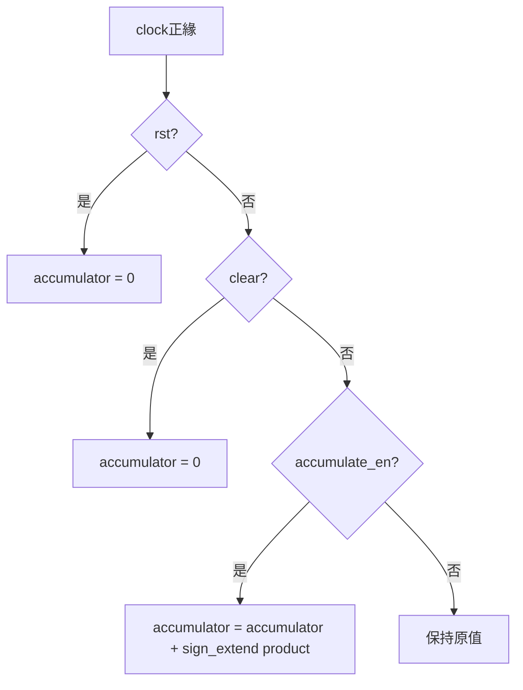
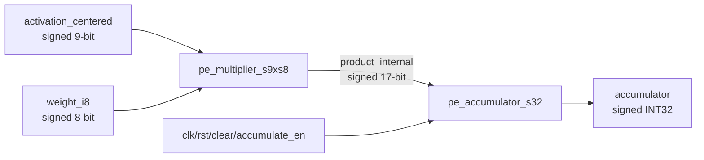
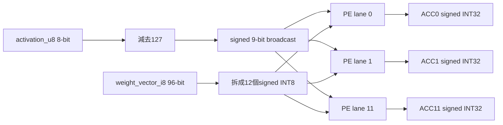
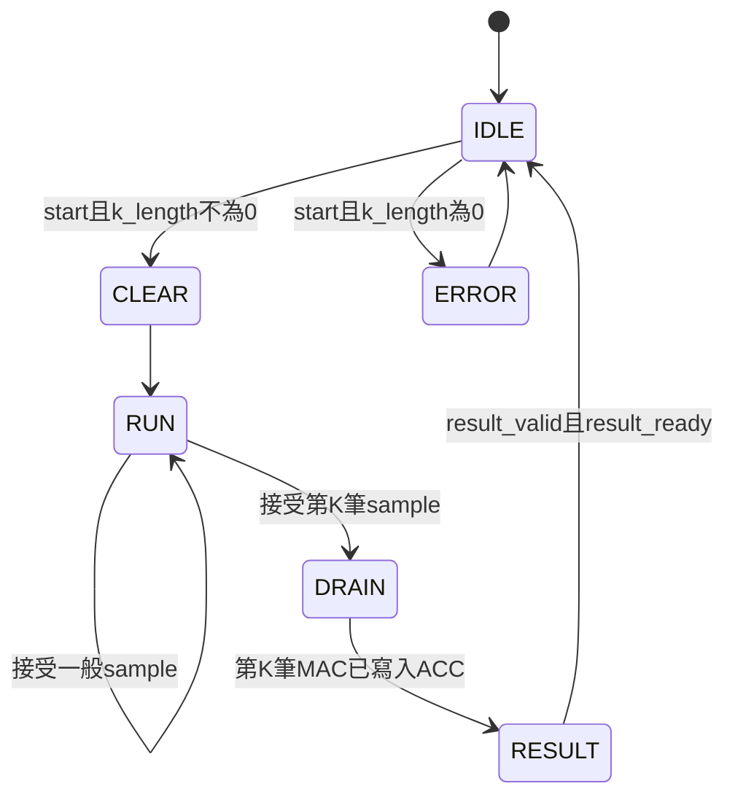
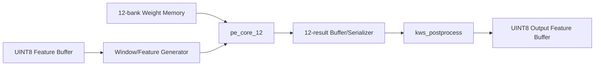

# KWS 12-Lane PE Core 中文架構說明

## 2026-09-21：同模型 zp128／PoT 比較配置

PE9 MAC 仍使用 LUT signed9×8、Product FF、ACC FF，不改乘法器。
共用 pe_memory_engine 新增 INPUT_ZERO_POINT（預設127）；設為128時改接 A−128 的9-bit sign extension。
新 pe9_pot_board_top 透過 pe_pot_engine 接上 PoT／ReLU128／FIFO，與 PE8 使用同一數值契約。
三種新版 engine／板級模擬皆通過；Vivado新報告與板上測試仍需執行。
因9-bit輸入實際只有−128..127，合成器可能裁掉冗餘位寬，不能保證與PE8有明顯LUT差距。
完整差異、FSM、驗證與GUI匯入見 [PE PoT整合](../../HYBRID_SYSTEM/docs/PE_POT_INTEGRATION.md)。

## 最新狀態：PE9 LUT／FF（2026-09-14）

本節取代下方歷史DSP狀態。pe_mac_lane已移除DSP48E1，採signed9×8
乘法→17-bit product FF→sign extension→32-bit accumulator FF。
兩段使用同步active-high rst/clear，優先清除；N接收、N+1累加，保留
product_valid及modulo 2^32語意。介面、array與TB不變。
MAC與獨立乘法器設use_dsp="no"，Makefile不再載入DSP模擬庫。
PE_COMPARISON/common_setup將兩個新建array專案MAX_DSP設0；既有專案
須自行更新設定並重跑。舊DSP報告不是本版結果，不使用report_dsp_mac.tcl。
修改前RTL及Makefile備份：PE_COMPARISON/snapshots/pe9_before_lut_20260914.tar.gz。
兩份等價top仍在規劃階段，見PE_COMPARISON/docs/PE_LUT_EQUIVALENT_PLAN.md。
本次執行PE_CHIP的make test lint通過；MAC完成280241次管線／控制／wrap
檢查，array完成2928次lane比較及package契約，其他算術測試亦通過。
尚未執行Vivado，不能據此宣稱125MHz或實測DSP=0已驗證。

## 最新實作：每 lane 明確實例化一顆 DSP48E1（2026-09-12）

此節取代下方「一般 RTL 推導 DSP MAC」的最新狀態。推導版實際生成每 lane 兩顆 DSP，故改為 primitive 實例化。修改前備份為 `../../PE_COMPARISON/snapshots/pre_explicit_dsp48_20260912.tar.gz`，SHA256 為 `76e022835694b235373c38b3292edf79f5ac6a86ffbe095e119a5b3874c1fc52`；旧報告未修改。

每 lane 只有一個 DSP48E1 實例 `dsp_mac`，設定 AREG/BREG=0、MREG/PREG=1、控制暫存器=0、OPMODE=0100101、ALUMODE=0000、INMODE=00000。A/B 符號延伸；DSP 內部 M 保存乘積，P 累加上一拍的 M 並回授自己。外部保留一個 product_valid FF，CEM=accumulate_en，CEP=product_valid。rst OR clear 同步送到 RSTM/RSTP 並清 valid。DSP 未使用的 cascade/status 輸出留空、未用輸入固定為 0。

```text
A,W → [ DSP48E1: multiply → MREG → add → PREG → feedback ]
                                               └→ low 32 bits
accept → product_valid FF → CEP
```

兩份 PE 都更新；12 個 lane 目標為 12 顆 DSP，外部介面及 N 接受、N+1 累加的時序不變。末筆需一拍 drain，clear/reset 丟棄 pending。輸出仍為模 2^32，8×8 weight-sum 補償仍在未來上層。這次沒有改 XDC，也沒有以 false path 隱藏 Hold 違反；DSP 數量減少不保證 reset Hold 通過。

### 驗證與匯入

普通 `make test lint` 使用 sim_verilator 中的限定組態行為模型。另以 `PE_COMPARISON/make test-unisim` 跑官方 Xilinx DSP48E1 模型，驗證兩份 lane、兩份 array、跨版本比較；來源與版本限制见 sim_vendor/README.md。官方模型不是本機 Vivado 2023.2 版本，最後仍可用 XSim bundled UNISIM 重跑。

Vivado 只更新兩份 lane 的 RTL 即可，未新增需匯入的 RTL 模組；不要加入 PE_COMPARISON/sim_vendor 或 sim_verilator，否則會覆蓋 primitive 定義。保留 MAX_DSP=-1、OOC、8 ns 約束，重新 synthesis/implementation。在 Open Synthesized Design 後 source PE_COMPARISON/vivado/report_dsp_mac.tcl，檢查 DSP=12 與 MREG=PREG=1。primitive 不一定出現在舊的 inference DSP Final Report 表格中，應以 netlist/resource report 為準。

## 可讀性更新：明確列出 12 個 lane（2026-09-12）

`rtl/array/pe_array_12.sv` 移除 generate-for，改為 `pe_lane_0` 到 `pe_lane_11` 十二個實例。每個實例明確寫出 weight 的 8-bit slice、result 的 32-bit slice，以及 `accumulate_en && lane_mask[i]`。PE0 對應 weight[7:0]/result[31:0]；PE11 對應 weight[95:88]/result[383:352]。activation、clk、rst、clear 仍共用，DSP MAC 與一拍 drain 契約不變。

本次只修改 PE_CHIP，PE_CHIP_8x8 保留 generate 寫法。實例路徑從 `gen_lane[i].mac_lane` 改為 `pe_lane_i`；若自訂波形或約束引用舊階層，必須更新。明確展開固定為 12 lanes，未來更改 package 的 lane 數量或位寬時也必須同步修改接線。原本 generate-for 本來就可合成；此變更不保證節省資源或改善時序。

## 目前版本：Pipelined DSP MAC（2026-09-11）

本次驗證結果：兩份 PE 的 test/lint 全通過；MAC 各 280241 checks、array 分別 2928/2964 checks、跨版本比較 10812 checks、工具測試 6 項通過。尚未執行 Vivado 合成。

本節取代下方歷史版本中「組合乘法＋獨立 accumulator」的架構與週期描述。這是一般 RTL 推導版本，不是直接實例化 DSP48E1，實際映射與時序仍須 Vivado 驗證。

### 備份與架構

修改前來源保存在 `../../PE_COMPARISON/snapshots/pre_dsp_mac_20260911.tar.gz`，SHA256 與還原說明見同目錄 PRE_DSP_MAC.md。排除 build/reports，舊報告仍留原位。

```text
Activation ─┐
            ├→ multiply → product_reg → add → mac_accumulator[47:0]
Weight ─────┘                           ↑             │
                                        └─────────────┘
                                                      └→ output[31:0]
accumulate_en → product_valid → enable accumulator
```

lane 加上 use_dsp=yes，目標每 lane 一顆 DSP48E1，包含 MREG 乘法暫存與 PREG 累加暫存。PE_CHIP 的 product_reg 為 signed 17-bit，PE_CHIP_8x8 為 signed 16-bit。兩份內部 ACC 為 48-bit，輸出低 32-bit，維持模 2^32 溢位，不是 saturation。8×8 的 weight-sum 補償仍由未來上層負責。

新版 lane 不再實例化獨立 multiplier/accumulator，但那些檔案與單元測試保留。Package、12-lane array 外部介面與位寬不變。

### 時序契約

- 同步 active-high rst/clear：清除 product、valid 與 accumulator，拒收當拍輸入，丟棄 pending 乘積。
- 上升緣 N 接受輸入，N+1 將該乘積累加。仍可每拍接收一筆。
- lane 的接受條件仍是 accumulate_en AND lane_mask[i]，有效訊號延遲一拍，不能以當拍 mask 決定上一拍是否累加。
- 停送第一拍仍可能更新 ACC，第二拍才完全保持；最後輸入後必須有一拍 drain，clear 不能取代 drain。
- 沒有新增外部 done/valid，上層 controller 必須遵守新的一拍延遲。

| 上升緣 | 接受 | 更新後 ACC |
|---|---|---|
| 1 | P0 | 0 |
| 2 | P1 | P0 |
| 3 | P2 | P0+P1 |
| 4 | 無 | P0+P1+P2 |
| 5 | 無 | 保持 |

### 測試與合成

MAC TB 以獨立交易 queue 逐拍驗證首筆延遲、連續輸入、停頓/排空/重複 idle、clear/reset 丟棄 pending、同時 enable、正負邊界、K=9/32/144，以及各 140000 次正負累加驗證 INT32 overflow。Array TB 保留 packing、交錯/one-hot/部分/全零 mask 與 K/停頓，reference 改為累加上一拍有效交易。8×8 與跨版本 array 比較仍驗證 raw+weight_sum 等於原 zp127 公式。

執行各 PE 的 `make test lint` 與 PE_COMPARISON 的 `make test lint check-tools`。這些測試只能證明功能，不能證明 DSP mapping 或 125 MHz。

Vivado 更新實際使用的 RTL 副本，保存舊報告，允許 MAX_DSP=-1，保留 OOC/8 ns，重新 synthesis/implementation。Open Synthesized Design 後 source `PE_COMPARISON/vivado/report_dsp_mac.tcl`。目標 DSP Final Report 為 A*B+P、MREG=1、PREG=1；僅 DSP=12 不足以證明 MAC 整合。若仍有外部累加 CARRY4，需要再調整推導或採用 primitive。比較 routed WNS/WHS/LUT/FF/DSP，OOC 邊界限制仍存在。

## DSP 合成實驗（2026-09-11）

`pe_multiplier_s9xs8` 的 module 宣告加入 `(* use_dsp = "yes" *)`，要求 Vivado 將乘法映射至 DSP。介面、signed 17-bit 乘積、32-bit 累加器及原本週期不變，沒有新增 pipeline。8×8 版本也採相同設定以便比較。模擬僅驗證數值與控制，不能確認 DSP 映射或 125 MHz 時序。

既有 Vivado 專案須確認使用更新的 RTL（若之前複製來源到專案內，需更新該副本）。先保存舊報告，再將 synthesis 的 `MAX_DSP` 設為 `-1`，Reset Run 並重跑 synthesis/implementation；保留 OOC 與 8 ns 約束。新建比較專案的 `common_setup.tcl` 已設定 DSP 上限為 `-1`。

```tcl
set_property -name STEPS.SYNTH_DESIGN.ARGS.MAX_DSP -value -1 -objects [get_runs synth_1]
reset_run synth_1
launch_runs synth_1 -jobs 2
wait_on_run synth_1
open_run synth_1
puts "DSP48E1 count = [llength [get_cells -hierarchical -filter {REF_NAME == DSP48E1}]]"
report_utilization
```

驗證沿用 `make test lint` 與 `PE_COMPARISON` 的 `make test lint check-tools`，涵蓋乘法、累加、單 lane、12 lanes 與兩種位寬的數值比對。實際 DSP 數量、LUT/FF、routed WNS/WHS 必須由 Vivado 報告確認，不能預先保證通過 125 MHz。

## 1. 文件目的與審核結論

本文件定義`PE_CHIP`中12-lane數位Processing Element核心的功能、數值格式、介面、資料流、控制狀態及與`HYBRID_SYSTEM`的分工。

重新核對目前軟體匯出資料、模型大小、已完成RTL及Hybrid後處理後，結論如下：

| 審核項目 | 結論 | 說明 |
|---|---|---|
| PE負責Conv1、FC1、FC2 | 符合 | 這三層適合12-output並行PE；Conv2、Conv3仍規劃給DCIM |
| Activation格式 | 符合 | 軟體內部activation是UINT8 code，zero-point固定127 |
| Weight格式 | 符合 | 權重為per-output-channel量化的signed INT8，weight zero-point全部為0 |
| Bias | 符合 | 目前checkpoint使用`bias=false`，轉換後bias為None或全0 |
| PE輸出格式 | 符合 | PE只輸出raw signed INT32 accumulator |
| 12-lane output-stationary | 符合 | 同一個activation同時乘12個output-channel weight |
| Conv1 mapping | 符合 | K=9，一次產生12個filter在同一空間座標的結果 |
| FC1 mapping | 符合 | 32個output拆成12、12、8三次transaction |
| FC2 mapping | 符合 | K=32，只啟用前8條lane |
| UINT8後處理分工 | 符合 | Requant、ReLU、Pool、Argmax已放在`HYBRID_SYSTEM` |
| 可設定activation zero-point | 已修正 | 目前RTL固定127，不在第一版`pe_core_12`提供可變zero-point參數 |
| 12個PE輸出接單路後處理 | 需整合 | `HYBRID_SYSTEM`必須加入12-to-1 result buffer/serializer |
| 12 DSP、125 MHz | 尚待驗證 | 這是Vivado合成目標，不是目前已證實的PPA結果 |

整體架構與目前論文方向一致：使用小型12-lane數位PE處理Conv1、FC1、FC2，使用DCIM處理Conv2、Conv3，兩個engine最後共用UINT8後處理資料路徑。

## 2. 目前模型與硬體邊界

本設計只對應下列12-filter checkpoint：

```text
SHA256 = a0d08dec45cc0390aa8e56411241afa0bc466119bfc0531f151db52ed25e39d7
```

對應軟體資料：

```text
/home/LAB505/projects/KWS/layer_activation_uint8
/home/LAB505/projects/KWS/layer_weights_int8
```

不可混用：

```text
layer_activation_uint8_filters14
layer_weights_int8_filters14
```

目前完整硬體推論的輸入邊界已改為軟體`QuantStub`後的UINT8 Mel feature map，而不是FP32 Mel，也不是原始audio waveform：

```text
UINT8 quant_input [1,64,126]
        │
        ▼
Pool1 [1,32,63]
        │
        ▼
Conv1 PE
        │
        ▼
Conv2/Conv3 DCIM
        │
        ▼
FC1/FC2 PE
        │
        ▼
Argmax
```

因此`PE_CHIP`不需要FP32運算，也不需要實作FP32轉UINT8 quantizer。

## 3. 凍結的數值格式

目前QAT/QNNPACK模型的硬體數值契約為：

```text
activation storage   : unsigned UINT8 code
activation zero-point: 127
weight storage       : signed INT8 two's complement
weight zero-point    : 0
weight scale         : per-output-channel
bias                 : disabled / zero
product              : signed 17-bit
accumulator          : signed INT32
```

第`j`條lane只負責計算：

```text
acc[j] = sum(k=0..K-1) ((activation_u8[k] - 127) * weight_i8[j][k])
```

### 3.1 Activation中心化

UINT8 code必須先減去zero-point：

\[
x_c=q_x-127
\]

完整合法輸入範圍為：

```text
q_x = 0..255
x_c = -127..128
```

signed 8-bit無法表示正128，因此中心化結果使用signed 9-bit。

目前已完成：

```text
rtl/arithmetic/activation_center_127.sv
tb/arithmetic/tb_activation_center_127.sv
```

並已驗證全部256種UINT8 code。

### 3.2 Signed乘法

每條lane計算：

\[
p_j=x_cw_j
\]

格式為：

```text
signed 9-bit activation × signed 8-bit weight
                      -> signed 17-bit product
```

目前模型實際乘積範圍為：

```text
-16384..16256
```

第一版仍保留完整17-bit乘法輸出，不手動截位。

### 3.3 INT32累加

每條lane各自保存一個signed INT32 accumulator：

\[
ACC_j^{next}=ACC_j+p_j
\]

目前最大K值為FC1的144，INT32足以容納所有層的理論最大累加量，並與軟體raw accumulator格式一致。

已完成的`pe_accumulator_s32`介面為：

```systemverilog
module pe_accumulator_s32 (
    input  logic               clk,
    input  logic               rst,
    input  logic               clear,
    input  logic               accumulate_en,
    input  logic signed [16:0] product,
    output logic signed [31:0] accumulator
);
```

每個clock正緣的控制優先順序固定為：

```text
rst > clear > accumulate_en > hold
```



`rst`是同步active-high，用於初始化或中止PE；`clear`只清除目前lane的partial sum，讓下一個output開始新的dot product。即使`clear`與`accumulate_en`同時為1，仍以clear為優先，避免上一個output殘留。

17-bit product在加法前明確做sign extension：

```text
signed_product_32 = {{15{product[16]}}, product}
```

本模組不包含飽和、rounding、bias、ReLU或requantization。以目前最長FC1 `K=144`估算：

```text
最大正向上限 =  16,256 × 144 =  2,340,864
最大負向上限 = -16,384 × 144 = -2,359,296
```

兩者都遠小於signed INT32範圍。單獨合成Accumulator可能使用FF與CARRY；是否與乘法一起映射進DSP48E1，要等`pe_mac_lane`整合後由Vivado報告確認。

`tb_pe_accumulator_s32`已驗證：

1. 同步active-high reset只在正緣清零。
2. `clear`優先於`accumulate_en`。
3. 正數、負數與正負交錯累加。
4. `accumulate_en=0`時保持原值。
5. 合法乘積邊界`16256`與`-16384`的sign extension。
6. 連續144次最大正乘積，結果為`2340864`。
7. 連續144次最大負乘積，結果為`-2359296`。
8. 運算途中reset可清除既有partial sum。

### 3.4 單一PE MAC Lane

`pe_mac_lane`將已驗證的Multiplier與Accumulator組成一條完整運算lane：

```systemverilog
module pe_mac_lane (
    input  logic               clk,
    input  logic               rst,
    input  logic               clear,
    input  logic               accumulate_en,
    input  logic signed [8:0]  activation_centered,
    input  logic signed [7:0]  weight_i8,
    output logic signed [31:0] accumulator
);
```

內部沒有重新撰寫乘法或累加，而是直接實例化：



一條lane執行：

\[
ACC^{next}=ACC+(activation_{centered}\times weight_{i8})
\]

Multiplier是組合邏輯，Accumulator在clock正緣更新。因此只要輸入與`accumulate_en`在正緣前穩定，該乘積就會在這個正緣加入Accumulator。完整Core會在lane之前建立input pipeline，所以整合後的時序是：

```text
Cycle N正緣   ：Core接受並註冊activation與12個weights
Cycle N~N+1   ：12條lane的Multiplier組合運算
Cycle N+1正緣 ：sample_commit使Accumulator加入product
```

`activation_center_127`不放在lane內，而是在上層只實作一次後broadcast給12條lane，避免重複12個相同的減127邏輯。`pe_mac_lane`也不接收`lane_mask`或`sample_valid`；未來`pe_array_12`會產生：

```text
lane_accumulate_en[j] = sample_commit && lane_mask[j]
```

再將結果送入第`j`條lane的`accumulate_en`。K計數、busy/done及valid/ready則由Controller與Core負責。

目前MAC lane保留清楚的模組階層：

```text
pe_mac_lane
├── pe_multiplier_s9xs8
└── pe_accumulator_s32
```

這有利於單元驗證與錯誤定位。Vivado能否將這兩層合併成單一DSP48E1 MAC，仍取決於hierarchy flattening、pipeline與synthesis策略；目前只有功能模擬PASS，尚不能宣稱已使用DSP。

`tb_pe_mac_lane`共完成25項檢查：

1. 同步reset初始化Accumulator。
2. `clear`優先於有效乘法。
3. 正×正、正×負、負×正、負×負連續MAC。
4. `accumulate_en=0`時即使乘積非零仍保持結果。
5. `128×(-128)=-16384`及`(-127)×(-128)=16256`跨模組邊界正確。
6. Conv1形式K=9 dot product逐步累加，最終結果為`35`。
7. FC2形式K=32 deterministic dot product，testbench獨立計算golden，結果為`36`。
8. Clear後開始新transaction不殘留前一次partial sum。
9. 運算後同步reset能將lane結果清為0。

### 3.5 PE不負責Requantization

PE輸出的INT32不能直接取低8-bit。後續由`HYBRID_SYSTEM`執行：

\[
q_y=\operatorname{sat}_{0,255}
\left(
\operatorname{round}
\left(ACC\frac{M_{Q31}}{2^{31}}\right)+127
\right)
\]

其RTL已位於：

```text
HYBRID_SYSTEM/rtl/datapath/requantizer_int32_to_uint8.sv
HYBRID_SYSTEM/rtl/datapath/relu_uint8_zp127.sv
HYBRID_SYSTEM/rtl/datapath/maxpool2x2_uint8.sv
HYBRID_SYSTEM/rtl/datapath/argmax_8.sv
HYBRID_SYSTEM/rtl/datapath/kws_postprocess.sv
```

## 4. 為什麼使用12個PE

模型的Conv1、Conv2、Conv3皆有12個output channel。12-lane PE可在同一個output空間座標平行計算12個filter：

```text
同一個activation[k]
        │
        ├── × weight[0][k]  -> ACC0
        ├── × weight[1][k]  -> ACC1
        ├── × weight[2][k]  -> ACC2
        │
        └── × weight[11][k] -> ACC11
```

本論文的分工並不是因為PE只能做Conv1，而是根據目前混合架構選擇：

```text
Conv1、FC1、FC2 -> 12-lane PE
Conv2、Conv3    -> DCIM
```

PE數量12也能有效配合：

- Conv1的12個output channel，一次全部計算。
- FC1的32個output，以12、12、8分三批。
- FC2的8個class，只啟用前8條lane。

## 5. Output-Stationary資料流

每次接受的input beat包含：

```text
1個 activation_u8[k]
12個 weight_i8[j][k]
```

Activation只中心化一次，再broadcast到12條lane：



12個accumulator在完整K迴圈期間固定保存相同output channel的partial sum，因此稱為output-stationary。

資料不是「一次輸入12個activation」，而是：

```text
一次輸入1個activation，平行乘上12個不同output-channel weight
```

## 6. PE Core交易介面

第一版`pe_core_12`規劃介面如下：

```systemverilog
module pe_core_12 (
    input  logic         clk,
    input  logic         rst,

    input  logic         start,
    input  logic [7:0]   k_length,
    input  logic [11:0]  lane_mask,
    output logic         busy,
    output logic         done,
    output logic         error,

    input  logic         sample_valid,
    output logic         sample_ready,
    input  logic [7:0]   activation_u8,
    input  logic [95:0]  weight_vector_i8,

    output logic         result_valid,
    input  logic         result_ready,
    output logic [383:0] result_vector_s32
);
```

### 6.1 為何不再提供zero-point參數

原文件將`ACTIVATION_ZERO_POINT=127`列成`pe_core_12`參數，但目前已實作的底層元件名稱與功能都固定為`activation_center_127`，而且目前checkpoint所有activation zero-point也是127。

為避免介面看似可設定、內部卻仍固定127，第一版核心不提供可變zero-point參數。未來若要支援其他模型，再把底層改成generic `activation_center`並同步加入zero-point輸入。

### 6.2 Transaction控制

```text
start
    開始一筆新的dot-product transaction

k_length
    本次需要接受的reduction元素數量，合法範圍1..255

lane_mask
    決定12條lane中的哪些lane允許累加

busy
    從接受start到result完成handshake期間保持1

done
    result_valid && result_ready完成時脈衝一個clock

error
    例如k_length=0時脈衝一個clock
```

`k_length[7:0]`可表示最大255，足以涵蓋目前K值9、32及144。

### 6.3 Input handshake

只有下列條件成立時才能接受一筆activation/weight：

```text
sample_accept = sample_valid && sample_ready
```

同一個`sample_valid`同時涵蓋activation與完整96-bit weight vector，避免兩個資料流錯位。

### 6.4 Weight packing

```text
lane j weight = weight_vector_i8[(8*j) +: 8]
```

| Lane | Weight slice |
|---:|---:|
| 0 | `[7:0]` |
| 1 | `[15:8]` |
| 2 | `[23:16]` |
| ... | ... |
| 11 | `[95:88]` |

每個8-bit slice都必須以two's-complement signed INT8解讀。

### 6.5 Result packing

```text
lane j result = result_vector_s32[(32*j) +: 32]
```

| Lane | Result slice |
|---:|---:|
| 0 | `[31:0]` |
| 1 | `[63:32]` |
| 2 | `[95:64]` |
| ... | ... |
| 11 | `[383:352]` |

`result_vector_s32`是packed bit vector，但每個32-bit slice都必須用signed INT32解讀。

`result_valid`必須保持為1，且整個384-bit result bus必須保持不變，直到`result_ready=1`完成handshake。

## 7. Pipeline設計

第一版使用一級input register，再由12條MAC lane累加：

```text
Cycle N正緣
    sample_valid && sample_ready
    -> 保存centered activation與12個weights
    -> input_pipeline_valid=1

Cycle N到N+1
    12個signed multiplier產生products

Cycle N+1正緣
    input_pipeline_valid && lane_mask[j]
    -> 12個accumulator更新
```

這樣的優點是：

- Activation減127只實作一次。
- 12條lane共用同一筆已註冊activation。
- Activation與96-bit weight vector一起進pipeline，不會錯位。
- Pipeline可在無stall時每clock接受一筆新資料。

控制器必須分別追蹤：

```text
accepted_count : 已進入input pipeline的筆數
committed_count: 已真正寫入accumulator的筆數
```

否則最後一筆資料可能已被接受，但尚未累加就錯誤輸出結果。

## 8. Controller狀態機



| 狀態 | 功能 |
|---|---|
| `IDLE` | 等待合法`start` |
| `CLEAR` | 清除12個accumulator與計數器 |
| `RUN` | 在`sample_ready=1`時接受K筆資料 |
| `DRAIN` | 停止接受新資料，等待最後一筆pipeline資料完成累加 |
| `RESULT` | 保持12個INT32結果，等待`result_ready` |
| `ERROR` | 對非法`k_length=0`產生錯誤脈衝 |

Reset規格：

```text
PE_CHIP內部reset = synchronous active-high
```

若板級reset是非同步輸入，必須在系統top先同步後再送入PE core。

## 9. RTL檔案階層與責任

```text
PE_CHIP/rtl/
├── pe_pkg.sv
├── arithmetic/
│   ├── activation_center_127.sv
│   ├── pe_multiplier_s9xs8.sv
│   ├── pe_accumulator_s32.sv
│   └── pe_mac_lane.sv
├── array/
│   └── pe_array_12.sv
├── control/
│   └── pe_core_controller.sv
└── core/
    ├── pe_core_12.sv
    └── pe_standalone_top.sv
```

| 模組 | 責任 | 是否需要clock | 目前狀態 |
|---|---|---:|---:|
| `pe_pkg` | 位寬、lane數與packing常數 | 否 | 尚未實作 |
| `activation_center_127` | UINT8減127，輸出signed 9-bit | 否 | 已完成、256值PASS |
| `pe_multiplier_s9xs8` | signed 9×8乘法，輸出signed 17-bit | 否 | 已完成、65,536組PASS |
| `pe_accumulator_s32` | INT32 clear、enable、hold、累加 | 是 | 已完成、控制與K=144 PASS |
| `pe_mac_lane` | 組合一個multiplier與一個accumulator | 是 | 已完成、25項MAC檢查PASS |
| `pe_array_12` | 12條lane、broadcast、unpack與lane mask | 是 | 尚未實作 |
| `pe_core_controller` | K計數、accept/commit、drain與handshake | 是 | 尚未實作 |
| `pe_core_12` | 整合input pipeline、controller與array | 是 | 尚未實作 |
| `pe_standalone_top` | PE單獨Vivado合成與PPA wrapper | 是 | 尚未實作 |

目前資料夾中的`rtl/buffer/`是預留空目錄。第一版不在`PE_CHIP`內建立整層weight buffer或feature-map buffer；這些記憶體屬於`HYBRID_SYSTEM`。若後續確認完全不需要PE專用buffer，此空目錄可以移除。

### 9.1 為何不建立獨立lane-mask模組

Lane mask只需要控制每條accumulator的enable：

```text
lane_acc_enable[j] = sample_commit && lane_mask[j]
```

邏輯很小，放在`pe_array_12`中即可，不需額外增加一層module。

### 9.2 為何不建立PE內部整層weight memory

PE Core只接受每個k對應的96-bit weight vector。整層weight mapping、BRAM組織及address產生屬於Hybrid系統，否則PE Core會綁死特定layer。

## 10. 各層映射方式

### 10.1 Conv1

```text
weight shape = [12,1,3,3]
K            = 3×3×1 = 9
lane_mask    = 12'hFFF
output shape = [12,30,61]
```

對一個3×3 patch：

```text
k=0: activation[0] × filter 0..11 weight[0]
k=1: activation[1] × filter 0..11 weight[1]
...
k=8: activation[8] × filter 0..11 weight[8]
```

9筆input beat完成後，同時得到12個filter在同一output座標的結果。

Conv1共有：

\[
30\times61=1830
\]

個空間座標，因此共產生：

\[
1830\times12=21960
\]

個output element。

### 10.2 FC1

```text
weight shape = [32,144]
K            = 144
output shape = [32]
```

12條PE需分三次transaction：

| Transaction | Output範圍 | Lane mask | Input beats |
|---:|---:|---:|---:|
| 0 | 0..11 | `12'hFFF` | 144 |
| 1 | 12..23 | `12'hFFF` | 144 |
| 2 | 24..31 | `12'h0FF` | 144 |

三次transaction使用相同144個input activation，但讀取不同output group的weights。

### 10.3 FC2

```text
weight shape = [8,32]
K            = 32
lane_mask    = 12'h0FF
output shape = [8]
```

只需一次transaction，PE0到PE7產生8個class accumulator，PE8到PE11停用。

## 11. 與HYBRID_SYSTEM的介面分工



### 11.1 PE_CHIP負責

- Activation減127。
- 12組signed乘法。
- 12組INT32 output-stationary累加。
- K筆資料交易控制。
- Lane mask。
- Result valid/ready handshake。

### 11.2 HYBRID_SYSTEM負責

- Layer名稱與執行順序。
- Input feature-map storage。
- Conv window與FC feature產生。
- 整層weight memory與address。
- 將每個k所需的12個weight組成96-bit vector。
- 將PE的12個INT32結果轉成scalar stream。
- 選取每個output channel的Q31 multiplier。
- Requantization、ReLU、MaxPool、Argmax。
- Output feature-map address與寫回。

### 11.3 必須新增的12-to-1 result path

目前`kws_postprocess`一次接收一個signed INT32 accumulator，但`pe_core_12`一次產生最多12個結果，所以Hybrid System必須加入：

```text
384-bit PE result
        │
        ▼
12-entry result register/buffer
        │
        ▼ one result per cycle
output channel index + signed INT32
        │
        ▼
requant parameter lookup
        │
        ▼
kws_postprocess
```

第一版採單路後處理可減少Q31乘法器數量。若日後量測顯示12-to-1輸出成為瓶頸，再評估多lane requantizer。

由於目前`kws_postprocess`只有`valid`而沒有`ready`，result serializer第一版必須確保下游每clock都能接收；更完整的整合應增加ready/backpressure或小型FIFO。

## 12. 驗證計畫

建議由小到大依序完成：

```text
1. activation_center_127
2. pe_multiplier_s9xs8
3. pe_accumulator_s32
4. pe_mac_lane
5. pe_array_12
6. pe_core_controller
7. pe_core_12
8. 一個實際Conv1 3×3 patch
9. 完整FC2
10. 完整FC1
11. PE + result serializer + post-process
```

### 12.1 底層算術驗證

| 模組 | 必測內容 |
|---|---|
| Activation center | 0、127、255及完整256種code |
| Multiplier | 正正、正負、負正、負負、0及65,536種完整組合 |
| Accumulator | clear、enable、hold、正負交錯及長序列 |
| MAC lane | back-to-back product、disable hold及reset/clear |
| Array | 12個不同weight、broadcast activation及每個mask bit |

### 12.2 Controller驗證

- K=1、9、32、144。
- `sample_valid`中途stall。
- `k_length=0`錯誤處理。
- 最後一筆product確實包含在結果中。
- `result_ready=0`時結果保持穩定。
- Busy期間不接受新的start。

### 12.3 軟體Golden驗證

第一個整合目標使用實際Conv1輸出座標`y=0, x=0`：

```text
Pool1提供9個UINT8 activation
Conv1提供12組3×3 INT8 weight
PE輸出12個signed INT32 accumulator
HYBRID requantizer輸出12個UINT8 Conv1結果
```

已知filter 0：

```text
raw accumulator = 5872
Q31 multiplier  = 4157385
UINT8 result    = 138
```

必須先比較raw INT32，再比較後處理UINT8，這樣才能判斷錯誤發生在PE或requantizer。

## 13. PPA與時序目標

第一版目標為：

```text
clock target              = 125 MHz
accepted input throughput = 1 beat/clock（無stall時）
lane count                = 12
expected multiplier DSP   = 約12個，待Vivado確認
```

需要由Vivado synthesis與implementation報告確認：

- DSP48E1實際數量。
- LUT、FF、CARRY使用量。
- WNS與TNS。
- Critical path。
- Route delay比例。
- 是否有inferred latch、unconstrained clock或multi-driven net。

不能只因RTL寫了12個乘法就宣稱一定使用12個DSP。Vivado是否把乘法與accumulator合併進DSP，取決於RTL寫法、pipeline、attribute與synthesis設定。應在`pe_mac_lane`完成後建立`pe_standalone_top`實測。

## 14. 初步效能估算

只看PE Core且假設輸入無stall：

| Transaction | K | 主要計算beats |
|---|---:|---:|
| Conv1一個patch、12 outputs | 9 | 9 |
| FC1一組最多12 outputs | 144 | 144 |
| FC2八個outputs | 32 | 32 |

另外仍有：

- Start/CLEAR overhead。
- 最後一筆pipeline drain。
- Result handshake。
- 12-to-1後處理輸出時間。
- Feature與weight memory供應stall。

因此完整layer latency不能只用K除以clock frequency，必須等controller、memory與result serializer整合後，以cycle counter量測。

## 15. 目前仍未決定或尚未驗證的項目

1. 12個乘法是否確實各映射為一個DSP48E1。
2. PE Core在PYNQ-Z2上是否能達成125 MHz post-route timing。
3. Weight memory要用12-bank BRAM、較寬BRAM word或其他組織。
4. 12-to-1 result serializer是否需要ready/FIFO。
5. PE與Hybrid後處理的最佳clock domain安排。
6. 完整test set而非單一樣本的bit-accurate與accuracy驗證。
7. PE與DCIM的實際layer latency、利用率及公平比較方式。

這些項目不影響目前先由底層建立PE arithmetic，但必須在宣稱完整Hybrid KWS推論或PPA成果之前完成。

## 16. 下一步

目前四個底層算術元件均已驗證：

```text
activation_center_127.sv
    -> 256種UINT8 code PASS
pe_multiplier_s9xs8.sv
    -> 65,536組signed乘法 PASS
pe_accumulator_s32.sv
    -> reset/clear/enable/hold/邊界/K=144 PASS
pe_mac_lane.sv
    -> signed MAC/控制/邊界/K=9/K=32共25項PASS
```

上述四個底層測試保留。package 與 array 的新增進度如下；單 lane 與 12-lane 的 DSP inference 仍需由後續 Vivado synthesis 報告確認。

## 新增：pe_pkg 與 pe_array_12

`rtl/pe_pkg.sv` 統一定義 12 lanes、activation UINT8/zp127、centered signed9、weight signed8、product signed17、ACC signed32，以及 96-bit weight / 384-bit result packing。package 本身不是電路。既有 arithmetic 模組未改寫，修改 package 常數不代表所有模組會自動調整規格。

`rtl/array/pe_array_12.sv` 使用 generate 實例化 12 個既有 pe_mac_lane，所有 lane 共用一個 centered activation。activation_center_127 位於 array 外部，未在 array 內重複實例化。

```text
UINT8 → 外部 center_127 → signed9 activation 廣播
                              │
96-bit weights → 12 × pe_mac_lane → 12 × INT32 ACC → 384-bit result
                              ▲
                   accumulate_en AND lane_mask[j]
```

### 介面與時序

| 訊號 | 功能 |
|---|---|
| clk/rst | 同步 active-high reset |
| clear | 清除所有 ACC，不受 lane_mask 影響 |
| accumulate_en | 本拍 operand 有效，允許累加 |
| lane_mask[11:0] | 每 lane enable；關閉時保持，不自動歸零 |
| activation_centered | signed9，合法中心化範圍 −127～128 |
| weight_vector_i8[95:0] | lane j 位於 j*8 +: 8，明確轉為 signed |
| result_vector_s32[383:0] | lane j 位於 j*32 +: 32，觀察時按 signed32 解讀 |

正緣優先序 rst > clear > enable > hold。沒有新增 pipeline、輸出暫存器、adder tree、K counter、valid/ready 或 done。輸出為即時 ACC 狀態；外部須在新 dot product 前 clear，並計算有效提交次數。12 個結果屬於不同 output channels，不能互相加總。Mask 僅控制累加器，不保證乘法器完全停止切換。

### 驗證與執行

新增 `tb/array/tb_pe_array_12.sv`，以獨立整數 reference 在每個被檢查的正緣後比對全部 12 路；reference 使用固定介面寬度，以捕捉 package/packing 設定錯誤。

| 測試 | 目的 |
|---|---|
| Package 位寬常數 | 確認型態與接口契約 |
| 12 個不同 signed weights | lane 對應、負數與 packing |
| FFF/0FF/AAA/555/000/逐路 one-hot | lane mask、保持、切換 |
| reset/clear 與 enable 同時有效 | 控制優先序、清除停用 lane |
| A=−127/128、W=−128/127 | 符號與極端值 |
| K=9/32/144 | 各 lane dot product、停頓與重啟；K32 使用前8路 |

混合資料由固定公式產生，可重現，不宣稱隨機覆蓋。未新增 array 溢位壓力測試；累加器邊界仍由既有單元測試負責。

```sh
make test-array
make test
make lint
```

Vivado 合成 array 時依序匯入 pe_pkg、乘法器、累加器、MAC lane、array，設 top 為 pe_array_12；全部設為 SystemVerilog，測試檔不可當 synthesis sources。這是寬資料核心介面，不是板级引腳 top；PPA 可採 OOC，不能當作可直接燒錄的完整系統。

### PE_CHIP_8x8 後續對齊方式（尚未實作）

下一步建立 pe8_pkg 與 pe8_array_12，維持相同 12 lanes、mask、控制優先序與 packing，但 activation 為 signed8、product 為 signed16，實例化現有 pe8_mac_lane。其 array 輸出仍是 raw D=Σ(A−128)W。

新版測試先驗證 raw，再在 testbench 加 ΣW，和原版 Σ(A−127)W 比對。硬體補償等兩版 array 都完成後，再於 core 層設計；不要只在新版 array 多加補償，卻把資源與原版 raw array 當作完全同功能比較。最終等價系統需要包含補償參數與電路成本。

### 實際驗證紀錄（2026-09-11）

使用 Verilator 5.030 重新執行 `make test lint`，結束碼 0。

| 項目 | 結果 |
|---|---|
| activation_center_127 | 全部測試 PASS |
| pe_multiplier_s9xs8 | 全部測試 PASS |
| pe_accumulator_s32 | 19 項檢查 PASS |
| pe_mac_lane | 25 項檢查 PASS |
| pe_array_12 | 2,928 次逐 lane 比對及 package 契約檢查 PASS |
| RTL lint | 完成，無輸出警告或錯誤 |

Package 的 ACT_U8_WIDTH 與 ACT_ZERO_POINT 為外部原始輸入契約，array 接收的是已中心化資料，故這兩個常數在單獨 lint array 時刻意不使用。僅對這兩個宣告局部豁免 Verilator UNUSEDPARAM；其他新增 array 警告仍視為失敗。原本四個元件的測試與 lint 指令保留。

本次未執行 Vivado synthesis、implementation 或上板測試，尚無新 array 的 LUT/FF/DSP、時序或功耗量測。PE_CHIP_8x8 本次未修改，仍停留在四個 arithmetic 元件階段。
