# Signed 8×8 PE 架構與驗證

## 2026-09-21：PoT requantizer 與 zp128 整合規劃

新增獨立 `requantizer_int32_to_uint8_pot.sv`：signed INT32、每筆5-bit shift、nearest-even、zp128飽和輸出，三個register stages、II=1。
新PoT模型的PE8 raw accumulator已是Σ(A−128)W，不需要ΣW補償；本次尚未變更engine／板測／postprocess。
RTL單元及匯出sample逐層26,944筆驗證通過，完整驗證範圍與下一步修改清單見
[PoT requantizer架構](../../HYBRID_SYSTEM/docs/REQUANTIZER_POT_ARCHITECTURE.md)。
沒有新Vivado或板級結果，既有zp127版本繼續保留。

## 2026-09-20：正常板級 PE 自我測試

新增三個固定 `pe9_board_top` / `pe8_compact_board_top` / `pe8_pipeline_board_top`，
共用125MHz IBUF/BUFG、BTN0同步/reset、測試FSM、Golden ROM、PASS/FAIL及heartbeat LED。
engine Operand Pipeline 與乘法器不改，不使用OOC。三配置各兩轮共104結果獨立golden測試通過，含reset重測與timeout FAIL測試。
完整來源清單、FSM、板級XDC與Windows GUI流程见 [PE板級自我測試](../../PE_COMPARISON/docs/PE_BOARD_TEST_GUIDE.md)。
Vivado時序及bitstream尚需於Windows實測，板級PASS不能替代STA。

## 2026-09-20：共用 Operand Pipeline（本次更新）

`pe_memory_engine` 在 read-align 與 PE array 間新增一級 106-bit RTL 儲存量的 operand 暫存（96W + 8A + last + valid）。
三種配置一律使用，`RESULT_PIPELINED` 仍只控制結果端。wrapper、MAC 數值公式、原群組 FSM 狀態皆未改。
群組控制器觀察暫存後的 valid/last，避免提早收集結果；只 reset valid，payload 在 invalid 時不參與運算。
共同 Verilator TB 通過每版 44 loads / 50 jobs / 863 outputs；本次環境未提供 Icarus/Vivado，125 MHz 仍需重新 implementation。
Conv1/FC1/FC2 compute cycles 現為 PE9=30/489/49、PE8 compact=54/553/65、PE8 pipeline=32/495/51。
詳細架構、逐拍時序、驗證、修改清單及 Windows 新快照指令見 [Operand Pipeline 說明](../../PE_COMPARISON/docs/PE_OPERAND_PIPELINE.md)。
下方早期紀錄保留作為演進歷史；新 RTL 與 cycle 以本節及連結文件為準。

## 2026-09-20：三個固定 Wrapper 與 GUI Vivado 流程已建立

`PE_COMPARISON/rtl/memory_backed/` 新增pe9_memory_top、pe8_compact_memory_top、pe8_pipeline_memory_top。
全部僅固定engine參數及接線，不加暫存器。共同TB同時測三個wrapper，各有獨立來源／握手，與相同golden比對；Verilator/Icarus皆通過各44次load、50次compute、863輸出。
新增專用import-only Tcl：來源快照、固定part/策略、依頻率生成XDC、post-synth/pre-opt/post-route hooks。
本機只通過Tcl runtime/mock檢查，沒有Vivado，不能宣稱125MHz或PPA已完成。
完整操作、檔案結構、量測定義與GUI指令見
[PE_MEMORY_COMPARISON_GUIDE.md](../../PE_COMPARISON/docs/PE_MEMORY_COMPARISON_GUIDE.md)。
本次共同TB的效能案例weight來源改為連續供應，所以load cycles不同於下方舊engine TB的turnaround數字；compute cycles一致。

## 2026-09-20：RESULT_PIPELINED 已接入共用 Engine

本節是最新進度；下方「管線尚未接入engine」為歷史紀錄。
`pe_memory_engine.sv` 新增 `parameter bit RESULT_PIPELINED=0`，原有外部ports完全不變。

| PE8_MODE | RESULT_PIPELINED | elaboration後結果路徑 |
|---:|---:|---|
| 0 | 0 | PE9＋`g_compact_result.results` |
| 1 | 0 | PE8精簡＋`g_compact_result.results` |
| 1 | 1 | PE8管線＋`g_pipeline_result.results` |
| 0 | 1 | 不支援；模擬time0以INVALID_PE_CONFIGURATION明確拒絕 |

預設仍是PE8精簡版。參數不是runtime mode，沒有同時實例化兩個結果controller，也沒有新增輸出選擇MUX。
初始 `$fatal` 是模擬診斷；不能保證所有合成工具都以同樣方式處理。未來Vivado建置脚本必須另檢查非法參數組合。

### 架構及保持不變的內容

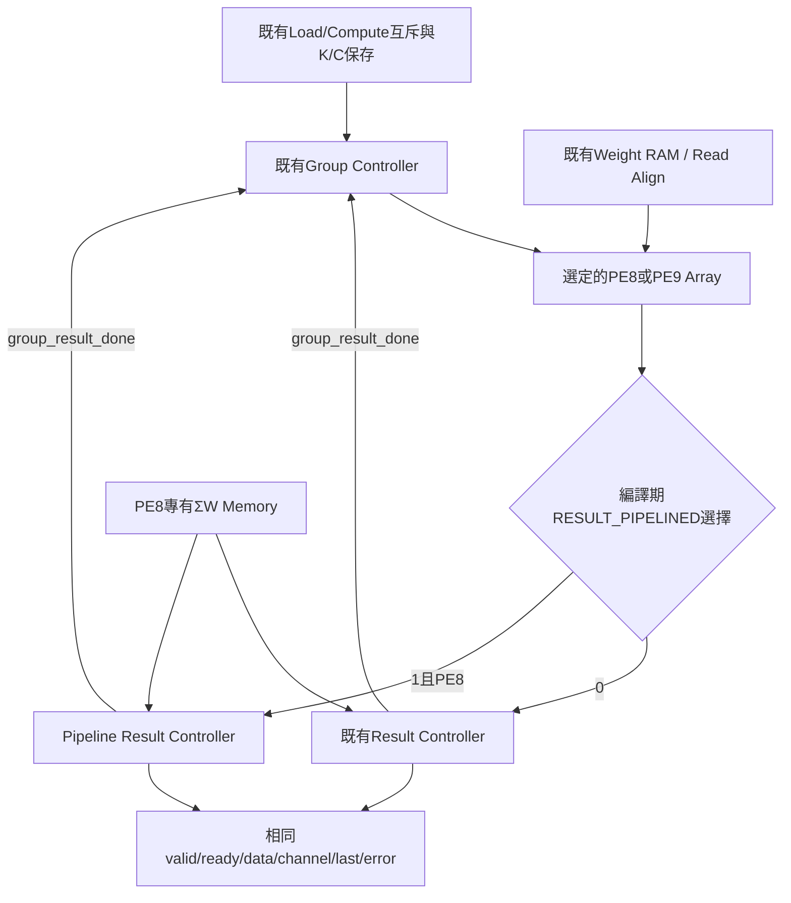

圖中的兩條結果路徑是選項，不是同時存在。
不更改loader、MAC、ΣW、group FSM；group仍在WAIT_RESULT等待最後輸出接受後的group_result_done。
ACC/base/active_lanes在整組結果取完前保持，不重疊下一組MAC與前一組結果排空。
所有子模組共用reset，避免memory殘留回應被新controller誤用。

### 修改檔案

- `HYBRID_SYSTEM/rtl/integration/pe_memory_engine.sv`：參數、generate分支、非法配置診斷。
- `HYBRID_SYSTEM/tb/integration/tb_pe_memory_engine.sv`：三配置、長阻塞、更多reset與契約監測、cycle紀錄。
- `HYBRID_SYSTEM/tb/control/tb_pe8_result_controller_pipeline.sv`：請求阻塞保持與請求數監測。
- `HYBRID_SYSTEM/scripts/verify_engine_elaboration.py`：檢查三配置、選定結果controller唯一性。
- `HYBRID_SYSTEM/scripts/check_invalid_engine.py`：新增預期失敗測試，必須非零退出且含指定錯誤標記，不把其他崩潰當成功。
- `HYBRID_SYSTEM/Makefile`：來源加入pipeline；三配置用獨立build目錄；新增非法配置測試。

### 驗證方法

TB從外部供命令、權重與activation，以64-bit golden `Σ(A−127)W` 比對所有結果。
額外唯讀觀察內部start/done及ACC，用來assert跨module契約；不force、不寫DUT內部、不替DUT排程。

新增與保留的覆蓋：

1. 三種配置跑相同Conv1/FC1/FC2與C1..32、K邊界、極值、非法載入、重複compute。
2. C25的channel0/12/24各阻塞24 cycles，涵蓋首筆、中間組、最後一筆。
3. reset四類：部分權重載入、等待replay、多lane輸出阻塞、MAC接受第一筆activation後。
4. ACC、channel_base、active_lanes在result start到group完成期間保持。
5. output error被接受後，下一個cycle必須反映compute_error。
6. 單元pipeline TB：ΣW請求若未接受，valid/address保持；每組請求數恰為active_lanes。
7. 三種elaboration各只有一個array、一個選定result controller；PE9不含ΣW/correction。
8. 非法PE9+pipe配置須明確失敗；與合法配置PASS分開計算。

注意第5項是防止未來改版接錯的監測；正常engine資料不會自然注入ΣW錯誤，因此不能宣稱engine故障分支已被觸發覆蓋。故障／飽和的資料路徑由獨立result TB測試。

### Cycle量測定義與初步結果

Verilator/Icarus交叉結果一致：

| 配置 | 成功load | 完整compute | 正確output | 非法load | reset中斷 | output保持檢查 |
|---|---:|---:|---:|---:|---:|---:|
| PE9 | 44 | 50 | 863 | 4 | 4 | 520 |
| PE8精簡 | 44 | 50 | 863 | 4 | 4 | 483 |
| PE8管線 | 44 | 50 | 863 | 4 | 4 | 544 |

非法(0,1)配置的Verilator預期失敗測試通過；三種合法配置lint與elaboration實例數檢查通過。
新增請求保持／數量監測後，獨立pipeline TB亦經Verilator/Icarus通過（21組、116輸出、3次取消）。
最後完整執行HYBRID_SYSTEM的 `make test lint`，退出碼0，包含舊精簡版、group、memory engine及後處理回歸。
過程修正Makefile模式迴圈的美元符號轉義問題後重新完整通過；未改舊controller的RTL來避開測試。
既有部分後處理lint允許非致命警告，退出碼0不等於全專案零警告；本次未執行CIM資料夾或Vivado測試。

另外加入三個固定工作量案例，activation不插空拍、out_ready不阻塞；仍包含TB既有命令／replay排程與起始忙碌命令測試的等待。
因此這是**相同來源排程下的整合模擬結果**，不是硬體極限吞吐或Vivado Fmax。

`compute_to_done_edge`：compute握手邊緣到接收端可在上升緣觀察compute_done的邊緣。
`last_output`：compute握手到最後output握手。兩者差2 cycles，包含result到group的完成回傳及done的同步觀察。

| 工作 | PE9 compute cycles | PE8精簡 | PE8管線 |
|---|---:|---:|---:|
| Conv1單patch K9/C12 | 29 | 53 | 31 |
| FC1 K144/C32 | 486 | 550 | 492 |
| FC2 K32/C8 | 48 | 64 | 50 |

PE8精簡/管線MAC和載入完全相同；節省分別22、58、14 cycles，與各組結果路徑 `3N` 改為 `N+2` 的差值一致。
PE8管線仍比PE9每組多2 cycles，沒有刻意讓PE9等待來湊相同時間。

權重來源仍保留每個word的turnaround，不是最大吞吐來源；本測試load觀察值如下，**不能當loader理論最短週期**：

| 工作 | PE9 load observed | PE8兩版 load observed |
|---|---:|---:|
| Conv1 | 229 | 241 |
| FC1 | 9249 | 9281 |
| FC2 | 521 | 529 |

正式三top比較時應增加continuous weight driver，並保留這份有turnaround的基準測試。

### 重跑方式

```bash
cd /home/LAB505/projects/KWS/KWS_DNN_Hybrid/HYBRID_SYSTEM
make test-memory-engine lint-memory-engine check-engine-elaboration
make test-invalid-engine
make test-memory-engine-iverilog  # 需要Icarus或指定工具路徑
make test lint
```

### 架構審查與剩餘限制

- ready/valid不表示有命令queue；busy時的短脈衝不會排隊，來源必須保持到握手。
- 嚴格load優先可能讓持續load請求延後compute；這是目前契約，不是公平仲裁器。
- ΣW介面限定獨占且有序，最多一筆待修正回應；不是可直接替换成亂序、多outstanding的AXI記憶體。
- 無timeout、ECC或硬體故障恢復；少送activation或永久out_ready=0會等待，需要上層監督。
- 暫存metadata依賴group保持；新增下一組MAC重疊功能前必須重新設計ACC保存，不能只縮短WAIT_RESULT。
- ready回傳及ACC MUX→correction的路徑是否達125MHz仍需Vivado，模擬不能保證。
- 本次不是形式驗證、CDC驗證或板級驗證；沒有新增功能錯誤的證據，不等於保證無所有漏洞。

下一步：三個固定參數top、跨版本比較報表、相同約束的Vivado專案。先不要把新engine報告與舊stream-equivalent面積混用。

## 2026-09-19：PE8 結果管線（獨立元件，尚未接入 engine）

新增 [pe8_result_controller_pipeline.sv](../../HYBRID_SYSTEM/rtl/control/pe8_result_controller_pipeline.sv)
與 [獨立 TB](../../HYBRID_SYSTEM/tb/control/tb_pe8_result_controller_pipeline.sv)。
依本次要求，**沒有修改 `pe_memory_engine.sv`、精簡 result controller 或 correction／sum memory RTL**。
下面歷史紀錄中的「PE8 結果管線尚未實作」自此改為「獨立模組已完成，engine 整合尚未完成」。

### 1. 目的與介面

PE8 結果仍為 `Y[c] = raw_acc[c] + ΣW[c]`，signed 32-bit 飽和及 overflow 行為與既有 correction 一致。
原精簡版每 lane 分別 READ_SUM→FEED_CORRECTION→EMIT；本版重疊不同 lanes 的讀取、修正及輸出。
**只有一顆 correction 加法路徑，不是每個 lane 各一顆加法器。**

與既有 `pe_result_controller` 保持相同 port 名稱與寬度，但本模組固定 PE8，不提供 PE8_MODE 參數。

| 介面 | 用途與契約 |
|---|---|
| `clk, rst` | 同步 active-high reset；controller、correction、sum memory 必須一致 reset |
| `result_start_valid/ready` | 接受一組結果；active_lanes 必須1..12，base+lanes≤32 |
| `channel_base[4:0], active_lanes[3:0], raw_results[383:0]` | start握手起到group_result_done保持不變；不另複製整份ACC |
| `busy, group_result_done` | busy涵蓋STREAM/DRAIN；最後output握手後done脈衝一拍 |
| `sum_rd_valid/ready/channel_id` | 逐channel讀ΣW；獨占、依序回應的memory讀取介面 |
| `sum_out_valid/ready/channel_id/data/error` | 同步memory回應；最多一筆尚未被correction接受的ΣW請求 |
| `out_valid/ready/data/channel_id/last/error` | 阻塞時data與標記一起保持；last是本group最後一筆 |

非法group描述不拉高start_ready，與精簡版相同；需由上層提供合法描述。
尚未加入 AXI、CDC、逾時監督或多個 groups 並行；一次僅處理一組，ACC直到取完都不可清除。
無效期間的data/last/error不是交易，只有valid為1時才解讀。

### 2. 資料路徑與暫存責任

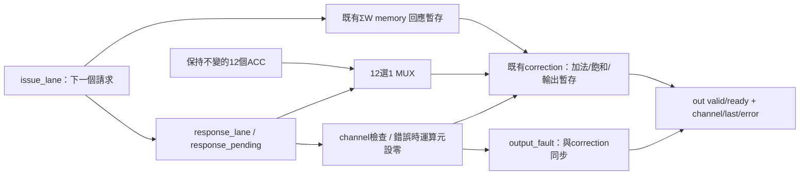

新增控制暫存：2-bit宣告的state、4-bit issue_lane、4-bit response_lane、response_pending、output_fault，以及done。
這只是RTL宣告位寬，不是Vivado最終FF數量；FSM可能重新編碼。
既有memory保存ΣW資料，既有correction保存修正結果與channel，因此不增加ΣW資料副本或384-bit ACC副本。
last由correction輸出的channel與保持中的group終點比較，不必另外存一個last FF。

`issue_lane`與`response_lane`不能合併：同一拍可能接受lane2請求、修正lane1、輸出lane0。

### 3. 狀態表

| 狀態 | 行為 | 離開條件 | 下一狀態 |
|---|---|---|---|
| IDLE | 等待合法start，不讀ΣW | start握手 | STREAM |
| STREAM | 有空位就讀下一個lane；同時接受回應、修正、輸出 | 最後lane的讀取請求握手 | DRAIN |
| DRAIN | 停止新請求，繼續處理在途回應與結果 | 最後output握手 | IDLE，done=1 |

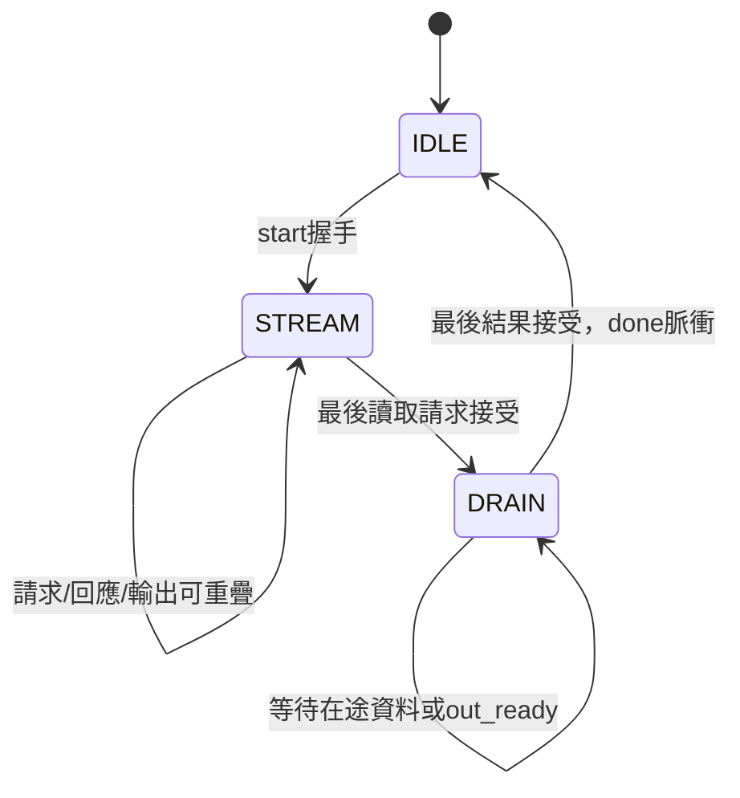

Reset中斷任何狀態，清除pending、correction valid及done，不輸出被取消的結果。
不能只reset本controller卻保留memory的舊response，否則可能把舊回應當成新工作；TB與未來engine都必須共用reset。

### 4. 握手、同拍替換與backpressure

```text
response_fire = running && response_pending && sum_out_valid && correction_ready
sum_rd_valid  = STREAM && (!response_pending || response_fire)   （另加 !rst）
request_fire  = sum_rd_valid && sum_rd_ready
```

- 若request_fire：response_lane保存issue_lane，response_pending=1。
- 否則若response_fire：response_pending=0。
- 兩者同拍時，先前response送入correction，新request的tag取代舊tag，pending保持1。
- correction未滿或舊結果同拍被取走時可接受下一筆，`output_fault`使用相同enable更新。

```text
out_ready=0 → correction保持 → memory回應保持 → 停止新讀取
```

最多可同時有一筆修正後結果與一筆ΣW回應在途。允許在空槽吸收一筆新資料，但不允許覆蓋被阻塞的資料。
ready的組合回傳路徑需要未來Vivado檢查；模擬連續吞吐正確不等於125MHz達標。

### 5. 錯誤不走旁路

ΣW回報無效或channel不符合response_lane時：將correction兩個輸入設為0，照常通過同一個stage；同步記錄output_fault。
最後輸出data=0/error=1，channel仍是原本預期channel，保持筆數及次序。
正常資料的加法overflow沿用correction的signed飽和；out_error = output_fault OR correction_overflow。
因此錯誤結果不會越過前一筆被阻塞的正常結果，亦不會使group提早結束。

### 6. 理想cycle表

以下為上升緣的握手事件；N=4、無阻塞、既有同步sum memory：

| Edge | 讀請求 | correction接受 | 外部接受 |
|---|---|---|---|
| T0 | start接受 | — | — |
| T1 | lane0 | — | — |
| T2 | lane1 | lane0 | — |
| T3 | lane2 | lane1 | lane0 |
| T4 | lane3，進入DRAIN | lane2 | lane1 |
| T5 | — | lane3 | lane2 |
| T6 | — | — | lane3，edge後done=1 |

從start握手edge到最後output握手edge：N+2 cycles，填滿後II=1。
12 lanes為14 cycles，原精簡版為36 cycles；1 lane兩者皆3 cycles。
這不包含MAC、activation/replay、group controller啟動／收尾，不能將14/36直接當整層加速比。

### 7. 驗證內容與執行

TB接上真實 `pe_channel_sum_memory` 和RTL內的correction；golden使用獨立64-bit加法與INT32飽和判斷。
沒有階層force或改寫DUT狀態。request/response停頓與錯誤channel透過外部介面測試接線注入。

| 案例 | 驗證 |
|---|---|
| lanes0/13、base31+lanes2 | 非法描述不接受 |
| lanes1..12且group終點32 | 資料、channel、last與N+2 latency；連續輸出II=1 |
| 12 lanes輸出停頓 | 每個阻塞cycle檢查valid及全部output內容保持 |
| request停頓、response停頓 | 不漏請求、依序讀取、解除停頓後恢復 |
| 有效/無效ΣW交錯、三介面獨立週期停頓 | 錯誤與正常資料不超車、數量不變 |
| 回應channel錯誤 | 預期channel對應零值error封包 |
| INT32正／負overflow | 飽和到最大／最小值並標錯誤 |
| request wait／response wait／多lane output堵塞時reset | 清除在途資料；重新載入ΣW後可恢復 |
| 每個完成事件 | done恰在最後output接受後，不能提早或重複 |

```bash
cd /home/LAB505/projects/KWS/KWS_DNN_Hybrid/HYBRID_SYSTEM
make test-result-pipeline
make lint-result-pipeline
make test-result-pipeline-iverilog  # 需要Icarus在PATH，或指定IVERILOG/VVP/IVL_FLAGS
```

新測試／lint已加入本資料夾的make test/lint；精簡版及engine測試保留。
本次最終TB的Verilator與Icarus結果一致：21個完成groups、116筆輸出、3次reset取消、119筆ΣW請求、10筆錯誤結果、130個輸出阻塞觀察。
請求數包含被reset取消的在途請求，因此不必等於成功輸出筆數。
獨立RTL strict lint通過；HYBRID_SYSTEM完整 `make test lint` 退出碼0。
這是既有engine（仍為PE8精簡/PE9）及後處理的回歸，不代表管線已接入engine，也不包含CIM資料夾測試。
既有部分回歸lint目標允許非致命警告；新pipeline獨立lint採 `-Wall`，不豁免RTL警告。

### 8. 下一步（本次尚未做）

1. 在engine新增RESULT_PIPELINED常數參數，三個合法組合為PE9、PE8精簡、PE8管線；不改外部ports。
2. 將engine外部TB參數化加入管線模式，驗Conv1/FC1/FC2、重播、載入互斥及reset。
3. 建立三個固定參數wrapper及同一工作量的比較TB，分別量load/compute/輸出cycles。
4. 建立memory-backed專用Vivado流程與資源／時序表；本次沒有合成PPA或頻率達標結論。

## 2026-09-19：共用 `pe_memory_engine` 已實作

本節更新優先於下方歷史章節的「尚無 memory-backed engine」描述。
新增 [pe_memory_engine.sv](../../HYBRID_SYSTEM/rtl/integration/pe_memory_engine.sv)，
支援 `PE8_MODE=1`（PE8 精簡）與 `PE8_MODE=0`（PE9）。PE8 結果管線與三個比較 wrappers 尚未建立。

### A. 此模組的範圍

一個 engine 保存一層權重，接受一個 activation patch/vector，輸出全部 channels 的 signed INT32 dot product。
同一層可重複 compute，不必重載權重。沒有 bias、requant、pool、CIM、AXI、完整 CNN 排程或 activation 儲存器。
外部必須按 replay 請求提供 activation；未來可接 feature-map reader，現在由測試資料來源提供。

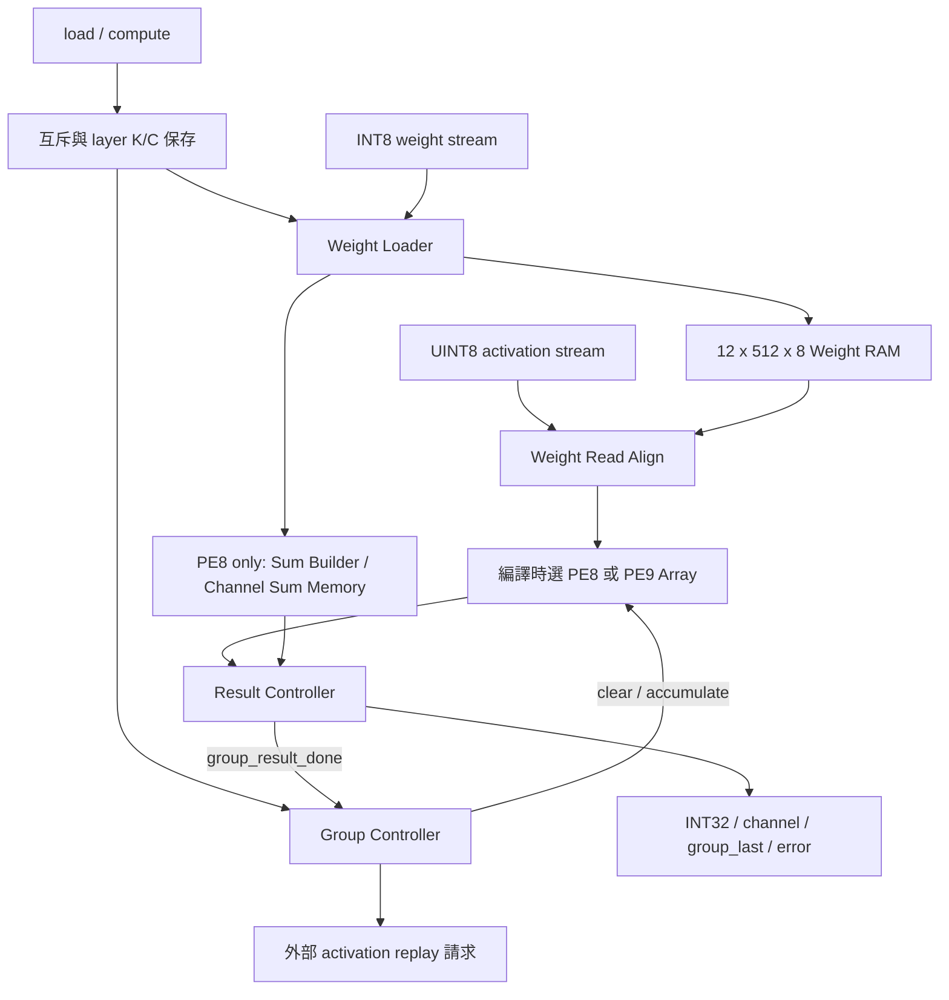

只建立一個 array。PE9 不建立 ΣW builder、ΣW memory、correction。
PE8：`Σ(A−128)W + ΣW`；PE9：`Σ(A−127)W`；正常配置下兩者等價。
既有 MAC 都是 LUT/FF 版本，這次未增加 DSP primitive 或改動底層 MAC。

### B. 外部介面與規格

| 類別 | Ports | 規則 |
|---|---|---|
| 時脈/reset | `clk, rst` | 單一時脈，同步 active-high reset；全部子模組共用 |
| Load 描述 | `load_valid/ready, load_k[7:0], load_channels[5:0]` | 握手保存設定；K1..255、C1..32、ceil(C/12)×K≤512 |
| Load 狀態 | `load_busy, load_done, load_error, layer_ready` | done/error 各為脈衝；非法命令回 error，不回 done；ready 表示完整層已可用 |
| 權重串流 | `weight_valid/ready, weight_i8` signed8 | W[channel][k]，先送同一 channel 的全部 K 項，總數 C×K |
| Compute 命令 | `compute_valid/ready` | 沒有第二組 K/C，使用 resident layer 描述 |
| Compute 狀態 | `compute_busy/done/error` | done 脈衝；error 保留到下一次 compute 握手或 reset |
| Replay | `replay_valid/ready, replay_k[7:0], replay_channel_base[4:0]` | 每組 channels 請求同一個 vector；須先握手再送 activation |
| Activation | `activation_valid/ready, activation_u8[7:0]` | 每次 replay 恰好 K 項；engine 自己產生最後一項標記 |
| Result | `out_valid/ready, out_data` signed32、`out_channel_id[4:0], out_group_last, out_error` | 依 channel 0..C−1 輸出，阻塞時保持 |

`out_group_last` 不是 layer-last；FC1 在 channels 11、23、31 拉高。
`compute_done` 代表一個 vector/patch 的全部 channels 已取完，不代表整張 Conv feature map 完成。
load/compute valid 必須一直保持到 ready 為 1 的上升緣。忙碌期間的短脈衝不會排隊；若需稍後執行，來源必須保持 valid。
兩個 valid 同時提出時 load 優先；compute_valid 若繼續保持，會在新 layer 載入完成後才可能接受。
權重少送會等待，多送的額外資料不會在 loader 完成後被接受；本模組沒有逾時 watchdog，監督／取消由外部 reset 或上層完成。

### C. 最小控制邏輯

本版沒有新增 supervisor FSM，沿用 loader/group 的狀態：

```text
load_ready    = !rst && !compute_busy && loader_ready
compute_ready = !rst && !load_busy && !load_valid && layer_ready && group_ready
```

K 與 channels 只在 `load_valid && load_ready` 時保存。Loader 同一個握手邊緣接收相同描述。
新 load 接受後，loader 清除 layer-ready，PE8 sum memory 同時清除有效旗標；即使 load 描述非法也不能再用舊 layer。
engine 不再複製 loader 的合法性算式或 layer-valid 暫存器，減少規格分歧。

概念生命週期（非額外 FSM）：

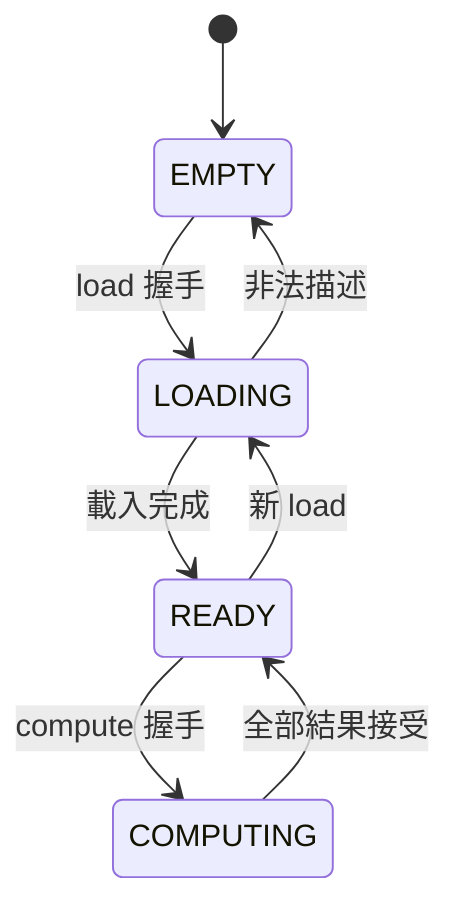

Reset 中斷任意階段、清除 pending/valid 與描述，但不清除整個 RAM 資料陣列；reset 後 layer-ready=0，必須重新載入，不會合法使用殘留資料。
compute_error 在 output error 被握手接收或 group error 出現時設為 1；不在新 load 時清除，僅新 compute 或 reset 清除。
合法的本層 K/資料範圍不會自然產生 INT32 overflow；此旗標是保留既有結果錯誤的整合機制。

### D. 一次 FC1 操作流程

1. Load K=144、channels=32，等待 load 握手。
2. 依 W[c][k] 提供 4,608 個 INT8 權重，等 load_done、layer_ready。
3. 提出 compute 並完成握手。
4. replay base=0，握手後提供 144 個 activation；計算／取出 channels 0..11。
5. replay base=12，重送相同 144 個 activation；取出 channels 12..23。
6. replay base=24，再重送相同 activation；取出 channels 24..31。
7. 最後結果接受後，經 result→group 完成回傳，compute_done 拉高一拍。
8. 可直接對下一個 activation vector 再 compute；或先 load 下一層。

已有 group 狀態維持：IDLE→CLEAR→REPLAY→RUN→WAIT_LAST→DRAIN_MAC→START_RESULT→WAIT_RESULT→NEXT_GROUP/IDLE。
沒有為三種 PE 複製三套 group controller。

### E. 外部介面的自我檢查 TB

新增 [tb_pe_memory_engine.sv](../../HYBRID_SYSTEM/tb/integration/tb_pe_memory_engine.sv)。
TB 只實例化 engine，由 DUT 自己完成 RAM 位址、ΣW、MAC enable、結果排程；沒有 force、階層寫入、偽造 partial sum 或以 TB 代替控制器。

Golden 以 signed 64-bit 變數獨立計算 `Σ(A−127)W`，逐一比對 channel、data、group_last、error。

| 案例 | 驗證目的 |
|---|---|
| Reset／尚未載入就 compute | 空 layer 不可計算，握手關閉，恢復為可 load |
| load/compute 同時提出 | load 優先，不可同時接受 |
| 載入後改外部 K/C | 已保存設定不受改動影響 |
| Conv1 K9/C12，FC1 K144/C32，FC2 K32/C8 | 典型模型大小、12+12+8 尾組 |
| 同 layer 多次 compute | 權重及 ΣW 不被清除；不同 activation 正確 |
| K170/C32、K255/C24、K1/C1..32 | 深度界限附近、全 channel count、尾 lane mask |
| K0、C0、C33、K171/C32 | 拒絕非法描述、舊 layer 失效、error 脈衝 |
| A=0/127/128/255；W=−128/127/0/混合 | signed 解讀、PE8 修正與零點 |
| activation/replay/weight 空拍、output backpressure | 按握手前進，結果阻塞時保持 |
| 忙碌期間提出其他命令 | 不改寫／重啟當前工作 |
| 載入途中、等待 replay、結果阻塞時 reset | 中斷交易後必須重載，重載後正確 |

沒有用故障注入破壞內部 ΣW 來製造 engine error；錯誤／overflow 分支已有獨立 result/correction TB，本 engine TB 只檢查正常外部可達流程不誤報錯。

### F. 執行與結構檢查

```bash
cd /home/LAB505/projects/KWS/KWS_DNN_Hybrid/HYBRID_SYSTEM
make test-memory-engine
make lint-memory-engine
make check-engine-elaboration
```

`test-memory-engine` 自動跑 PE8_MODE=1/0；`check-engine-elaboration` 檢查 Verilator 展開的 instance tree：每版一個選定 array，PE9 無 ΣW builder/memory/correction，PE8 各一個。
這不是 Vivado 面積估計。Lint 僅豁免兩模式共用連線中未使用的訊號警告；TB 另豁免時脈／scoreboard blocking assignment 警告，其他 lint 警告仍視為失敗。

可選交叉模擬：

```bash
make test-memory-engine-iverilog
```

需要 PATH 中有 Icarus；也可用 Makefile 的 IVERILOG/VVP/IVL_FLAGS 指定位置。
新 Verilator 測試、lint、結構檢查已加入既有 `make test`／`make lint`，不移除歷史測試。

### G. 本次測試結果

2026-09-19，Verilator 及 Icarus 兩個模擬器結果一致：

| 模式 | 成功 load | 完整 compute | 正確輸出 | 非法 load | reset 中斷 | 阻塞保持檢查 |
|---|---:|---:|---:|---:|---:|---:|
| PE8 精簡 | 40 | 44 | 725 | 4 | 3 | 411 |
| PE9 | 40 | 44 | 725 | 4 | 3 | 451 |

725 是所有完整工作的輸出總數；中斷交易不算成功 compute。兩版不同 stall_checks 來自結果路徑不同的時序，不是資料遺失。
兩模式 lint 與 engine elaboration 結構檢查皆通過。無 Vivado 新的資源或時序報告。
本次亦執行 `HYBRID_SYSTEM` 的完整 `make test lint`，程序退出碼為0，既有後處理與PE backend回歸均完成；
這不包含其他資料夾的CIM或板級測試。既有部分後處理Make目標允許非致命lint警告，不能將退出碼0解讀為全專案零警告。

### H. 下一步

先確認本 engine 的契約，再建立 PE8 結果管線 controller 與其 TB，接著建立三個固定參數 wrapper／共同比較 TB／Vivado 統一約束與報告腳本。
本次尚無 RESULT_PIPELINED 參數，避免暴露一個實際尚無實作的模式。
此版本是可合成 RTL 的整合，但本機沒有 Vivado，不能以模擬／lint 宣稱 125 MHz 或 PYNQ-Z2 面積已達標；這些須之後合成實作取得報告。

## 2026-09-19：Top-down 整合規劃（未變更 RTL）

全系統與 PE 的責任邊界、尚未完成清單、記憶體順序與比較里程碑，見
[KWS Top-down 架構閱讀文件](../../TOP_DOWN_ARCHITECTURE_REVIEW.md)。
本次建議先用薄的 `pe_memory_engine` 整合既有 loader/group/result/array，
K/C 保存及互斥可直接放 engine，暫不強制新增獨立 supervisor。
注意 PE 的 patch-major 結果不能直接餵給要求 CHW 的 MaxPool；規劃先按位址寫回 UINT8 feature-map RAM，再獨立執行 pooling pass。
PE8 結果管線、memory-backed engine 與三個比較 wrapper 都仍未實作。
本次既有 PE8/PE9 group-result 整合測試重跑通過，未執行 Vivado。

## Result Controller 實作（2026-09-16）

新增 `HYBRID_SYSTEM/rtl/control/pe_result_controller.sv`。
新增獨立 `tb/control/tb_pe_result_controller.sv` 與真實整合
`tb/control/tb_pe_group_result_controller.sv`。原group-controller測試保留，沒有覆蓋歷史基準。
現在整合測試的lane選取、ΣW讀取、correction交握與group_result_done全由RTL產生；
TB只保留命令/activation來源及最外部out_ready消費者，不再代替Result Controller排程。

### 架構與parameter

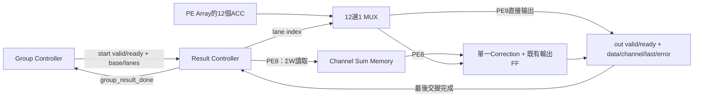

`parameter bit PE8_MODE=1'b1` 在elaboration時決定generate分支，不是運行時mode腳位。
PE8模式建立 `g_pe8.correction`；PE9模式只建立 `g_pe9`，不建立correction實例，
sum_rd_valid與sum_out_ready恆0，不保留ΣW修正加法器/資料輸出FF。
PE9仍有channel地址等控制加法邏輯，不能描述為整個模組完全沒有加法器。
結果控制器本身不實例化PE array，所以參數不會自動把外部PE8 MAC改成PE9 MAC。
未來整合top需以相同參數選array、activation轉換、loader.SUM_ENABLE，以及是否建立ΣW memory。
現有雙array驗證TB不是這個面積比較top。

已用Verilator XML elaboration檢查：mode1的hierarchy含
`pe_result_controller.g_pe8.correction`；mode0的hierarchy只有controller，沒有correction。
這是結構展開驗證，不是Vivado LUT/FF/DSP實測報告。

### 介面契約與省面積方式

| 介面 | 用途 |
|---|---|
| clk / rst | 同步active-high reset，與group controller/ΣW memory同時reset |
| result_start_valid/ready | 接受一組已計算完成的ACC |
| channel_base[4:0] / active_lanes[3:0] | 1..12個連續lane，base+lanes<=32 |
| raw_results[383:0] | 12×signed32-bit ACC，由array提供 |
| sum_rd_valid/ready/channel_id | PE8每lane同步讀ΣW |
| sum_out_valid/ready/channel_id/data/error | PE8接收ΣW；ID不符也視為錯誤 |
| out_valid/ready/data/channel_id/last/error | 最終結果；last指group最後一筆 |
| busy / group_result_done | 進行中；最後外部結果接受後的單cycle完成脈衝 |

無效group描述不拉高start_ready，沒有額外錯誤封包；目前group controller保證描述合法。
group資料、raw_results從start交握到group_result_done都必須保持；本模組不複製384-bit結果，
也不重新暫存base/lanes。所有正常輸出或錯誤輸出都只在out_valid && out_ready時被接受。
一次只有一個lane在途，lane直到輸出接受才增加；channel=base+lane，last=(lane==lanes-1)。
PE8只共用一個既有correction，ΣW沿用memory輸出FF，無額外raw/ΣW副本。
correction的channel輸出未被使用，對外ID直接取穩定base+lane；工具可以裁去無用tag儲存。
選擇Mux仍需邏輯與routing，沒有宣稱零成本；絕對最小面積須依實際合成確認。

### FSM與正常時序

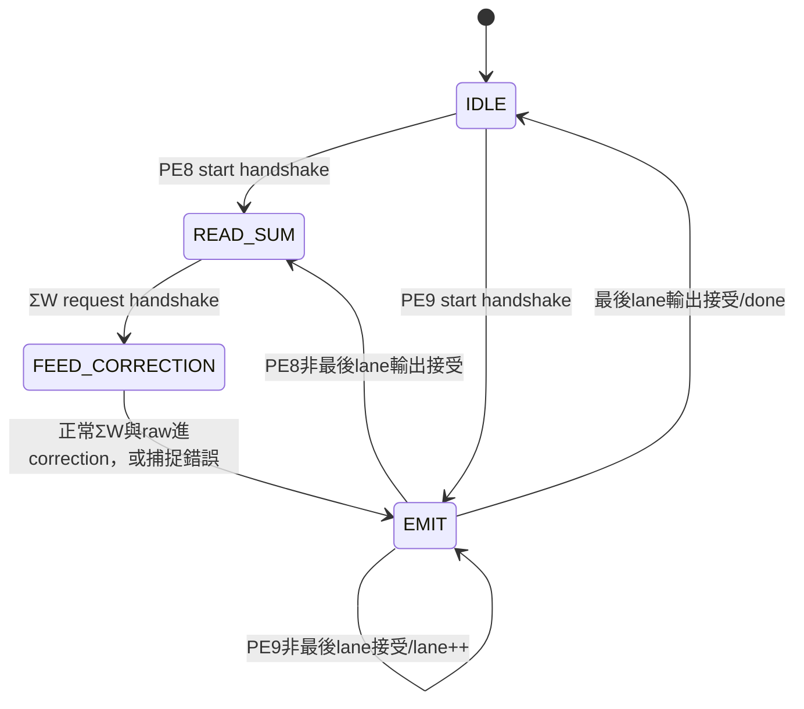

PE8無停頓時：T0接受start，T1讀取ΣW，T2送correction，T3輸出接受。
下一lane在T4/T5/T6完成，Nlanes從start到最後輸出為3N clocks。
PE9從start到最後輸出為N clocks。獨立TB對1..12lanes逐一驗證這個延遲。
完成脈衝是最後輸出交握後更新的registered signal，group controller於下一正緣接收，
故group controller的最終done可能再晚一clock，不可混淆兩個完成點。

### 錯誤處理

ΣW未載入或回傳channel不符：不餵入正常correction，保存1bit error_pending，
輸出data=0、out_error=1，仍遵守valid/ready並繼續其他lane。
若correction的33-bit加法溢位，保留其signed32飽和結果並將overflow映射到out_error。
out_error/其他欄位只在out_valid時有意義。
group_result_done只表示全部封包已被接收，不代表沒有錯誤；最終系統top需累積out_error
成為該job/inference的sticky error，不能因done=1就判定推論成功。
Reset取消尚未完成結果，不回報正常done；必須同時resetΣW memory，避免殘留舊回應。

### 驗證內容

獨立TB兩個parameter版本皆連真實ΣW memory，使用public握手與獨立64-bit加法golden。
掃active_lanes1..12、base接近31邊界、invalid描述、無停頓延遲、输出背壓、ΣW要求/回應延遲、
未載入channel、錯誤ID注入、INT32上下界溢位、request/response/output等待中的reset及恢復。
錯誤ID透過TB外部匯流排訊號注入，不修改DUT內部。檢查done恰在最後交握後，不能提前或重複。
PE9斷言完全沒有ΣW讀取，錯誤ΣW輸入不能影響PE9正常輸出。

整合TB沿用48筆完整job、C1..32覆蓋、真實loader/weight buffer/align/group controller/兩個array。
兩種result模式分別執行；每個最終結果比對獨立Σ(A-127)W與PE9 raw，並保留逐cycle雙array scoreboard。
TB只控制外部result_ready，不驅動sum_rd、correction輸入、result_start_ready或group_result_done。
既有TB還保留作control-only接收環境基準，不會取代新的RTL整合結果。

```bash
cd /home/LAB505/projects/KWS/KWS_DNN_Hybrid/HYBRID_SYSTEM
make test-result-controller
make test-group-result-controller
make lint-result-controller
make test-result-controller-iverilog # 或指定IVERILOG/VVP/IVL_FLAGS
make check-result-elaboration       # mode1有1顆correction、mode0為0顆
make test lint
```

PE9保留共用ΣW介面但不使用輸入，因此mode0 lint對UNUSEDSIGNAL作預期豁免；
mode1 RTL使用完整-Wall lint。測試中的unused診斷也豁免，其他warning仍為fatal。
實際驗證完成：獨立兩模式各20組/108筆結果、3組reset取消；PE8有110次ΣW讀取、
6筆預期錯誤（未載入2、錯誤ID2、溢位2），PE9讀取0次/錯誤0。
新RTL整合兩模式各48筆完整job/728個輸出、4種非法命令、6次reset，C1..32全覆蓋；
Verilator與Icarus結果一致。完整 `make test lint` 與elaboration結構檢查皆exit code 0。
elaboration檢查腳本在 `HYBRID_SYSTEM/scripts/verify_result_elaboration.py`，透過XML hierarchy
斷言mode1只有一顆correction、mode0沒有該實例，不使用模擬輸出猜測結構。
沒有本地Vivado，不聲稱已達125MHz或知道最終LUT/FF/BRAM大小。

### 下一步

Result Controller已不再是缺口。下一步建立兩個獨立可合成memory-backed top，
統一load/compute/activation replay/output/error契約、保存layer K/C，分別選PE8或PE9電路。
先用相同外部activation串流/重播接口即可做核心面積比較；若要無主機協助重播，再加入共用activation buffer。
PE8包含ΣW builder/memory/correction，PE9用SUM_ENABLE=0並不建立ΣW memory；
共用相同權重容量、controller、read align、工具與時脈約束，再測LUT/FF、BRAM與setup/hold。

## Group Controller 實作（2026-09-16）

RTL：`HYBRID_SYSTEM/rtl/control/pe_group_controller.sv`。
整合TB：`HYBRID_SYSTEM/tb/control/tb_pe_group_controller.sv`。
兩種PE共用此controller；不取代或疊接既有pe8_core_controller/pe8_core_12，舊比較基準保留。
一次命令計算一個activation向量/Conv patch的所有輸出channels，並非整張Conv feature map。

### 真實連接與本次邊界

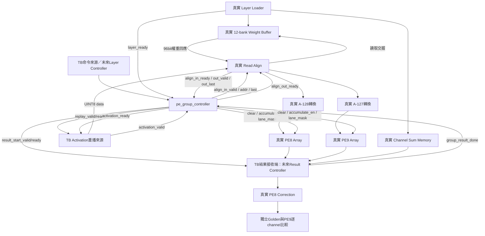

TB只模擬尚未實作的上游命令/activation來源與結果接收端。
權重經真實loader public stream寫入，不直接初始化DUT內部RAM；MAC啟動、clear、lane mask、
weight address、last全由真實controller產生。沒有force/release、階層寫入或預填accumulator。
結果接收端使用真實ΣW RAM與correction，最後一筆結果被接受後才回報group_result_done。
此接收端目前是TB task，不是已完成的可合成Result Controller，因此此TB不能當面積比較top。

### 公開介面

| 類別 | 訊號與契約 |
|---|---|
| Clock/reset | clk；同步active-high rst，必須與align/RAM回應/PE/result path一起reset |
| 命令 | cmd_valid/ready、cmd_k[7:0]、cmd_channels[5:0]、layer_ready |
| 狀態 | busy；done/error為一cycle脈衝 |
| 重播要求 | replay_valid/ready、replay_k[7:0]；來源接受後提供K筆activation |
| Group描述 | channel_base[4:0]、active_lanes[3:0]、lane_mask[11:0] |
| Activation流控制 | activation_valid輸入、activation_ready輸出；8bit資料直接繞過controller接align |
| Align輸入端 | align_in_valid/ready、align_weight_addr[8:0]、align_in_last |
| Align輸出端 | align_out_valid/last輸入，align_out_ready輸出 |
| PE | pe_clear、pe_accumulate_en輸出 |
| 結果端 | result_start_valid/ready；group_result_done輸入脈衝 |

cmd_ready只在IDLE、!rst、layer_ready成立時拉高。合法範圍K1..255、C1..32、
ceil(C/12)*K<=512；非法已接受命令脈衝error並留IDLE，不進ERROR狀態。
busy期間的新命令不被接受。layer_ready僅作命令准入，不在RUN中任意中止交易。
上層必須保證權重loader與controller使用相同K/C，並在busy期間不換層、不重載權重。
controller不另有權重描述比對功能；最終top應共用一份已載入layer descriptor。

replay與result_start都是valid/ready，等待時保持group描述。group_result_done應在
result_start交握完成後、最後外部結果被接收時脈衝；與start同edge的done不支援。
idle時的group描述可保留上一筆，只有valid/busy指定的階段具有語意。
沒有外部PE stall控制：RUN/WAIT_LAST時PE array可每clock接受一筆。
activation_valid須遵守上游保持規則；K筆後controller會關閉activation_ready。

### 狀態與分組

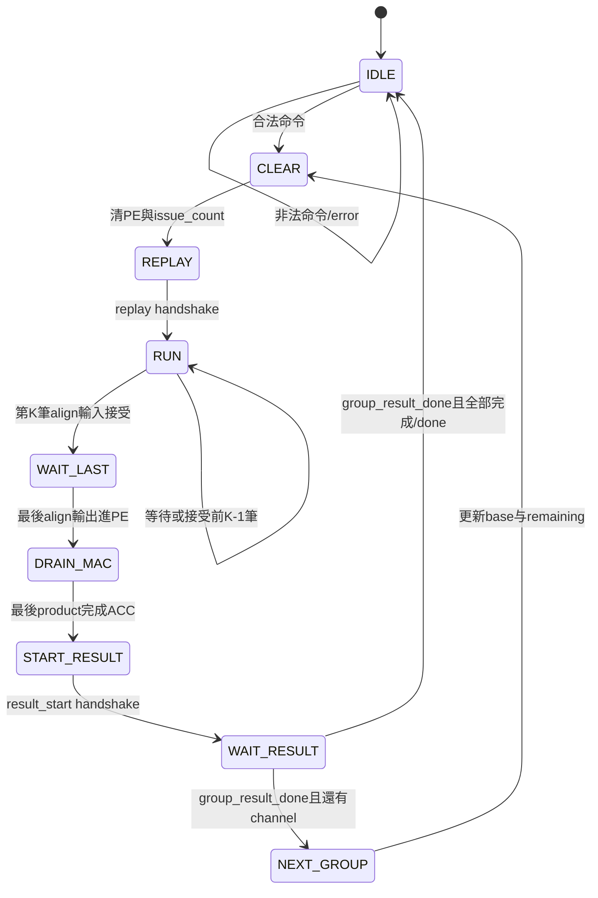

weight_addr=group_weight_base+issue_count；issue_count只在align_in_valid&&align_in_ready時增加。
pe_accumulate_en=align_out_valid&&align_out_ready。active_lanes=min(remaining_channels,12)。
下一組channel_base+=12，group_weight_base+=K，remaining-=12；無可變除法/乘法。
FC1：channels0..11/base0/maskFFF；12..23/base144/maskFFF；24..31/base288/mask0FF。
同層切group只clear PE，不能clear權重RAM或ΣW有效旗標。

### 最後一筆的精確時序

| 正緣 | 行為 |
|---|---|
| T | 最後align輸出接受，PE Product Register載入最後乘積；進DRAIN_MAC |
| T+1 | 最後乘積加入ACC；進START_RESULT，result_start_valid在此edge後有效 |
| T+2或以後 | 結果接收端最早接受start |

前提是read-align直接接組合activation轉換再接array。舊core額外input FF不在這條路徑。
本版等待本組全部修正結果被接收才處理下一組，沒有雙ACC緩衝或跨組重疊。

### 正規自我檢查驗證方法

採transaction stimulus + public-port protocol assertions + 獨立cycle scoreboard +
整筆golden model + 功能覆蓋計數，Verilator/Icarus交叉執行。不是UVM framework，
也不是形式工具的全狀態證明，不宣稱100% code/branch coverage。

1. 真實loader逐筆寫入W[c][k]，完成layer_ready後才向controller發命令。
2. Activation來源只依replay/activation握手送A[k]，不控制PE內部狀態。
3. Monitor檢查每筆地址、activation、last、channel_base、lane_mask與K接受數。
4. 獨立模型依數學A/W公式算product，逐clock更新預期ACC，對照兩個真實array全部12lanes。
5. START_RESULT不得早於最後MAC的T+2取樣；比較整筆Σ(A-128)W与Σ(A-127)W，disabled lane須為0。
6. 結果等待期間ACC必須完全保持，clear不得與MAC或尚未完成結果重疊。
7. 讀真實ΣW memory、送真實correction，檢查 PE8_corrected = PE9 = 獨立Σ(A-127)W。
8. busy新命令、未載入命令、非法命令、reset取消與重新載入、done/error脈衝皆有檢查。

Golden不是直接拿PE9當唯一參考；兩者都必須符合獨立公式。
隨機停頓使用固定seed 0x16260916的xorshift，提供可重現、有界的replay/input/result等待。
另有無空拍案例。此TB不跳過控制器，也沒有用TB代替其clear/accumulate/address輸出。

測例：K1/C1、Conv1、FC1、FC2、C13/24/25、K170/C32、K255/C24；再完整掃C1..32。
資料含A0/127/128/255，W-128/+127/0與混合值；A128且非零W驗證raw PE8=0而修正後=ΣW。
同層重複job不重新載權重。Reset插在CLEAR、REPLAY、MAC中途、最後product drain、結果等待，
每次reset後均重新載入並跑完整job。總watchdog避免死鎖測試永遠等待。

實際結果：Verilator與Icarus一致PASS；48筆完整job、86次result-start交握
（其中1次後續reset取消）、728個最終channel輸出、4個非法命令、6次reset（含初始reset）、
1810次MAC輸入、373164次逐cycle lane結果對照。功能覆蓋C1..32全數命中；
replay等待298cycles、input空拍1868cycles、result等待2106次觀察、88次busy命令被拒絕。
完整 `make test lint` exit code 0，未出現Warning/Error，既有62448筆software-golden後處理比對也通過。

```bash
cd /home/LAB505/projects/KWS/KWS_DNN_Hybrid/HYBRID_SYSTEM
make test-group-controller
make lint-group-controller
make test-group-controller-iverilog # 需iverilog/vvp在PATH，或指定Make變數
make test lint
```

### 面積比較：目前能做什麼

此控制器可單獨作OOC合成觀察大小；PE8/PE9裸array也能繼續比較。
但本次完整結果取出/ΣW對齊仍由TB receiver排程，不能宣稱完整記憶體版PE8/PE9可合成top已完成。
下一步實作可合成Result Controller與activation replay buffer/等效外部串流介面，再做兩個獨立top。
PE8應包含實際需要的ΣW builder、memory、correction；PE9不應被強制帶上無用ΣW電路。
兩者共用相同K/C範圍、weight buffer容量、controller、輸入輸出契約、clock/XDC與綜合選項。
本次兩個array同時存在是驗證平台，不可拿它合成後的資源當單一PE的面積。

| Resource | PE8 | PE9 | 說明 |
|---|---:|---:|---|
| LUT | 待Vivado | 待Vivado | 範圍一致後再計算節省率 |
| FF | 待Vivado | 待Vivado | 包含各自實際控制/修正暫存 |
| BRAM | 待Vivado | 待Vivado | 必須列出，不能只看LUT而忽略記憶體轉移 |
| DSP | 目標0 | 目標0 | 既有兩種MAC皆use_dsp=no，需核對報告 |

LUT節省率=(LUT_PE9-LUT_PE8)/LUT_PE9×100%，負值表示PE8整體反而較大。
同時檢查WNS/WHS與是否完整約束/完成route；不以未通過時序或大量邏輯被裁掉的結果宣稱優勢。
本地沒有Vivado，不提供虛構PPA或保證125MHz。

## Weight Read Align（2026-09-16）

新增 `HYBRID_SYSTEM/rtl/datapath/pe_weight_read_align.sv`，供 PE8/PE9 共用。
保存原始UINT8 activation與last，將它們與同步權重RAM的12筆權重配對。
不做MAC、zero-point轉換、ΣW修正、地址生成或group切換。

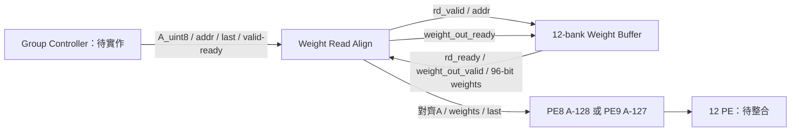

### 介面與實作

| 類別 | 介面 |
|---|---|
| 系統 | clk、同步active-high rst |
| 上游 | in_valid/ready、in_activation_u8[7:0]、in_weight_addr[8:0]、in_last |
| RAM要求 | weight_rd_valid/ready、weight_rd_addr[8:0] |
| RAM回應 | weight_out_valid/ready、weight_data[95:0] |
| 下游 | out_valid/ready、out_activation_u8[7:0]、out_weights[95:0]、out_last |

連接 buffer 時設定 ADDR_WIDTH=9。align 的 weight_rd_* 接 buffer rd_*；
buffer out_valid/weights_flat 接 align weight_out_valid/weight_data；
align weight_out_ready 接 buffer out_ready。兩者必須同clk、同rst。
上游in_valid等待期間必須保持activation/address/last，直到in_ready=1的正緣。
下游僅在out_valid && out_ready時接受資料；out_valid=0時輸出data沒有語意。

內部僅 pending(1bit)、activation(8bit)、last(1bit)，沒有新增96bit權重暫存器。
權重由原buffer的read_q保存；因此buffer需保證out_valid && !out_ready時資料保持。
地址直接轉送，不另外暫存：RAM接受要求的同一正緣已取用地址。

```text
output_fire = out_valid && out_ready
slot_available = !pending || output_fire
in_ready = !rst && weight_rd_ready && slot_available
weight_rd_valid = !rst && in_valid && slot_available
out_valid = !rst && pending && weight_out_valid
weight_out_ready = !rst && pending && out_ready
```

每次input_fire與RAM read_fire同步成立，才能保存metadata。
同cycle舊輸出接受且新輸入接受時，新輸入優先更新metadata、pending保持1。
只有輸出而沒有新輸入時pending清0。Reset禁止對外交握，並在正緣清metadata/pending。

### 狀態與時間

不額外實作state register，以pending代表EMPTY/HOLD。

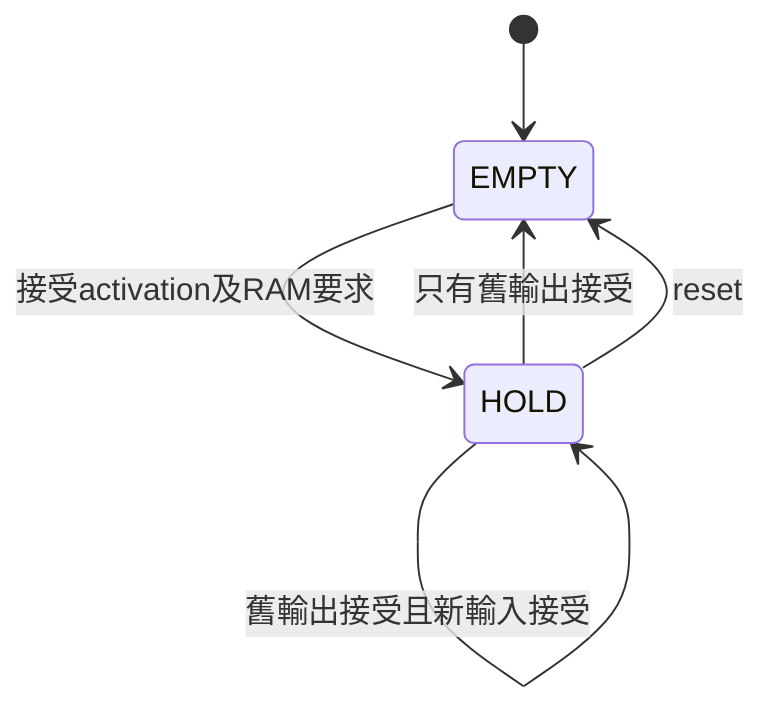

| 正緣 | 新要求 | 下游接受 |
|---|---|---|
| N | A0、W地址0 | 無 |
| N+1 | A1、W地址1 | A0與W0 |
| N+2 | A2、W地址2 | A1與W1 |
| N+3 | 無 | A2與W2 |

此為送入PE的時序，不是ACC更新時序。既有Product Register還需要後續排空。
控制器可以用out_valid && out_ready產生PE的accumulate_en；只用out_valid會在stall時重複運算。
lane_mask由group controller保持，整個group不可變動。第一版不支援交錯group。

### 使用限制與125MHz

RAM讀取介面必須由align獨占；其他master不得插入未帶metadata的讀取。
正常運算不重載權重；TB只額外測不同地址寫入造成的read_ready阻擋。
Reset必須同時取消RAM回應與align pending，不支援單獨flush其中一個。
正常換group先排空，再切換控制；不能用reset丟掉正常未完成結果。
沒有CDC功能，不能直接連不同時脈的RAM與PE。
資料暫存精簡，但ready包含組合路徑。125MHz需Vivado post-route驗證，必要時再加入skid/pipeline。
本次沒有更動原buffer、PE array或比較top，沒有新的面積/時序結論。

### 驗證架構

新增 `HYBRID_SYSTEM/tb/datapath/tb_pe_weight_read_align.sv`，連真實512-depth buffer。
先写滿12×512bytes，以獨立RAM image及輸入握手queue預測資料，不查看DUT內部寄存器。
每次out_valid比對activation、12lane權重、last；另外檢查stalled輸出穩定。
涵蓋：K1、FC1三組144連續讀取、非連續地址、activation邊界、來源空拍、長時間backpressure、
同cycle輸出/新輸入、RAM寫優先阻擋讀取後重試、last等待、reset取消後重新讀取。
最後檢查 accepted = received + cancelled，且連續傳輸有足夠重疊、沒有吞吐空拍。
這是RAM與align整合測試，尚未接PE MAC，不宣稱已驗證整層MAC結果。

實際結果：Verilator與Icarus一致PASS，accepted=516、received=515、reset取消=1，
同cycle新舊交易重疊482次、stall檢查104個cycle、12lane權重值共7428次比對。
權重比對包含等待期間重複檢查，不是7428筆不同交易。
RTL strict lint通過；完整 `make test lint` exit code 0，既有loader/ΣW/後處理回歸皆通過。

```bash
cd /home/LAB505/projects/KWS/KWS_DNN_Hybrid/HYBRID_SYSTEM
make test-weight-read-align
make lint-weight-read-align
make test lint
```

下一步：group運算controller（K計數、group_base、lane_mask、clear、last與MAC排空），
接著raw結果與ΣW同步讀取對齊、correction，再完成共用權重記憶體的PE8/PE9比較top。
FC1三組需重播activation，先由TB上游重播，獨立全硬體後續需activation buffer。

## Channel ΣW Memory（2026-09-16）

新增 `HYBRID_SYSTEM/rtl/datapath/pe_channel_sum_memory.sv`。
保存當前層 32 個 channel 的 signed 32-bit ΣW（共1024 data bits），另外有32-bit有效旗標。
此元件不執行加總、不含 bias、不包含 PE raw result 對齊；供既有 correction 計算
`Σ(A-128)W + ΣW = Σ(A-127)W`。

### 組成與介面

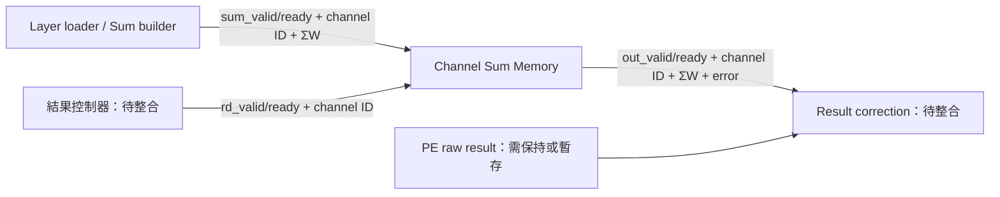

| 介面 | 用途 |
|---|---|
| clk / rst | 同步時脈、同步 active-high reset |
| layer_clear | 同步取消待輸出回應並清除全部有效旗標 |
| wr_valid/ready、wr_channel_id[4:0]、wr_weight_sum signed[31:0] | 寫入各 channel 的 ΣW |
| rd_valid/ready、rd_channel_id[4:0] | 發出讀取要求 |
| out_valid/ready、out_channel_id、out_weight_sum、out_error | 一筆可等待的同步讀回結果 |

RAM data 不 reset，只清 channel_valid 與輸出暫存器。未載入 channel 讀取會回應
out_valid=1、out_error=1、data=0；合法 ΣW=0 則 error=0。
下游不能把 error 回應拿去修正。輸出欄位在 out_valid=0 時沒有語意。
不強制 RAM primitive；實際 LUTRAM/FF/BRAM 映射須檢查 Vivado 報告。

### 狀態與時序

沒有額外 FSM register，以 out_valid 表示 EMPTY/FULL。

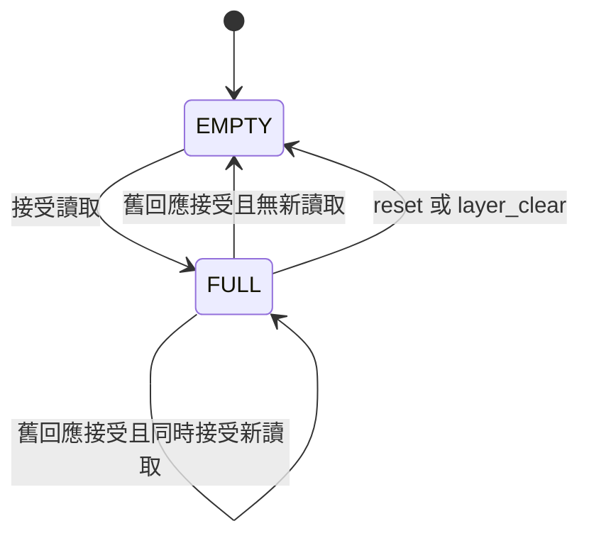

優先順序：rst/layer_clear > 寫入 > 新讀取。
wr_ready = !rst && !layer_clear。
rd_ready = !rst && !layer_clear && !write_fire && (!out_valid || out_ready)。
因此 wr_ready 不依賴 wr_valid，能直接接現有 loader 的 sum_ready。
寫入可以與舊回應被接受同時發生，但不接受新讀取；已捕捉的 stalled 回應不受後續覆寫影響。
正緣 N 接受讀取後更新輸出，最早 N+1 正緣下游接受。連續 ready 時每clock可讀一筆。
rst/clear 為同步操作，正緣取消回應；上層在 clear/reset 時須同步取消舊交易，不能計為正常結果。

新層命令握手可產生 layer_clear，包含非法新命令亦清有效旗標，與 loader.layer_ready 行為一致。
正常換層必須等待舊層所有結果收完。group切換不能clear；FC1的三組仍共用同一層ΣW。
整層 ready 後再啟動 PE；本元件只追蹤單 channel 有效性，不自行判定整層是否完整。

### 測試與執行

獨立 TB：`HYBRID_SYSTEM/tb/datapath/tb_pe_channel_sum_memory.sv`。
使用獨立陣列與握手 scoreboard，測 reset後未載入讀取、32channel寫讀、正負/零/32-bit極值、
覆寫、連續讀取、背壓保持、同址覆寫不更改已捕捉輸出、讀寫優先、clear/reset取消回應、換層失效。

整合 TB：沿用 `tb_pe_layer_weight_loader.sv`，新增 STORE_SUM=1 模式。
接實際 loader + weight buffer + sum builder + sum memory；原 STORE_SUM=0 測試保留。
每層讀完全部32channel，獨立依權重公式計算ΣW，未使用channel必須報錯；
FC1→FC2特別檢查 channel8–31 不會沿用舊ΣW。權重仍逐筆驗證與完整讀回。
測試中 sum_ready 的額外節流只屬TB，用以重現等待；正式接線可直接相接。

```bash
cd /home/LAB505/projects/KWS/KWS_DNN_Hybrid/HYBRID_SYSTEM
make test-channel-sum-memory
make test-layer-sum-integration
make lint-channel-sum-memory
make test lint
```

尚未在 Vivado 合成，本地模擬的8ns clock不能證明125MHz setup/hold成立。
實際驗證：Verilator 與 Icarus 均通過獨立及整合測試。
獨立TB：37次寫入、103次讀取、101筆正常接收、2筆clear/reset取消、8個等待週期檢查。
整合TB：16642次權重寫入、121筆ΣW、33282次權重讀值檢查、672次ΣW回應欄位檢查
（7層測例 × 32channel × 3個保持觀察點，不是672筆不同ΣW）。
完整 `make test lint` exit code 0，原PE8/PE9 loader、buffer與後處理回歸通過。
下一步：`pe_weight_read_align`，對齊同步權重RAM、activation與valid；之後是group controller、
raw result/ΣW對齊，再整合 PE8/PE9 比較top。

### 混合系統的記憶體分層（規劃，不是已完成 RTL）

目前 HYBRID_SYSTEM/rtl/memory 與 rtl/dcim_adapter 只有 .gitkeep。
CIM pin master 有 row/bank地址與權重burst寫入介面，但不是 CNN 層級權重配置器。
建議全域共用 activation ping-pong memory、層級描述/量化參數與權重來源；
局部保留 PE 的12-bank weight buffer/ΣW memory，以及 CIM cell權重陣列。
全域權重可從主機逐層串流或先放DDR/BRAM，是否保存全部層尚未決定。

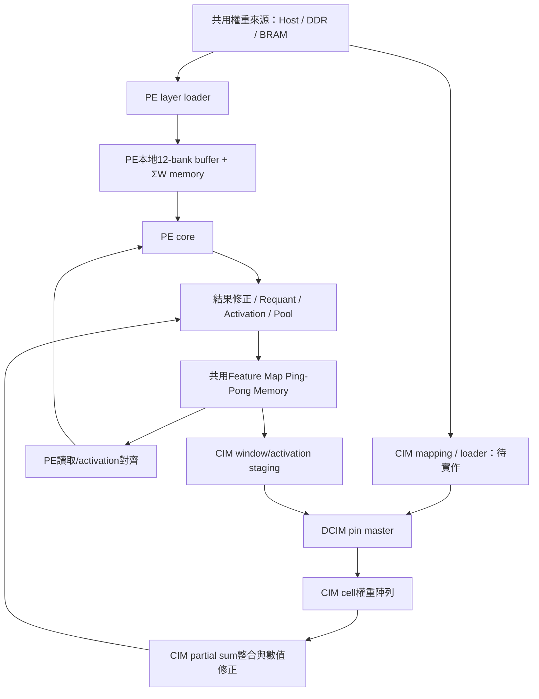

共用指共享地址空間/儲存資源，不代表所有單元同時從單埠RAM取資料。
逐層執行時可由控制器分時授權PE/CIM，避免先引入複雜仲裁。
同時跨125MHz/50MHz則需獨立CDC介面或正確雙時脈RAM方案，不可直接跨域接valid/address。
CIM需另定義K tiling、row/group/bank pair映射、bit順序、補零、partial sum重建與signed/zero-point修正。
目前 master原始結果依其介面定義為 odd + (even << 4)，不能套用其他even/odd假設。
PE8的+ΣW修正式不可未分析CIM編碼就直接共用；係數資料可有統一管理，但運算需匹配各核心表示法。
本次未更改 CIM_CHIP 或全域記憶體 RTL。

## 整層權重載入更新（2026-09-15）

共用 `pe_weight_buffer_12` 已新增 ADDR_WIDTH，保留預設 256 深度，整層使用 512。
新增 `pe_layer_weight_loader`：依 W[channel][k] 載入，每 12 個 channel 為一組；
FC1 三組地址為 0–143、144–287、288–431。PE8 在寫 RAM 時同步計算各 channel 的 ΣW，
PE9 可用 SUM_ENABLE=0 移除加總器。不是每個 patch 重新計算 ΣW。

架構、FSM、接線、限制與測試詳見 [整層 Loader 文件](../../PE_COMPARISON/docs/PE_LAYER_WEIGHT_LOADER.md)。
新增整合 TB 已驗證真實 loader + sum builder + 512-depth RAM；兩設定各 16642 次寫入、
33282 次讀值比對，PE8 另驗證 121 筆 ΣW。保留原 256-depth buffer 測試。
尚待 channel sum memory、read align、group controller 與 PE 整合，不代表已完成整層推論或 125 MHz 時序收斂。

## 最新：Standalone 板上自測（2026-09-12）

實際驗證：`make test lint` exit code 0。Standalone共204次逐lane比對（兩次完整7-case，加上中途reset前已完成的3-case）；controller 14 checkpoints、core 288 checks、array 2964 checks、MAC 280241 checks及原算術單元測試全部通過。正常、golden錯誤與timeout三個top实例同时驗證。Vivado Tcl/XDC尚未在Vivado執行，並未宣稱實體時序通過。

新增 rtl/core/pe8_standalone_top.sv、tb/core/tb_pe8_standalone_top.sv、constraints/pe8_standalone_top_pynq_z2.xdc、vivado/create_pe8_standalone_project.tcl。原 core/array/arithmetic 不修改。這是自測頂層，不是完整模型推論；測試 raw Σ(A-128)W，不含 +ΣW、bias 或 requantization。

### 板上操作

單一 H16 125 MHz 時脈，Vivado 一般頂層流程插入 clock input/global buffer；無 MMCM、CDC 或分頻邏輯時脈。BTN0（D19）是重測按鍵，不是 PS SRST。reset_sync 初值11提供配置後啟動，按鍵非同步置位、兩拍同步解除，下游只使用同步reset。未實作按鍵debounce，彈跳可能重複reset，放開穩定後重新測試。

LED0 heartbeat；LED1 testing；LED2 sticky PASS；LED3 sticky FAIL。125 MHz、HEARTBEAT_BITS=26 時 heartbeat 約1.86 Hz。測試只需數百clock，LED1可能短到肉眼看不到；完成後LED2保持，LED0持續閃爍。若LED0不閃先檢查時脈/燒錄，不應直接認定MAC錯誤。

### 架構與FSM

```text
clk → global clock → reset synchronizer / test FSM / PE8 core
test ID + sample index → registered A/12weights → core
core 12xINT32 → 12-to-1 comparison → PASS/FAIL
offline constant golden ROM ────────↑
```

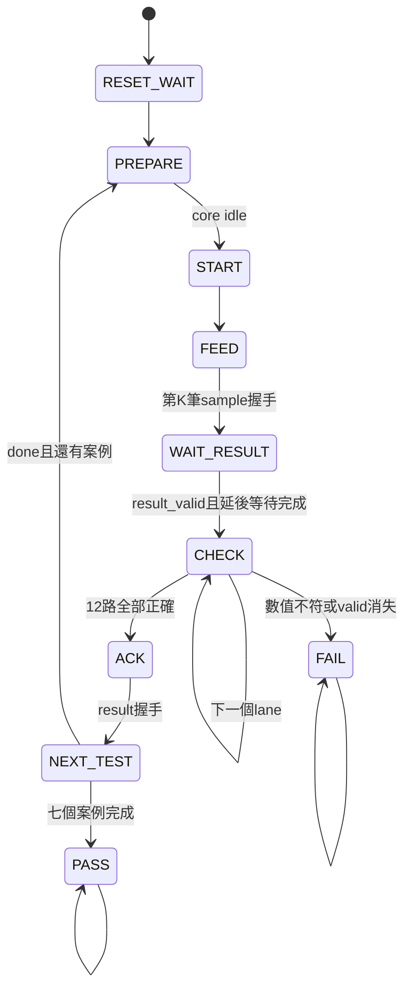

各活動步驟受watchdog監督；PREPARE成功開始新case時清watchdog。預設每個case TIMEOUT_CYCLES=4096。RESULT檢查期間ready=0；全部12路都檢查，包含masked lane應為0。不直接操作core內部clear/ACC。

### 測資與Golden

case ID從0開始，sample index i=0..K-1，lane j=0..11：

- A = (73i + 29case) mod 256，UINT8。
- W = ((37i + 19j + 11case) mod 256) - 128，signed INT8。
- Golden = Σ(A-128)W，masked lane為0。

RTL只用常數ROM保存golden，沒有第二組reference MAC。測資端固定係數運算在top use_dsp=no與MAX_DSP=0設定下合成一般邏輯。

| case | K | mask | 驗證 |
|---|---:|---|---|
| 0 | 1 | FFF | 最短運算、正負weights |
| 1 | 9 | FFF | Conv1長度 |
| 2 | 32 | 0FF | FC2長度、8路有效 |
| 3 | 144 | FFF | FC1一批outputs |
| 4 | 9 | FFF | 每筆間隔兩個clock |
| 5 | 32 | FFF | result_valid後額外等待7clock，再逐lane比對 |
| 6 | 9 | 000 | 消費9筆但結果全零 |

整組236筆sample、84個lane結果。fail_reason=1數值錯誤、2timeout、3協定/狀態異常；test_id、sample_index、check_lane、fail_actual、fail_expected保存供ILA/debug。MARK_DEBUG不等於已加入ILA core；需使用Vivado Set Up Debug後才能連到實際ILA。

### 模擬驗證

`make test-standalone`；或 `make test lint` 跑完整回歸。TB同時建立正常、INJECT_GOLDEN_ERROR=1、TIMEOUT_CYCLES=8三個實例，確認正常PASS、錯誤golden FAIL、timeout FAIL，以及狀態保持。正常實例以獨立整數scoreboard讀取實際sample握手，驗證K筆數、全部lane結果與result背壓保持；測試無按鍵power-up、PASS後reset、K144途中reset並完整重跑。模擬HEARTBEAT_BITS=4只為加速觀察，不改運算週期。

### Vivado GUI / Tcl

關閉原OOC專案，在Tcl Console執行：

```tcl
source {C:/Windows/System32/aoc-workspace/projects/KWS/KWS_DNN_Hybrid/PE_CHIP_8x8/vivado/create_pe8_standalone_project.tcl}
```

腳本僅建立/匯入，不啟動合成。已存在的build/vivado_standalone不覆寫，請開啟其中xpr。GUI執行Run Synthesis、Run Implementation，檢查route/DRC/WNS/WHS後才Generate Bitstream。此頂層是normal mode，不用-mode out_of_context，不匯入舊pe_array_ooc.xdc。

手動匯入時只加入rtl下的sv，package先編譯，top=pe8_standalone_top，part=xc7z020clg400-1，使用本次standalone XDC。不要加入tb或vendor simulation models。MAX_DSP=0；不要用要求12 DSP的舊report_dsp_mac.tcl檢查這份LUT設計。

XDC將非同步BTN0來源切為false path，只連reset同步器；LED為人眼觀察無外部同步接收器，故LED輸出也切為false path。core所有同步控制/資料路徑仍需通過時序，沒有用false path掩蓋内部Hold。腳位依據AMD官方範例：
https://github.com/Xilinx/xup_fpga_vivado_flow/blob/main/source/pynq-z2/lab5/uart_led_pins_pynq.xdc

### 結果解讀限制

此環境沒有Vivado，不能宣稱已生成bitstream或通過125 MHz。合成後需確認DSP=0、clock走global buffer、無重要DRC與unconstrained internal paths、routed WNS/WHS非負。固定測資/ROM及MARK_DEBUG會影響資源與布局，KEEP_HIERARCHY不是完整防止常數最佳化，standalone不能代替公平PE PPA測試。以hierarchical utilization區分測資/比對/core。

## 最新：LUT/FF Core 與五狀態控制器（2026-09-12）

驗證結果：controller 14 項 checkpoint 通過；core 6 筆工作、288 項結果檢查通過（另含 K0、停頓、排空、背壓、四個活動狀態 reset）；core RTL lint 通過。原 arithmetic/array 回歸保留並通過，跨版本 array 數值比較 10812 checks 通過。未執行 Vivado。

備份 SHA256：`988d140dd8f543bf8a706a56e576f3141de391e4fbe7aaf6c0e50ee09f4f5fde`。備份可解壓到新目錄檢視，勿直接覆蓋新版本。

此節取代下方 DSP 歷史版本描述。備份：`../../PE_COMPARISON/snapshots/pe8_before_lut_core_20260912.tar.gz`。PE_CHIP 不變；只有 PE_CHIP_8x8 改為非 DSP。現在直接比較兩份 array 的 PPA 不再是單純 9×8 vs 8×8 的比較，還包含 LUT/DSP 實作差異。

### 檔案與介面

新增 `rtl/control/pe8_core_controller.sv`、`rtl/core/pe8_core_12.sv` 及各自 testbench。pe8_mac_lane 改為 signed16 Product FF + signed32 ACC FF，一拍接受一拍提交；lane 與 core 設 use_dsp=no，獨立 multiplier 也設 no。無 DSP48E1 primitive。原本 arithmetic/array 測試保留。

Core 介面：clk/rst、start、k_length[7:0]、lane_mask[11:0]、busy/done、sample_valid/sample_ready、activation_u8[7:0]、weight_vector_i8[95:0]、result_valid/result_ready、result_vector_s32[383:0]。沒有 error port。

start 必須在 Idle 提供單拍脈衝。K=0 不接受工作，留在 IDLE，不 clear、不 done、不 error。合法 K=1..255 時鎖住 K/mask；busy 期間的 start 與命令變化忽略。全零 mask 仍消費 K 筆並輸出零。sample_valid 同時涵蓋 A 與 12 weights；握手前資料需遵守 valid/ready 協定。

### 架構與排空

```text
UINT8 → A-128 → input register → signed8 multiply → Product FF → ACC FF
weights ─────→ input register ────────↑                         │
                                                               └→ raw 12xINT32
sample_accept → input_valid → lane product_valid → commit
```

Controller 的 product_pending 與 lane valid 同步追蹤相同提交時序，只追蹤有效交易、不處理數值。N 拍接受、N+1 Product、N+2 ACC。最後一筆後兩個上升緣排空；最後 commit 的上升緣同時進入 RESULT，結果在該緣後有效，接收端最早下一個上升緣握手。

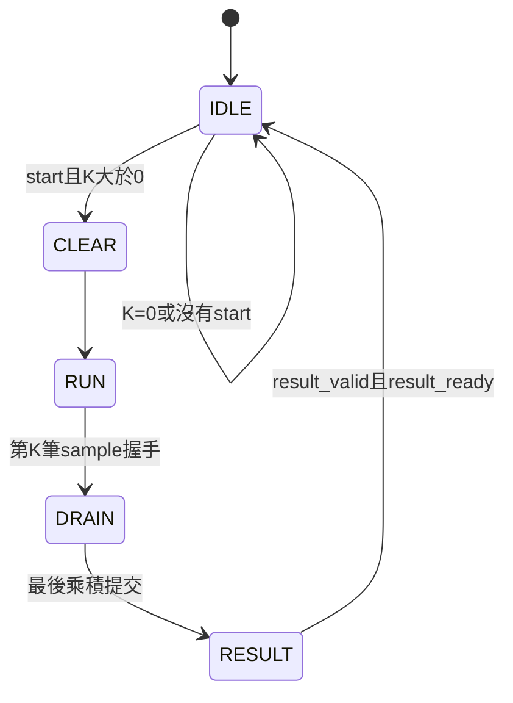

CLEAR 清所有 ACC 與 pipeline；RUN 可有任意輸入泡泡；DRAIN 不接受輸入；RESULT 保持 ACC 不動，不複製384-bit結果暫存器。busy 在非Idle有效，done 在結果被接受後脈衝一拍。同步active-high rst 隨時中止工作，丟棄pending且清結果。重新編碼補償仍未實作：raw=Σ(A-128)W，模型zp127需在後續加ΣW，再進requantization。

### 驗證與使用

- `make test-controller`：K0、K1、命令鎖存、輸入停頓、兩拍drain、結果背壓與done單拍。
- `make test-core`：獨立整數reference驗證12路，K=1/9/32/144/255、部分/全零mask、變更busy時命令、停頓、結果保持、active states reset。
- `make test lint`：保留全部舊單元/array回歸並加入以上兩項。

Vivado core top 改為 pe8_core_12。來源依序：rtl/pe8_pkg.sv、rtl/arithmetic/*.sv、rtl/array/pe8_array_12.sv、rtl/control/pe8_core_controller.sv、rtl/core/pe8_core_12.sv。不要加入tb或simulation primitive models。若要嚴格禁用整份PE8設計的DSP，可另外設 synthesis MAX_DSP=0；但不可套用到仍使用DSP的PE9專案。core 的新增命令/握手port也需適當約束；既有array報告不代表core時序。此環境未跑Vivado，不保證PPA或時序。

## 最新實作：每 lane 明確實例化一顆 DSP48E1（2026-09-12）

此節取代下方「一般 RTL 推導 DSP MAC」的最新狀態。推導版實際生成每 lane 兩顆 DSP，故改為 primitive 實例化。修改前備份為 `../../PE_COMPARISON/snapshots/pre_explicit_dsp48_20260912.tar.gz`，SHA256 為 `76e022835694b235373c38b3292edf79f5ac6a86ffbe095e119a5b3874c1fc52`；旧報告未修改。

每 lane 只有一個 DSP48E1 實例 `dsp_mac`，設定 AREG/BREG=0、MREG/PREG=1、控制暫存器=0、OPMODE=0100101、ALUMODE=0000、INMODE=00000。A/B 符號延伸；DSP 內部 M 保存乘積，P 累加上一拍的 M 並回授自己。外部保留一個 product_valid FF，CEM=accumulate_en，CEP=product_valid。rst OR clear 同步送到 RSTM/RSTP 並清 valid。DSP 未使用的 cascade/status 輸出留空、未用輸入固定為 0。

```text
A,W → [ DSP48E1: multiply → MREG → add → PREG → feedback ]
                                               └→ low 32 bits
accept → product_valid FF → CEP
```

兩份 PE 都更新；12 個 lane 目標為 12 顆 DSP，外部介面及 N 接受、N+1 累加的時序不變。末筆需一拍 drain，clear/reset 丟棄 pending。輸出仍為模 2^32，8×8 weight-sum 補償仍在未來上層。這次沒有改 XDC，也沒有以 false path 隱藏 Hold 違反；DSP 數量減少不保證 reset Hold 通過。

### 驗證與匯入

普通 `make test lint` 使用 sim_verilator 中的限定組態行為模型。另以 `PE_COMPARISON/make test-unisim` 跑官方 Xilinx DSP48E1 模型，驗證兩份 lane、兩份 array、跨版本比較；來源與版本限制见 sim_vendor/README.md。官方模型不是本機 Vivado 2023.2 版本，最後仍可用 XSim bundled UNISIM 重跑。

Vivado 只更新兩份 lane 的 RTL 即可，未新增需匯入的 RTL 模組；不要加入 PE_COMPARISON/sim_vendor 或 sim_verilator，否則會覆蓋 primitive 定義。保留 MAX_DSP=-1、OOC、8 ns 約束，重新 synthesis/implementation。在 Open Synthesized Design 後 source PE_COMPARISON/vivado/report_dsp_mac.tcl，檢查 DSP=12 與 MREG=PREG=1。primitive 不一定出現在舊的 inference DSP Final Report 表格中，應以 netlist/resource report 為準。

## 目前版本：Pipelined DSP MAC（2026-09-11）

本次驗證結果：兩份 PE 的 test/lint 全通過；MAC 各 280241 checks、array 分別 2928/2964 checks、跨版本比較 10812 checks、工具測試 6 項通過。尚未執行 Vivado 合成。

本節取代下方歷史版本中「組合乘法＋獨立 accumulator」的架構與週期描述。這是一般 RTL 推導版本，不是直接實例化 DSP48E1，實際映射與時序仍須 Vivado 驗證。

### 備份與架構

修改前來源保存在 `../../PE_COMPARISON/snapshots/pre_dsp_mac_20260911.tar.gz`，SHA256 與還原說明見同目錄 PRE_DSP_MAC.md。排除 build/reports，舊報告仍留原位。

```text
Activation ─┐
            ├→ multiply → product_reg → add → mac_accumulator[47:0]
Weight ─────┘                           ↑             │
                                        └─────────────┘
                                                      └→ output[31:0]
accumulate_en → product_valid → enable accumulator
```

lane 加上 use_dsp=yes，目標每 lane 一顆 DSP48E1，包含 MREG 乘法暫存與 PREG 累加暫存。PE_CHIP 的 product_reg 為 signed 17-bit，PE_CHIP_8x8 為 signed 16-bit。兩份內部 ACC 為 48-bit，輸出低 32-bit，維持模 2^32 溢位，不是 saturation。8×8 的 weight-sum 補償仍由未來上層負責。

新版 lane 不再實例化獨立 multiplier/accumulator，但那些檔案與單元測試保留。Package、12-lane array 外部介面與位寬不變。

### 時序契約

- 同步 active-high rst/clear：清除 product、valid 與 accumulator，拒收當拍輸入，丟棄 pending 乘積。
- 上升緣 N 接受輸入，N+1 將該乘積累加。仍可每拍接收一筆。
- lane 的接受條件仍是 accumulate_en AND lane_mask[i]，有效訊號延遲一拍，不能以當拍 mask 決定上一拍是否累加。
- 停送第一拍仍可能更新 ACC，第二拍才完全保持；最後輸入後必須有一拍 drain，clear 不能取代 drain。
- 沒有新增外部 done/valid，上層 controller 必須遵守新的一拍延遲。

| 上升緣 | 接受 | 更新後 ACC |
|---|---|---|
| 1 | P0 | 0 |
| 2 | P1 | P0 |
| 3 | P2 | P0+P1 |
| 4 | 無 | P0+P1+P2 |
| 5 | 無 | 保持 |

### 測試與合成

MAC TB 以獨立交易 queue 逐拍驗證首筆延遲、連續輸入、停頓/排空/重複 idle、clear/reset 丟棄 pending、同時 enable、正負邊界、K=9/32/144，以及各 140000 次正負累加驗證 INT32 overflow。Array TB 保留 packing、交錯/one-hot/部分/全零 mask 與 K/停頓，reference 改為累加上一拍有效交易。8×8 與跨版本 array 比較仍驗證 raw+weight_sum 等於原 zp127 公式。

執行各 PE 的 `make test lint` 與 PE_COMPARISON 的 `make test lint check-tools`。這些測試只能證明功能，不能證明 DSP mapping 或 125 MHz。

Vivado 更新實際使用的 RTL 副本，保存舊報告，允許 MAX_DSP=-1，保留 OOC/8 ns，重新 synthesis/implementation。Open Synthesized Design 後 source `PE_COMPARISON/vivado/report_dsp_mac.tcl`。目標 DSP Final Report 為 A*B+P、MREG=1、PREG=1；僅 DSP=12 不足以證明 MAC 整合。若仍有外部累加 CARRY4，需要再調整推導或採用 primitive。比較 routed WNS/WHS/LUT/FF/DSP，OOC 邊界限制仍存在。

## DSP 合成實驗（2026-09-11）

`pe8_multiplier_s8xs8` 加入 module 屬性 `(* use_dsp = "yes" *)`，要求 Vivado 使用 DSP 實作乘法；signed 16-bit 乘積、32-bit 累加、介面與延遲不變，未新增 pipeline。原版 9×8 乘法器也同步加入相同屬性，方便公平比較。

沿用 `make test lint` 及 `../PE_COMPARISON` 的比較測試。模擬不驗證實體 DSP 映射；需重新 synthesis 並查看 DSP48E1 數量，再 implementation 確認 8 ns 時序。既有專案須更新來源副本、允許 `MAX_DSP=-1` 並保留 OOC 設定。操作 Tcl 見 `../../PE_CHIP/docs/PE_CORE_ARCHITECTURE.md` 的 DSP 合成實驗章節。此次不修改 weight-sum 補償與數值契約。

## 範圍

與原版 PE_CHIP 的 array 階段對齊：四個 arithmetic RTL、package、12-lane array 及測試。
原版不修改。尚未建立 controller、core、weight-sum 補償硬體。

## 數值契約

原始 activation 是 UINT8，zero-point=127；weight 是 INT8，zero-point=0。

原版：S = Σ(A−127)W。
新版硬體目前只產生 D = Σ(A−128)W。
未來在 requantization 前加入 C = ΣW，才能得到 S = D+C。

因此兩個 MAC lane 的 raw accumulator 不應直接相等。
補償不是模型 bias，即使 bias=false 仍然必要。
測試中的補償是參考計算，不會被合成為硬體。

## 元件與位元寬度

| 模組 | 工作 |
|---|---|
| activation_u8_to_s8 | 翻轉 UINT8 的最高位，再按 signed 解讀，等價 A−128，範圍 −128～127 |
| pe8_multiplier_s8xs8 | 組合 signed 8×8 乘法，完整 signed 16-bit 乘積 |
| pe8_accumulator_s32 | 16-bit 乘積符號延伸至 32-bit，同步累加 |
| pe8_mac_lane | 實例化乘法器與 accumulator，activation 轉換位於 lane 外 |

```text
UINT8 A → activation_u8_to_s8 → signed8 A ─┐
                                         × → signed16 → INT32 ACC → raw D
                              signed8 W ─┘
```

未來 12 lanes 共用一個轉換器。現階段沒有 valid/ready 或 K 計數器：
外部控制 accumulate_en，每個有效正緣提交一對 operand。
乘法器沒有 pipeline register；正緣前輸入需滿足 setup/hold。
rst 為同步 active-high，優先序 rst > clear > accumulate_en > hold。
clear 與 enable 同時有效時只清除，不接受乘積。
ACC 採二補數 32-bit 回繞，不飽和、不 rounding、不 requantization。

## 測試命令

在 PE_CHIP_8x8 目錄執行：

```sh
make test
make lint
make test-activation
make test-multiplier
make test-accumulator
make test-mac-lane
```

使用 Verilator，警告視為失敗；只有測試時鐘等 testbench 程序的 BLKSEQ 警告關閉。
每組测试輸出摘要，不逐筆列印所有成功值。失敗使用 $fatal 並傳回失敗狀態。
build/ 是生成的測試執行檔與 C++ 中間檔，不是 RTL。

## 驗證內容

| 測試 | 輸入與檢查 |
|---|---|
| activation | 枚舉 UINT8 0～255，對照整數 A−128 |
| multiplier | 枚舉 −128～127 的兩個 operand，共 65,536 組，與整數乘法對照 |
| accumulator | reset/clear 優先、保持、正負乘積、同步 reset 不提前生效；連續合法 16-bit 乘積跨越 INT32 正負邊界 |
| MAC lane | 寫實例 A=[200,100], W=[−3,2]；raw=−272，weight sum=−1，補償後=−273 |
| MAC lane | K=9/32/144，每種測試正權重、負權重、零權重、A=127、固定公式產生的混合資料；插入 enable=0 停頓 |
| MAC lane | 每拍分別對照 raw dot product 與補償後原版公式；檢查 reset、clear、重新開始 |

混合資料為可重現公式，不宣稱為隨機覆蓋。
等價性是對原版數學公式的獨立整數 reference，沒有實例化原版 RTL。
這些短 dot product 不溢位；溢位回繞由 accumulator 測試獨立驗證。

## 合成與比較範圍

只加入 rtl/arithmetic/*.sv 到 Vivado Design Sources，使用 SystemVerilog。
選 pe8_mac_lane 作為單 lane top，可和原版 pe_mac_lane 對比。
比較時需固定 FPGA part、時脈、DSP 策略、pipeline、約束、工具版本。
轉換器位於 lane 外，不在 lane top 的統計內，兩版應同樣處理。

目前僅為 arithmetic 資源/時序比較，不含完整等價推論所需補償、參數記憶體或控制成本。
8×8 不保證比 9×8 少 DSP。未執行 Vivado 不得宣稱已達到 PPA 或時序目標。
目前無板級 wrapper 或 XDC，不可把單元模擬通過視為上板驗證完成。

## 執行紀錄

使用 Verilator 5.030 執行 `make test lint`，exit code 0。

| 項目 | 結果 |
|---|---|
| Activation | PASS，256 組 |
| Multiplier | PASS，65,536 組 |
| Accumulator | PASS，131,084 次時脈檢查，另檢查同步 reset |
| MAC lane | PASS，1,088 次檢查，包含 raw 與補償後等價公式 |
| 四個 RTL top lint | PASS，無警告／錯誤 |

本次沒有執行 Vivado synthesis、implementation 或板上測試。

## 新增 pe8_pkg 與 pe8_array_12（2026-09-11）

Package 定義固定 12 lanes，signed8 activation/weight、signed16 product、signed32 ACC。
模型 ACT_ZERO_POINT=127，重新編碼 ACT_RECODE_OFFSET=128，兩者不可混淆。
原始 UINT8 位寬、zero-point 與 recode offset 是供外部 core 使用的契約，單獨 lint raw array 時只局部豁免這三個 metadata 常數的 UNUSEDPARAM 警告。

```text
UINT8 A → 外部 activation_u8_to_s8 → signed8 activation broadcast
                                          │
96-bit weights → 12 × pe8_mac_lane → 12 × INT32 raw ACC → 384-bit result
                                          ▲
                            accumulate_en AND lane_mask[j]
```

與原版一致：rst 同步 active-high；rst > clear > enable > hold。
Clear 清除所有 lanes，包括 mask 關閉者。Mask 關閉保持原值，不自動清零；不保證乘法器停止切換。
Lane j 權重為 j*8 +: 8，結果為 j*32 +: 32。權重 slice 明確轉 signed；結果觀察也須按 signed32 解讀。
不新增 pipeline、輸出暫存器、adder tree、K 計數器或 valid/ready。轉換器位於 array 外。
Raw D=Σ(A−128)W，日後 core 需在 requantization 前加入 ΣW；本次没有補償硬體。

### 新增測試

`tb/array/tb_pe8_array_12.sv` 外接轉換器，以 UINT8 測資驱動。每次檢查全部12路，獨立整數 reference 使用固定 packing 位寬，分別檢查 raw 與 corrected=Σ(A−127)W。ΣW 只計入被 enable/mask 接受的權重。

| 測試 | 驗證 |
|---|---|
| Package 契約 | 位寬、127 與128不同意義 |
| 不同 lane signed weights | Packing 與符號 |
| FFF/0FF/AAA/555/000/全部one-hot | 啟用、保持、不串路 |
| reset/clear/enable 同時有效 | 優先序與清除停用 lane |
| A=0/255、W=−128/127 | signed8 端點 |
| A=127、A=128 | 前者補償後為零，後者 raw 為零 |
| K=9/32/144 | 可重現混合資料、停頓與重啟；K32使用8路 |

執行 `make test-array`，或 `make test lint` 保留全部 arithmetic 回歸。測試比較原版數學公式，不依賴原版 RTL，未宣稱形式驗證或完整網路精度測試。

### 2026-09-14：ΣW建立器已獨立實作

2026-09-15：共用pe_weight_buffer_12已獨立實作，12×256×8同步RAM、
write優先、讀取valid-ready、reset不清RAM；Verilator與Icarus交叉測試通過。
尚未接入PE，詳見[Weight buffer說明](../../PE_COMPARISON/docs/PE_WEIGHT_BUFFER_12.md)。

2026-09-15更新：PE_COMPARISON/tb/tb_pe8_weight_sum_integration.sv已將
builder直接接上PE8 cfg，TB只供weights、不直供ΣW；獨立比較top及RTL
不變。整合流程與下一步共同loader/BRAM公平比較見上述整合說明文件。

HYBRID_SYSTEM/rtl/datapath/pe_weight_sum_builder.sv逐channel累加1..255筆
signed8權重，输出signed32 ΣW與channel。使用IDLE/ACCUMULATE/RESULT，
命令/weight/結果各有valid-ready，同步active-high reset。
一顆加法器與一個32-bit sum工作暨結果暫存器，不額外複製結果。
ΣW不由本模組長期保存；後續需寫入channel參數儲存。
目前僅獨立實作，尚未接入PE8；現有equivalent top仍由外部cfg提供ΣW。
測試命令：在HYBRID_SYSTEM執行make test-weight-sum-builder與
make lint-weight-sum-builder。詳細FSM、時序、驗證範圍與backend組成見
[ΣW建立器整合說明](../../PE_COMPARISON/docs/WEIGHT_SUM_BUILDER_INTEGRATION.md)。

### 2026-09-14：無 bias 結果補償模組已獨立實作

本節更新先前「補償硬體尚未實作」的進度：模組與單元驗證已完成，
但尚未接入 core/backend。原本 PE core 與 array 的輸出仍是 raw。

來源：`../../HYBRID_SYSTEM/rtl/datapath/pe8_result_correction.sv`。
測試：`../../HYBRID_SYSTEM/tb/datapath/tb_pe8_result_correction.sv`。

限定 A 重新編碼為 A−128、模型 activation zp=127、weight zp=0，
計算 corrected = raw + weight_sum = Σ(A−127)W。沒有 bias 腳位或加法級。
若模型使用非零 bias，這條路徑尚不足以還原該模型。

```text
PE raw + 對應channel的ΣW
          ↓ 同筆valid/ready握手
33-bit signed加法 → INT32飽和檢查
          ↓
一級輸出暫存(result/channel/overflow/valid)
          ↓ valid/ready
requantization（尚未接線）
```

接口：signed32 raw_accumulator、weight_sum、corrected_accumulator；
CHANNEL_ID_WIDTH 預設5；in/out_channel_id；in_valid/in_ready、
out_valid/out_ready、out_overflow；clk與同步active-high rst。
加法前符號擴展成33-bit，以最高兩位是否相同判斷overflow。
超界時輸出INT32最大／最小值，out_overflow與該筆結果同步。
不能修復進入此模組之前 raw accumulator 已發生的溢位。

in_ready = !rst && (!out_valid || out_ready)。在N上升緣接受輸入後，
N邊緣後結果即有效，下游最早於N+1上升緣接收；滿速每拍一筆。
輸出被阻擋時所有輸出保持；空級仍能先接收一筆。輸出接收與新輸入
可同拍發生。沒有FSM、start/done、K計數器或額外FIFO。
reset邊緣清valid及資料，丟棄未交付結果；無效期間資料不可當作交易。

ΣW由外部weight loader建立、channel parameter memory保存。本模組
不讀權重也不產生ΣW。raw/channel/ΣW須事先對齊；channel代表真實輸出
channel，不只lane編號。tiling需先合併完整K再補償一次。
frame/座標由backend依成功握手追蹤，不能在有停頓時固定延遲。
目前kws_postprocess無ready；只有確定可逐拍接收時才將out_ready接1。

驗證指令（在HYBRID_SYSTEM執行）：

```bash
make test-pe8-result-correction
make lint-pe8-result-correction
```

TB以64-bit參考加法和一筆待處理scoreboard檢查握手與飽和；另外用
獨立直接公式Σ(A−127)W建立K=9/32/144的參考答案。
涵蓋A=127、128、0/255、W=−128/127與混合值、正負INT32上下界、
連續64筆跨32channels、輸入泡泡、5拍反壓、同拍接收/替換、reset丟棄。
結果：Verilator單元測試PASS，88筆交付、1筆reset丟棄、93次輸出檢查；
獨立RTL嚴格lint通過，未降低warning嚴重度。這不是Vivado時序或全網路驗證。

### Array 合成

先編譯 rtl/pe8_pkg.sv，接著 rtl/arithmetic/*.sv 與 rtl/array/pe8_array_12.sv，top 設為 pe8_array_12。只匯入設計來源，不含 tb。寬介面核心建議 OOC 比較，不是可直接上板的 pin top。
與原版 array 比較須相同器件、約束、工具及 DSP 策略。Raw array 面積不包含轉換器或補償硬體；完整等價系統比較必須額外計入它們。

本次使用 Verilator 5.030 執行 `make test lint`，結束碼 0；四份 arithmetic 測試全部 PASS，新增 array 完成 2,964 次 lane 檢查（每次包含 raw 與補償後 reference 比對）及 package 契約檢查，全部 PASS。Lint 無輸出警告或錯誤（上述三個 metadata 常數有局部 UNUSEDPARAM 豁免）。未執行 Vivado 合成、實作或上板測試。
