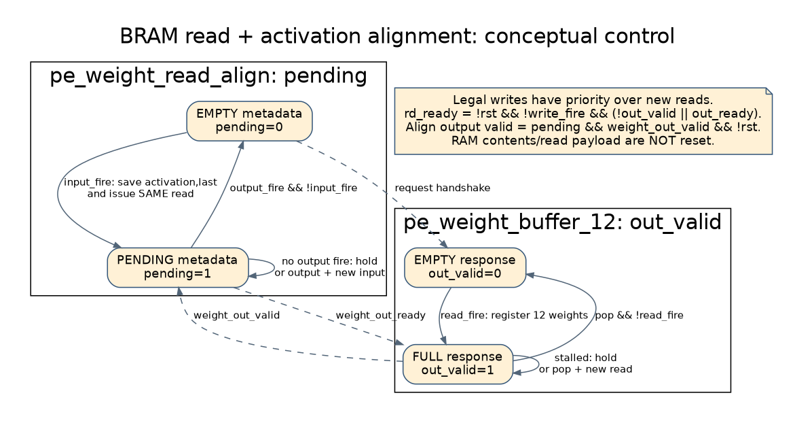
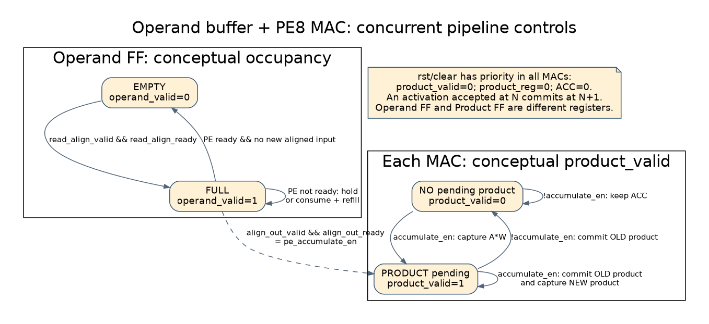
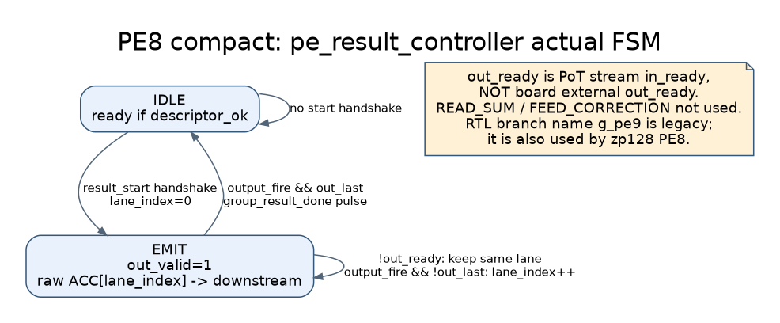
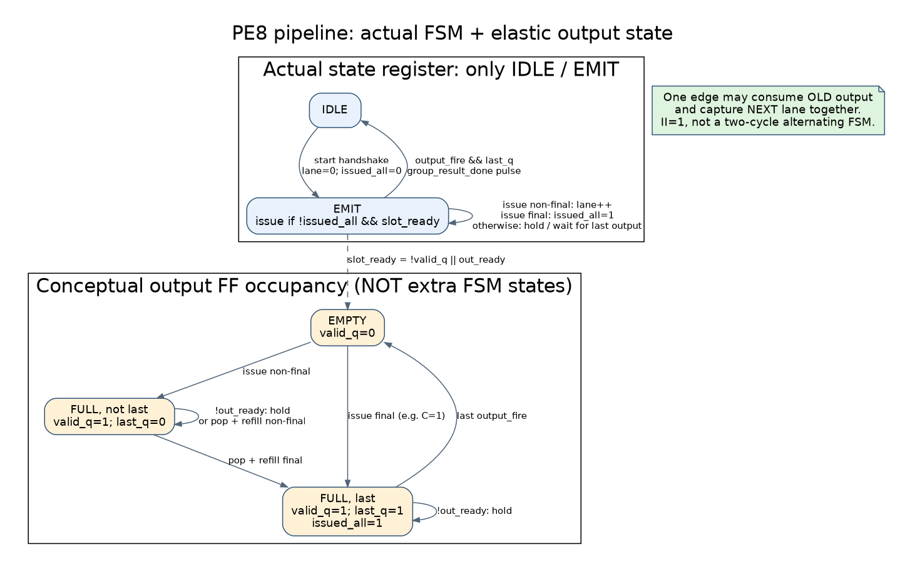
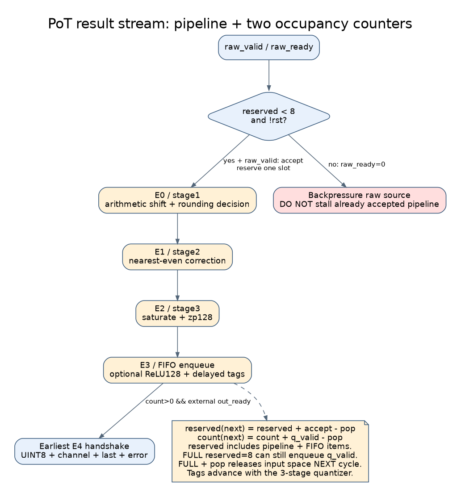
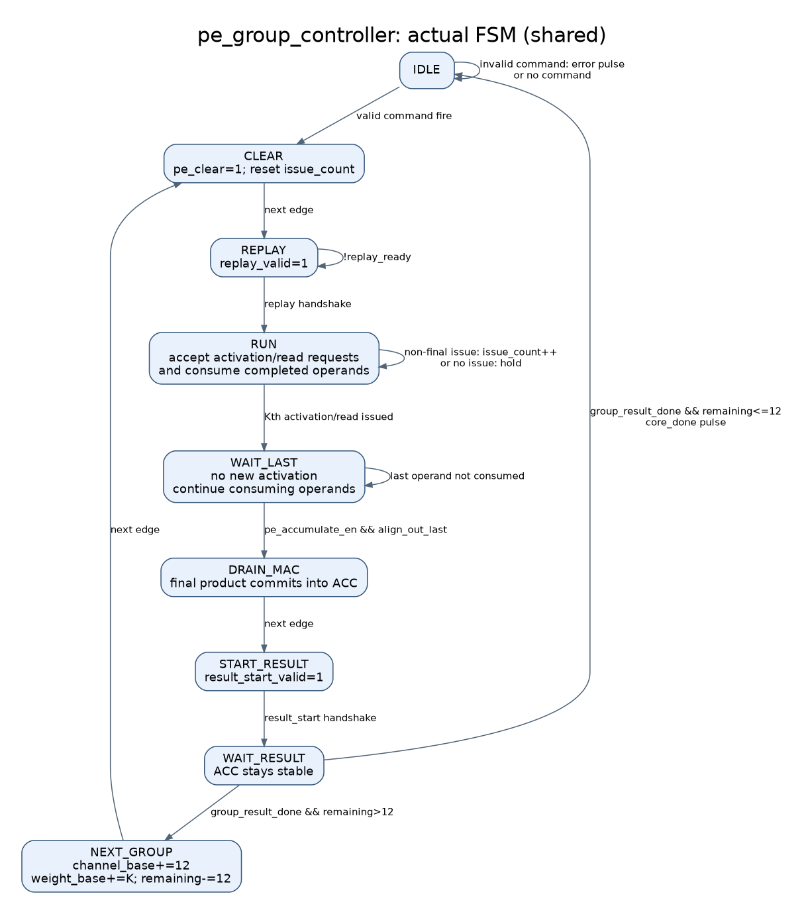
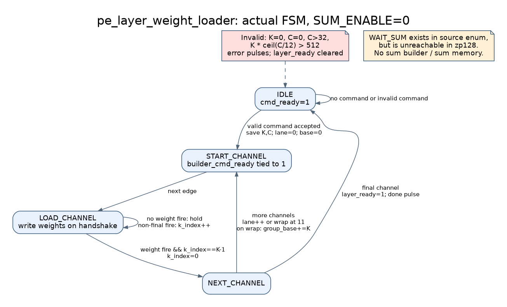
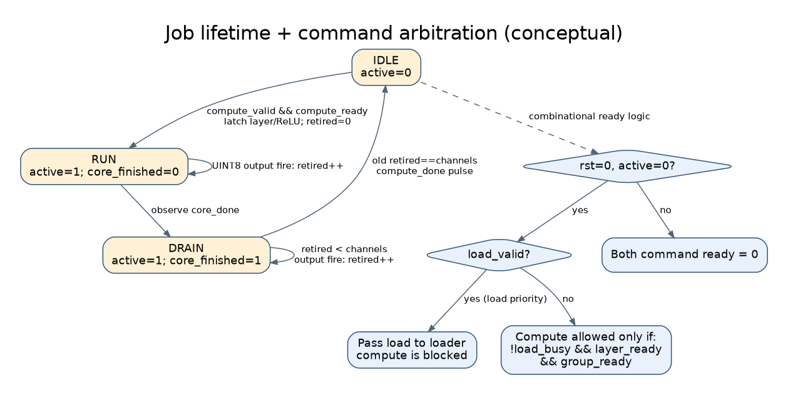
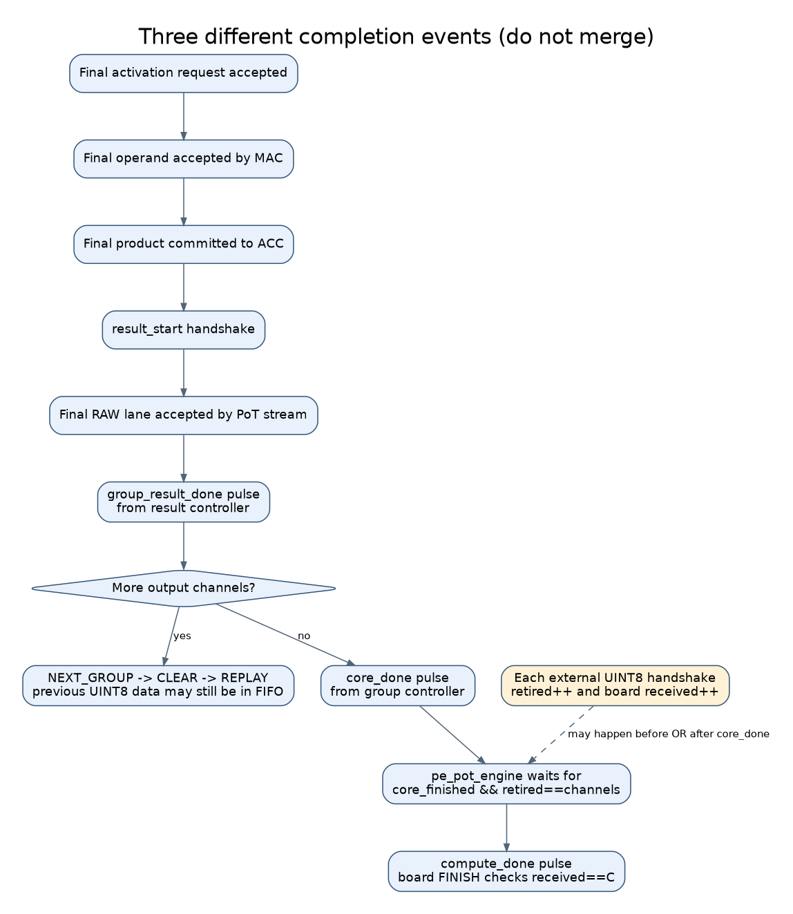
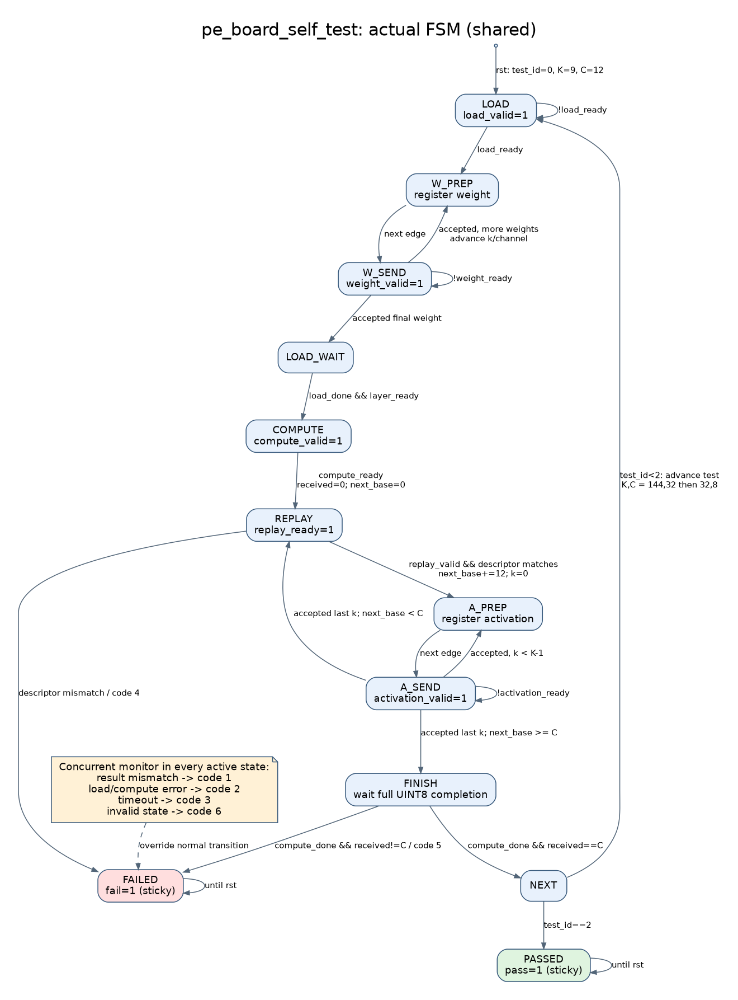

# PE8 精簡版／pipeline：Bottom-up 架構與控制流程

範圍：目前 zp128／PoT 的兩個板級 top。本文改變閱讀方向，不改變 RTL。完整轉移條件圖可搭配 [控制狀態圖集](PE8_CONTROL_STATE_ATLAS.md)。

本篇後處理說明以預設 `POSTPROCESS_PIPELINED=1` 為準；新增的組合後處理選項與外部時序差異見 [組合後處理設計](../../HYBRID_SYSTEM/docs/PE_COMBINATIONAL_POSTPROCESS.md)。

閱讀原則：**先理解一個 MAC 如何完成一筆乘加，再理解誰餵資料、誰收結果，最後理解誰指揮整組與整個工作。** Bottom-up 是由小元件組成大元件的閱讀順序，不是開機後的時間順序；真正執行仍然必須先載入權重。

## 1. 最小計算單位：一個 pe8_mac_lane

來源：[activation 轉換](../../PE_CHIP_8x8/rtl/arithmetic/activation_u8_to_s8.sv)、[MAC lane](../../PE_CHIP_8x8/rtl/arithmetic/pe8_mac_lane.sv)。

```text
UINT8 A ── 減去 128 ── signed INT8 a ──┐
                                     × ── Product FF ── 加法器 ── ACC FF
signed INT8 W ────────────────────────┘                     ↑       │
                                                           └───────┘
```

數學上 `a=A−128`；硬體透過翻轉 A 的最高位元並解讀為 signed8 完成，不需要實作一般減法器。範圍剛好是 −128～127。

每個 lane 計算 `ACC[c] = Σ_k (A[k]−128) × W[c,k]`，Product 為 signed16，ACC 為 signed32。當前 zp128 不需要額外加 ΣW，也不加入 bias。

### 控制不是 FSM，而是 enable 與 valid

| 條件 | 在上升緣做什麼 |
|---|---|
| rst 或 clear | 清除 ACC、Product 及 product_valid |
| accumulate_en=1 | 擷取當前乘積，設 product_valid |
| 上一拍 product_valid=1 | 將舊 Product 符號延伸後加到 ACC |
| accumulate_en=0 | 不產生新乘積，但上一拍有效乘積仍會提交 |

擷取新乘積與累加舊乘積可以在同一拍發生。這不是「乘法一拍、加法一拍交替停止」，而是有一拍延遲的管線。

例如清除後餵入 `A=[130,127,132]、W=[3,−2,1]`，則 a=[2,−1,4]，乘積為 [6,2,4]：

| 邊緣 | 本拍擷取 Product | 本拍提交舊 Product | 更新後 ACC |
|---|---:|---:|---:|
| E0 | 6 | 無 | 0 |
| E1 | 2 | 6 | 6 |
| E2 | 4 | 2 | 8 |
| E3 | 無 | 4 | 12 |

這是假設資料已到 MAC 輸入的例子，不包含之前的 BRAM／Operand 延遲。最後仍要 E3 排空乘積，正是上層需要 DRAIN_MAC 的原因。

## 2. 十二個 lane 組成 pe8_array_12

```text
                         ┌─ lane0  × W0  → ACC0
同一個 signed8 activation ├─ lane1  × W1  → ACC1
廣播到 12 lanes          ├─ ...
                         └─ lane11 × W11 → ACC11
```

同一個 k 的一筆 activation 同時搭配 12 個不同 output channel 的權重，因此一次可產生最多 12 個乘積。每個 lane 的 ACC 留在原位置，連續累加 K 筆，屬於 Output Stationary。

array 本身不判斷「Conv 還是 FC」，也不知道 K 何時結束；只看 `clear`、`accumulate_en`、`lane_mask`。每個 lane 的有效 enable 是共用 accumulate_en 與自己的 mask bit 相 AND。結果為 12×32=384 bits，後面再逐 channel 輸出，不是一次把 384 bits 全送到板外。

## 3. 如何把資料準時送到十二個 lane





```text
權重 BRAM ─┐
           ├─ read-align ─ Operand FF ─ activation 轉換／12個乘法器
activation ┘                                         │
                                      Product FF → ACC FF
```

| 小元件 | 保存／處理內容 | 如何控制 |
|---|---|---|
| pe_weight_buffer_12 | 12 lanes 權重；同步讀出 12×8 bits | 讀寫握手、out_valid，寫入優先於新的讀取 |
| pe_weight_read_align | activation、last，與其對應 BRAM 回應 | pending 旗標防止操作數配錯 |
| Operand FF | 一個 A、12 個 W、last | operand_valid；空槽或舊資料可被接收時才補入 |
| Product FF | 每個 lane 的乘積 | product_valid 決定何時進 ACC |

這些是「空／有資料／保持」的概念狀態，不是 RTL enum FSM。`valid=1 && ready=0` 必須維持資料；只有 `valid && ready` 的上升緣才算一次傳輸。

**兩個版本都已經有 Operand FF 與 Product FF。** 本次比較名稱中的 pipeline，不是表示另一版完全沒有管線。

## 4. 十二個 ACC 算完，如何逐一輸出

由 `pe_result_controller` 接手。兩版有效 FSM 均為：

```text
IDLE ── result_start 握手 ──→ EMIT
 ↑                            │
 └──── 最後一筆 raw 結果被接收 ─┘
```

### 精簡版：ACC 選擇器直接連到後處理



`ACC[lane_index] → out_data`。在 EMIT 時提供有效資料；握手才增加 lane_index；反壓時保持同一個 lane。最後一筆握手後脈衝 group_result_done。整組 ACC 在輸出結束前必須穩定。

### pipeline 版：選擇器後增加可停頓暫存器



`ACC[lane_index] → output FF → out_data`。lane_index 在裝入 output FF 時前進；最終完成則仍以最後一筆被下游接收為準。

`slot_ready = !valid_q || out_ready`，因此一拍可同時送出舊資料並補入下一筆。首筆相對精簡版多一拍，但持續 ready 時兩版都能每拍一筆。

本次實際使用 `pe_result_controller` 的 RAW_PIPELINED 分支，不是舊 zp127 的 `pe8_result_controller_pipeline` 加 ΣW 路徑。

## 5. INT32 如何變成對外的 UINT8



```text
INT32 ACC → 依 layer/channel 查 shift → 右移／round-to-nearest-even
          → 加 zero-point 128／飽和至 0..255 → 可選 ReLU → FIFO → 外部
```

量化公式：`q = clip[0,255](round_even(ACC / 2^shift) + 128)`。開啟 ReLU 時，UINT8 結果下界提高為 128，因為量化的實數零對應 128，不是 0。這裡不加入 bias。

Quantizer 為三級 valid 管線，不能中途任意停住，因此 `pot_result_stream` 在接受 raw 結果時就預留 FIFO 空間：

- `reserved`：所有已接受、外部尚未收走的結果，包括在途資料。
- `count`：已真正寫入 FIFO 的資料數。
- reserved 達到 8，就拉低 raw in_ready。
- 外部握手會釋放空間，之後才能繼續接受 raw 結果。

反壓會向前傳遞：外部不收 → FIFO 信用額度用完 → 結果控制器停在 EMIT → 分組控制器停在 WAIT_RESULT。不會要求已算完的 ACC 重新做乘加。

## 6. 誰指揮一組 K 次乘加：pe_group_controller



底層 lane 不知道 K，因此需要這個 FSM 組合前面的資料路徑：

| 順序／狀態 | 指揮誰 | 完成條件 |
|---|---|---|
| IDLE | 接收 K、channels | 合法命令握手 |
| CLEAR | 清除各 lane ACC／Product valid | 一拍後進 REPLAY |
| REPLAY | 要求上游重送該 patch/vector | replay handshake |
| RUN | read-align／BRAM，依序發出 K 筆 | 最後一筆 activation 已發出 |
| WAIT_LAST | 等資料管線抵達 MAC | 最後 Operand 被 MAC 接收 |
| DRAIN_MAC | 等最後 Product 提交 ACC | 一拍後可讀最終 ACC |
| START_RESULT | 啟動結果控制器 | result_start handshake |
| WAIT_RESULT | 等結果控制器 | group_result_done |
| NEXT_GROUP | 更新 channel base、weight base | 回 CLEAR 開始下一組 |

若已是最後組，WAIT_RESULT 直接脈衝核心 done 並回 IDLE，不經 NEXT_GROUP。無效 K/channels／深度會回報 error 並保持 IDLE，不增設 ERROR state。

FC1 的例子：K=144、channels=32。

| 組 | lanes 對應的 channels | 重播 activation 數 | 最終 raw 結果數 |
|---|---|---:|---:|
| 0 | 0～11 | 144 | 12 |
| 1 | 12～23 | 144，同一份 vector | 12 |
| 2 | 24～31，另四 lanes 關閉 | 144，同一份 vector | 8 |

三組各自 clear、累加、輸出，共得到 32 個 channel 結果。這不是把三組 ACC 再加成一個值。

## 7. 權重從哪裡來：loader 與整層記憶體



`pe_layer_weight_loader` 的有效路徑是：

```text
IDLE → START_CHANNEL → LOAD_CHANNEL → NEXT_CHANNEL
                          ↑                │
                          └─ 經 START_CHANNEL，還有 channel
最後 channel 完成 → layer_ready=1、load_done=1 → IDLE
```

軟體／上游逐 channel 傳 K 個 INT8 權重，loader 把它們轉為硬體的 lane 與 address：

`lane = channel % 12`

`address = floor(channel/12) × K + k`

例如 FC1，channel13、k=5 → lane1、address149。運算第 1 組（channels12～23）時，讀 address144～287 即可每拍取回該組 12 個 W。

目前每 lane 深度 512，必須滿足 `K × ceil(channels/12) <= 512`。zp128 將 SUM_ENABLE 關閉，因此不走 WAIT_SUM，不保存 ΣW。

## 8. 將上述元件包成 pe_memory_engine

此層把 loader、weight buffer、read-align、Operand FF、PE array、group controller、result controller 接起來。

```text
load 命令／權重 → loader → weight buffer
                                  ↓
compute 命令 → group controller → 讀取／MAC → result controller → INT32
                     ↑                                  │
                     └──────── group_result_done ────────┘
```

它不是再包一個大型 enum FSM。主要採互斥規則：load 中禁止 compute，compute 中禁止 load，兩命令同時出現時 load 優先。layer_ready 表示權重已完整載入；後續不同 patch 可重用同一層權重，不必每次 compute 重載。

注意一次 compute 是「一個 patch／vector，算所有輸出 channels」。完整 Conv feature map 仍需上游逐 patch 發命令與提供資料；此引擎不是完整 CNN 控制器。

## 9. 加上後處理，成為 pe_pot_engine



`pe_memory_engine + PoT result stream + 工作完成管理 = pe_pot_engine`。

它以旗標構成概念上的三個階段，不是新增 enum：

1. IDLE：active=0，可接命令。
2. RUN：active=1，核心執行，後處理與外部接收也可同時進行。
3. DRAIN：核心完成，但仍要確保所有 UINT8 結果已被外部接收。

只有 core_finished 且 retired==channels 才完成整筆命令；retired 只在外部 out_valid && out_ready 時增加。旗標／計數的非阻塞更新意味著最後握手後還有完成判斷邊緣，不能把同拍視為已經 done。



`group_result_done` 是一組 raw 結果提交完；`core_done` 是所有組提交完；`compute_done` 才是整筆 UINT8 工作完成。三者不同，但運算與排空可以重疊，不應把整段畫成完全串行的等待。

## 10. 最上面：板級自我測試與固定參數 top



`pe_board_self_test` 扮演上游軟體／外部控制器：

`LOAD → W_PREP/W_SEND → LOAD_WAIT → COMPUTE → REPLAY → A_PREP/A_SEND → FINISH → NEXT`。

它載入人工權重、回應每組 replay、送 activation、同時核對輸出。三個案例 (K,C)=(9,12)、(144,32)、(32,8) 都正確才到 PASSED；數值、順序、error 或 timeout 有問題就到 FAILED。這三個案例並非串接的完整神經網路推論。

`pe_board_top` 再加 IBUF／BUFG、按鍵同步、reset release counter 及 LED。這些是板級時脈與觀察配套，不是 MAC 演算法的一部分。

兩個固定 top 都是 PE8、zp128、PoT，只固定 RESULT_PIPELINED=0 或 1。它是 elaboration 參數，兩版分開合成，不是執行中的 mode FSM。

## 11. 將閱讀順序與真正執行順序分開

Bottom-up 組成順序：

```text
乘法／ACC → 12 lanes
          → 記憶體讀取與操作數管線
          → 結果輸出與後處理
          → 分組控制與權重載入
          → memory engine → PoT engine
          → board self-test → clock/reset/LED top
```

一次工作的時間順序：

```text
reset 釋放 → 整層權重載入 → layer_ready → compute 命令
          → 每組 clear／replay／K筆 MAC／drain／結果輸出
          → 全部 raw 提交，等待所有 UINT8 被接收 → compute_done
```

結果輸出、PoT、外部接收可以並行；下組計算亦可與前組後處理重疊，但目前控制器須先完成前組 raw 提交才開始下一組，並非雙 ACC bank 的重疊計算設計。

## 12. 核對與驗證界線

本次僅新增 bottom-up 說明，沿用已建立的狀態圖；未修改 RTL。重新對照 MAC lane、Operand stage、PoT quantizer／FIFO 及 engine 工作控制，並檢查文件連結與乘加範例。未重跑 RTL simulation、Vivado 或板級測試，不把文件檢查視為新的硬體驗證結果。
