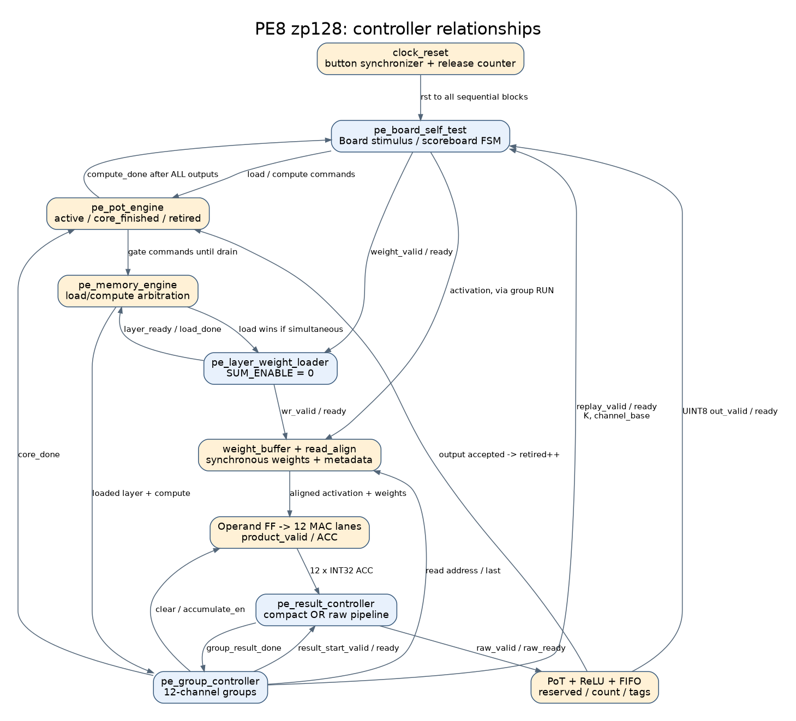
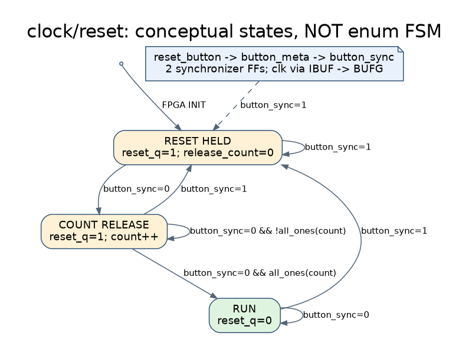

# PE8 精簡版與 PE8 pipeline：由頂層往下的控制狀態圖

本圖集對照目前工作樹 RTL，範圍是 **zp128、PoT 後處理的板級比較架構**。兩版均保留 Operand FF 與 Product FF；pipeline 版另外在 raw ACC 輸出加入可停頓暫存器。不是重新設計控制器，也沒有修改 RTL。

後續新增的 `POSTPROCESS_PIPELINED=0` 選項請看 [組合後處理與控制](../../HYBRID_SYSTEM/docs/PE_COMBINATIONAL_POSTPROCESS.md)。本圖集原 00～11 圖仍描述預設三級量化版；新增 12 圖描述組合後處理，其他 FSM 不變。原 quantizer/reserved/tag 波形路徑現在位於 postprocess 的 `g_pipeline` 分支。

## 1. 如何閱讀

- 藍色方塊：RTL 中真正的 FSM 狀態或其模組。
- 淡橘色方塊：由 valid、計數器、旗標構成的「概念狀態」，不是額外新增的 state 暫存器。
- 箭頭文字：轉移條件／該上升緣執行的更新。`fire` 表示 `valid && ready`。
- 條件不成立時保持原狀態；同步 reset 優先於正常操作。板級 FSM reset 回 `LOAD`，其他 FSM 通常回 `IDLE`。
- 控制器彼此並行運作，不能將所有圖中的方塊直接串起來計算總 cycles。
- 圖中保留英文 RTL 名稱方便搜尋；中文解說放在下方。PNG 可直接貼投影片，SVG 適合放大，DOT 是可重新編輯的原始圖。

## 2. 頂層與控制器關係



[向量圖](pe8_control_diagrams/00_relationship.svg)／[圖形原始碼](pe8_control_diagrams/00_relationship.dot)

| 階層 | 主要檔案 | 控制方式／責任 |
|---|---|---|
| 固定參數 top | `pe8_compact_pot_board_top`、`pe8_pipeline_pot_board_top` | 只選參數，不另設 FSM |
| 板級整合 | `pe_board_top` | 接時脈、reset、自我測試及 LED；heartbeat 是計數器 |
| 板級測試 | `pe_board_self_test` | 產生權重／activation、發命令、檢查結果 |
| 工作生命週期 | `pe_pot_engine` | `active/core_finished/retired` 確保輸出排空才完成 |
| 共用記憶體引擎 | `pe_memory_engine` | 載入／運算互斥、保存 K/channels、連接下列模組 |
| 權重載入 | `pe_layer_weight_loader` | 整層權重依 channel、K 順序寫入 12-lane 記憶體 |
| 分組運算 | `pe_group_controller` | 每組最多 12 channels，重播 activation、MAC、輸出結果 |
| 結果輸出 | `pe_result_controller` | 逐 lane 送 INT32；兩版差異所在 |
| 後處理 | `pot_result_stream` | PoT requantize、可選 ReLU、FIFO、反壓 |

兩個 top 分別設定 `PE8_MODE=1, POT_MODEL=1`，只有 `RESULT_PIPELINED=0/1` 不同。`pe_pot_engine` 將 raw engine 的輸入 zero-point 設為 128：

`ACC[c] = Σ (A_uint8[k] − 128) × W_int8[c,k]`

因此目前 **不走 ΣW 修正路徑**。舊 `pe8_result_controller_pipeline.sv` 不是本次 pipeline top 的有效實例；實際使用 `pe_result_controller.sv` 的 `g_raw_pipeline`。精簡分支名 `g_pe9` 是沿用名稱，並不表示這裡用了 PE9。

主要 RTL：[board top](../rtl/board/pe_board_top.sv)、[PoT engine](../../HYBRID_SYSTEM/rtl/integration/pe_pot_engine.sv)、[memory engine](../../HYBRID_SYSTEM/rtl/integration/pe_memory_engine.sv)。

## 3. 板級自我測試 FSM


來源：[pe_board_self_test.sv](../rtl/board/pe_board_self_test.sv)。

| 狀態 | 動作 | 正常離開條件／下一狀態 |
|---|---|---|
| LOAD | 發出 layer 載入命令 | load handshake → W_PREP |
| W_PREP | 準備一個權重 | 下一拍 → W_SEND |
| W_SEND | 保持權重 valid，等待接收 | 未寫完 → W_PREP；整層寫完 → LOAD_WAIT |
| LOAD_WAIT | 等待整層可用 | load_done 且 layer_ready → COMPUTE |
| COMPUTE | 發出運算命令 | compute handshake → REPLAY |
| REPLAY | 接收本組 K/channel_base，核對分組順序 | 正確 → A_PREP；不符 → FAILED |
| A_PREP | 準備一個 activation | 下一拍 → A_SEND |
| A_SEND | 送 activation，接受反壓 | 未滿 K → A_PREP；下一組 → REPLAY；最後組 → FINISH |
| FINISH | 等全部輸出接收完成 | compute_done 且數量正確 → NEXT |
| NEXT | 切換測試案例 | 尚有案例 → LOAD；全部完成 → PASSED |
| PASSED | pass 保持，停止測試 | reset 才重新開始 |
| FAILED | fail 保持，保存原因 | reset 才重新開始 |

輸出 scoreboard 在上述 FSM 之外並行接收、核對結果。資料／channel／last 不符、下層 error、timeout 均可導向 FAILED；這不是只有 FINISH 才檢查正確性。

測試依序為 `(K,C)=(9,12)、(144,32)、(32,8)`，對應 Conv1-like、FC1-like、FC2-like 工作。**三個是獨立的人工資料測試，不是完整 CNN 前一層結果接下一層。** `out_ready` 刻意週期性拉低以測反壓，W_PREP/A_PREP 也帶來間隔，所以板級測試花費的 clocks 不等於核心最大吞吐量。

## 4. 時脈與 reset 控制



來源：[pe_board_clock_reset.sv](../rtl/board/pe_board_clock_reset.sv)。IBUF → BUFG 提供共用時脈；按鍵經兩級同步，再由 release counter 保持 reset。這是同步器／計數器邏輯，沒有三個 enum states。按鍵重新有效會清除計數並重新保持 reset；計數飽和後釋放。預設 20-bit 延遲在 125 MHz 約為 8.39 ms，另有同步與邊緣判斷時間。

## 5. 工作控制與 load/compute 互斥


`pe_pot_engine` 沒有 enum；可用三個概念階段理解：

| 概念階段 | 旗標 | 行為 |
|---|---|---|
| IDLE | active=0 | 可接受合法 load 或 compute |
| RUN | active=1、core_finished=0 | 核心運算，同時可接收後處理結果 |
| DRAIN | active=1、core_finished=1 | 等 retired 等於 channels，然後 compute_done |

`retired` 只在外部 `out_valid && out_ready` 時增加。最後一筆被接收，不代表同一上升緣立刻產生 compute_done：RTL 使用暫存旗標／舊計數判斷，會在後續上升緣確認。

內層 `pe_memory_engine` 的互斥是組合邏輯，不是另一個 FSM：正在 compute 不接受 load；正在 load 不接受 compute；load_valid 與 compute_valid 同時出現時 load 優先。外層 active 又擋住後處理排空期間的新命令。

## 6. 整層權重載入 FSM


來源：[pe_layer_weight_loader.sv](../../HYBRID_SYSTEM/rtl/datapath/pe_layer_weight_loader.sv)。

`IDLE → START_CHANNEL → LOAD_CHANNEL → NEXT_CHANNEL`。LOAD_CHANNEL 每次握手寫一筆 signed INT8 權重，完成 K 筆才切下一個 channel；lane 0～11 循環，跨到下一組時記憶體 group base 增加 K。最後一個 channel 完成才拉高 layer_ready、脈衝 load_done 並回 IDLE。

檢查 K 不為 0、channels 在 1～32、`K × ceil(channels/12) <= 512`。非法命令回報 error，留在 IDLE，不另設 ERROR state。

原始 enum 尚有 WAIT_SUM，但本次 `SUM_ENABLE=0`，不會進入它；沒有等待 ΣW 的 cycles。

## 7. 12-lane 分組運算 FSM


來源：[pe_group_controller.sv](../../HYBRID_SYSTEM/rtl/control/pe_group_controller.sv)。

| 狀態 | 工作及轉移 |
|---|---|
| IDLE | 接受合法 K/channels 後進 CLEAR |
| CLEAR | 清除 12 個 ACC／product valid，下一拍進 REPLAY |
| REPLAY | 要求上游重播同一個 patch/vector；握手後進 RUN |
| RUN | 接受 K 個 activation 並發出權重位址；最後一筆「發出」後進 WAIT_LAST |
| WAIT_LAST | 等最後一組 Operand 真正被 MAC 接收，才進 DRAIN_MAC |
| DRAIN_MAC | 讓最後 product 寫入 ACC；之後進 START_RESULT |
| START_RESULT | 向結果控制器握手，成功後進 WAIT_RESULT |
| WAIT_RESULT | 等本組 raw 結果全部被後處理接收；最後組 done→IDLE，否則 NEXT_GROUP |
| NEXT_GROUP | channel_base 加 12、weight base 加 K，回 CLEAR |

FC1 的 32 channels 分為 12、12、8；最後組 mask 只開啟 8 lanes。每組重播相同的 K 個 activation，並不是對同一組 ACC 累加下一組 channels。

WAIT_LAST 與 DRAIN_MAC 不能視為重複：前者等待資料通過 BRAM/read-align/Operand FF，後者等待 Product FF 的最後乘積提交。

## 8. 結果控制：兩版真正的差別

### PE8 精簡版


### PE8 pipeline 版


來源：[pe_result_controller.sv](../../HYBRID_SYSTEM/rtl/control/pe_result_controller.sv)。兩版有效 enum 狀態均只有 `IDLE/EMIT`；READ_SUM、FEED_CORRECTION 不在 zp128 有效路徑。

| 比較 | 精簡版 | pipeline 版 |
|---|---|---|
| 資料路徑 | ACC lane mux → 後處理 | ACC lane mux → output FF → 後處理 |
| lane 前進 | raw output 握手 | 下一筆被裝入 output FF |
| 反壓時 | lane 保持，ACC 必須保持 | valid/data/channel/last 保持 |
| 終止 | 最後 lane 被接收 | 最後暫存結果被接收，不是裝入時 |
| 連續輸出能力 | 下游 ready 時每拍一筆 | 下游 ready 時每拍一筆 |
| 首筆額外延遲 | 基準 | 相對精簡版多一拍 |

pipeline 的 `slot_ready = !valid_q || out_ready` 允許同一上升緣「送出舊資料並裝入新資料」。因此不能畫成讀取／輸出兩個必須交替的 FSM，否則會錯誤暗示每兩拍才有一筆。

假設 E0 接受 result_start，且後處理始終 ready：精簡版 E1 接受 lane0、E2 lane1；pipeline 版 E1 裝入 lane0、E2 接受 lane0 並裝入 lane1。兩版 group_result_done 都在最後 raw 結果的接收邊緣產生，父控制器在後續邊緣看到該脈衝。

## 9. 記憶體讀取與 Operand/MAC 控制


來源：[read align](../../HYBRID_SYSTEM/rtl/datapath/pe_weight_read_align.sv)、[memory engine](../../HYBRID_SYSTEM/rtl/integration/pe_memory_engine.sv)。

這兩張是概念狀態，沒有新增 FSM：

1. Weight buffer 同步讀出；合法寫入優先於新的讀取，已暫存讀取結果在反壓時仍保持。
2. read-align 保存 activation／last，等待對應 BRAM 權重到達後一起送出。
3. Operand FF 保存整組操作數，可在送出舊資料的同一拍補入新資料。
4. 每個有效 lane 在 accumulate_en 時把 A×W 放入 Product FF；下一拍 product_valid 使舊 product 加進 ACC。
5. lane enable 還要與 lane_mask 相 AND。reset／clear 優先清除有效旗標與 ACC，不提交被取消的 product。

資料路徑為 `BRAM → read-align → Operand FF → signed8×signed8 → Product FF → INT32 ACC`。這些級數和 valid 對齊也解釋了分組 FSM 為何要保留 drain。

## 10. PoT 後處理與輸出 FIFO


來源：[pot_result_stream.sv](../../HYBRID_SYSTEM/rtl/datapath/pot_result_stream.sv)。quantizer 是固定延遲 valid pipeline，不是額外 enum FSM；輸出 FIFO 承接外部反壓。

- `reserved`：已接受但外部尚未接收的所有結果，包括還在量化管線中的資料。
- `count`：已進入 FIFO、尚未被外部接收的結果。
- `reserved < 8` 才接受新 raw 結果，預留所有在途資料的空間，避免固定延遲管線溢出。
- `reserved += raw_accept − external_pop`；`count += quantizer_output − external_pop`。
- reserved 已滿時，即使本拍 pop，仍到下一拍才恢復接受；這是目前實作，圖中沒有額外加 ready bypass。

以 E0 raw 接受為起點：E0 量化第一級、E1 rounding、E2 UINT8 結果有效、E3 FIFO 收入，最早 E4 才在外部握手。channel/last/error/relu metadata 必須與數值走同樣延遲。這是每筆 latency，不表示每筆必須相隔四拍。

## 11. 三種完成訊號不能混淆


| 訊號／事件 | 代表完成什麼 | 尚不能推論什麼 |
|---|---|---|
| group_result_done | 一組 raw INT32 已交給 PoT stream | 不代表這組 UINT8 全被外部接收 |
| core_done | 所有 channel groups 的 raw 結果已提交 | 不代表後處理與 FIFO 已排空 |
| compute_done | core 已完成，且 retired==channels | 才可視為此次頂層命令完成 |

輸出與計算並行；部分甚至全部輸出可能在 core_done 前就已被接收。所以圖中的 DRAIN 是等待「兩個條件都成立」，不是固定長度的新資料運算階段。

## 12. 波形觀察與核對方式

由實際 TB 或 Vivado 層級選取相同實例；以下是相對於 wrapper 內 `board` 的 RTL 路徑，合成後名稱可能被最佳化，不保證逐字保留：

| 想觀察的事 | 訊號／位置 |
|---|---|
| 測試進度 | `board/self_test/state`、test_id、pass、fail |
| 工作完成管理 | `board/self_test/g_pot.engine/active`、core_finished、retired |
| 載入 FSM | `.../engine/core/loader/state` |
| 分組 FSM | `.../engine/core/groups/state`、issue_count、channel_base |
| 讀取／乘法提交 | core 的 aligner/pending、operand_valid、pe_accumulate_en，以及 MAC lane 的 product_valid/ACC |
| 結果 FSM | `.../engine/core/g_compact_result.results/state`、lane_index |
| pipeline output FF | results 的 `g_raw_pipeline/valid_q`、issued_all、data_q、last_q |
| 輸出排空 | engine/postprocess 的 reserved、count，以及頂層 out_valid/out_ready/compute_done |

每個等待狀態應配 valid/ready 觀察；valid=1 不等於資料已傳輸。比較兩版時，同時標記 result_start handshake、首筆 raw handshake、末筆 raw handshake、最後 UINT8 handshake 與 compute_done，才能分辨延遲、吞吐量、反壓時間。

本次驗證範圍是 RTL 靜態對照、實際 enum 狀態覆蓋、DOT 渲染及 SVG 格式檢查；沒有修改 RTL，也沒有以圖形檢查取代 RTL simulation／Vivado timing／板級測試。

檢查結果：12 組圖檔成功渲染；SVG XML 解析與本文件相對連結均通過；板級 12 個、載入有效 4 個、分組 9 個、兩版結果各 2 個 enum 狀態均在對應圖中出現。狀態覆蓋檢查不等於形式驗證，轉移條件另依 RTL 靜態核對。

## 13. 圖檔清單與再產生

原圖集共 12 張圖（00～11），另有組合後處理擴充圖 12；每張同時提供 `.dot`、`.svg`、`.png`，位於 [pe8_control_diagrams](pe8_control_diagrams/)。從 repository 根目錄使用 Graphviz：

```bash
for f in PE_COMPARISON/docs/pe8_control_diagrams/*.dot; do
    dot -Tsvg "$f" -o "${f%.dot}.svg"
    dot -Tpng -Gdpi=110 "$f" -o "${f%.dot}.png"
done
```

未列入目前有效階層的舊 standalone core FSM、zp127 ΣW builder／memory／correction、完整 CNN layer/window 控制器，不應混入這次比較圖。未來接完整推論時，應以真正的系統上游替換 board_self_test，而不是把此測試 FSM 當成 CNN 控制器。
