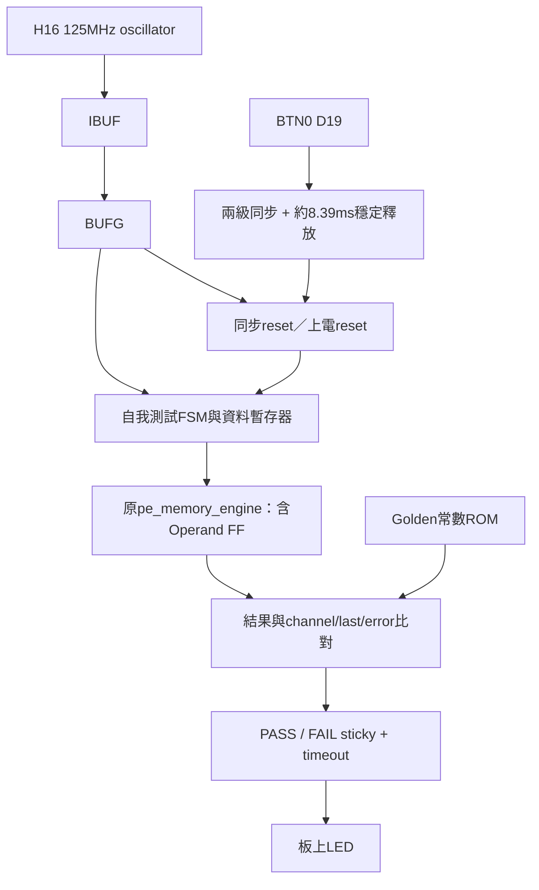
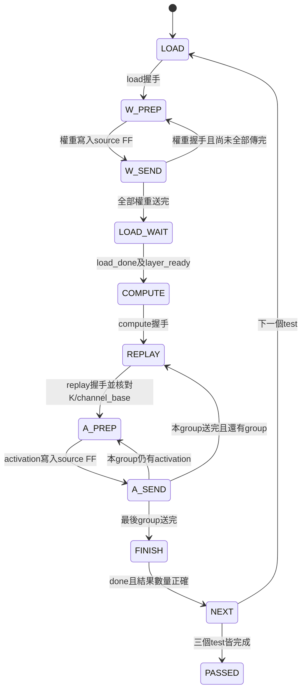

# PE 三版本 PYNQ-Z2 板級自我測試

## 修正紀錄：XDC if／post-synth 缺少 board_clk

使用者 log 顯示 synth_design 已成功產生 DCP，但 XDC 的 if 不被 project XDC reader 支援，
且 post-synth hook 查不到 board_clk 而停止。不能據此宣稱 RTL 合成失敗，亦不能確定缺少clock全由if造成。
已移除 XDC if，物件數量檢查移到 `ensure_pe_board_constraints.tcl`。
hook 先 update_timing，若仍無clock且輸入沒有其他clock，載入完整凍結XDC；不同名稱／錯誤週期的clock會拒絕覆寫。
新專案自動加入pre-opt檢查。既有 `build/board/pe9` 的XDC及報告腳本也已修正，DCP/log未改。
既有專案開啟時，請補掛pre-opt（新版create腳本建立的專案不需要手動做）：

```tcl
set board_scripts {C:/Windows/System32/aoc-workspace/projects/KWS/KWS_DNN_Hybrid/PE_COMPARISON/build/board/pe9/scripts}
add_files -fileset utils_1 -norecurse [list [file join $board_scripts ensure_pe_board_constraints.tcl] [file join $board_scripts pre_opt.tcl]]
set_property STEPS.OPT_DESIGN.TCL.PRE [file join $board_scripts pre_opt.tcl] [get_runs impl_1]
```

GUI對synth_1執行Reset Run，再Run Synthesis，確認成功後Run Implementation。
本次Tcl測試增加XDC指令白名單、clock遺失恢復、錯誤週期拒絕、同步器找不到時拒絕；仍非真正Vivado驗證。

2026-09-20。保留目前 Operand Pipeline 與 LUT 乘法器，不修改 engine 的數值／握手／MAC。
這是正常頂層合成及板級功能測試，不是 OOC，不是完整 KWS 推論。

## 1. 檔案與架構

```text
PE_COMPARISON/
  rtl/board/
    pe_board_clock_reset.sv   IBUF → BUFG、按鍵同步、上電 reset／穩定釋放
    pe_board_self_test.sv     共用測試 FSM、registered sources、結果比對、timeout
    pe_board_golden.sv        52 筆預先計算的 golden 常數
    pe_board_top.sv           組合上述元件及 heartbeat
    pe9_board_top.sv          固定 PE8_MODE=0, RESULT_PIPELINED=0
    pe8_compact_board_top.sv   固定 PE8_MODE=1, RESULT_PIPELINED=0
    pe8_pipeline_board_top.sv  固定 PE8_MODE=1, RESULT_PIPELINED=1
  constraints/pe_board_pynq_z2.xdc
  vivado/create_pe_board_project.tcl
  vivado/report_pe_board.tcl
  tb/tb_pe_board.sv
  sim_verilator/pe_board_clock_primitives.sv  僅模擬，不得加入 Vivado
  scripts/test_board_tcl.py
```



所有邏輯使用同一條 BUFG 125 MHz 時脈，無 MMCM、無 CDC、無 PS/AXI。
reset_button 是 BTN0，不是 PS SRST。兩級 ASYNC_REG 同步後，按下即進行同步 reset，
放開要連續穩定 2^20 個 clock 才重跑（約8.39ms），彈跳會重新計數。
同步暫存器與計數器使用 FPGA configuration INIT 上電值，初始自動執行測試。
這是 Xilinx FPGA 導向的初始化方式，不能直接當 ASIC power-on reset。

## 2. 測資與 FSM

| test_id | 類比的 layer 尺寸 | K | channels | outputs |
|---|---|---:|---:|---:|
| 0 | Conv1 單 patch | 9 | 12 | 12 |
| 1 | FC1 | 144 | 32 | 32 |
| 2 | FC2 | 32 | 8 | 8 |

不是實際訓練權重，也不串接三層 feature map；是三個獨立 engine 測試。
權重依 channel-major 次序傳送：先 channel0 的全部 K，再 channel1。

```text
Wbits(c,k,t) = (71*c + 29*k + 128 + 17*t) mod 256
W = Wbits 的 signed INT8 解讀
A(k,t) = (43*k + 17 + 61*t) mod 256
Golden(c,t) = Σk ((A(k,t)-127) * W(c,k,t))
```

Golden 是預計算 ROM，不再用待測 PE 即時計算參考答案。
TB 另用獨立整數迴圈重新計算每筆結果，確認 ROM 和 PE 數值。
權重和 activation 隨 channel/k/test 改變；不是全零或單一常數測試。
有限測資不能保證合成完全沒有特化；面積需查看引擎 hierarchy 與運算資源是否保留。



每拍有效結果握手都檢查 data、channel順序、group_last、out_error；
out_ready 每8拍阻塞1拍，測試結果背壓。每筆 source 的 PREP/SEND 分離，因此不作最大吞吐 benchmark。
每個 result 對外是32-bit；PASS要求全部52筆正確且三次 compute_done 完成。
任何錯誤或超過1,000,000 clocks（8ms，不含上電reset等待）進入 FAILED。
失敗碼：1=結果/順序/last，2=engine error，3=timeout，4=replay descriptor，5=結果數量，6=非法FSM狀態。
failure_code/test_id/checked_outputs 可在模擬觀察；未加 ILA，不會直接透過LED呈現詳細錯誤碼。

## 3. LED

| LED | 功能 |
|---|---|
| LED0 | heartbeat，約0.93Hz完整週期；不是 MMCM locked |
| LED1 | busy，測試很短，肉眼可能看不到 |
| LED2 | PASS，保持亮到reset |
| LED3 | FAIL，保持亮到reset |

預期成功：LED0緩慢閃爍、LED2常亮、LED1/3熄滅。
按BTN0後重新執行。PASS只代表本測資於此板此環境通過，不替代STA或完整模型驗證。

## 4. Windows Vivado 2023.2 執行

先 Close Project，Tcl Console：

```tcl
set pe_variant pe9
source {C:/Windows/System32/aoc-workspace/projects/KWS/KWS_DNN_Hybrid/PE_COMPARISON/vivado/create_pe_board_project.tcl}
```

專案建立於 `PE_COMPARISON/build/board/pe9`，不自動啟動 runs。
GUI：Run Synthesis → Run Implementation → 檢查 setup/hold/DRC → 通過後 Generate Bitstream → Hardware Manager 燒錄。
另兩版改 `pe_variant` 為 `pe8_compact` / `pe8_pipeline`，每次先 Close Project。
如果既存目錄存在，不覆寫；可開該 XPR，或在source前指定：

```tcl
set pe_board_build_root {C:/Windows/System32/aoc-workspace/projects/KWS/KWS_DNN_Hybrid/PE_COMPARISON/build/board_trial2}
```

新專案會凍結23份SV以及board XDC和報告hooks；舊OOC專案不變。
不匯入 simulation primitive stub、TB、OOC XDC，也不設定 -mode out_of_context。
不需要 Clocking Wizard IP 或 block design。IBUF/BUFG 使用 Vivado 內建primitive。
來源路徑由 Tcl 本身位置推算，不依赖工作目錄或Linux絕對路徑。

XDC：H16=125MHz、D19=BTN0、R14/P14/N16/M14=LED0..3。
按鍵/LED對照 [Xilinx PYNQ-Z2 constraints](https://github.com/Xilinx/PYNQ/blob/master/boards/Pynq-Z2/logictools/vivado/constraints/logictools.xdc)，
H16沿用已使用的DCIM板級約束。
只將非同步按鍵到第一級同步D、及不具同步接收器的LED設為false path；
沒有忽略同步器級間、內部reset、engine資料路徑。check_timing可能列出按鍵/LED已明確排除的I/O項目，應核對exceptions而非忽略全部警告。

## 5. 驗證與時序判讀

```bash
cd /home/LAB505/projects/KWS/KWS_DNN_Hybrid/PE_COMPARISON
make lint-board
make test-board
python3 scripts/test_board_tcl.py
```

Verilator測試三種參數配置：載入中reset、按鍵彈跳、兩輪完整測試（各104筆獨立golden）、PASS保持。
另以縮短timeout測試sticky FAIL。IBUF/BUFG僅行為直通模擬，不能模擬時脈網路／亞穩態。
固定wrapper皆經lint；測試以相同參數共用board top並縮短reset等待。
Tcl測試使用mock Vivado API，不是執行Windows Vivado。

實作報告在 `build/board/<variant>/reports/post_route/<timestamp>/`。
需檢查 WNS/WHS>=0、TNS/THS=0、無內部未約束路徑、routing/DRC、clock使用BUFG。
新增的source/golden/checker本身也可能成為最差路徑，要從實際path判斷，不宣稱已保證125MHz。
本次沒有執行Vivado；不能宣稱已合成或可燒錄成功。

面積用 hierarchy.rpt 分開列：`board/self_test/engine`、其餘self-test/reset/clock/LED。
三版使用相同測試環境但工具可能做不同最佳化，因此應同時列全top及engine資源。
OOC數據與板級top總面積不可直接混表；有限板級測資也不等同通用engine完全未特化的面積。
