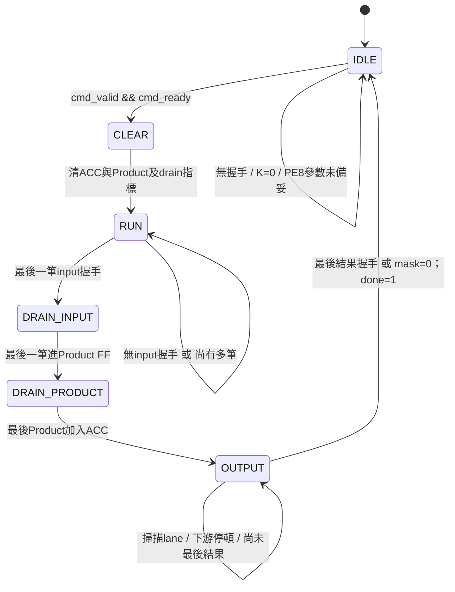

# PE8／PE9等價比較：實作、狀態與操作

## 最新：三個 Memory-backed Wrapper 與匯入流程

已建立三份固定參數top與共同比較TB，Verilator/Icarus均通過。
新的import-only流程為 `vivado/create_pe_memory_project.tcl`，建置在 `build/memory_backed/<variant>/f<frequency>/`。
操作請看 [PE_MEMORY_COMPARISON_GUIDE.md](PE_MEMORY_COMPARISON_GUIDE.md)。
舊stream-equivalent專案與本文件後面的历史報告保持不變，不和memory-backed範圍混用。

## 2026-09-20：三種 Engine 配置已接通

`pe_memory_engine` 新增RESULT_PIPELINED，合法組合為(PE8_MODE, RESULT_PIPELINED)=(0,0)/(1,0)/(1,1)。
外部介面未修改；由generate只建立一個結果controller。非法(0,1)有模擬預期失敗測試。
TB擴充三模式與長阻塞、MAC/多筆結果在途reset、ACC保持契約監測。
Icarus的相同來源排程測得compute cycles：Conv1單patch 29/53/31，FC1 486/550/492，FC2 48/64/50（PE9/PE8/PE8pipe）。
這是整合模擬cycle，不是最高吞吐、post-route時序或PPA；權重來源仍有turnaround。
完整定義與審查見 [PE8架構文件](../../PE_CHIP_8x8/docs/PE8_CORE_ARCHITECTURE.md) 2026-09-20章節。
後续還需三個固定參數wrapper及專用Vivado建置/報告；舊stream top報告仍不可混用。

## 2026-09-19 更新：獨立 PE8 結果管線已建立

`HYBRID_SYSTEM/rtl/control/pe8_result_controller_pipeline.sv` 及獨立TB已完成。
Verilator/Icarus均通過21組/116筆輸出，包含N+2延遲、II=1、錯誤、阻塞與reset。
**尚未修改engine或外部介面，三個比較top仍未建立**；目前engine仍只有PE8精簡與PE9。
下一步才是在engine加入RESULT_PIPELINED參數並完成整合TB。
詳細架構與狀態表見 [PE8架構文件](../../PE_CHIP_8x8/docs/PE8_CORE_ARCHITECTURE.md) 最上方章節。

## 2026-09-19 更新：共用 Memory Engine 已完成（PE8 精簡／PE9）

新增 `HYBRID_SYSTEM/rtl/integration/pe_memory_engine.sv`：保存 layer K/C，仲裁 load/compute，
串接真實 loader、weight RAM、group/read-align、選定的 array 與 result controller。
PE8 另有 ΣW builder/memory/correction；PE9 在 elaboration 移除。
外部介面 TB 每模式完成40次load、44次compute、725個輸出、4非法load、3reset中斷，
Verilator/Icarus 一致通過；instance tree 檢查確認每版僅一個 array。
操作與驗證詳見 [PE8共用架構文件](../../PE_CHIP_8x8/docs/PE8_CORE_ARCHITECTURE.md)。

後續仍需：PE8結果管線、三個memory-backed固定參數top、共同比較TB及專用Vivado約束／報告流程。
下方舊 stream-equivalent top 及其 PPA 沒有變更，不能當作新 memory engine 的面積／時序。

## 2026-09-16 更新：Result Controller已完成

`HYBRID_SYSTEM/rtl/control/pe_result_controller.sv` 已用PE8_MODE generate選擇結果路徑。
新增 `tb_pe_group_result_controller`，以真正RTL接管ΣW讀取、correction與group完成通知，
PE8/PE9兩模式均執行48筆job/728個channel的整合比對。
因此下方歷史紀錄的「結果取出仍為TB task」只描述之前版本；新結果路徑已可合成。
仍需建立保存layer描述與统一load/compute/replay/output/error介面的兩個獨立memory-backed top，
才能取得與舊stream-compute範圍不同的新比較報告；本次沒有修改舊top或Vivado流程。

## 2026-09-16 進度：記憶體版分組控制器

HYBRID_SYSTEM 已新增 `pe_group_controller`，實際串接loader/weight buffer/read-align/
PE8與PE9 array/ΣW memory/correction的自動比對TB通過。
架構與48筆job驗證詳見 [PE8主架構文件](../../PE_CHIP_8x8/docs/PE8_CORE_ARCHITECTURE.md)。
注意：TB的activation重播與結果取出仍為環境task；尚未建立完整memory-backed可合成比較top。
以下舊stream-compute比較top沒有被修改，舊面積數字不包含新loader/RAM/group controller。
不得把兩種範圍的LUT/FF或時序報告混用；下一步需可合成result path與一致介面的兩個top。

本次建立兩個可分別合成的stream compute top。兩者皆使用12個LUT／FF
MAC、Product暫存、32-bit ACC，不含bias。不是完整KWS layer或上板top。
PE8額外計入12×32-bit ΣW參數暫存、有效旗標、配置選擇邏輯及補償管線。
ΣW建立器、weight RAM、feature-map RAM、DDR/DMA、requantizer皆不在本次範圍。

## 1. 檔案與階層

```text
rtl/equivalent/
  pe8_equivalent_top.sv ─┐
  pe9_equivalent_top.sv ─┴→ pe_compare_engine.sv（PE8常數參數）
                             ├→ pe_compare_stream_controller.sv
                             ├→ 104-bit共用輸入暫存＋valid
                             ├→ PE_CHIP或PE_CHIP_8x8的array
                             ├→ pe_compare_result_drain.sv
                             └→ PE8才有：ΣW暫存、pe8_result_correction
tb/tb_pe_equivalence.sv
constraints/pe_equivalent_ooc.xdc
vivado/create_pe_equivalent_project.tcl
vivado/report_equivalent_post_synth.tcl
vivado/report_equivalent_post_route.tcl
vivado/report_pe_equivalent.tcl
scripts/summarize_pe_equivalent.py
scripts/test_summarize_pe_equivalent.py
```

新增engine讓兩份top不需複製共同程式。generate的PE8參數在展開階段固定，
不是運行時選擇器；PE9不包含PE8的參數RAM／補償硬體。
S9×S8的Product是17-bit，S8×S8是16-bit，ACC均32-bit。

## 2. 數值與資料流程

```text
共用輸入：A UINT8、W[0..11] INT8
               ↓ 一次valid/ready接受104bits
         activation_q、weights_q
               ↓
PE9：A−127 → 12×S9×S8 → Product FF → ACC FF
PE8：A−128 → 12×S8×S8 → Product FF → ACC FF
               ↓ 完整K項累加
         result drain依lane順序輸出
          ├ PE9：直接INT32/valid/ready
          └ PE8：ΣW[lane]＋raw → correction FF → INT32/valid/ready
```

Golden = Σ(A−127)W。PE8以Σ(A−128)W＋ΣW還原，沒有bias。
一筆輸入是一個K位置的activation與12個output channels在該位置的權重，
不是12個不同activation。weights_flat[8*j+:8]對應lane j。
raw result_vector[32*j+:32]對應lane j。輸出lane_id是0..11的local lane；
真正layer channel = 外部channel_base + lane_id，本top不保存channel_base。

K是8-bit、範圍1..255。以本範圍及運算元大小，dot product不會溢位INT32，
所以PE9 out_overflow固定0。PE8若配置錯誤／超大ΣW，仍可觸發correction
的飽和旗標；此情況不是等價模型運算。不得把任意溢位資料當作等價保證。

## 3. 外部接口

| 類別 | 訊號 | 規則 |
|---|---|---|
| Reset | clk/rst | 同步active-high，任意狀態中止、丟棄未輸出資料 |
| 命令 | cmd_valid/cmd_ready | 同時1的上升緣接收K與mask |
| 命令參數 | cmd_k[7:0]/cmd_lane_mask[11:0] | K=0不接受；mask=0合法 |
| 運算 | in_valid/in_ready | 成功握手才計K；反壓時上游保持 |
| 資料 | activation_u8[7:0]/weights_flat[95:0] | UINT8與12個signed8 bit patterns |
| 結果 | out_valid/out_ready | 成功握手交付一個enabled lane |
| 結果資料 | result signed32/lane_id[3:0] | 與valid對齊 |
| 結尾 | out_last | 最後一個enabled lane，只有out_valid時有意義 |
| 狀態 | busy/done | busy代表非IDLE；done為工作結束後一拍脈衝 |
| 溢位 | out_overflow | 與當筆結果對齊；正常模型應為0 |

沒有輸出ready時，result/lane/last/overflow/valid保持不變。
本版不重疊兩個job；等待所有結果交付後才能接受下一個命令。

## 4. PE8的ΣW配置

額外接口：cfg_valid/cfg_ready、cfg_lane[3:0]、cfg_weight_sum signed32。
僅IDLE可寫，lane>=12不接受。成功握手寫一個lane的完整K權重總和。
同拍有cfg_valid時優先配置，命令不接受。沒有cfg_valid時才檢查命令。

```text
reset → configured=0
    ↓
依序寫ΣW到本job會啟用的lanes
    ↓ 每個成功寫入設定configured[lane]
cmd_valid && K>0 && 所有enabled lanes已配置 && !cfg_valid
    ↓
接受命令、清configured旗標（數值不清除）
    ↓
運算期間cfg_ready=0，參數保持
    ↓
完成後下個job重新配置
```

為防止沿用上一個filter的ΣW，本版要求每個job重新配置enabled lanes。
此策略簡單但有配置開銷，不利用Conv跨patch重用；日後backend可加入
明確parameter-set ID以重用，此時需重新評估面積與執行時間。
mask=0不需要配置參數；仍接收K筆資料後完成，無out_valid，由done表示完成。
ΣW暫存採組合讀，與drain_lane同步選擇，因此本版無額外參數讀取等待拍。
改成同步BRAM時必須增加raw/channel延遲對齊，不能直接替換。

## 5. 控制器狀態圖



任何狀態遇到rst上升緣都回IDLE並清管線；圖中省略所有reset箭頭。

| 狀態 | 腳位／內部動作 | 為何需要 |
|---|---|---|
| IDLE | cmd_ready按K、config決定；in_ready=0 | 鎖住job參數 |
| CLEAR | clear=1，清MAC及result drain | 上次ACC不能殘留 |
| RUN | in_ready=1，每次握手remaining−1 | bubble不重算、不漏算 |
| DRAIN_INPUT | 停止接收，上拍input register送入Product | 共用輸入暫存有一拍 |
| DRAIN_PRODUCT | 最後Product加入ACC | MAC還有Product FF |
| OUTPUT | ACC保持，啟用drain；等待最後外部握手 | 防止下游停頓時覆寫結果 |

假設最後一筆輸入在L邊緣接受：L+1進Product、L+2進ACC，
L+2邊緣後進OUTPUT。PE9第一個enabled lane若是lane0，下游最早L+3接收；
PE8在L+3存補償結果，下游最早L+4接收。

## 6. 結果輸出／last的設計

drain從lane0掃至11。enabled且ready時送出；disabled lane每拍跳一格。
last由mask中是否還有更高enabled lane決定，而非一律lane11。
最後enabled lane送入PE8補償級後，drain進exhausted，避免重送；controller
仍等外部真正接受out_last才done。PE8 last_q與correction輸入握手同步，
與其輸出暫存同拍更新；反壓時两者共同保持。

不增加384-bit結果副本，直接使用保持不變的array ACC。代價是輸出期间
不能開始下一筆MAC。這是兩边共用的基準，不是最大吞吐量設計。

## 7. 延遲與公平性

以命令接受邊緣為0、滿12 lanes、無泡泡／反壓：CLEAR在邊緣1執行，
第一筆輸入邊緣2，最後一筆邊緣K+1；最後輸出握手為PE9的K+15、
PE8的K+16。done在該邊緣後拉高。額外PE8補償延遲如實計入，
不在PE9加虛假暫存器來湊相同延遲。
上式不包含PE8配置（完整12 lanes需12次cfg握手，之後才可接受cmd）、
上游等待及兩個job之間的命令握手。稀疏mask依掃描位置改變週期。
正式比較同時列job latency與包含配置的完整交易時間。

## 8. 已建立的測試

兩個top各自driver／scoreboard，不把ready或cycle綁在一起。
同一組A/W公式以直接Σ(A−127)W建立各lane golden；不依賴另一個DUT當答案。
驗證9筆正常工作，各top75個輸出，另有RUN中斷reset案例。

| K | activation／weight模式 | mask | 主要目的 |
|---:|---|---|---|
| 1 | A=0/255模式，W=−128/127 | FFF | 最小K與邊界 |
| 9 | A=127，混合W | FFF | 補償後零 |
| 32 | A=128，混合W | 0FF | 輸出ΣW、8 lanes |
| 144 | 0/255與−128/127 | FFF | FC1長度、泡泡／反壓 |
| 9 | 固定混合公式 | A55 | 稀疏mask與last |
| 32 | 固定混合公式 | 800 | 只最後lane有效 |
| 255 | 固定混合公式 | FFF | K上界 |
| 9 | 固定混合公式 | 000 | 無輸出但done |
| 9 | reset後混合公式 | FFF | 重啟無殘留 |

另外測K=0拒絕、PE8未配置拒絕、非法cfg_lane拒絕、輸出stall payload保持、
重複lane禁止、last正確、overflow=0。不是所有狀態的形式驗證；
目前沒有隨機測試，也尚未驗證全層記憶體排程。

```bash
cd /home/LAB505/projects/KWS/KWS_DNN_Hybrid/PE_COMPARISON
make test-equivalent
make lint-equivalent
make check-tools
```

本次執行結果：test-equivalent與lint-equivalent通過，PE8/PE9各75筆結果；
check-tools共7個Python單元測試通過。分開RTL來源的兩份top lint亦通過。
建專案Tcl兩個variant及合成／route四個報告hook經mock檢查通過，
這只驗證腳本流程／路徑，不代表Vivado原生命令已執行。

| 無泡泡／反壓案例 | PE8 job cycles | PE9 job cycles |
|---|---:|---:|
| K=1、FFF | 17 | 16 |
| K=9、FFF | 25 | 24 |
| K=32、0FF | 44 | 43 |
| K=255、FFF | 271 | 270 |
| K=9、000 | 13 | 13 |

job cycles以命令成功接受到done邊緣計，不含ΣW配置；其他帶反壓案例
由TB輸出實測數值，但不同絕對時間對應的ready模式不同，不用它們
推論PE8必定只多一拍。上述表格是功能模擬週期，不是實測頻率。

Lint僅豁免測試時鐘blocking assignment、未使用的參數化分支訊號、
刻意空接cfg_ready及同檔TB輔助module檔名警告；其他warning維持fatal。
另外已用兩套Tcl指定的精簡RTL來源各自lint，確認不必匯入另一套array。

## 9. Vivado GUI建置（Windows 2023.2）

### 最新修正：自動補載完整XDC與opt_design前置檢查

ensure_pe_equivalent_constraints.tcl供報告與prepare_pe_equivalent_impl.tcl
共用。需要open design與clk port；update_timing後若缺少pe_clk，直接source
完整pe_equivalent_ooc.xdc（含uncertainty與I/O min/max），再檢查8ns及來源。
既有正確clock不重建；錯誤週期、不同名稱clock、沒有open design則停止。
不設定HD.CLK_SRC、不降低警告、不更改RTL或原DCP。
僅clock存在不代表所有I/O限制完整，仍須檢查timing_summary的unconstrained項。

create／repair均掛上STEPS.OPT_DESIGN.TCL.PRE，確保implementation在opt前
執行此檢查。report_pe_equivalent亦呼叫同一支guard，並在manifest記錄
full_xdc_reloaded_for_report。合成後重載限制只代表重新分析既有網表，
不能宣稱合成優化當時已完整使用這些限制；opt前檢查則用於後續實作。

既有GUI專案先source repair_pe_equivalent_project.tcl，再Reset Run synth_1
並Run Synthesis。重要舊run產物請先備份；確認synth_1完成而非failed後
再Run Implementation。不要在checkpoint臨時專案中執行repair。
預期log：`PE constraints ready: pe_clk=8.000 ns; full_xdc_reloaded=...`。
本地Tcl mock涵蓋缺clock補載、既有clock不重複載入、錯誤週期、無design、
異名clock拒絕；沒有本地Vivado，實際run完成狀態由使用者重新執行確認。

### Common 17-170修復

原腳本以位置參數傳入`-mode out_of_context`，Vivado可能將它解析為
set_property本身的選項。已改為AMD官方使用的明確命名參數：

```tcl
set_property -name {STEPS.SYNTH_DESIGN.ARGS.MORE OPTIONS} -value {-mode out_of_context} -objects [get_runs synth_1]
```

若建置在此處中止，專案已部分建立，後面的報告hooks尚未設定。
保留目前開啟的等價專案，執行下列修復，不要再次create或刪除build：

```tcl
source {C:/Windows/System32/aoc-workspace/projects/KWS/KWS_DNN_Hybrid/PE_COMPARISON/vivado/repair_pe_equivalent_project.tcl}
```

它補上OOC、MAX_DSP及兩個報告hooks並更新編譯順序，不重設或啟動runs。
若已關閉專案，先開build/pe8_equivalent/pe8_equivalent.xpr（或pe9）再修復。
若之前已跑合成，需於GUI重新合成使設定生效。先前Tcl mock不實作Vivado
的選項解析，因此未偵測到此問題；mock通過不等於Vivado驗證。

### 新建專案

### synth成功但報告顯示No clocks（2026-09-14修正）

後續19:39記錄更新：XPR已包含out_of_context，run腳本也已使用
read_xdc -mode out_of_context，因此不能再將缺時脈歸因於未設定USED_IN。
report hook先前在update_timing前就檢查get_clocks；本次改為先update_timing
再檢查，以測試是否為timing engine尚未套用限制。這是待Vivado確認的
修正假設，不是已證實根因。仍缺時脈時輸出clock port、全部clock與XDC
屬性並停止，不自動補create_clock。建議先Open Checkpoint既有DCP，
執行update_timing/report_clocks確認，不必先再重跑合成。

使用者run腳本以一般read_xdc載入限制，沒有OOC標記；在OOC合成後
pe_clk不存在，報告的get_property PERIOD對空集合報Common 17-55。
create及repair腳本已加入USED_IN {synthesis implementation out_of_context}，
repair也會補入缺失XDC並啟用。報告腳本新增時脈檢查，缺少pe_clk時
明確停止，不生成可用於比較的manifest，不於報告階段臨時create_clock掩蓋問題。

開啟原專案，再source repair_pe_equivalent_project.tcl，確認輸出的
XDC USED_IN包含out_of_context。於GUI對synth_1執行Reset Run，再Run
Synthesis；這會重跑該run，重要舊結果請先保留。成功後Open Synthesized
Design並執行 `report_clocks`，應看到pe_clk週期8ns。再Run Implementation。
HD.CLK_SRC未指定是另外的OOC物理時脈來源限制，不代表create_clock缺失，
也不會單靠這次USED_IN修正就保證消失；不要任意指定不存在的BUFG位置。

先關閉既有專案。Tcl Console：

```tcl
set pe_variant pe8
source {C:/Windows/System32/aoc-workspace/projects/KWS/KWS_DNN_Hybrid/PE_COMPARISON/vivado/create_pe_equivalent_project.tcl}
```

完成後在GUI依序Run Synthesis、Run Implementation；不要Generate Bitstream。
關閉專案後，再用同一source指令並將pe_variant改成pe9建立另一份。
腳本不會關閉、重設、覆寫既有專案；目錄存在時請直接開該XPR。

Tcl動作：選variant來源（package先行）、加入共用RTL與該top；設定器件
xc7z020clg400-1、SystemVerilog、MAX_DSP=0、flatten rebuilt；設定
MORE OPTIONS為`-mode out_of_context`，不是給set_property直接傳-mode；
加入共用8ns、uncertainty 0.2ns、I/O max2ns/min0.5ns的XDC；掛上報告hooks。
其餘合成實作設定使用同版本預設值，手動改策略時請兩邊一致。

```text
build/pe8_equivalent/pe8_equivalent.xpr
build/pe9_equivalent/pe9_equivalent.xpr
各自：*.runs/synth_1、impl_1
各自：reports/post_synth/<時間>/、reports/post_route/<時間>/
```

報告根目錄由腳本位置推導，不依run的current_project DIRECTORY，
避免先前CIM報告落到run目錄的問題。每次用時間與必要suffix保留舊檔。
包含total_utilization/hierarchy/timing_summary/control_sets/clocks，
route後另有route_status/drc/methodology，以及comparison_config.txt。
OOC沒有板子pin配置，可能仍有HD.CLK_SRC／PARTPIN邊界警告，不能假装
實體邊界延遲已正確路由；此時只用同條件資源比較，時序需註明限制。
本地沒有Vivado，僅做Tcl mock與RTL驗證，尚未證實合成或125MHz達成。

## 10. LUT／FF表格與節省率

```bash
python3 scripts/summarize_pe_equivalent.py \
  build/pe8_equivalent/reports/post_route/<PE8時間> \
  build/pe9_equivalent/reports/post_route/<PE9時間>
```

參數是具體報告資料夾，不填XPR或runs根目錄。工具輸出Markdown到終端；
不會刪改報告。可自行儲存到docs。工具拒絕variant/範圍/階段/器件/工具版本/
時脈不一致、非Fully Routed的post_route報告及DSP非0；仍需人工確認
XDC與策略一致及無嚴重DRC/路由失敗，工具不宣稱效能已通過。

| Resource | PE8（含ΣW儲存與補償） | PE9 |
|---|---:|---:|
| LUT | 待Vivado報告 | 待Vivado報告 |
| FF | 待Vivado報告 | 待Vivado報告 |

LUT節省率 = (LUT_PE9−LUT_PE8)/LUT_PE9×100%。負值表示PE8更大。
FF獨立列出，不與LUT直接相加。舊array／DSP／standalone測試top不可混入。
summary的10%單元測試數字是合成報告格式的人工fixture，不是實際面積。
