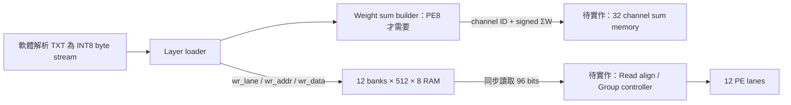
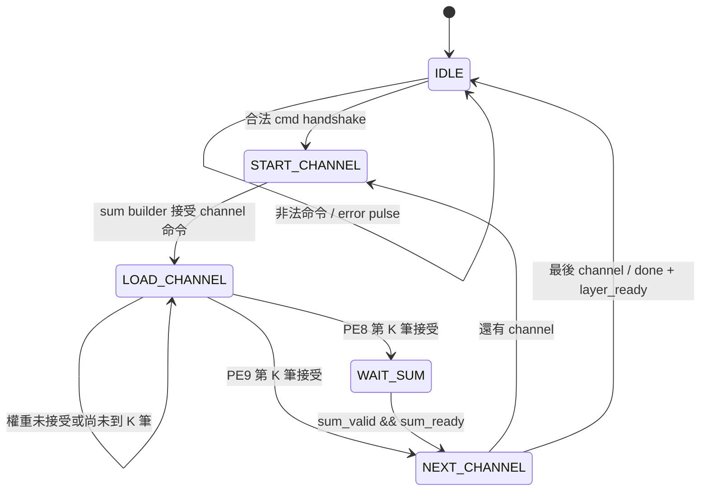

# 整層權重儲存與載入器

## 2026-09-16 更新：ΣW 記憶體已實作

新增 `pe_channel_sum_memory.sv`，32channel × signed32-bit，加有效旗標與同步讀取回應。
最新架構、狀態、測試與混合系統記憶體規劃統一記於
[PE8_CORE_ARCHITECTURE.md](../../PE_CHIP_8x8/docs/PE8_CORE_ARCHITECTURE.md)。
`make test-layer-sum-integration` 以 STORE_SUM=1 連接真實 loader/buffer/builder/sum memory。
本文件以下提及「待實作 sum memory」為前一階段紀錄；目前元件與TB完成，但還未接完整PE top。

## 本次範圍

實作 `HYBRID_SYSTEM/rtl/datapath/pe_layer_weight_loader.sv`，並將同目錄的
`pe_weight_buffer_12.sv` 改為可設定容量。尚未接入 PE 比較 top，舊比較面積不包含本次新增電路。



TXT 的文字、換行及十進位解析由軟體處理；本模組不解析 ASCII。
傳送順序固定為 `W[channel][k]`：一個 channel 的 K 筆送完才送下一個 channel。
卷積 K 的 flatten 順序須與日後 activation/window generator 相同。

## Buffer 修改

新增 `ADDR_WIDTH` 參數，預設 8（保持原本 256 bytes/bank），整層使用 9（512 bytes/bank）。
深度固定為 `2**ADDR_WIDTH`，不另外提供互相矛盾的 DEPTH 設定。
12×512×8 = 6144 bytes 邏輯容量，不代表實際 BRAM 實體配置大小。

讀寫行為未變：合法寫入優先，同步平行讀取 12 個 byte；讀取要求在正緣被接受後，
`out_valid/weights_flat` 更新，接收端最早於下一正緣接受結果。
輸出 stalled 時保持資料。Reset 僅清有效旗標，RAM 不清除，利於 BRAM 推導。

## 位址對映

`lane = channel % 12`，`group = channel / 12`，`addr = group*K + k`。
RTL 用 lane/channel/k 計數器及 group_base 加法，不用可變除法或乘法。

| 層 | K | channels | 各 group 的 RAM 地址 | 最後 group 有效 lane |
|---|---:|---:|---|---|
| Conv1 | 9 | 12 | 0–8 | 0–11 |
| FC1 | 144 | 32 | 0–143、144–287、288–431 | 0–7 |
| FC2 | 32 | 8 | 0–31 | 0–7 |

未使用 lane 的舊資料不清空。後續運算端必須使用 lane mask，不能當成零。
支援 K=1–255、channels=1–32，且 `ceil(channels/12)*K <= 512`。
例如 K=170/C=32 合法；K=171/C=32 拒絕；K=255/C=24 合法。

## FSM 與交握



`cmd_valid && cmd_ready` 接受一份 layer 描述。busy 時不接受命令。
開始新命令（包含非法命令）即清 `layer_ready`。非法命令回報一個 cycle 的 `error`，
不寫 RAM；成功才回報一個 cycle 的 `done`。
`layer_ready` 保持到新命令或 reset；代表 RAM 與所有 ΣW 已經被下游接受，不保證下游有永久保存。

PE8 預設 `SUM_ENABLE=1`，內部沿用已驗證 `pe_weight_sum_builder`。
同一筆 `weight_valid && weight_ready` 同時寫入 RAM 與加到 ΣW。
`wr_valid` 受 builder ready 控制，builder valid 受 RAM ready 控制，兩者不會單獨接受。
因此 RAM 下游 ready 必須像目前 buffer 一樣不組合依賴 wr_valid，避免組合迴圈。
權重來源遇到 ready=0 必須保持 valid/data。
ΣW 輸出使用真實 channel ID 0–31，而不是只有 lane ID 0–11。
sum_ready=0 時保持 sum/result，整層載入會等待。

PE9 設 `SUM_ENABLE=0`，generate 移除 sum builder、sum_valid 恆為 0；仍用相同權重映射。
sum_ready 此時不影響進度。Reset 為同步 active-high，取消未完成 layer，不還原已寫入資料。
沒有封包長度/timeout/CRC檢查：上游少送資料會等待，多送資料不會在 IDLE 被接受。

## 時序與系統連接

每個 load cycle 最多接受一個 8-bit 權重。沒有停頓時，命令接受至 done：
PE8 約定此 FSM 精確為 `C*(K+3)` clocks，PE9 為 `C*(K+2)` clocks。
包含每個 channel 的 START/NEXT（PE8 再加 WAIT_SUM），不含 host 傳輸空檔。
本 TB 故意加入來源空檔、RAM 與 sum backpressure，因此不是效能 benchmark。

上層必須避免運算中重新載入；本 loader 不仲裁 PE 的讀取，buffer 本身只提供寫優先。
接線：loader 的 wr_* 接 buffer 的 wr_*，buffer 設 ADDR_WIDTH=9，兩者同一 clk/rst。
ΣW 接後續 channel sum memory；只有整層完成才能啟動運算。
接下來還需要 sum memory、同步 RAM read 對齊、分組 controller、activation replay 與整合 top。

125 MHz 是目標而非保證：本次沒有大乘除法位址路徑，RAM 同步輸出；但握手路徑、
ΣW 的 32-bit 累加以及整合後 routing 仍須 Vivado post-route 檢查 setup/hold。
本環境沒有 Vivado，模擬通過不代表已達到 125 MHz 或確認 BRAM 數量。

## 驗證

`HYBRID_SYSTEM/tb/datapath/tb_pe_layer_weight_loader.sv` 連接真正 loader、sum builder 與 512-depth buffer。
兩次執行分別 SUM_ENABLE=1/0。獨立 scoreboard 根據接受的資料序號計算期望位址與 signed ΣW。

測試 Conv1/FC1/FC2、K170/C32、K255/C24、K1/C1、重載 Conv1；
檢查每筆寫入 lane/address、逐 group 讀回全部有效權重、讀出等待期間資料保持；
插入 RAM backpressure、sum backpressure、weight bubbles；測試非法 K/C/容量與載入中 reset 後重載。
權重 deterministic pattern 涵蓋 signed 正負與位元組邊界。
保留原 256-depth buffer TB，不覆蓋原本測試。

實際結果：Verilator 兩模式各通過 16642 次寫入與 33282 次讀值比對；
PE8 121 筆 ΣW、PE9 0 筆 ΣW（符合設定）。寫入數包含 reset 前取消的 1 筆。
Icarus 另執行 PE8 整合 TB，結果相同。
`make test lint` 全部完成，包含原 buffer、sum builder、correction 與後處理測試。

```bash
cd /home/LAB505/projects/KWS/KWS_DNN_Hybrid/HYBRID_SYSTEM
make test-weight-buffer
make test-layer-weight-loader lint-layer-weight-loader
make test lint
```
