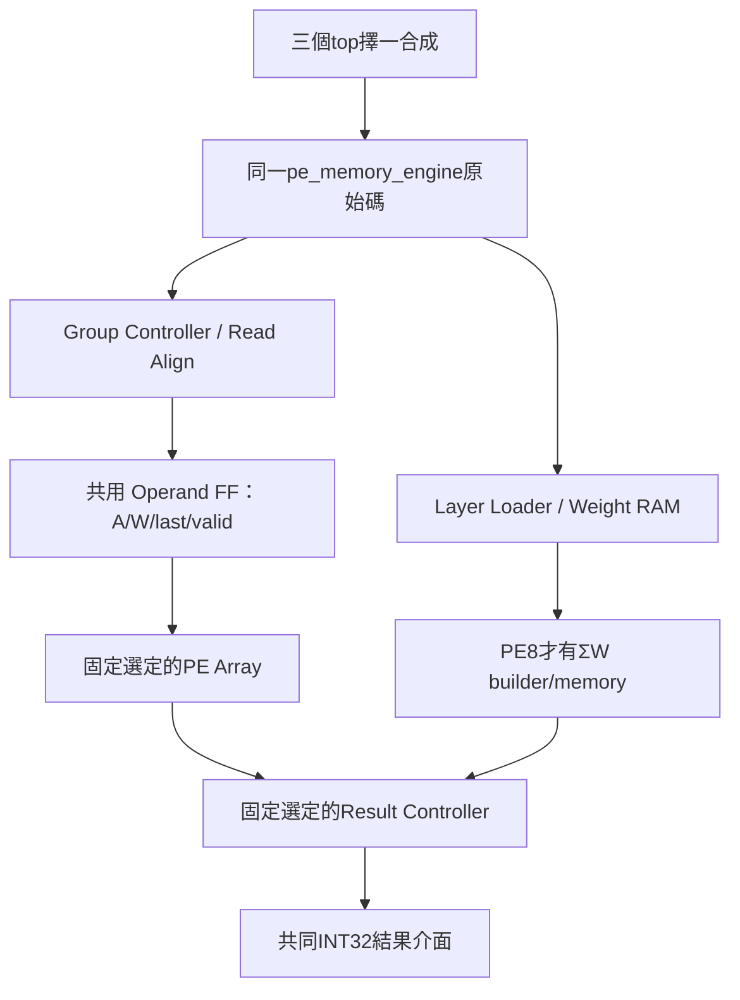

# 三種 Memory-backed PE：共同驗證與 Vivado GUI 比較

需要正常板級流程、BTN0重測與LED結果時，使用 [PE板級自我測試](PE_BOARD_TEST_GUIDE.md) 及 `create_pe_board_project.tcl`。本文件下方原有 OOC 流程保留，不要將兩份 XDC 混用。

日期：2026-09-20。本文件範圍是PE engine，不是整個KWS系統或板級bitstream。

本版已加入三配置共用的 Operand Register。新架構、修改檔案與保留舊快照的 Vivado 指令見 [Operand Pipeline 說明](PE_OPERAND_PIPELINE.md)。以下 cycle 表已更新；先前 Icarus 通過紀錄不代表新版本已用 Icarus 重測。

## 1. 已建立的架構

| 固定top | PE8_MODE | RESULT_PIPELINED |
|---|---:|---:|
| pe9_memory_top | 0 | 0 |
| pe8_compact_memory_top | 1 | 0 |
| pe8_pipeline_memory_top | 1 | 1 |

三份檔案在 `rtl/memory_backed/`。每個wrapper只實例化一個 `pe_memory_engine`，沒有額外FF、MUX、FIFO或FSM。
三者port完全相同；編譯期選擇不會把三套引擎同時放入一片FPGA。



比較包含loader、12×512×8權重RAM、MAC、控制、PE8 ΣW與修正。
不含feature-map RAM、Requant/Pool、CIM、AXI、主機通訊、board self-test和TB。
DSP政策為0；BRAM實際推導結果必須看報告，不能由ram_style屬性直接宣稱。

## 2. 共同比較 TB

`tb/tb_pe_memory_comparison.sv` 同時實例化三個獨立測試case，每個case內是真正固定wrapper。
各自有獨立valid/ready、命令與來源，不把ready相AND，不要求同拍輸出。
三者跑相同deterministic權重/activation/workload，以64-bit golden `Σ(A−127)W` 檢查數值及channel、last、error。
本TB只讀写外部ports，不由TB代替engine控制內部MAC、RAM或結果排程。
既有HYBRID_SYSTEM TB繼續保留內部唯讀契約監測；兩者互補。

覆蓋：Conv1/FC1/FC2、C1..32、K邊界、極值、重載／重複計算、4個非法load、4種reset中斷、首／中／尾輸出長阻塞。
每個wrapper完成44次load、50次compute、863筆output；Verilator與Icarus均通過。

執行：

```bash
cd /home/LAB505/projects/KWS/KWS_DNN_Hybrid/PE_COMPARISON
make test-memory-comparison
make lint-memory-comparison
make test-memory-comparison-iverilog  # IVERILOG / VVP / IVL_FLAGS可指定工具位置
python3 scripts/test_memory_tcl.py
```

最後一項是Tcl runtime＋mock Vivado指令測試，不是實際Vivado。
會在暫存目錄檢查來源快照、三配置/多頻率、報告hooks、時脈遺失恢復、錯誤時脈拒絕、既存目錄不覆蓋、非法variant/頻率拒絕。

### 2.1 本次共同TB cycles

效能案例中權重來源在ready可接受時連續供應，不再額外插入每word turnaround；activation無故意空拍、out_ready=1。
仍有loader本身的狀態開銷及既有命令/replay測試端排程，不是宣稱理論最短整機時間。

| 工作 | PE9 compute | PE8 compact | PE8 pipeline |
|---|---:|---:|---:|
| Conv1一個patch K9/C12 | 30 | 54 | 32 |
| FC1 K144/C32 | 489 | 553 | 495 |
| FC2 K32/C8 | 49 | 65 | 51 |

compute從命令握手到接收端可在上升緣觀察done。METRIC亦記錄first_output/last_output，三者定義一致。

| 工作 | PE9 load observed | PE8兩版 load observed |
|---|---:|---:|
| Conv1 | 133 | 145 |
| FC1 | 4673 | 4705 |
| FC2 | 273 | 281 |

load從命令握手到done的同步觀察，含來源第一次送資料的排程。不要與舊TB的turnaround load數字混用。
舊stream-equivalent top的面積不包含本版weight RAM/loader，不可混表。

## 3. 在 Windows Vivado 2023.2 建立專案

先關閉目前開啟的專案。Tcl Console輸入：

```tcl
set pe_variant pe9
set pe_frequency_mhz 125
source {C:/Windows/System32/aoc-workspace/projects/KWS/KWS_DNN_Hybrid/PE_COMPARISON/vivado/create_pe_memory_project.tcl}
```

另外兩版分別改為：

```tcl
set pe_variant pe8_compact
# 或
set pe_variant pe8_pipeline
```

每次建立新專案前先在GUI Close Project。來源腳本以自身所在位置推算路徑，不依賴Vivado的pwd；若Windows掛載路徑變動，只要修改source那行。

**Tcl不會launch_runs、不會reset_run、不會自動開始合成或實作。**

### 3.1 GUI步驟

1. 確認Sources顯示選定top，Design Sources為SystemVerilog且沒有TB。
2. 確認part為xc7z020clg400-1。
3. 按Run Synthesis，完成後Open Synthesized Design。
4. 查看自動生成的post_synth報告及Messages，確認時脈/資源/約束。
5. 按Run Implementation，完成後Open Implemented Design。
6. 查看post_route報告，特別是setup、hold、unconstrained、route、DRC/methodology。
7. 不按Generate Bitstream：這是OOC子模組比較，沒有PYNQ實體pin配置。

不要將 `-mode out_of_context` 放成set_property的未命名參數。腳本已使用：

```tcl
set_property -name {STEPS.SYNTH_DESIGN.ARGS.MORE OPTIONS} \
    -value {-mode out_of_context} -objects [get_runs synth_1]
```

`target_language Verilog`不代表SV不支援；來源已明確設定file_type SystemVerilog。

### 3.2 建立位置與來源快照

```text
build/memory_backed/
  pe9/f125/
    pe9_f125.xpr
    inputs/                 19份RTL與本次XDC的快照
    scripts/                本次config與報告/約束hooks快照
    source_manifest.tsv     原始路徑、快照路徑、bytes
    reports/
      post_synth/<timestamp>/
      post_route/<timestamp>/
    pe9_f125.runs/           Vivado自行產生
  pe8_compact/f125/...
  pe8_pipeline/f125/...
```

19份RTL包含兩類array定義，但只有選定分支可被實例化；其他wrapper不匯入。package順序與compile order由腳本設定。
來源採快照，原始RTL更改不會自動更新既存專案。若要比較新版，保存／移走舊專案後重新建立，不要只按Run Synthesis以為會讀到最新RTL。
`source_manifest.tsv`是路徑與大小紀錄，不是密碼學雜湊；需要追溯時保留整個inputs/scripts快照。
若目錄已存在，腳本直接報錯，不覆寫任何資料。可Open Project開啟既存XPR。
若已搬動「生成後的」專案路徑，config與hook中的絕對路徑也需更新；優先在最終路徑重新建立，不直接搬動後假設可用。

## 4. 統一约束與hooks

- 頻率預設125MHz，period=1000/f，依專案產生XDC，不再硬編碼8ns於guard。
- clock uncertainty=0.2ns；input/output max delay=2ns、min delay=0.5ns。
- 這是共同抽象同步環境，不是板級pin timing。
- 保留正常reset／資料路徑，沒有新增false path來掩蓋違規。
- 缺少pe_clk時，在open netlist上載入完整生成XDC；若已有錯period或clk掛另一clock，報錯而非覆寫。
- guard驗證top、clock與period；I/O timing覆蓋由check_timing/unconstrained報告審查，不能只看guard成功就當所有限制完整。

| 時點 | 自動動作 |
|---|---|
| Synthesis結束 | guard＋post_synth報告 |
| Implementation opt_design前 | guard，避免沒有時脈就開始 |
| Route Design結束 | guard＋post_route報告 |

統一策略：Flow_Default synthesis、Vivado Implementation Defaults、flatten_hierarchy=rebuilt、MAX_DSP=0。
若你在GUI手動改策略，需同樣更改三者；報告manifest會記錄當時策略名稱，但不完整捕捉所有手改選項，因此仍應保存XPR。

### 4.1 手動重出報告

先Open Synthesized Design或Open Implemented Design，再source對應生成的hook，例如：

```tcl
source {C:/Windows/System32/aoc-workspace/projects/KWS/KWS_DNN_Hybrid/PE_COMPARISON/build/memory_backed/pe9/f125/scripts/post_synth.tcl}
# 已Open Implemented Design時才用 scripts/post_route.tcl
```

不要在沒有open design時執行update_timing。也不要在synthesized design上source post_route hook來偽裝成route報告。

## 5. 報告內容與判讀

| 檔案 | 用途 |
|---|---|
| utilization.rpt | LUT、FF、BRAM、DSP實際映射 |
| hierarchy.rpt | loader/RAM/array/result等階層占比 |
| timing_summary.rpt | setup/hold、未約束路徑 |
| setup_paths.rpt / hold_paths.rpt | 各10條最差路徑 |
| clocks.rpt / check_timing.rpt | 頻率與缺漏约束檢查 |
| control_sets.rpt | reset/enable控制集合 |
| route_status.rpt | post_route的布線完整性 |
| drc.rpt / methodology.rpt | post_route實作及方法學問題 |
| comparison_config.txt | scope、variant、top、stage、頻率、part、Vivado版本與策略 |

報告每次用新timestamp目錄，不覆蓋前次。主比較用post_route；post_synth另列，不能混階段。

OOC的HD.CLK_SRC/HD.PARTPIN_LOCS警告不能以任意位置假資料消除。邊界時序與實際系統不同，應把clock/boundary限制和內部路徑一起說明。
WNS≥0不等於通過：還要檢查hold、timing coverage、route完整性及DRC。此流程不自動給出「可上板」判定。

| 指標 | PE9 | PE8 compact | PE8 pipeline |
|---|---|---|---|
| LUT / FF / RAMB18 / RAMB36 / DSP | 等Vivado | 等Vivado | 等Vivado |
| WNS / WHS / TNS / THS | 等Vivado | 等Vivado | 等Vivado |
| Routing / Unconstrained / OOC限制 | 檢查 | 檢查 | 檢查 |
| 工作cycles | 上表 | 上表 | 上表 |

LUT節省率=(PE9 LUT−方案LUT)/PE9 LUT×100%，可為負數；只有實際讀到同範圍/同頻率/同階段報告後才計算。

## 6. 驗證證據與限制

- Verilator共同TB與lint通過，Icarus共同TB通過；三wrapper各863筆輸出正確，最後共同PASS。
- Tcl腳本經libtcl runtime/mock測試通過，但本機沒有Vivado；尚無真實XPR合成/route/PPA結果。
- Mock能抓Tcl語法、set_property引數數量、路徑與guard流程，不能證明所有Vivado API/property在2023.2已實機執行。
- 第一輪請先建立pe9/f125，檢查synthesis/implementation Messages與reports；確認流程後以完全相同設定建立另外兩版。
- 若125MHz失敗，保留失敗報告，三者共同增加較低頻率專案比較；不要單獨改其中一版的約束後稱同頻率比較。
