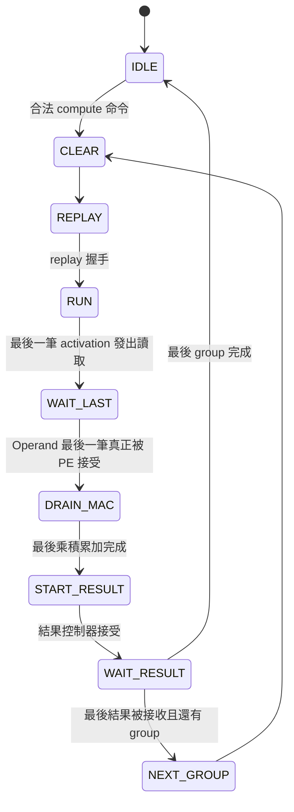

# PE Operand Register：BRAM 到乘法器的時序分割

更新：2026-09-20。範圍：memory-backed PE engine，不是整個 KWS 或板級 bitstream。

## 1. 修改目的與邊界

舊 PE9/f125 post-route 最差路徑是權重 BRAM bank9 到 lane9 product_reg[16]。
資料延遲 8.219 ns（邏輯 4.847、繞線 3.372），setup WNS -0.394 ns。
BRAM clock-to-output 本身佔 2.454 ns。舊 hold WHS -0.202 ns，最差路徑是外部 activation 到 aligner。

本次增加真正的同步 Operand Register，不修改乘法精度、累加器、結果修正、DSP 政策或 XDC 時脈。
不使用 false path/multicycle，也不放寬 I/O delay。
舊 `build/memory_backed/pe9/f125` 快照與報告保留，未被修改。


## 2. 修改檔案

| 檔案 | 修改 |
|---|---|
| HYBRID_SYSTEM/rtl/integration/pe_memory_engine.sv | 在 aligner 與 PE 間加入一級 elastic operand FF |
| HYBRID_SYSTEM/rtl/control/pe_group_controller.sv | 更新介面契約註解；FSM 行為不改 |
| HYBRID_SYSTEM/tb/integration/tb_pe_memory_engine.sv | 新增逐拍 payload/valid/last 監測與 operand 有效時 reset 測試 |
| PE_COMPARISON/vivado/create_pe_memory_project.tcl | 新實驗目錄選項 pe_build_root；修正 synthesis strategy、登錄 hook 檔 |
| PE_COMPARISON/vivado/report_pe_memory.tcl | 修正 check_timing 輸出方式；hook 無 run object 時不再空物件取 property |
| PE_COMPARISON/scripts/test_memory_tcl.py | mock 測試同步更新，加入獨立輸出目錄及無 run object 案例 |

Operand FF 寫在共用 engine 裡，不新增外部 port，也不需要新增 RTL source 清單。
三個薄 wrapper 不改：PE9、PE8 compact、PE8 pipeline 全部使用同一個新 operand 級。
`RESULT_PIPELINED` 仍只控制結果端，不是本次的 operand pipeline 開關。

## 3. 資料及握手

新增原始碼訊號：

- `read_align_*`：原 aligner 的輸出。
- `operand_w[95:0]`：12 路各 8-bit 權重。
- `operand_a[7:0]`：同一筆 UINT8 activation。
- `operand_last`：本 group 的最後一筆 k。
- `operand_valid`：此筆資料有效。
- `align_out_*`：現在代表 operand 級的輸出，交給 group controller 決定 MAC 接受。

```text
read_align_ready = !rst && (!operand_valid || align_out_ready)
align_out_valid  = !rst && operand_valid
pe_accumulate_en = align_out_valid && align_out_ready
```

| 條件 | 時脈邊緣動作 |
|---|---|
| rst=1 | 清除 operand_valid，不讓舊資料流入 PE |
| operand 已滿且下游不 ready | 保持所有 payload 與 valid |
| 有空間且上游 valid | 同時暫存 A/W/last，valid=1 |
| 有空間但上游無資料 | valid=0，payload 保留但無效 |
| 下游取走舊資料、上游同時有新資料 | 同一 edge 完成取走／替換，維持每拍一筆的能力 |

只 reset valid，不 reset 105-bit payload，避免不必要的 reset 扇出。
無效時 payload 可為舊值或 X，MAC 必須且已由 valid 握手遮蔽；不能把 invalid 資料當結果觀察。
新增 RTL 儲存量為 106 bits，實際 FF 增量可能因 BRAM output register 吸收及最佳化而不同。

## 4. Cycle 與 FSM

假設無停頓，一筆資料依序經過：

| 邊緣 | 動作 |
|---|---|
| E0 | 接受 activation 與權重讀取地址；BRAM/read-align 在 edge 後產生對應輸出 |
| E1 | 新 Operand FF 擷取這組 A/W/last |
| E2 | PE 接受 Operand FF 資料，乘積存入 Product FF |
| E3 | 乘積寫入 Accumulator FF |

E1 同時可發出下一筆讀取，E2 可接受下一筆 operand；延遲多一拍，不是每個 k 都插入空拍。



不增加固定等待狀態；原 WAIT_LAST 已由末筆握手決定何時往下走。
重要：不能讓 WAIT_LAST 仍監看 register 前的 `read_align_last`，否則會提早一拍取結果。

## 5. 驗證及觀察

```bash
cd /home/LAB505/projects/KWS/KWS_DNN_Hybrid/HYBRID_SYSTEM
make lint-memory-engine
make test-memory-engine
cd ../PE_COMPARISON
make test-memory-comparison
python3 scripts/test_memory_tcl.py
```

Verilator 驗證三配置、真實 loader/BRAM/controller/MAC/result 路徑，不由 TB 驅動內部訊號代替控制器。
共同 TB 每版 44 次 load、50 次 compute、863 筆結果；golden 為 64-bit `Σ(A−127)W`。
涵蓋 Conv1/FC1/FC2、K/C 邊界、C=1..32、極值、停頓、重載、非法命令與 reset。
engine TB 另逐拍比對 operand valid、A/W/last，reset 中斷有效 operand，重新載入後確認無殘留乘積。
本次最終 engine 回歸三版均 PASS；每版監測到 2,610 次 operand 擷取。
engine / wrapper lint 及三配置 elaboration 結構檢查通過，確定每版只包含一套選定 array 與結果控制器。
未強制內部 ready 製造不可達狀態；完整任意背壓的 formal proof 不在本次驗證範圍。
本環境沒有 Icarus/Vivado；不把先前版本的 Icarus 結果視為本次已測，也不宣稱已完成新版本 implementation。
Tcl 測試是實際 Tcl interpreter 搭配 mock Vivado API，不等同 Windows Vivado 執行。

共同 TB 最新量測（compute 命令握手至 done 可在上升緣觀察）：

| 工作 | PE9 舊→新 | PE8 compact 舊→新 | PE8 pipeline 舊→新 |
|---|---:|---:|---:|
| Conv1 K9/C12 | 29→30 | 53→54 | 31→32 |
| FC1 K144/C32 | 486→489 | 550→553 | 492→495 |
| FC2 K32/C8 | 48→49 | 64→65 | 50→51 |

每個 group 多一拍，FC1 三組多三拍；layer 載入路徑未改。
共同 TB 與 engine TB 的權重 driver 間隔不同，load cycle 不混用。

## 6. Windows Vivado：必須建立新快照

舊專案引入的是 `inputs/` 的凍結檔。只修改原始 engine、在舊 XPR 按重新合成，仍會用舊程式。
先 Close Project，再於 Tcl Console：

```tcl
set pe_variant pe9
set pe_frequency_mhz 125
set pe_build_root {C:/Windows/System32/aoc-workspace/projects/KWS/KWS_DNN_Hybrid/PE_COMPARISON/build/memory_operand}
source {C:/Windows/System32/aoc-workspace/projects/KWS/KWS_DNN_Hybrid/PE_COMPARISON/vivado/create_pe_memory_project.tcl}
```

新專案在 `build/memory_operand/pe9/f125`，按 Run Synthesis → Run Implementation。
不自動啟動 runs、不覆寫舊目錄；若該目錄已存在，開其 XPR 或指定全新 `pe_build_root`。
另外兩版改 `pe_variant` 為 `pe8_compact` / `pe8_pipeline`，每次先 Close Project。
新 reports 在各專案的 `reports/post_synth`、`reports/post_route` 下。
腳本以自身路徑推算檔案，不使用 Docker 的 Linux 路徑，也不依賴 Windows Vivado 的 pwd。

## 7. 是否能符合 125 MHz？

目前只能確認 RTL 資料路徑已切成「BRAM→Operand FF」與「Operand FF→乘法器→Product FF」。
不能將舊 8.219 ns 直接減去 2.454 ns 當成新路徑延遲：新 FF 放置、routing、clock skew 都會改變。
新 setup 關鍵路徑可能轉到 activation 轉換＋乘法、累加器、ready/enable 或控制邏輯。
舊 hold 是邊界/clock context 相關，本次新增 operand 級並沒有移除 input→aligner 這條路徑，不能保證 hold 修復。

實作後檢查：

1. 最差路徑是否改由 operand 寄存器出發到 Product FF，或 BRAM 到 operand FF。
2. 如果新寄存器被吸收到 BRAM output register，確認 RAM DOA_REG/DOB_REG 與實際網表，而非只找名稱。
3. WNS>=0、WHS>=0、TNS/THS=0，且沒有 unconstrained endpoints。
4. DSP=0、BRAM 推導正常，LUT/FF 對照相同 125 MHz 條件。
5. OOC 的 HD.CLK_SRC/HD.PARTPIN_LOCS 問題仍需實際上層 context 確認；OOC 通過不等同整機 signoff。

若 setup 通過但 hold 仍失敗，下一步分析新 hold_paths，不能以降低頻率或隨意加 false_path 解決。
