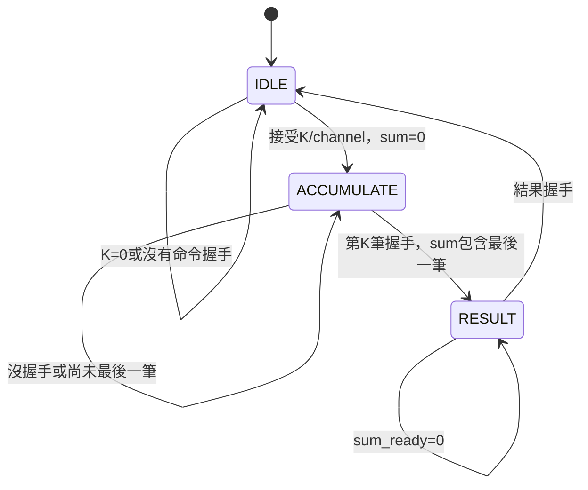

# ΣW建立器：單元實作與完整PE比較的整合順序

## 2026-09-15：builder→PE8整合TB已建立

新增`tb/tb_pe8_weight_sum_integration.sv`，直接實例化真實builder與
pe8_equivalent_top。cfg_valid/cfg_lane/cfg_weight_sum完全由builder輸出，
cfg_ready直接回接sum_ready；沒有TB直送ΣW，也沒有額外gate假造反壓。
builder的CHANNEL_ID_WIDTH=4，本TB僅local lane0..11，不處理layer base。
本次只修改TB／Makefile／文件，不修改可合成RTL與舊比較top。

```text
對每個enabled lane逆序11→0：TB提供K筆W
          ↓ weight handshake（穿插bubble）
builder累加 → RESULT → cfg handshake → PE8參數暫存
          ↓ 所有enabled lanes已配置
TB發K/mask命令 → 重播相同W與A → PE8 → correction → 結果scoreboard
```

TB的reference_sum只用來驗證builder接受的權重總和，不驅動DUT。
最終golden使用直接Σ(A−127)W，不以DUT raw或DUT ΣW計算答案。
configuration刻意逆序，可驗證真正使用channel位址而非假設配置順序。
mask未啟用lane不配置；mask0沒有cfg或輸出，但仍完成K筆輸入及done。

測试組合：K=1/9/32/144/255、A=127/128/0/255及固定混合，W含−128/127，
mask FFF/0FF/A55/800/000。檢查result/lane/last/overflow、無重複／漏輸出、
輸入bubble、輸出反壓、未配置命令拒絕。另測builder部分累加reset、
PE在RUN時下一份builder結果因cfg_ready=0被阻擋再reset、PE輸出被阻擋
時reset，以及之後重新完整配置並運算。不是隨機或形式驗證。

```bash
cd /home/LAB505/projects/KWS/KWS_DNN_Hybrid/PE_COMPARISON
make test-weight-sum-integration
make lint-weight-sum-integration
```

實際結果：兩個make目標結束碼0。10個完整job、83筆最終輸出、85次ΣW
配置交付、5434次builder權重接受、5拍cfg反壓與236拍結果反壓檢查通過。
85次配置包含兩筆後來被reset中止的PE工作配置，不代表85筆有效推論輸出。
此外重跑既有equivalent_sim/Vtb_pe_equivalence回歸執行檔（RTL未變）亦通過。
只驗證RTL模擬與lint，未跑Vivado，不代表新的面積或125MHz時序結論。

## 接下來的共同BRAM比較目標（尚未實作）

進度更新：pe_weight_buffer_12及獨立TB已完成，詳見
[PE_WEIGHT_BUFFER_12.md](PE_WEIGHT_BUFFER_12.md)。以下loader／對齊／
完整weight-loaded top仍未實作，現有比較top沒有自動包含buffer。

軟體逐layer/group提供INT8權重；先以單個最多12-channel group儲存。
兩邊共用相同loader、12-bank權重buffer、K讀址／activation對齊與結果排程。
PE8額外保留builder／ΣW儲存／correction，PE9不加虛假ΣW電路。

| 建議順序 | 新模組 | 完成判斷 |
|---|---|---|
| 1 | pe_weight_buffer_12 | lane/k地址寫入，12路同k同步讀出；完整讀回TB |
| 2 | pe_weight_loader | 按channel接收K筆；每次接受同時寫RAM與送builder；完成標記 |
| 3 | 權重讀取與A對齊控制 | 同步RAM返回與A/valid同筆對齊，stall不覆寫 |
| 4 | weight-loaded PE8／PE9 top | 兩邊同一載入／運算接口；PE8自主建立並保存ΣW |
| 5 | 比較TB與Vivado專案 | 同權重、A與golden；分開合成兩個top及統計資源 |

權重buffer先按12個邏輯bank、每bank至少容納最大K=255規劃，未啟用lane
須mask；有效旗標管理避免未寫RAM讀取，勿為初始化整個RAM加逐bit reset
而妨礙BRAM推導。同步讀取延遲需先訂清楚，輸入A與valid一起暫存。
目前stream top仍從TB重播weights，因此不是已完成BRAM方案。
完成階段4後，TB只載入weights一次、推論只送activation，才能證明硬體
真正重用BRAM權重與ΣW。Conv多patch與FC1的12+12+8 group重載都需測試。

面積以同階段post-route的LUT/FF表為主，另外列BRAM與DSP（MAC應為0）；
不能只比較LUT而忽略BRAM容量與bank碎片。LUT節省率仍以PE9為分母。
既有1477 LUT/1166 FF屬於不含builder／weight RAM的舊stream top，不能
與新weight-loaded版本混用。前次OOC hold問題尚未因新增TB而解決。

## 本次範圍

新增HYBRID_SYSTEM/rtl/datapath/pe_weight_sum_builder.sv與
tb/datapath/tb_pe_weight_sum_builder.sv。沒有修改目前等價top／XDC／Vivado
filelist，因此舊PE8面積1477 LUT/1166 FF不包含此建立器。
完整PE8尚未接好，不宣稱已完成硬體權重載入到推論的端到端驗證。

## 組成

一個signed32工作暫存器weight_sum、一個8-bit remaining、channel暫存器、
三狀態FSM與有號加法。weight_sum同時作結果暫存，沒有第二份32-bit副本。
每筆signed8先符號擴展為32-bit，只有weight_valid && weight_ready才累加。
K=1..255，總和範圍[-32640,32385]，無需overflow／飽和；保留32-bit接口
配合既有correction。CHANNEL_ID_WIDTH預設5，可供目前32個output channels。

| 狀態 | 動作 | 離開條件 |
|---|---|---|
| IDLE | cmd_ready在K!=0時為1；weight_ready=0 | 命令握手，記錄K/channel、sum清零 |
| ACCUMULATE | 每次權重握手sum+=W、remaining−1 | 第K筆被接受，進RESULT |
| RESULT | sum_valid=1；sum/channel保持；不接受cmd或weight | sum_valid && sum_ready回IDLE |



同步active-high rst優先，任何狀態都清資料與有效狀態，丟棄未交付結果。
輸出sum在ACCUMULATE會變動，但只有sum_valid=1才是完整有效結果。
命令當拍不接受weight；命令在N接受、無泡泡時weights在N+1..N+K接受，
N+K邊緣後sum_valid=1，下游最早N+K+1接收，下一命令最早N+K+2。
RESULT握手不會同拍接受下一命令。上游必須保持valid資料直到對應ready。

## 驗證

```bash
cd /home/LAB505/projects/KWS/KWS_DNN_Hybrid/HYBRID_SYSTEM
make test-weight-sum-builder
make lint-weight-sum-builder
make test lint
```

TB以外部握手建立獨立scoreboard，不讀DUT的state／remaining。
25筆交叉案例：K=1/9/32/144/255 × 全0/全127/全−128/交錯/固定混合。
另有cmd與weight同拍出現（只接受cmd）、reset後重啟，共27筆正常结果。
reset分别在ACCUMULATE（已有一筆weight）及RESULT（下游未接受）中止2筆。
持續busy時故意送不同K/channel命令，驗證不能覆蓋工作；RESULT期間送
多餘weight，驗證不多算；K0拒絕、bubble、結果反壓、最後一筆包含皆檢查。
固定公式不是隨機測試；此TB不驗證RAM寫入或整個PE計算結果。

實際驗證：Verilator 5.030執行make test lint結束碼0。builder接受29筆
命令、27筆結果交付、2筆reset丟棄、2217筆權重握手、78次結果保持檢查，
全部PASS。builder RTL嚴格lint通過，既有correction及後處理回歸亦通過。
未執行Vivado，沒有新增面積／時序結論。

## 下一步：先接現有cfg，再整合真實loader

第一個整合TB將builder的sum輸出接PE8配置接口：

```text
TB權重序列 → builder → sum_valid/weight_sum → PE8 cfg_valid/cfg_weight_sum
                 ↑                              │
                 └──── sum_ready ← cfg_ready ────┘
全部enabled lanes配置完成 → 發PE命令 → 送A/W → PE8 raw+ΣW → Golden
```

這一階段TB提供的是weights，不可再直接提供ΣW；TB可以為計算階段重播
相同weights。這僅驗證整合功能，不代表已經有weight RAM或省掉外部重播。
builder使用真實channel ID，cfg_lane是0..11的local lane。若測試用channel
base=0，可將builder CHANNEL_ID_WIDTH設4並確保<12；正式FC1 group需
以channel-base轉成lane，禁止直接截低4-bit（例如channel24應為lane0）。
全部ΣW存入後再發cmd，避免目前cfg優先與job清configured的規則衝突。

## 完整stream PE backend應如何組成

```text
                 相同外部權重載入接口
                          ↓
                    共用weight loader
                  ┌───────┴──────────┐
                  ↓                  ↓（PE8才有）
             12-bank Weight RAM     ΣW builder
                  │                  ↓
                  │             ΣW參數儲存
                  ↓                  │
       外部A → 共用讀址/輸入對齊      │
                  ↓                  │
             PE8 / PE9 array         │
                  ↓                  │
                drain               │
                  ├ PE9 → INT32     │
                  └ PE8 → correction←┘ → INT32
```

建議先以每lane一個weight bank（各深度255×8bit）容納單個12-channel group；
每拍讀同一k地址，取得12個權重。RAM同步讀取延遲要與activation/valid一起
對齊，不能直接替換目前stream weights。12×255×8是24480個邏輯儲存bits，
實際LUTRAM/BRAM配置與容量碎片不能用bits除總BRAM容量直接推論。

權重接受事件必須同时觸發RAM写入與builder累加。單拍可寫RAM可用
weight_valid && weight_ready產生we；若RAM反壓，需共同控制接受事件，
不可讓兩端獨立握手而一邊漏算。channel完成須等待最後write以及ΣW交付。
相同filter多patch應重用ΣW，但目前等價top每job需配置；後續改成以
parameter-set有效標記管理，或由參數RAM於每job重新配置，時間須計入。

## 公平的面積比較

建立新範圍的兩份top，不覆寫舊stream等價報告：

| 模組 | PE8完整weight-loaded版本 | PE9完整weight-loaded版本 |
|---|---|---|
| loader／weight RAM／讀址／輸入對齊 | 計入 | 同等規格計入 |
| array／工作controller／result drain | 計入 | 同等規格計入 |
| ΣW builder／參數儲存／補償 | 計入 | 不需配置虛假等價電路 |
| bias／requant／feature map RAM | 本輪不含 | 本輪不含 |

兩邊都LUT/FF MAC、12 lanes、相同device/clock/策略；記憶體若使用BRAM
也必須額外揭露，不能只列LUT/FF掩蓋轉移到BRAM的成本。

| Resource | PE8含builder完整指定範圍 | PE9同範圍 |
|---|---:|---:|
| LUT | 待整合合成 | 待整合合成 |
| FF | 待整合合成 | 待整合合成 |

LUT節省率=(LUT_PE9−LUT_PE8)/LUT_PE9×100%。不要把builder獨立合成的LUT
直接加到舊1477上冒充整合結果；合併後存在最佳化／共享／布局變化。
時間分開記錄首次載入（含ΣW生成）、單job推論、參數重用的連續推論。
此版本可称weight-loaded PE backend，不是全段CNN／完整KWS系統。
