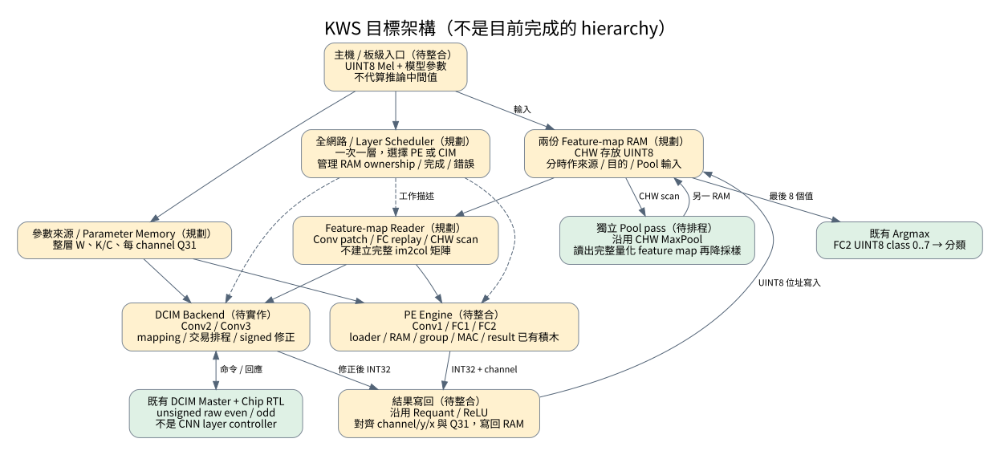
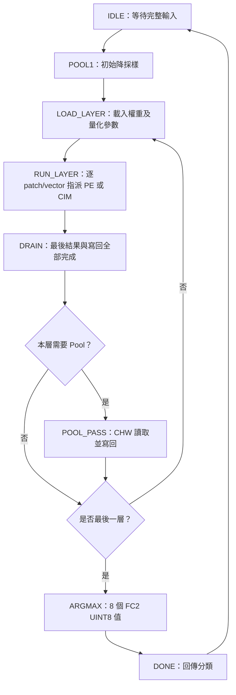
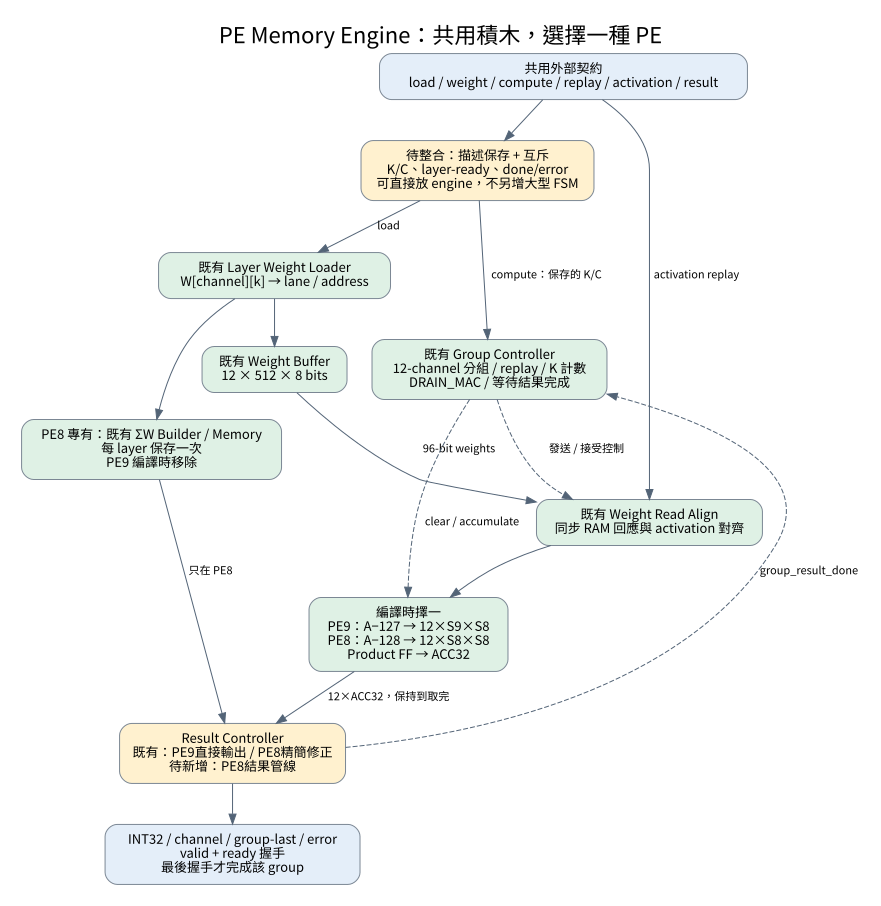
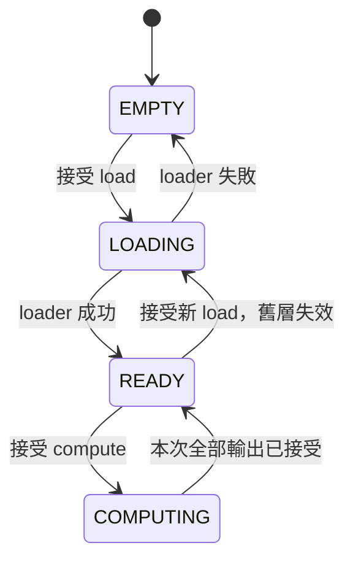
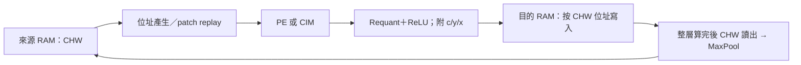

# KWS 混合推論系統：由上而下理解架構與剩餘工作

日期：2026-09-19。目的：先定義系統要完成什麼，再決定需要哪些模組，避免持續增加底層元件卻無法整合。

> 後續實作更新（2026-09-19）：本文件以下保留規劃當時的狀態。其後已完成
> `HYBRID_SYSTEM/rtl/integration/pe_memory_engine.sv` 的 PE8 精簡／PE9 整合與外部介面 TB，
> K/C 保存及互斥已實作；詳見 [PE8主文件](PE_CHIP_8x8/docs/PE8_CORE_ARCHITECTURE.md)。
> PE8結果管線、三個比較wrapper、完整CNN系統仍未完成。

本次只整理規格、閱讀實際 RTL／測試與模型匯出資料，不修改 RTL。圖中的「規劃」不表示已實作；檔名也不代表一定要拆成一個獨立模組。

## 1. 先看結論

目前不是「PE／CIM 都還沒做完」，而是：

- **PE 算術與主要局部控制已有 RTL 和整合測試，但還沒有整層權重記憶體版的可合成 engine/top。**
- **CIM 晶片數位模型與腳位交易 master 已有，但尚未將一個 CNN layer 轉成一串 CIM 交易。**
- **後處理元件已有，但 feature-map 記憶體、資料順序、全網路排程與板級資料入口還沒接起來。**

最需要優先完成的是「資料由誰保存、何時有效、誰負責下一步」，不是再做一套 MAC 或另一套重複的分組 FSM。

建議保留兩條里程碑：

| 里程碑 | 範圍 | 完成後可以主張什麼 |
|---|---|---|
| A：PE 公平比較 | 相同權重記憶體與外部契約，PE9／PE8 精簡／PE8 結果管線三種獨立 top | 同範圍功能等價、LUT/FF/BRAM、延遲與時序比較 |
| B：完整混合推論 | 特徵圖記憶體、PE＋CIM、後處理、層控制、輸入／輸出 | 從 UINT8 Mel 到 8 類分類，全流程由硬體執行 |

**不要讓完成 A 必須先完成 B。也不要把 A 的 engine 當成已完成 B 的系統。**

## 2. Level 0：整個 FPGA 究竟要做什麼？

本階段採用既有決定：輸入已量化的 UINT8 Mel，非原始音訊、非 FP32 Mel。

```text
主機：準備模型參數與 UINT8 Mel → 傳入 FPGA → 等待分類結果
FPGA：Pool1 → Conv1 → Conv2 → Conv3 → FC1 → FC2 → Argmax
                    每層之間包含相應的 Requant / ReLU / Pool
```

主機可以負責資料載入與比對，但推論過程不能請 Python 代算中間 activation／partial sum。Python golden 是驗證工具，不是硬體的運算單元。

若未來要求「原始聲音直接輸入」，還要增加取樣、窗函數、FFT、Mel／log 與輸入量化；這些**不在目前完成或規劃的 PE engine 內**。

### 2.1 本次依匯出資料核對的數值契約

| 項目 | 規格 |
|---|---|
| 初始 UINT8 輸入 | 1×64×126，共 8,064 bytes |
| Activation | UINT8，zero-point = 127 |
| Weight | signed INT8，zero-point = 0，channel-major 匯出 |
| Bias | 本版無 bias |
| MAC 結果 | signed INT32，目標為 `Σ(A−127)W` |
| FC2 分類 | 先得到與軟體相同的 UINT8 FC2 輸出，再依 class 0..7 做 argmax |

不能直接用尚未做 per-channel requant 的 FC2 原始 ACC 做 argmax；不同 channel 的權重 scale 可能不同。

### 2.2 分層工作量

| 運算 | 輸入 | K | 輸出 channel | 原始運算輸出 | 後續結果 | 指派 |
|---|---|---:|---:|---|---|---|
| Pool1 | 1×64×126 | — | 1 | — | 1×32×63 | Pool |
| Conv1 | 1×32×63 | 9 | 12 | 12×30×61 | ReLU＋Pool → 12×15×30 | PE |
| Conv2 | 12×15×30 | 108 | 12 | 12×13×28 | ReLU＋Pool → 12×6×14 | CIM |
| Conv3 | 12×6×14 | 108 | 12 | 12×4×12 | ReLU＋Pool → 12×2×6 | CIM |
| FC1 | 144 | 144 | 32 | 32 | ReLU → 32 | PE |
| FC2 | 32 | 32 | 8 | 8 | Argmax → class | PE |

每個 Conv／FC 後有 requant。Flatten 不必複製整份資料；若採 CHW 儲存，12×2×6 的連續位址本來就是 FC1 的 144 項。

## 3. Level 1：整機方塊圖

下圖是**目標架構**，不是目前已完成的 hierarchy。灰／黃框表示需要新增或整合；綠框表示可沿用的主要積木。



### 3.1 大架構先簡化成「一次只做一層、一個 backend」

第一版不做 PE/CIM 同時跨層運算，不加入多筆工作 queue、out-of-order、多主端 crossbar 或雙份完整後處理。

1. 載入一層參數。
2. 由 feature-map RAM 產生一個 patch/vector。
3. 交給 PE 或 CIM。
4. 將 INT32 結果做 requant/ReLU，按 channel/y/x 位址寫回另一個 RAM。
5. 所有輸出及後處理 pipeline 排空後，才進行 pooling 或下一層。

這能讓記憶體 ownership 與除錯順序清楚。代價是暫不重疊不同層的工作；是否值得再加重疊，需要先量到瓶頸。

### 3.2 系統 FSM 的責任邊界



圖省略錯誤箭頭：任何層失敗都須停止發送新工作、回報失敗並按規範清除／重啟。`done` 只表示一次交易結束，不應自動解讀為成功。

系統 FSM **不直接控制 MAC 的每拍 accumulate_en，也不直接拉 CIM 腳位**。這些工作由既有下層控制器負責。

## 4. Level 2：PE 子系統——缺的是外殼整合，不是重寫核心



### 4.1 單一 engine 對外只暴露四類交易

| 交易 | 建議訊號／資料 | 誰負責 |
|---|---|---|
| 載入 layer | `load_valid/ready, load_k[7:0], load_channels[5:0]` | engine 接受描述並保存 |
| 載入權重 | `weight_valid/ready, weight_i8[7:0]` | 外部依 W[channel][k] 順序提供 |
| 計算與 replay | `compute_valid/ready`；`replay_valid/ready, replay_k, replay_channel_base`；`activation_valid/ready, activation_u8` | engine 請求相同 vector 的各次重播，外部 memory reader 供應 |
| 接收結果 | `out_valid/ready, out_data[31:0], out_channel_id[4:0], out_group_last, out_error` | engine 輸出一個 channel 的完整 dot product |

另有 `load_busy/done/error, layer_ready, compute_busy/done/error`。所有 ready/valid 交易只在兩者同時為 1 的上升緣生效；阻塞時來源保持資料不變。

`out_group_last` 是一組最多 12 lanes 的最後一筆，不是整層結束。`compute_done` 是一個 patch/vector 的全部 output channels 完成，不是整张 Conv feature map 完成。

### 4.2 K／channels 與互斥控制怎麼放才不重複？

建議先在 `pe_memory_engine.sv` 內以少量暫存與仲裁實作，**不必為這個功能強制再建一個獨立 `pe_memory_engine_control.sv`**。前一輪提出的獨立 control 尚未實作，現在可以先收斂邊界。

- load 握手保存 K／channels；compute 只讀保存值，不設第二組外部 K／channels。
- load 與 compute 同時請求，load 優先；busy 時不接受新的另一類工作。
- 接受新 load 就清除 layer-ready 與 PE8 ΣW 有效旗標，不能繼續使用舊 layer。
- K 合法範圍 1..255；channels 1..32；`ceil(channels/12) × K ≤ 512`。
- 保留現有 loader 的描述合法性檢查，不再在多個新增模組複製另一套不同規則。
- loader 回報成功才發布 layer-ready；失敗後必须重載，不能計算。
- 計算期間記錄 result error，最後仍要分別呈現 done／error。
- ΣW 在換 group 或換 patch 時不能清除；它屬於 layer，不屬於一次 MAC。

既有 group／loader 內部保存的工作描述可先保留，避免為省少量 FF 重構已驗證邏輯；重點是**外部規格只有一個權威來源**。



這是生命週期圖，不要求再加四態 supervisor FSM；可以由既有 busy/ready 與 layer-valid 組合實現。Reset 可中斷任意階段並回到 EMPTY。

### 4.3 engine 內既有積木如何接？

| 工作 | 沿用檔案 | 狀態 |
|---|---|---|
| 整層權重寫入與 mapping | `pe_layer_weight_loader.sv` | 已有 |
| 12-lane 權重 RAM | `pe_weight_buffer_12.sv`，engine 使用 ADDR_WIDTH=9 | 已有，12×512×8 bits |
| PE8 每 channel 的 ΣW | `pe_weight_sum_builder.sv`、`pe_channel_sum_memory.sv` | 已有；PE9 不建立此路徑 |
| 12-channel 分組與 MAC drain | `pe_group_controller.sv` | 已有 |
| 同步 RAM 的 A/W 對齊 | `pe_weight_read_align.sv` | 已有 |
| 12-lane MAC | `pe_array_12.sv` 或 `pe8_array_12.sv` | 已有 |
| 取出結果／PE8 修正 | `pe_result_controller.sv`、`pe8_result_correction.sv` | 已有 |
| 對外統一控制、描述保存與實體連接 | `pe_memory_engine.sv` | 未建立 |
| 結果管線化 | `pe8_result_controller_pipeline.sv` | 未建立，先做基準再加 |

**不要再把舊 `pe8_core_12` 套在新 group controller 的 array 路徑內。** 舊 core 有自己的控制與輸入級，新路徑目前按 `read-align → 組合轉換 → array` 的時序驗證，重疊套用會產生兩套控制及不同延遲。

### 4.4 三個版本只差在哪？

| 項目 | PE9 | PE8 精簡 | PE8 結果管線 |
|---|---|---|---|
| activation 轉換 | A−127，S9 | A−128，S8 | 同 PE8 精簡 |
| MAC | S9×S8 | S8×S8 | 同 PE8 精簡 |
| ΣW 載入／記憶體 | 無 | 有 | 有 |
| 結果 | raw ACC | raw ACC＋ΣW | 同一公式、重疊讀取／修正／送出 |
| 結果無 stall 時 | 每 cycle 1 個 | 目前每 3 cycles 1 個 | 目標填滿後每 cycle 1 個 |

三者均有現有 Product register；「管線版」指結果路徑，不是把未管線 MAC 改為管線 MAC。管線版首筆仍有啟動延遲，也不保證一定提高全 engine Fmax。

精簡 PE8 結果 FSM：`IDLE → READ_SUM → FEED_CORRECTION → EMIT`，每個 lane 重複。
PE9 結果 FSM：`IDLE → EMIT`，每次握手前進一個 lane。
PE8 管線版規劃：`IDLE → STREAM → DRAIN`；STREAM 可同時請求下一個 ΣW、修正上一筆並輸出更早一筆，DRAIN 等最後外部握手。需要同步推進 channel/last/error 標籤，不可只管 data。

三個 wrapper 使用 elaboration-time 參數，只產生一個選定 engine，不把三份硬體放在同一片 FPGA 再做 runtime mux。

## 5. Level 2：CIM 子系統——master 不等於 CNN controller

```text
待實作：DCIM layer adapter
  權重編碼與寫入 mapping
  patch 的 108 項切成 4 組，每組 32 項
  選 filter / row group → 發送交易 → 收集結果
  even/odd 重組 → 4 組 partial sum 合併 → signed / zp 修正
           ↓ 既有交易介面
已有：dcim_pin_master
           ↓ 晶片腳位
已有：dcim_chip_pin_top → dcim_macro_core → array / cells
```

現在 master 一次接受 32 個 activation，指定一個 row group、一個 bank pair，回傳 even/odd raw result。它不知道 Conv2 的 feature-map 大小、108 個 K 或哪個輸出像素。

### 5.1 Conv2／Conv3 的第一版 mapping

- 一個 filter 的 K=108，映射 row 0..107；row group 0..3 分別涵蓋 32/32/32/12 個有效位置。
- 一個 output channel 使用一組 bank pair，12 filters 使用 12 pairs。
- 每個輸出像素發出 `12 filters × 4 row groups = 48` 次目前的 CIM compute 交易。
- 這是交易次數，不是 48 個 clocks；每筆交易仍有 master 的裝入、bit-serial 計算與結果回收延遲。
- 最後 20 個 padding 位置必須定義 activation 與 weight 編碼，不能保留上一層資料。

### 5.2 必須先解決 unsigned CIM 與 signed weight

既有 master 的 W8 重組為 `U = odd + (even << 4)`；even 是高 nibble。移位前先擴位，不能在 18-bit 中移位而截掉高位。

目標是 `R = Σ(A−127)W`。CIM raw U 不是 R，不能直接接 requant。

一個可行但**尚未實作／驗證**的規劃是有效位置採 `V = W + 128`（將 INT8 權重 MSB 翻轉後視為 UINT8）：

```text
U    = Σ A·V
SA   = Σ A             （每個 patch 一次，可供所有 filters 共用）
SW_c = Σ W_c           （每層載入時計算／保存）
R_c  = U_c − 128·SA − 127·SW_c
```

等式可直接展開驗證。可用移位／加減實現常數乘法；所有中間量需明確 signed 擴位，依界限決定寬度。
對 108 項，`U ≤ 108×255×255 = 7,022,700`，INT32 有足夠範圍，但窄的 raw nibble 值仍須正確擴位。

padding 的簡單契約：只對有效 K 計算 SA/SW；無效位置直接写入 unsigned V=0、activation=0，讓 U 的額外項為 0。不要把 padding 當成有效 W=0→V=128 卻又忘記補償規則。

這與 PE8 的 `raw+ΣW` **不是同一個 correction**。先固定並做獨立數值驗證，再接 CIM adapter；本文件不改動既有 chip。

## 6. Level 2：記憶體與資料順序，才是整合關鍵

### 6.1 不能直接接起來的地方

`pe_group_controller` 一個命令算一個 patch 的全部 channels，因此自然輸出：

```text
patch(y0,x0): c0,c1,...c11 → patch(y0,x1): c0,c1,...c11 → ...
```

而 `maxpool2x2_uint8.sv` 明確要求：

```text
c0: 所有 y,x → c1: 所有 y,x → ... （CHW，x 最快）
```

**僅加一個小 FIFO 不能修正完整的資料排列差異。** 必須更改排程、使用可索引儲存重排，或重設計多 channel pool。本版先選可索引 RAM，保留已驗證的 pool。

### 6.2 第一版採兩個 feature-map RAM＋獨立 pooling pass



- Conv 執行時：來源 RAM 唯讀，目的 RAM 寫量化後 UINT8，不保存整張 INT32 feature map。
- Conv 與後處理全部排空後：目的 RAM 按 CHW 讀出供 pool，pool 結果寫回已不再需要的舊來源 RAM。
- 不需 pool 的層：完成後交换來源／目的角色。
- Pool1 直接處理 UINT8 輸入，不經過 requant。
- 同一顆 feature-map RAM 不同 phase 的 ownership 由系統控制，先不做多主端競爭。

採兩份各 32 KiB 的邏輯 RAM 是容易理解的初版容量規劃：最大的非 pooling Conv1 UINT8 結果為 `12×30×61 = 21,960 bytes`；原始 Mel 為 8,064 bytes。這是**邏輯容量建議，不是已合成 BRAM 數量或保證放得下**；BRAM 實際使用還受埠寬、深度、映射方式影響。

原始 CHW 位址：`addr = (c × H + y) × W + x`。硬體可以用 row/channel base 加法與計數器遞增，不必每個 cycle 寫一般乘除法。

### 6.3 Patch／replay 不需要完整 im2col 大矩陣

Conv 的 K 順序固定為 `(input_channel, kernel_y, kernel_x)`，與權重展平順序相同。
位址產生器按此順序讀取原 feature map，無須把所有 patches 展開存成另一張大矩陣。

FC1 的 32 outputs 分成 12＋12＋8，要求同一份 144-byte vector 讀三遍。
第一版直接重讀來源 RAM 即可；不必同時建立 replay RAM、input FIFO、line buffer 三份相同資料。
現有 `pe_weight_read_align` 負責權重同步讀取對齊；未來 activation reader 也要遵守 ready/valid 並保持 SRAM 返回資料，不可假設 BRAM 是組合讀取。

### 6.4 後處理介面的兩個待整合項目

1. `kws_postprocess`／requant／pool 為 valid-only，沒有 out_ready。若 downstream 隨時會停頓，不能直接假設可 backpressure。
   第一版目的 RAM 寫埠專供後處理、保證逐拍接受；在 pipeline 前完成乘數讀取與資源預約，`in_valid` 只在結果握手時脈衝。若無法保證，再加入容量足夠且有在途筆數管理的 FIFO。
2. `(channel,y,x,last)` 必須與 data 穿過同樣 pipeline 延遲。不同 channel 的 Q31 multiplier 也必須在 requant 接受該筆資料時對齊。

第一版可分別沿用 requantizer／ReLU／MaxPool 小元件，不強制把現有串流 `kws_postprocess` 整個包進新路徑。這是避免為了遷就既有封裝而增加大型重排邏輯。

既有 pool 的 channel-count 腳位為 5-bit，不能表示數字 32；目前只有 Conv 的 12 channels 要 pool，FC1 的 32 channels 不使用 pool。channel ID 的 5-bit 與 channel count 所需 6-bit 不要混淆。

## 7. Level 3：控制器究竟需要幾層？

| 層級 | 負責 | 不應做的事情 |
|---|---|---|
| 全網路 controller（缺） | 層序、backend 選擇、RAM ownership、layer 完成 | 每拍 MAC／CIM 腳位 |
| layer/patch scheduler（缺，可先合在上層） | y/x 走訪、一次 patch 完成、pool phase | 重寫 group 內 lane 計數 |
| PE engine 薄整合（缺） | K/C 保存、load/compute 互斥、連接元件 | 再做一套 group FSM |
| PE group/result/loader（已有） | channel 分組、K 項發送、結果握手、權重裝入 | 全 CNN layer 編排 |
| DCIM adapter（缺） | filter/group 排程、權重 mapping、修正 | 直接重寫 SRAM read/write 腳位時序 |
| CIM master（已有） | 一筆 SRAM／CIM 交易的腳位序列 | 計算 feature-map 位址 |

**減少的是重複責任，不是單純減少 `.sv` 檔案數。** 小模組化本身不等於額外硬體；真正面積成本是多餘 RAM／FF、重複 arithmetic、buffer、mux 與控制。

## 8. 時脈、外部通訊與可延後項目

建議功能整合第一版先採共同 50 MHz，先完成正確全流程；這是新的實作策略建議，不改既有 PE 頻率比較目標。

- PE 面積／時序比較仍可獨立用相同的 50/75/100/125/150 MHz 約束實驗。
- 若之後系統採 PE／記憶體 125 MHz、CIM 50 MHz，CDC 放在 CIM **交易**邊界，非每個 cell 或每段 pipeline。
- 現有 `dcim_cdc_bridge` 可沿用單筆命令／回應模型，但不能假設 SRAM burst weight stream 已完整支援跨域；先用單筆寫入，或另做 burst CDC 並測試。
- Line buffer 是資料重用／排列儲存，不是 CDC 的替代品。
- engine 內部不必全部 AXI 化。AXI/DMA 或其他主機傳輸只在板级整合邊界選定；目前 memory-backed 比較 top 不負責解析 TXT。
- TXT 由主機解析成帶描述的二進位權重 stream，FPGA loader 只看到 INT8 值。

板級自測完成不能代表主機可任意上傳模型、input 並取回分類；後者仍需正式外部通訊與測試。

## 9. 目前尚未完成清單與建议順序

| 優先 | 工作 | 驗收條件 |
|---:|---|---|
| 1 | 凍結 PE engine 契約、K/C 保存、互斥與 layer-valid | 同時請求、busy、非法描述、新 layer 與 reset 都有測試 |
| 2 | 將既有積木接成 `pe_memory_engine`，先 PE9/PE8 精簡 | TB 只從 top 供命令、權重、activation，不能幫 DUT 控內部流程 |
| 3 | 三個比較 wrappers＋PE8 結果 pipeline | 三者完整 output/channel 等價；獨立 backpressure、不強迫同拍輸出 |
| 4 | 相同約束與範圍的合成／實作比較 | post-route 資源、setup/hold、時序覆蓋、load/compute cycles；失敗點標明 |
| 5 | feature-map RAM＋reader＋逐 patch scheduler＋參數 ROM／RAM | Conv1/FC1/FC2 用真實模型資料逐層比對，含資料排列 |
| 6 | DCIM 編碼／修正規格、adapter＋layer scheduler | K108、padding、12 filters、跨4組、正負權重與 UINT8 邊界皆比對 |
| 7 | 全網路 controller＋pool phase＋argmax | 一張 UINT8 Mel 不靠 Python 中途運算，全部中間層／分類吻合 |
| 8 | 板級載入／回傳、時脈與 CDC、系統報告 | 上板重複推論、reset恢復、host比對；實測吞吐及資源 |

可以先以全層順序處理達成功能，不必一開始同時追求最高頻率、最少 RAM、跨層重疊、完整可換模型支援。

### 9.1 收斂後的建議檔案結構（未新增這些 RTL）

```text
HYBRID_SYSTEM/rtl/
  integration/pe_memory_engine.sv       ← 薄整合，含 K/C 與互斥
  control/pe_group_controller.sv        ← 已有，沿用
  control/pe_result_controller.sv       ← 已有，精簡／PE9
  control/pe8_result_controller_pipeline.sv ← 之後新增
  control/kws_layer_controller.sv       ← 全網路＋初版 patch 排程可先合併
  memory/feature_map_memory.sv          ← 兩個實例，不是兩份不同 RTL
  memory/feature_map_reader.sv          ← Conv 位址／FC replay／CHW scan
  memory/layer_parameter_memory.sv      ← descriptor 與 per-channel multiplier
  dcim_adapter/kws_dcim_backend.sv      ← 可先合併 mapping、交易排程、結果修正
  integration/kws_result_writeback.sv   ← requant/ReLU、tag 與目的位址
  top/kws_hybrid_top.sv                 ← 完整推論整合，非 board wrapper

PE_COMPARISON/rtl/memory_backed/
  pe9_memory_top.sv
  pe8_compact_memory_top.sv
  pe8_pipeline_memory_top.sv
```

這些是責任的建議名字，不是要求現在全部建立空檔案。若單一模組太大或有獨立重用需求，再拆子模組。

## 10. 驗證從 top-down 規格往下落地

### 10.1 比較 engine：相同數學、不同時序

Golden 固定為 `Σ(A−127)W`。三個 engine 由各自 ready 決定輸入時刻，依 `(job_id, channel_id)` 比對結果，不用 cycle 對 cycle 強迫對齊。

測試至少包含 Conv1 K9/C12、FC1 K144/C32、FC2 K32/C8、重複 compute、不重載權重、換 layer、reset 中斷、backpressure 與非法載入。

合成 top 不包含 golden、測試用第二套 PE 或檔案讀取 task。ΣW 生成／記憶體要計入 PE8 完整 engine 成本；不能只比較小一 bit 的 multiplier。

### 10.2 完整推論：逐層資料，而非只看最後分類

1. 比對 `quant_input → pool1` 每個 UINT8 值與座標。
2. 比對每層 signed INT32 dot product（獨立整數 golden）。
3. 比對 requant、ReLU、Pool 的 UINT8 與 CHW 位址。
4. 比對 FC1 flatten 順序、FC2 所有 8 個輸出及 argmax tie 行為。
5. 增加多筆輸入與 stall/reset；一筆 sample 通過不等於整個 test-set 準確率已驗證。

現有 golden 可由 `KWS/layer_activation_uint8` 與 `layer_weights_int8` 開始；請固定相同 checkpoint，不混用 filters14 版本。

### 10.3 本次檢查的範圍

本次核對實際 RTL、Makefile、整合 TB、匯出 metadata；沒有重新做簡報電路符合性審查、沒有執行 Vivado，也沒有量到新的 PPA。重跑測試結果見下方驗證紀錄。

舊文件的資源數字、板級自測 top 與 stream-equivalent top 具有不同範圍，不能當成尚未建立 memory-backed engine 的資源數字。

### 10.4 本次實際重跑結果（2026-09-19）

在 `HYBRID_SYSTEM` 執行：

```bash
make test-group-result-controller test-python-golden
```

| 測試 | 本次結果 | 證明範圍 |
|---|---|---|
| PE8 group＋result RTL 整合 | PASS；48 jobs、728 個輸出、4 個非法命令、6 次 reset 測試 | 既有記憶體／控制／MAC／correction 的測試連接 |
| PE9 group＋result RTL 整合 | PASS；48 jobs、728 個輸出、4 個非法命令、6 次 reset 測試 | 既有 PE9 結果路徑與相同數學目標 |
| Python 整數後處理對匯出 golden | PASS；62,448 個數值，argmax class=1 | 該匯出 sample 的 requant／ReLU／pool／argmax 數值契約 |

前兩项使用 Verilator，第三项是 Python 驗證，**不是把完整 CNN RTL 跑了 62,448 筆**。
目前 TB 仍是命令與 activation 的來源，尚未新增 engine/top，因此本次結果不代表新規劃的全系統已完成。
未重跑所有 CIM TB、未重新合成或實作。

圖檔與可編輯 Graphviz 原始碼在 `docs/top_down/`。修改 `.dot` 後可重建：

```bash
dot -Tsvg docs/top_down/system_overview.dot -o docs/top_down/system_overview.svg
dot -Tsvg docs/top_down/pe_engine.dot -o docs/top_down/pe_engine.svg
```

SVG 圖可直接開啟；狀態圖採 Markdown Mermaid，需支援 Mermaid 的閱讀器才能圖形化顯示。

## 11. 主要閱讀來源

- [既有 PE8 架構與單元／整合測試](PE_CHIP_8x8/docs/PE8_CORE_ARCHITECTURE.md)
- [現有比較範圍與歷史實作](PE_COMPARISON/docs/PE_EQUIVALENT_IMPLEMENTATION.md)
- [PE 分組控制器](HYBRID_SYSTEM/rtl/control/pe_group_controller.sv)
- [結果控制器](HYBRID_SYSTEM/rtl/control/pe_result_controller.sv)
- [真實元件整合 TB](HYBRID_SYSTEM/tb/control/tb_pe_group_result_controller.sv)
- [MaxPool 的 CHW 輸入契約](HYBRID_SYSTEM/rtl/datapath/maxpool2x2_uint8.sv)
- [Requant 數值及管線](HYBRID_SYSTEM/rtl/datapath/requantizer_int32_to_uint8.sv)
- [CIM master 的交易契約](CIM_CHIP/fpga/dcim_pin_master.sv)
- [模型權重來源](../layer_weights_int8/README.txt)
- [輸入格式 metadata](../layer_activation_uint8/quant_input/metadata.txt)

最重要的下一步：**先完成一個「能保存一層權重，並重複計算多個 patch」的共用 PE engine；不用同時新增第二套 PE 控制、整張 im2col RAM 或完整 AXI 系統。**
